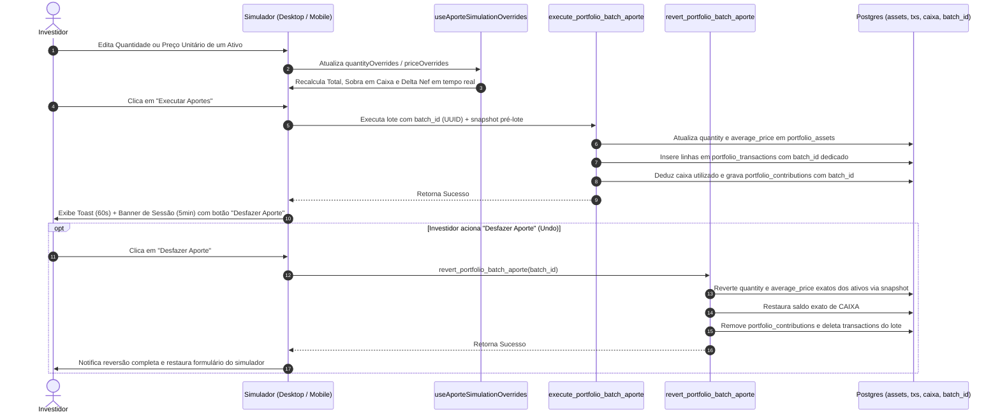

# Plano Mestre: Motor de Rebalanceamento Inteligente, Concentração em Camadas, Correlação Estrutural e Execução em Lote com Undo

> **Status:** Aprovado e Consolidado para Execução Incremental  
> **Área:** Engenharia de Portfólios, Arquitetura de Software & UX Financeira  
> **Módulos Afetados:** `src/domain/portfolio/`, `src/domain/reports/`, `src/features/investments/`, `src/components/modules/aporte-result/`, `src/data/rpc/`, `supabase/migrations/`  
> **Versão de Referência:** v3.13.0+  
> **Diretrizes de Conformidade:** AGENTS.md (zero emojis, tipagem estrita, funções puras em domain, testes Vitest colocalizados, mobile-first, zero duplicação de componentes, design tokens padronizados, zero elementos nativos desprotegidos)

---

## 1. Sumário Executivo & Princípios Inegociáveis

Em uso real do aplicativo, constatou-se que o motor de rebalanceamento orientava aportes exclusivamente com base no déficit relativo até a meta teórica, sem considerar tetos máximos de concentração (por ativo, por setor, por macro-setor e por emissor de crédito privado) e sem oferecer mecanismos seguros de edição de preço unitário e reversão contábil imediata (*Undo*).

Este documento formaliza o **Blueprint Canônico Definitivo**, estruturado sobre cinco pilares:

1. **Autonomia Absoluta do Investidor:** O aplicativo atua como copiloto analítico de alta precisão. O algoritmo alerta, sugere, limita e transborda resíduos, mas nunca retira do investidor a decisão final de compra, provendo controles granulares de *override* de um clique.
2. **Restrições Hierárquicas em Camadas Reais com Piso de Viabilidade:** A capacidade absorvível (*headroom*) respeita simultaneamente a meta individual, o teto do ativo, o teto do setor dentro da classe, o teto global do setor, o teto do macro-setor sistêmico e a garantia do FGC de emissor de Renda Fixa, rebaixando automaticamente para *soft warning* educativo quando a carteira estiver em formação.
3. **Transbordamento em Cascata (*Cascading Overflow*):** Quando um ativo ou setor atinge sua capacidade máxima de absorção ou está travado por nota de convicção baixa ($\le 5$), a verba não força estouros silenciosos: é canalizada para ativos elegíveis irmãos ou para setores e classes descorrelacionados, com auditoria transparente de cada centavo no *Overflow Ledger*.
4. **Execução Direta em Lote com Desfazer (*Undo*) Contabilmente Seguro:** Permite edição inline de quantidade e preço unitário antes de confirmar, suporta operações multi-moeda (BRL e USD nativo) e possibilita desfazer o lote inteiro com um clique via RPC atômico no Postgres com coluna dedicada `batch_id uuid` indexada, restaurando 100% do estado contábil anterior de posições, preço médio, caixa e contribuições.
5. **Fonte Única de Risco & Ergonomia Visual Responsiva:** Unificação de todos os parâmetros de concentração entre Rebalanceamento, Carrossel de Insights e Relatórios, acompanhada de barras horizontais comparativas ("Antes vs. Pós-Aporte"), métricas de impacto em descentralização ($N_{ef}$) e layout adaptativo sem estouro de viewport em smartphones, tablets e computadores.

---

## 2. Diagnóstico da Auditoria do Código Existente

### 2.1. O que Já Existe e Está Validado no Repositório
- **Hierarquia em Três Níveis:** [src/domain/portfolio/aporte.ts](file:///home/gabrielsales/meus_apps/financasnew/src/domain/portfolio/aporte.ts) implementa a divisão Macro (Classes), Meso (Setores) e Micro (Ativos), com suporte fracionário em `resolveAssetPrecision` (cotas inteiras na B3, 4 casas decimais em USD, 8 casas em Cripto e valor financeiro direto em Renda Fixa/Caixa).
- **Metas e Derivação de Pesos:** [src/domain/portfolio/allocation.ts](file:///home/gabrielsales/meus_apps/financasnew/src/domain/portfolio/allocation.ts) (`calculateEffectiveAssetTargets`) calcula metas teóricas e pesos ponderados por notas (0 a 10) e status operacional (`active`, `neutral`, `quarantine`, `exit`).
- **Catálogo e Inferência:** [src/domain/portfolio/tickers-catalog.ts](file:///home/gabrielsales/meus_apps/financasnew/src/domain/portfolio/tickers-catalog.ts) reúne catálogo curado de ações B3, FIIs e stocks, além de heurísticas automáticas em `inferSectorFromTicker` e `inferFixedIncomeCategories`.
- **Metadados de Renda Fixa:** [src/types/schema.ts](file:///home/gabrielsales/meus_apps/financasnew/src/types/schema.ts) contempla `fixed_income_metadata` (`rate_type`, `rate_value`, `base_date`, `maturity_date`, `is_tax_exempt`, `issuer_type`).
- **RPC Transacional de Aporte:** O banco possui o RPC `execute_portfolio_batch_aporte` (migração `20260101000127_unify_scoring_governance_and_sector_scope.sql`), que atualiza posições em lote, grava compras em `portfolio_transactions`, deduz o caixa utilizado e registra dinheiro novo em `portfolio_contributions`.
- **Reconciliação de Custódia:** [src/domain/portfolio/operations.ts](file:///home/gabrielsales/meus_apps/financasnew/src/domain/portfolio/operations.ts) (`calculateReconciledAssetPosition`) implementa a reconstituição exata de quantidade e preço médio a partir do ledger.

### 2.2. Incongruências e Pontos de Atrito Sanados neste Plano
1. **Desconexão de Tetos:** As regras em `snowball.ts` (25%), `concentration-risk.ts` (20%/35%) e `asset-governance-insights.ts` (5%) operavam isoladas sem restringir as ordens do rebalanceamento.
2. **Viés de "Falling Knife":** Em `aporte.ts` (linhas 1433–1445), o modo setorial ordenava ativos pelo maior desconto frente ao Preço Médio (`diffVsAveragePct < 0`), priorizando empresas com fundamentos deteriorados.
3. **Saturação Silenciosa de Setor:** Quando um setor entrava em déficit mas todos os ativos já atingiam os limites, não havia redistribuição auditada para setores irmãos descorrelacionados.
4. **Regex de Emissor Frágil:** A regex anterior truncava nomes compostos longos como `"CDB BANCO DO BRASIL"` ou `"CDB BANCO BTG PACTUAL"` e falhava em hífens internos como `"CDB-BTG-PACTUAL-AGO27"`.
5. **Ausência de Edição de Preço Unitário e Desfazer (*Undo*):** O rebalanceador só permitia editar cotas (preço fixado na cotação), não gerava identificador de lote indexado e não possuía mecanismo atômico de reversão.
6. **Concorrência Visual na UI:** Na aba Resumo, o `PortfolioConcentrationAlert` estático competia com os slides do `PortfolioInsightsCarousel`.

---

## 3. Fundamentação Financeira & Matemática Canônica

### 3.1. Índices de Descentralização: HHI e Número Efetivo ($N_{ef}$)
O modelo adota a formalização de Meucci (*Effective Number of Bets*) e o Índice Herfindahl-Hirschman (HHI) para medir a descentralização real da carteira sem ruído estocástico:

$$HHI_{\text{global}} = \sum_{k=1}^{m} w_k^2 \quad \text{onde} \quad w_k = \frac{\text{ValorExposiçãoBRL}_k}{\text{PatrimônioTotalBRL}}$$

$$N_{ef}^{\text{global}} = \frac{1}{\sum_{k=1}^{m} w_k^2} = \frac{1}{HHI_{\text{global}}}$$

#### Regras de Consolidação de Risco no HHI:
1. **Agrupamento de Emissor de Renda Fixa Privada:** Títulos privados com a mesma instituição emissora (`issuerKey`, ex.: múltiplos CDBs e LCIs do Banco Master) são consolidados em um único vetor de risco $w_{\text{emissor}}$, impedindo que múltiplos contratos do mesmo banco inflem artificialmente o $N_{ef}$.
2. **Sobreposição de Benchmark em ETFs:** Ativos que compartilham o mesmo índice subjacente (ex.: `BOVA11` e `BRAX11` = Ibovespa/IBrX-100; `IVVB11` e `SPXI11` = S&P 500) são agrupados no vetor do benchmark para avaliar a real exposição de mercado.
3. **Descentralização por Subportfólio de Risco:** Para evitar que o Caixa ou Renda Fixa Soberana mascarem concentrações em ações, calcula-se também a métrica restrita às classes de Ações e FIIs:
   $$HHI_{\text{classe}} = \sum_{i \in \text{classe}} \left(\frac{\text{ValorAtivoBRL}_i}{\text{PatrimônioClasseBRL}}\right)^2, \quad N_{ef}^{\text{classe}} = \frac{1}{HHI_{\text{classe}}}$$
4. **Proteção contra Divisão por Zero e Posições Zeradas:** Posições com $\text{ValorBRL} \le 0$ (encerradas ou vencidas) são excluídas da soma ponderada. Se o patrimônio total for zero, $HHI$ e $N_{ef}$ retornam `null`, exibindo apenas a projeção pós-aporte sem valores `NaN`.

---

### 3.2. Modelo de Headroom em Camadas com Dupla Trava e Piso de Viabilidade

Para cada ativo $i$, o valor máximo admissível no aporte é determinado pelo gargalo mais restritivo entre todas as restrições hierárquicas:

$$\text{HeadroomEfetivo}_i = \max\Big(0, \; \min\big(\text{GapMeta}_i, \; \text{CapAtivo}_i, \; \text{CapSetorNaClasse}_s, \; \text{CapSetorGlobal}_s, \; \text{CapMacroSetor}_m, \; \text{CapEmissorRF}_e\big)\Big)$$

#### Definição Rigorosa das Camadas:
1. **$\text{GapMeta}_i$:** Déficit financeiro até a meta teórica derivada:
   $$\text{GapMeta}_i = \max(0, \text{TargetValueBRL}_i - \text{CurrentValueBRL}_i)$$
2. **$\text{CapAtivo}_i$:** Teto de concentração individual do ativo:
   $$\text{TetoAtivoBRL}_i = \text{TetoPct}_i \times \text{PatrimônioTotalPósAporte}$$
   $$\text{CapAtivo}_i = \max(0, \text{TetoAtivoBRL}_i - \text{CurrentValueBRL}_i - \text{AlocadoAtivoNestaSimulação}_i)$$
3. **$\text{CapSetorNaClasse}_s$:** Teto do setor relativo à respectiva classe (padrão: 35% da classe):
   $$\text{PatrimônioClasseAlvo} = \frac{\text{ClassTargetPct}}{100} \times \text{PatrimônioTotalPósAporte}$$
   $$\text{TetoSetorNaClasseBRL}_s = \frac{\text{TetoSetorNaClassePct}_s}{100} \times \text{PatrimônioClasseAlvo}$$
   $$\text{CapSetorNaClasse}_s = \max(0, \text{TetoSetorNaClasseBRL}_s - \text{CurrentSectorBRL}_s - \text{AlocadoSetorNestaSimulação}_s)$$
4. **$\text{CapSetorGlobal}_s$:** Trava setorial global secundária (padrão: 25% da carteira total):
   $$\text{TetoSetorGlobalBRL}_s = \frac{\text{TetoSetorGlobalPct}_s}{100} \times \text{PatrimônioTotalPósAporte}$$
   $$\text{CapSetorGlobal}_s = \max(0, \text{TetoSetorGlobalBRL}_s - \text{CurrentSectorBRL}_s - \text{AlocadoSetorNestaSimulação}_s)$$
5. **$\text{CapMacroSetor}_m$:** Trava de clusters sistêmicos compartilhados (Macro-Financeiro = Bancos + Seguros; Commodities Cíclicas = Petróleo + Mineração + Agro):
   $$\text{TetoMacroBRL}_m = \min\left(\frac{\text{MacroInClassPct}}{100} \times \text{PatrimônioClasseAlvo}, \; \frac{\text{MacroGlobalPct}}{100} \times \text{PatrimônioTotalPósAporte}\right)$$
   $$\text{CapMacroSetor}_m = \max(0, \text{TetoMacroBRL}_m - \text{CurrentMacroBRL}_m - \text{AlocadoMacroNestaSimulação}_m)$$
6. **$\text{CapEmissorRF}_e$:** Teto de risco de crédito de emissor privado na Renda Fixa:
   $$\text{TetoEmissorBRL}_e = \min\big(0.30 \times \text{PatrimônioRFAlvo}, \; 0.15 \times \text{PatrimônioTotalPósAporte}, \; \text{R\$} \, 250.000,00\big)$$
   $$\text{CapEmissorRF}_e = \max(0, \text{TetoEmissorBRL}_e - \text{CurrentEmissorBRL}_e - \text{AlocadoEmissorNestaSimulação}_e)$$

#### Salvaguardas Especiais de Cálculo:
- **Piso de Viabilidade Matemática (Carteiras Pequenas / Em Formação):** Se $N_{\text{elegíveis}} \times \text{TetoPct} < 100\%$ (ex.: carteira de 1 a 6 ativos ou classe com 1 ou 2 setores), a aplicação de um teto rígido tornaria impossível alocar 100% do aporte. Nesses casos, o motor **rebaixa automaticamente a trava para *soft warning* educativo**, permitindo que o aporte seja alocado normalmente sem represamento em Caixa.
- **Falso Headroom B3:** Em ativos de lote inteiro (Ações/FIIs), se $\text{HeadroomEfetivo}_i < \text{PreçoUnitário}_i$, a capacidade comprável é truncada para zero, acionando imediatamente o *overflow* para o próximo ativo sem prender saldo morto.
- **Veículos Estruturalmente Diversificados:** Para ETFs amplos de mercado e Tesouro Soberano, $\text{TetoEfetivo} = \max(\text{diversifiedAssetCeilingPct}, \, \text{MetaClasse})$, garantindo que carteiras minimalistas de ETFs (ex.: 100% WRLD11 ou BOVA11 + Selic) não sejam travadas artificialmente.

---

### 3.3. Ordem Estrita de Avaliação no Fluxo de Waterfilling & Proteção Anti-Loop

```
  1. Para cada ativo i:
     a. Proteção de Onboarding contra "Nota 5 Padrão":
        O soft lock de qualidade (score <= 5) só pausa o aporte SE:
        (ativo.last_reviewed_at != null OU ativo.score_criteria preenchido)
        E (existir pelo menos 1 outro ativo na classe com score > 5).
        Nunca pausar 100% da carteira por padrão se o investidor ainda não avaliou os papéis.
     b. Se soft lock ativo E NOT ignoreQualityLock:
        HeadroomEfetivo_i = 0
     c. Se allocation_status != 'active':
        HeadroomEfetivo_i = 0
     d. Senão:
        HeadroomEfetivo_i = Min(GapMeta, CapAtivo, CapSetorNaClasse, CapSetorGlobal, CapMacroSetor, CapEmissorRF)

  2. Capacidade Absorvível do Setor s:
     CapSetor_s = Soma(HeadroomEfetivo_i para i em s)

  3. Avaliação de Saturação:
     Se CapSetor_s == 0:
        Dispara evento SECTOR_SATURATED_OVERFLOW
        100% da verba do setor s transborda para o próximo setor da classe com CapSetor > 0

  4. Pass 1: Alocação Proporcional ou Otimizada nos Membros:
     - No modo proportional, se N_elegiveis > 1 e o rateio gerar parcelas < minTicketBRL:
       Reconcentra o orçamento nos K = max(1, floor(orçamento / minTicketBRL)) ativos de maior prioridade antes de ratear.

  5. Pass 2 da Classe:
     Se sobrar saldo da classe após atender os setores com gap, oferta aos setores com folga de headroom.
     Guarda Anti-Loop: Se allocatedInPass == 0, interrompe o loop imediatamente.

  6. Pass 3 Global:
     Se sobrar saldo global, oferta a outras classes deficitárias com folga de headroom.
     Guarda Anti-Loop: Se allocatedInPass == 0, interrompe o loop imediatamente.

  7. Pass 4: Residual Greedy Pack Seguro:
     Varredura restrita exclusivamente a ativos já selecionados no lote deste aporte.
```

---

### 3.4. Regra Segura para o Residual Greedy Pack

Para aproveitar resíduos de cotas inteiras da B3 sem reintroduzir micro-ordens pulverizadas:
- Se após o rateio principal restar uma sobra financeira (ex.: R\$ 45,00) insuficiente para comprar a cota do ativo principal da fila:
  1. O motor verifica se algum ativo **já selecionado para compra neste lote** possui preço de cota $\le \text{resíduo}$ e ainda possui *headroom* livre. Em caso positivo, incrementa as cotas daquele ativo já aprovado.
  2. Caso nenhum ativo já selecionado caiba, canaliza o resíduo para frações de ativos neutros elegíveis (Tesouro Direto fracionário ou Criptoativos).
  3. Caso contrário, preserva o resíduo integralmente em Caixa (`leftover`).
  4. **Invariante:** O motor **nunca abre um novo ticker** na carteira abaixo de `minTicketBRL` (R\$ 100).

---

### 3.5. Correção do Viés de "Falling Knife"

A função de ordenação de membros dentro do grupo em `getAporteSuggestions` segue estritamente a priorização por **Déficit da Meta + Convicção Fundamentalista**:

$$\text{Prioridade}_i = f\big(\text{DeficitRel}_i, \; \text{Score}_i, \; \text{CurrentWeightPct}_i\big)$$

1. **Prioridade Primária:** Maior déficit relativo de meta ($\text{DeficitRel}_i = (\text{TargetBRL} - \text{CurrentBRL}) / \text{TargetBRL}$).
2. **Desempate Secundário:** Maior nota fundamentalista ($\text{Score}_i$, 0 a 10).
3. **Desempate Terciário:** Menor peso percentual atual na carteira ($\text{CurrentWeightPct}_i$).

*O percentual frente ao Preço Médio (`diffVsAveragePct`) é suprimido como critério de ordenação de compras, permanecendo na UI apenas como badge visual informativo em papéis que possuam nota de alta convicção ($\ge 7$).*

---

### 3.6. Parser Canônico de Emissor Blindado (`parseIssuerFromTicker`)

A função pura de inferência determinística opera a partir do `ticker` (usando `name` estritamente como fallback se o ticker for genérico), suportando hífens internos em nomes compostos e separando a chave canônica (`issuerKey`) do rótulo (`issuerLabel`):

```typescript
export interface InferredIssuer {
  issuerKey: string;   // Ex: "banco_do_brasil", "btg", "banco_inter", "banco_master", "tesouro_nacional"
  issuerLabel: string; // Ex: "Banco do Brasil", "BTG Pactual", "Banco Inter", "Banco Master", "Tesouro Nacional"
  isSovereign: boolean;
}

export function parseIssuerFromTicker(ticker: string, name?: string | null): InferredIssuer {
  const normTicker = (ticker ?? "").trim().toUpperCase().normalize("NFD").replace(/[\u0300-\u036f]/g, "");
  const normName = (name ?? "").trim().toUpperCase().normalize("NFD").replace(/[\u0300-\u036f]/g, "");

  // 1. Títulos Públicos Soberanos Federais
  if (
    normTicker.includes("TESOURO") || normTicker.startsWith("LFT") || normTicker.startsWith("LTN") || normTicker.startsWith("NTN") ||
    normName.includes("TESOURO")
  ) {
    return { issuerKey: "tesouro_nacional", issuerLabel: "Tesouro Nacional", isSovereign: true };
  }

  // 2. Extrai miolo do ticker primeiro; se falhar, tenta o name
  const extractCandidate = (source: string): string | null => {
    // Captura permitindo letras, números, espaços e hífens internos (ex: CDB-BTG-PACTUAL-AGO27)
    const match = source.match(
      /\b(?:CDB|LCI|LCA|RDB|LC|DEB[EÊ]NTURE|CRI|CRA)[-_ ]+([A-Z0-9À-ÿ]+(?:[-_ ][A-Z0-9À-ÿ]+)*?)(?=\s+(?:\d+(?:[.,]\d+)?%|\bCDI\b|\bIPCA\b|\bPRE\b|\bPREFIXADO\b|\bSELIC\b|\bDI\b|\bLIQUIDEZ\b|\bBANCO\b|\d{4}\b)|[-_ ](?:JAN|FEV|MAR|ABR|MAI|JUN|JUL|AGO|SET|OUT|NOV|DEZ)?\d{2,4}|$)/i,
    );
    if (!match?.[1]) return null;
    let text = match[1].replace(/[-_]/g, " ").trim();
    text = text.replace(/^BANCO\s+/i, "").replace(/\s+BANCO$/i, "").trim();
    return text.length >= 2 ? text : null;
  };

  let candidate = extractCandidate(normTicker) ?? extractCandidate(normName);
  if (!candidate) {
    // Fallback de detecção por palavras-chave institucionais
    const combined = `${normTicker} ${normName}`;
    if (combined.includes("BTG")) candidate = "BTG";
    else if (combined.includes("INTER")) candidate = "INTER";
    else if (combined.includes("BMG")) candidate = "BMG";
    else if (combined.includes("MASTER") || combined.includes("MAXIMA")) candidate = "MASTER";
    else if (combined.includes("ORIGINAL")) candidate = "ORIGINAL";
    else if (combined.includes("PINE")) candidate = "PINE";
    else if (combined.includes("FACTA")) candidate = "FACTA";
    else if (combined.includes("ITAU")) candidate = "ITAU";
    else if (combined.includes("BRADESCO")) candidate = "BRADESCO";
    else if (combined.includes("SANTANDER")) candidate = "SANTANDER";
    else if (combined.includes("SAFRA")) candidate = "SAFRA";
    else if (combined.includes("C6")) candidate = "C6";
  }

  const ALIAS_MAP: Record<string, { key: string; label: string }> = {
    "DO BRASIL": { key: "banco_do_brasil", label: "Banco do Brasil" },
    "BB": { key: "banco_do_brasil", label: "Banco do Brasil" },
    "BTG": { key: "btg", label: "BTG Pactual" },
    "BTG PACTUAL": { key: "btg", label: "BTG Pactual" },
    "INTER": { key: "banco_inter", label: "Banco Inter" },
    "BMG": { key: "banco_bmg", label: "Banco BMG" },
    "MASTER": { key: "banco_master", label: "Banco Master" },
    "ORIGINAL": { key: "banco_original", label: "Banco Original" },
    "PINE": { key: "banco_pine", label: "Banco Pine" },
    "FACTA": { key: "facta_financeira", label: "Facta Financeira" },
    "ITAU": { key: "itau", label: "Itaú" },
    "BRADESCO": { key: "bradesco", label: "Bradesco" },
    "SANTANDER": { key: "santander", label: "Santander" },
    "SAFRA": { key: "banco_safra", label: "Banco Safra" },
    "C6": { key: "c6_bank", label: "C6 Bank" },
  };

  if (candidate && ALIAS_MAP[candidate]) {
    return { issuerKey: ALIAS_MAP[candidate].key, issuerLabel: ALIAS_MAP[candidate].label, isSovereign: false };
  }

  const safeKey = candidate ? candidate.toLowerCase().replace(/[^a-z0-9]+/g, "_").replace(/^_+|_+$/g, "") : "emissor_privado";
  return {
    issuerKey: safeKey.length >= 2 ? safeKey : "emissor_privado",
    issuerLabel: candidate && candidate.length >= 2 ? candidate : "Emissor Privado",
    isSovereign: false,
  };
}
```

---

## 4. Arquitetura de Domínio, Persistência e Motor de Insights

### 4.1. Política Centralizada de Risco (`portfolio-risk-policy.ts`)

Todos os limiares operam sob uma única estrutura canônica:

```typescript
export interface PortfolioRiskPolicy {
  defaultAssetCeilingPct: number;          // 15% da carteira total
  diversifiedAssetCeilingPct: number;      // 40% global ou 100% da classe (ETFs neutros / Tesouro)
  defaultSectorInClassCeilingPct: number;  // 35% dentro da classe
  defaultSectorGlobalCeilingPct: number;   // 25% da carteira total
  macroSectorInClassCeilingPct: number;    // 45% dentro da classe
  macroSectorGlobalCeilingPct: number;     // 35% da carteira total
  maxPrivateIssuerInFixedIncomePct: number;// 30% da classe de Renda Fixa
  maxPrivateIssuerPct: number;             // 15% da carteira total
  maxPrivateIssuerFgcBRL: number;          // R$ 250.000,00 (garantia FGC)
  lowScoreThreshold: number;               // 5 (notas <= 5 entram em soft lock de qualidade)
  minTicketBRL: number;                    // R$ 100,00 (lote mínimo anti-pulverização B3)
  benchmarkOverlapCeilingPct: number;      // 30% da carteira no mesmo benchmark de ETF
}

export const DEFAULT_PORTFOLIO_RISK_POLICY: PortfolioRiskPolicy = {
  defaultAssetCeilingPct: 15,
  diversifiedAssetCeilingPct: 40,
  defaultSectorInClassCeilingPct: 35,
  defaultSectorGlobalCeilingPct: 25,
  macroSectorInClassCeilingPct: 45,
  macroSectorGlobalCeilingPct: 35,
  maxPrivateIssuerInFixedIncomePct: 30,
  maxPrivateIssuerPct: 15,
  maxPrivateIssuerFgcBRL: 250_000,
  lowScoreThreshold: 5,
  minTicketBRL: 100,
  benchmarkOverlapCeilingPct: 30,
};
```

### 4.2. Persistência Nativa sem Migrações de Banco
- As preferências de risco customizadas do usuário são armazenadas no campo JSONB existente `custom_settings: UserCustomSettings` na tabela `user_preferences`.
- Adiciona-se o nó opcional `portfolioRiskPolicy?: Partial<PortfolioRiskPolicy>` dentro de `UserCustomSettings`.
- Quando o usuário não tiver customizado um parâmetro, o sistema utiliza o valor padrão de `DEFAULT_PORTFOLIO_RISK_POLICY`. Zero tabelas novas, zero migrações SQL extras e sincronização imediata em nuvem.

### 4.3. Integração com o Carrossel de Insights de Investimentos
A função pura `evaluatePortfolioStructuralRisk` avalia a carteira atual e alimenta o [PortfolioInsightsCarousel.tsx](file:///home/gabrielsales/meus_apps/financasnew/src/features/investments/components/portfolio-insights-carousel.tsx):

1. **Hiperconcentração em Ativo Único ($\ge 25\%$):** Absorve o antigo `PortfolioConcentrationAlert`, renderizando como slide prioritário do carrossel (`id: "portfolio-concentration-risk"`, prioridade 1.5, tom `critical`), suprimindo banners concorrentes na aba Resumo.
2. **Concentração em Macro-Setor (Prioridade 5.5, `warning`):** Disparado quando um cluster macro-financeiro ou commodities ultrapassa 45% da classe de Ações ou 35% global. **CTA:** `Simular Rebalanceamento`.
3. **Baixa Descentralização Real (Prioridade 6.5, `primary`):** Disparado quando $N_{ef}^{\text{Ações}} < 3.0$ com $\ge 5$ ativos de ações na carteira. **CTA:** `Ver Sugestão de Aporte`.
4. **Teto de Emissor Privado FGC (Prioridade 2.5, `critical`):** Disparado quando a exposição a um banco privado ultrapassa R\$ 250.000,00 ou 30% da Renda Fixa. **CTA:** `Ver Renda Fixa`.
5. **Sobreposição Excessiva de Benchmark em ETFs (Prioridade 7.5, `info`):** Conecta o parâmetro `benchmarkOverlapCeilingPct` disparando alerta educativo quando múltiplos ETFs replicam o mesmo índice excedendo 30% da carteira. **CTA:** `Ver Carteira`.

### 4.4. Contrato Completo de Overrides Granulares
```typescript
export interface AssetAporteOverride {
  ignoreQualityLock?: boolean;       // Destrava ativo com nota <= 5
  ignoreAssetCeiling?: boolean;      // Destrava teto individual do ativo
  ignoreSectorCeiling?: boolean;     // Destrava teto do setor na classe
  ignoreMacroSectorCeiling?: boolean;// Destrava teto macro-setorial
  ignoreIssuerCeiling?: boolean;     // Destrava teto de emissor de RF (30% / FGC)
}

export type AporteOverridesMap = Record<string, AssetAporteOverride>;
```

---

## 5. Fluxo de Edição Inline, Execução em Lote e Desfazer (*Undo*)



### 5.1. Edição Inline de Quantidade e Preço Unitário (Multi-Moeda)
O hook `useAporteSimulationOverrides` gerencia:
- `quantityOverrides: Map<string, number>`
- `priceOverrides: Map<string, number>`
- `fxRateOverrides: Map<string, number>`

#### Regras por Classe:
- **Ações / FIIs (B3 - BRL):** Quantidade em cotas inteiras ($\ge 1$), preço unitário em BRL com máscara monetária de 2 casas.
- **Internacional (USD):** Quantidade fracionária (até 4 casas decimais), preço unitário em USD nativo e taxa cambial BRL/USD editável. O payload grava o custo em moeda nativa e `fx_rate`, protegendo a exatidão da contabilidade fiscal e preço médio original.
- **Renda Fixa:** Edição direta de quantidade/saldo e preço unitário PU em títulos fungíveis (Tesouro). Em CDBs de vencimento fechado, oferece atalho de 1 clique para cadastrar nova emissão com taxa/vencimento próprios via [InvestmentWizard](file:///home/gabrielsales/meus_apps/financasnew/src/features/investments/wizard/investment-wizard.tsx).
- **Ação Rápida de Reset:** Cada linha possui um botão de ícone discreto `RotateCcw` (*Resetar*) que restaura a cotação e quantidade sugeridas originalmente pelo motor.

### 5.2. Segurança do Caixa em Edições Manuais & Data Única do Lote
1. **Regra Invariante de Caixa:** Se a edição manual de preços ou quantidades fizer o total alocado ultrapassar o aporte planejado inicialmente:
   - Se o switch `Somar Caixa da Corretora` estiver **DESLIGADO**, o sistema **NUNCA** debita do `CAIXA` automaticamente. O total do aporte do bolso é recalculado para cima acompanhado de aviso visual informativo.
   - O débito de `CAIXA` só ocorre se e somente se o usuário tiver ativado deliberadamente o switch de uso do saldo da corretora.
2. **Data Única da Operação:** O modal de confirmação inclui campo opcional de **data única da operação do lote** (padrão: hoje, respeitando `p_date >= '2026-01-01'`).

### 5.3. Execução em Lote com Coluna Dedicada `batch_id uuid`
Na migração SQL da Fase 3:
- Adiciona-se a coluna `batch_id uuid` em `portfolio_transactions` com índice parcial `CREATE INDEX idx_portfolio_transactions_batch_id ON public.portfolio_transactions(batch_id) WHERE batch_id IS NOT NULL;`.
- Adiciona-se a coluna `batch_id uuid` em `portfolio_contributions` com índice parcial.
- O RPC `execute_portfolio_batch_aporte` recebe `p_batch_id uuid default null` e grava os snapshots pré-lote de `prev_quantity` e `prev_average_price` de cada ativo no log de auditoria `audit_events`.

### 5.4. Arquitetura do Desfazer (*Undo*) Contabilmente Seguro
O RPC transacional `revert_portfolio_batch_aporte(p_batch_id uuid)` restaura 100% da integridade contábil:
1. Localiza as transações vinculadas ao `p_batch_id` com bloqueio `FOR UPDATE`.
2. Restaura `quantity` e `average_price` de cada ativo com base no snapshot pré-lote gravado em `audit_events` (com fallback para a reconciliação formal do ledger via `calculateReconciledAssetPosition`), garantindo erro de arredondamento zero.
3. Se houve `cash_used > 0`, restaura o saldo de `CAIXA` exatamente pelo montante abatido.
4. Remove o registro correspondente em `portfolio_contributions`.
5. Deleta as linhas de compra em `portfolio_transactions`.
6. **Proteção de Integridade:** Se o ativo tiver sofrido qualquer movimentação posterior (venda ou nova compra após a data/hora do lote), a reversão automática é bloqueada e o investidor é orientado a gerenciar a transação individualmente pelo extrato.

### 5.5. Janela Dupla de Undo (Toast 60s + Banner 5min)
- **Toast Imediato (60 segundos):** Notificação flutuante com barra de progresso regressiva e botão de ação rápida `Desfazer Aporte`.
- **Banner de Sessão (5 minutos):** Caso o toast seja fechado, um banner sutil de recuperação permanece no topo da aba de Investimentos durante os primeiros 5 minutos da sessão (`sessionStorage`, chave `axir_last_batch_aporte`), permitindo desfazer o lote mesmo após navegação rápida.

---

## 6. Arquitetura de UI/UX Responsiva (Mobile, Tablet e Desktop)

### 6.1. Componente Canônico: `Horizontal Allocation Drift Bars`
Substitui gráficos de pizza duplos por barras horizontais comparativas em SVG puro e Tailwind CSS:
- Altura enxuta de 8px por barra;
- Barra sólida para a posição atual e extensão com tom semântico para a posição projetada pós-aporte;
- Linha marcadora vertical para a **Meta (%)** e marcador tracejado para o **Teto (%)**;
- **Salvaguarda Visual Anti-Colisão:** Números e percentuais ficam exclusivamente no cabeçalho textual da barra (nunca sobrepostos ao marcador vertical).
- **Largura Mínima Visual:** Qualquer valor $> 0\%$ recebe largura mínima visual de `3px`, e marcadores verticais respeitam `clamp(2%, pct, 98%)` para nunca cortarem nas bordas físicas da barra.

---

### 6.2. Painel Sticky Desktop com Seletor Compacto
No desktop (`> 1024px`), para garantir que o painel lateral nunca ultrapasse `100vh` gerando scroll duplo:
- As `Drift Bars` exibem por padrão apenas as **Classes** (Ações, FIIs, Renda Fixa, Internacional, Cripto).
- Inclui seletor compacto em abas: `[ Classes | Macro-Setores | Setores ]`.
- Ao selecionar Macro-Setores ou Setores, exibe no máximo os **Top 5 mais relevantes + Outros agrupado**, mantendo o footprint vertical contido e escaneável.

---

### 6.3. Lista de Pausados / Saturados em Acordeão Colapsado
Para manter a atenção do investidor focada nas ações imediatas:
- A lista/tabela principal de ordens renderiza **exclusivamente ordens ativas** ($\text{quantidade} > 0$) ou destravadas por override.
- Ativos pausados por nota baixa ($\le 5$) ou bloqueados pelo teto são agrupados em um **acordeão colapsado único no rodapé** (`Ver X ativos pausados ou no teto`), que pode ser expandido sob demanda pelo investidor.

---

### 6.4. Wireframes dos Layouts Responsivos

#### Layout Mobile (`< 640px` — Foco PWA)
Modo leitura limpo por padrão, com expansão sob toque para edição rápida:

```
┌────────────────────────────────────────────────────────┐
│ [PageHeader: Rebalancear Carteira]                     │
│ [Tabs: Simulador (ativo) | Metas]                      │
├────────────────────────────────────────────────────────┤
│ 1. ENTRADA DE CAPITAL (Card Compacto p-3.5)            │
│    • Aporte do bolso: [ R$ 2.000,00 ]                  │
│    • Switch: [X] Somar Caixa da Corretora (R$ 450,00)  │
│    • Poder de compra total: R$ 2.450,00                │
├────────────────────────────────────────────────────────┤
│ 2. IMPACTO NA CARTEIRA (Antes vs. Pós-Aporte)          │
│    • [Chip: Descentralização 6,2 -> 7,5 ativos (+21%)] │
│    • [Chip: Maior ativo diluído 18% -> 15,8%]          │
│    • Barras Horizontais:                               │
│      Ações:      [=====>    |Meta 30%]  22% -> 26%     │
│      FIIs:       [========> |Meta 35%]  31% -> 34%     │
│      Renda Fixa: [==========|] Meta 35% 35% (Meta OK)  │
├────────────────────────────────────────────────────────┤
│ 3. ORDENS SUGERIDAS (Cards Móveis p-3.5)               │
│    ┌──────────────────────────────────────────────┐    │
│    │ [✓] ITUB4 · Bancos               R$ 500,00   │    │
│    │     14 cotas x R$ 35,70          [Teto 15%]  │    │
│    │     [Botão: Editar Qtd/Preço]                │    │
│    │     Setor em déficit (saldo realocado)       │    │
│    │     [Override: Ignorar teto]                 │    │
│    └──────────────────────────────────────────────┘    │
│    ┌──────────────────────────────────────────────┐    │
│    │ [✓] TAEE11 · Elétricas           R$ 800,00   │    │
│    │     22 cotas x R$ 36,36          [Nota 9/10] │    │
│    │     Absorveu overflow de Bancos              │    │
│    └──────────────────────────────────────────────┘    │
│    [ > Ver 3 ativos pausados por qualidade ou teto ]   │
├────────────────────────────────────────────────────────┤
│ 4. BARRA DE EXECUÇÃO FIXA (Bottom Safe Area pb-safe)   │
│    [ Executar 2 Aportes Selecionados (R$ 1.300,00) ]   │
└────────────────────────────────────────────────────────┘
```
*No mobile, ao tocar em "Editar Qtd/Preço", o card expande inputs compactos com `inputMode="decimal"` e `text-base` para prevenir auto-zoom no iOS.*

#### Layout Tablet (`640px – 1024px`)
- Grid equilibrado de 2 colunas: Coluna Esquerda com entrada de valor e gráfico comparativo "Antes vs. Pós-Aporte"; Coluna Direita com métricas financeiras consolidadas e a lista de ordens sugeridas com inputs inline compactos.

#### Layout Desktop (`> 1024px`)
- **Painel Esquerdo Fixo/Sticky (40% de largura):** Entrada de valor, opções de caixa, seletor de estratégia (`optimized` / `proportional`), seletor de `Drift Bars` (`Classes | Macro | Setores`), e métricas de descentralização ($HHI$ e $N_{ef}$).
- **Painel Direito Rolável (60% de largura):** Alternador de visão (`Prioridade` vs. `Árvore`), tabela desktop com inputs inline de quantidade e preço, badges semânticos de teto, botões de override de 1 clique, acordeão colapsado de pausados no rodapé, drawer lateral para o *Overflow Ledger* sob demanda e botão de execução em lote.

---

## 7. Análise Exaustiva de Casos de Borda

1. **Carteira 100% Saturada:** Se todos os ativos e setores elegíveis já atingiram os tetos, o motor aloca R\$ 0,00 e mantém 100% do valor em Caixa (`leftover`), exibindo diagnóstico calmo com recomendação de novos ativos descorrelacionados.
2. **Ativos Novos sem Histórico:** A modelagem estrutural depende apenas de classe, setor e nota, calculando $N_{ef}$, HHI e *headroom* no primeiro segundo de cadastro.
3. **Múltiplos Vencimentos de Renda Fixa do Mesmo Emissor:** Títulos com mesmo `issuerKey` são consolidados. Ao atingir R\$ 250.000,00 ou 30% da Renda Fixa, novos aportes no emissor são travados, canalizando o saldo para títulos públicos ou outras instituições.
4. **Preço Editado Gerando Estouro de Orçamento:** Se o usuário editar preços para cima e o total ultrapassar o aporte informado:
   - Se o switch de caixa estiver desligado, o total do bolso é recalculado e exibido com aviso informativo, sem debitar caixa indevidamente.
5. **Reversão com Erro de Rede:** Como o Undo é disparado em uma única chamada RPC atômica (`revert_portfolio_batch_aporte`), a integridade contábil é garantida pelo isolamento ACID do Postgres (tudo reverte ou nada é alterado).

---

## 8. Governança de Execução & Portões de Qualidade (Quality Gates)

### Regras Universais de Todo Portão (Aplicáveis da Fase 1 à Fase 6)
Ao concluir qualquer fase, é obrigatório:
1. Executar e reportar o resultado real de `typecheck` (`tsc -b`), `lint` (`npm run lint`) e `vitest` (`npm run test:run`);
2. Verificar conformidade estrita com `AGENTS.md` (zero emojis, tipagem estrita sem `any`, zero duplicação de componentes, funções puras em `src/domain/`);
3. Entregar um **Relatório Curto de Fechamento do Portão** contendo: arquivos alterados, evidências dos testes executados, pendências/riscos residuais e **aguardar autorização explícita ("OK") para iniciar a próxima fase**.

---

### Critérios Específicos por Portão de Fase

- **Gate 0 (Meta-Análise & Plano Mestre):**  
  Plano `.md` 100% consistente com o repositório real, todas as 5 correções + 5 salvaguardas incorporadas, zero contradições entre seções e roadmap aprovado.
- **Gate 1 (Domínio Puro: Política, Parser & $HHI$/$N_{ef}$):**  
  Zero imports de UI/Supabase. Testes unitários provando `parseIssuerFromTicker` (nomes compostos longos, hífens, fallback e `issuerKey`), agrupamento de emissores/ETFs no $HHI$, $N_{ef}$ global e por classe, e resiliência a patrimônio zero / posições zeradas (`NaN`-free).
- **Gate 2 (Motor *Constrained Waterfilling* & Salvaguardas):**  
  Testes unitários provando: teto em camadas (ativo + setor na classe + macro-setor + emissor RF), setor saturado com *overflow*, piso de viabilidade em carteira pequena (1–6 ativos), proteção de onboarding (Nota 5 não avaliada), falso headroom B3, consolidação `proportional` em 50+ ativos, guarda anti-loop, eliminação do *falling knife* e *greedy sweep* seguro.
- **Gate 3 (Execução em Lote, Edição de Preço & Undo ACID):**  
  Migração SQL validada (`batch_id uuid` indexado + snapshot exato pré-lote); testes do mapper e dos hooks cobrindo edição BRL/USD/RF, não-débito indevido de Caixa, reversão contábil exata (posição, PM, Caixa e contribuições) e bloqueio de Undo quando houver movimentação posterior no ativo.
- **Gate 4 (Motor de Insights Unificado):**  
  Zero alertas duplicados na aba Resumo (`PortfolioConcentrationAlert` absorvido sem regressão); todos os insights (incluindo `benchmarkOverlapCeilingPct`, macro-setor, FGC e $N_{ef}$) consumindo `portfolio-risk-policy.ts` como fonte única, com CTAs funcionais.
- **Gate 5 (Refatoração UI/UX Responsiva):**  
  Build de produção passando; auditoria visual/estrutural nos 3 breakpoints (`<640px`, `640–1024px`, `>1024px`), painel sticky sem overflow vertical, `Drift Bars` sem colisão de rótulos, acordeão colapsado para pausados, edição sob toque no mobile, toast + banner de sessão do Undo e testes de regressão da UI passando.
- **Gate 6 (Refinamentos V1.5):**  
  Drawer do *Overflow Ledger*, nudge de tese vencida (sem bloquear aporte) e diagnóstico secundário de RF funcionando sob demanda sem degradar performance ou poluir a experiência primária.

---

## 9. Roadmap Canônico de Implementação (Fase 0 à Fase 6)

| Fase | Foco Técnico & Escopo | Entregáveis & Arquivos Modificados/Criados | Classificação | Critério de Aceite (DoD) |
|:---:|---|---|:---:|---|
| **Fase 0** | **Meta-Análise & Blindagem Arquitetural** | • `docs/plans/PLANO_MESTRE_REBALANCEAMENTO_CONCENTRACAO_CORRELACAO.md`<br/>• Especificação dos contratos matemáticos e RPCs de lote e undo | **Núcleo V1** | Validação de zero conflitos entre domínio, UI e schema do Supabase. Aprovado formalmente. |
| **Fase 1** | **Domínio Puro: Política Central de Risco, Parser Blindado & Métricas $N_{ef}$** | • `src/domain/portfolio/portfolio-risk-policy.ts`<br/>• `src/domain/portfolio/tickers-catalog.ts` (`parseIssuerFromTicker` blindado)<br/>• `src/domain/portfolio/diversification-metrics.ts`<br/>• `src/domain/portfolio/diversification-metrics.test.ts` | **Núcleo V1** | Testes unitários com Vitest (100% puros). Cálculos de HHI e $N_{ef}$ global e por classe, agrupando emissores de RF e clusters de benchmark de ETFs. |
| **Fase 2** | **Motor de Headroom em Camadas & Cascata (*Waterfilling*)** | • `src/domain/portfolio/aporte.ts` (`simulateConstrainedAporte`)<br/>• `src/domain/portfolio/aporte.test.ts` | **Núcleo V1** | Respeito estrito aos tetos em camadas com piso de viabilidade em carteiras pequenas. Transbordamento funcional em setor saturado. Eliminação do viés de *falling knife*. *Greedy sweep* seguro. |
| **Fase 3** | **Edição Inline de Preço/Quantidade & Motor de Lote com Undo** | • `src/domain/portfolio/aporte-execution-mapper.ts`<br/>• `src/data/rpc/portfolio.ts` (`revertPortfolioBatchAporte`)<br/>• Migração SQL adicionando `batch_id uuid` indexado e RPC `revert_portfolio_batch_aporte`<br/>• `useExecutePortfolioBatchAporte` & `useRevertPortfolioBatchAporte` | **Núcleo V1** | Edição inline de preço e quantidade em BRL e USD. Execução transacional com `batch_id`. Desfazer atômico restaurando 100% de posições, preço médio, caixa e contribuições. |
| **Fase 4** | **Integração com o Motor de Insights de Investimentos** | • `src/domain/portfolio/portfolio-risk-policy.ts` (`evaluatePortfolioStructuralRisk`)<br/>• `src/features/investments/components/insights-carousel/build-structural-risk-items.tsx`<br/>• `src/features/investments/components/portfolio-insights-carousel.tsx` | **Núcleo V1** | Carrossel exibe alertas de macro-setor, emissor FGC, baixa descentralização e sobreposição de benchmark com CTA direto para o simulador. Supressão do banner redundante `PortfolioConcentrationAlert`. |
| **Fase 5** | **Refatoração UI/UX Responsiva da Página de Rebalanceamento** | • `src/features/investments/components/aporte/aporte-input-card.tsx`<br/>• `src/components/modules/aporte-result/aporte-summary-section.tsx`<br/>• `src/components/modules/aporte-result/allocation-drift-bars.tsx`<br/>• `src/components/modules/aporte-result/aporte-desktop-table.tsx`<br/>• `src/components/modules/aporte-result/aporte-mobile-card-list.tsx` | **Núcleo V1** | Layout responsivo refinado (Mobile, Tablet, Desktop); gráfico Antes vs. Pós-Aporte em SVG puro; inputs inline de preço/qtd; toast e banner de sessão para Undo; acordeão de pausados; conformidade total com `AGENTS.md`. |
| **Fase 6** | **Refinamentos Analíticos V1.5 (Avançados sob demanda)** | • Drawer lateral com a Trilha de Decisão / *Overflow Ledger*<br/>• Nudge leve de tese desatualizada com link pro drawer de critérios<br/>• Diagnóstico secundário de indexadores e vencimentos de RF no Dossiê | **V1.5** | Recursos analíticos avançados sob demanda, mantendo a experiência primária leve, rápida e descomplicada. |

---

## 10. Conclusão & Prontidão

O **Plano Mestre está 100% consolidado, blindado e pronto para execução**.

A execução iniciará pontualmente pela **Fase 1** mediante confirmação explícita.
