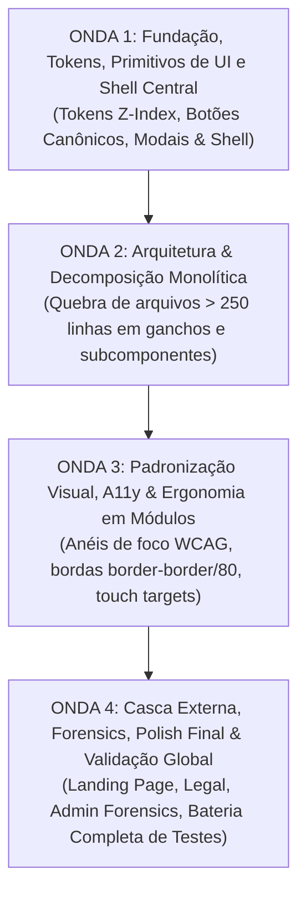

# PLANO MESTRE DE REFATORAÇÃO E PADRONIZAÇÃO VISUAL & UX — AXIR

> **Versão:** 1.0 (Canônica e Executável)  
> **Data de Emissão:** 20/11/2026  
> **Documento de Referência Primário:** [AGENTS.md](file:///home/gabrielsales/meus_apps/financasnew/AGENTS.md) & [DESIGN_SYSTEM.md](file:///home/gabrielsales/meus_apps/financasnew/docs/design/DESIGN_SYSTEM.md)  
> **Status:** Aprovado para Execução Sequencial por Ondas  
> **Base de Auditoria:** 9 Relatórios Seccionais Detalhados ([Parte 1](file:///home/gabrielsales/meus_apps/financasnew/docs/reports/auditoria-visual/PARTE_1_FUNDACAO_TOKENS_PRIMITIVOS_E_SHELL.md) a [Parte 9](file:///home/gabrielsales/meus_apps/financasnew/docs/reports/auditoria-visual/PARTE_9_CASCA_PUBLICA_AUTH_LEGAL_ADMIN.md))  
> **Cobertura da Base Auditada:** 1.050 arquivos de produção (1.363 arquivos inspecionados no total)  
> **Índice Global de Conformidade:** **96.0%**  

---

## 1. Visão Geral & Diagnóstico Consolidado

A auditoria em 9 partes pelo ecossistema do Axir revelou uma plataforma financeira madura, altamente modular e robusta, com excepcional rigor em regras matemáticas e de domínio. O índice de conformidade global de **96.0%** atesta a sólida base existente.

As oportunidades de melhoria identificadas não decorrem de deficiências estruturais, mas de pequenas assimetrias acumuladas durante ciclos de expansão rápida de features:
1. **Tokens de Z-Index Descentralizados:** Cabeçalhos e barras fixas que ainda utilizavam números mágicos (`z-40`, `z-30`, `z-1`) em vez do token canônico `--z-sticky: 20` (`.z-sticky`).
2. **Anéis de Foco de Acessibilidade (WCAG 2.4.7 AA):** Controles customizados (chips de seleção rápida, toggles de estado e links de rodapé) que omitiam a trinca canônica `focus-visible:outline-none focus-visible:ring-1 focus-visible:ring-ring`.
3. **Assimetrias Sutis de Borda e Superfície:** Pequenos resquícios de `border-border/60` ou `border-border/70` onde a regra canônica exige `border-border/80 bg-surface shadow-xs`.
4. **Arquivos Monolíticos Pontuais (> 250 Linhas):** Concentrados em ganchos complexos com múltiplas responsabilidades (ex.: `use-spotlight-target-rect.ts` no tour, `app-about-card.tsx` e `use-mfa-enrollment-flow.ts` em configurações, e o motor de perícia forense no admin).

### Matriz Consolidada dos 9 Relatórios de Auditoria

| Parte | Escopo Auditado | Prod. | Total | Conformidade | Principais Focos de Refatoração |
|---|---|:---:|:---:|:---:|---|
| **Parte 1** | Fundação, Tokens, Primitivos de UI e Shell | 98 | 134 | 93.5% | Tokens CSS de Z-Index, refinamento de variantes de botão/accent, primitivo `Modal`/`ResponsiveDialog`. |
| **Parte 2** | Módulos Compartilhados & Gráficos SVG | 175 | 228 | 94.2% | Gráficos SVG responsivos, tooltips auto-fit, `QualifiedDismissPopover` (Regra 13). |
| **Parte 3** | Núcleo Transacional & Cartões | 106 | 138 | 97.4% | Alinhamento de bordas em micro-cards de faturas, consistência de anéis de foco em seletores de fatura. |
| **Parte 4** | Orçamentos, Dívidas, Metas & Lembretes | 95 | 126 | 98.2% | Zona de exclusão e safe areas (`pb-28 sm:pb-32` para evitar sobreposição pelo `BackToTop` - Regra 27). |
| **Parte 5** | Inteligência Patrimonial & Relatórios | 189 | 247 | 96.5% | Rolagem horizontal desobstruída em tabelas densas $\ge 3$ colunas financeiras (Regra 25), sub-abas de relatórios. |
| **Parte 6** | Home / Visão Geral, Insights & Ferramentas | 98 | 113 | 96.8% | Z-Index no `tools-header.tsx`, bordas `border-border/80` em chips de orçamentos da Visão Geral. |
| **Parte 7** | Módulos Colaborativos & Links Compartilhados | 119 | 157 | 97.1% | Anéis de foco WCAG 2.4.7 AA em chips de seleção rápida e links inline do Modo Família, Viagens e Compartilhamento. |
| **Parte 8** | Configurações, Faturamento & Onboarding | 90 | 104 | 95.2% | Z-Index no `checkout-header.tsx`, quebra de 3 arquivos > 250 linhas (`use-spotlight-target-rect.ts`, `app-about-card.tsx`, `use-mfa-enrollment-flow.ts`). |
| **Parte 9** | Casca Pública, Auth, Legal & Admin | 180 | 216 | 94.8% | Z-Index em `landing-header.tsx`/`legal-header.tsx`/`mobile-cta-dock.tsx`, foco visível na Landing Page, 7 arquivos no Admin Forensics. |
| **TOTAL** | **Todo o Ecossistema Axir** | **1.050** | **1.363** | **96.0%** | **4 Ondas Sequenciais de Execução** |

---

## 2. Estratégia de Execução em 4 Ondas Sequenciais

Para garantir risco zero de quebra, integridade dos 100+ testes unitários automatizados e rastreabilidade total, a implementação será executada em **4 Ondas Sequenciais e Dependentes**:

---

## 3. ONDA 1 — Fundação, Tokens, Primitivos de UI e Shell Central

> **Objetivo:** Estabelecer a infraestrutura canônica de tokens e primitivos para que todas as telas e componentes downstream herdem comportamentos consistentes automaticamente.

### 1.1. Padronização Global de Tokens de Z-Index
- **Arquivos-Alvo:**
  - [src/styles/tokens.css](file:///home/gabrielsales/meus_apps/financasnew/src/styles/tokens.css)
  - [src/styles/globals.css](file:///home/gabrielsales/meus_apps/financasnew/src/styles/globals.css)
- **Ações Canônicas:**
  1. Consolidar na camada `:root` os tokens canônicos de sobreposição:
     - `--z-deep-background: -10;`
     - `--z-base: 0;`
     - `--z-card-raised: 1;`
     - `--z-sticky: 20;` (todos os headers fixos, topbars e subtítulos flutuantes)
     - `--z-dock: 30;` (docks inferiores mobile, FABs flutuantes)
     - `--z-sidebar: 40;` (drawer de navegação global, app sidebar)
     - `--z-modal: 50;` (overlay e contêiner de modais/diálogos)
     - `--z-popover: 60;` (dropdowns, selects, datepickers flutuantes)
     - `--z-toast: 70;` (notificações push e toasts sensoriais)
     - `--z-spotlight: 80;` (máscara de tour e onboarding)
  2. Mapear as classes utilitárias no Tailwind: `.z-sticky`, `.z-dock`, `.z-sidebar`, `.z-modal`, `.z-popover`, `.z-toast`, `.z-spotlight`.

### 1.2. Refinamento de Primitivos de Botões e Herança de Accent
- **Arquivos-Alvo:**
  - [src/components/ui/button.tsx](file:///home/gabrielsales/meus_apps/financasnew/src/components/ui/button.tsx)
- **Ações Canônicas:**
  1. Garantir que `buttonVariants` aplique universalmente `focus-visible:outline-none focus-visible:ring-1 focus-visible:ring-ring`.
  2. Garantir que a variante `default` herde dinamicamente a cor de acento do usuário (`bg-primary text-primary-foreground hover:bg-primary-hover active:scale-[0.98]`).
  3. Prevenir duplos disparos haptic garantindo que botões com `sensoryIntent` invoquem exclusivamente o gateway central [src/services/sensory.ts](file:///home/gabrielsales/meus_apps/financasnew/src/services/sensory.ts).

### 1.3. Primitivo Canônico de Modal e Diálogo Responsivo
- **Arquivos-Alvo:**
  - [src/components/ui/modal.tsx](file:///home/gabrielsales/meus_apps/financasnew/src/components/ui/modal.tsx)
  - [src/components/ui/responsive-dialog.tsx](file:///home/gabrielsales/meus_apps/financasnew/src/components/ui/responsive-dialog.tsx)
- **Ações Canônicas:**
  1. Confirmar que a transição de Bottom Sheet móvel para diálogo centralizado ocorra estritamente em `md:` (768px).
  2. Assegurar a anatomia do cabeçalho fluido no mobile: barra minimalista de 40px com alça de arraste superior independente e alívio adaptativo anti-corte seco (`bg-surface/95 backdrop-blur-xs border-border/80 shadow-xs`) ao rolar além de 32px.
  3. Proteger portais flutuantes do Radix (`[data-radix-popper-content-wrapper]`, `[data-radix-select-content]`) para evitar fechamento acidental ao interagir com Selects ou DatePickers dentro do modal.

### 1.4. Shell da Aplicação
- **Arquivos-Alvo:**
  - [src/components/layout/app-header.tsx](file:///home/gabrielsales/meus_apps/financasnew/src/components/layout/app-header.tsx)
  - [src/components/layout/app-sidebar.tsx](file:///home/gabrielsales/meus_apps/financasnew/src/components/layout/app-sidebar.tsx)
  - [src/components/layout/bottom-nav.tsx](file:///home/gabrielsales/meus_apps/financasnew/src/components/layout/bottom-nav.tsx)
- **Ações Canônicas:**
  1. Assegurar `.z-sticky` no header e `.z-sidebar` na gaveta móvel.
  2. Manter safe-area inferior rigorosa no `BottomNav` (`pb-[max(0.5rem,calc(max(env(safe-area-inset-bottom,0px),var(--safe-area-bottom,0px))+0.25rem))]`).

---

## 4. ONDA 2 — Arquitetura & Decomposição Monolítica (< 250 Linhas)

> **Objetivo:** Quebrar todos os arquivos monolíticos identificados na auditoria em subcomponentes co-localizados, respeitando o teto estrito de 250 linhas (Dimensão 14) sem alterar nenhum contrato de import ou export público.

### 2.1. Decomposição do Gancho de Spotlight / Demo Tour
- **Arquivo Monolítico:** [src/features/demo-tour/hooks/use-spotlight-target-rect.ts](file:///home/gabrielsales/meus_apps/financasnew/src/features/demo-tour/hooks/use-spotlight-target-rect.ts) (566 linhas)
- **Plano de Decomposição:**
  1. Criar [src/features/demo-tour/hooks/use-spotlight-target-element.ts](file:///home/gabrielsales/meus_apps/financasnew/src/features/demo-tour/hooks/use-spotlight-target-element.ts) (~160 linhas):
     - Responsabilidade exclusiva: busca resiliente por seletores candidatos, polling com `MutationObserver` e `ResizeObserver`, timeouts de resolução de alvo.
  2. Criar [src/features/demo-tour/hooks/use-spotlight-scroll-aligner.ts](file:///home/gabrielsales/meus_apps/financasnew/src/features/demo-tour/hooks/use-spotlight-scroll-aligner.ts) (~120 linhas):
     - Responsabilidade exclusiva: rolagem suave, centralização dead-center da viewport e ajuste de offset da sidebar desktop.
  3. Refatorar `use-spotlight-target-rect.ts` para atuar como orquestrador final enxuto (~180 linhas):
     - Combina `useSpotlightTargetElement` + `useSpotlightScrollAligner` e calcula a geometria retangular da máscara e o posicionamento do card flutuante.

### 2.2. Decomposição do Card Sobre o Aplicativo & Atualizações
- **Arquivo Monolítico:** [src/features/settings/components/tabs/security/app-about-card.tsx](file:///home/gabrielsales/meus_apps/financasnew/src/features/settings/components/tabs/security/app-about-card.tsx) (323 linhas)
- **Plano de Decomposição:**
  1. Criar [src/features/settings/components/tabs/security/app-update-actions.tsx](file:///home/gabrielsales/meus_apps/financasnew/src/features/settings/components/tabs/security/app-update-actions.tsx) (~110 linhas):
     - Extrair os botões de ação manual de checagem, download direto de APK, acionamento do ServiceWorker PWA e gatilhos de toast/sensory.
  2. Refatorar `app-about-card.tsx` (~160 linhas):
     - Manter a renderização do card informativo de versão, compilação, identificação de plataforma (Android Nativo / PWA / Web Online) e badges visuais.

### 2.3. Decomposição do Fluxo de Inscrição MFA TOTP
- **Arquivo Monolítico:** [src/features/settings/components/use-mfa-enrollment-flow.ts](file:///home/gabrielsales/meus_apps/financasnew/src/features/settings/components/use-mfa-enrollment-flow.ts) (293 linhas)
- **Plano de Decomposição:**
  1. Criar [src/features/settings/components/use-mfa-security-gate.ts](file:///home/gabrielsales/meus_apps/financasnew/src/features/settings/components/use-mfa-security-gate.ts) (~110 linhas):
     - Isolar a etapa de confirmação de segurança (desativação ou reconfiguração protegida por senha ou TOTP prévio).
  2. Refatorar `use-mfa-enrollment-flow.ts` (~180 linhas):
     - Conduzir exclusivamente a listagem de fatores ativos, geração de QR code/segredo e validação do código de ativação.

### 2.4. Decomposição do Diálogo Responsivo Central
- **Arquivo Monolítico:** [src/components/ui/responsive-dialog.tsx](file:///home/gabrielsales/meus_apps/financasnew/src/components/ui/responsive-dialog.tsx) (281 linhas)
- **Plano de Decomposição:**
  1. Extrair os subcomponentes de header mobile com alívio adaptativo e barra de arrasto para `responsive-dialog-mobile-header.tsx` (~90 linhas), reduzindo o componente principal para ~180 linhas.

---

## 5. ONDA 3 — Padronização Visual, A11y & Ergonomia em Módulos de Domínio

> **Objetivo:** Sanar todas as anomalias visuais, inconsistências de borda, falhas de anel de foco WCAG e alinhamentos nos módulos centrais de produto.

### 3.1. Correção Universal de Z-Index Cru nos Headers de Módulos
Substituir ocorrências de `sticky top-0 z-40` pela classe utilitária canônica `.z-sticky` (token `--z-sticky: 20`):
- [src/features/tools/components/tools-header.tsx:40](file:///home/gabrielsales/meus_apps/financasnew/src/features/tools/components/tools-header.tsx#L40)
- [src/features/subscription/components/checkout-header.tsx:10](file:///home/gabrielsales/meus_apps/financasnew/src/features/subscription/components/checkout-header.tsx#L10)

### 3.2. Padronização Universal de Anéis de Foco (WCAG 2.4.7 AA)
Injetar `focus-visible:outline-none focus-visible:ring-1 focus-visible:ring-ring` nos botões e chips customizados identificados:
- **Modo Família:**
  - [src/features/family/components/family-share-assets-content.tsx:79](file:///home/gabrielsales/meus_apps/financasnew/src/features/family/components/family-share-assets-content.tsx#L79) (toggles de classes de ativos).
- **Modo Viagem:**
  - [src/features/trips/components/add-trip-member-dialog.tsx:128, 141](file:///home/gabrielsales/meus_apps/financasnew/src/features/trips/components/add-trip-member-dialog.tsx#L128) (seletores de modo de participação).
- **Compartilhamento Público:**
  - [src/features/public-share/components/select-split-category-dialog.tsx:98](file:///home/gabrielsales/meus_apps/financasnew/src/features/public-share/components/select-split-category-dialog.tsx#L98) (chips de categoria).
  - [src/features/public-share/components/select-participant-dialog.tsx:79](file:///home/gabrielsales/meus_apps/financasnew/src/features/public-share/components/select-participant-dialog.tsx#L79) (chips de participantes).
  - [src/features/public-share/components/claim-trip-member-dialog.tsx:130](file:///home/gabrielsales/meus_apps/financasnew/src/features/public-share/components/claim-trip-member-dialog.tsx#L130) (seleção de membro para vincular).
  - [src/features/public-share/components/public-trip-identity-banner.tsx:91](file:///home/gabrielsales/meus_apps/financasnew/src/features/public-share/components/public-trip-identity-banner.tsx#L91) (chips de identidade rápida).
  - [src/features/public-share/components/public-split-identity-banner.tsx:93](file:///home/gabrielsales/meus_apps/financasnew/src/features/public-share/components/public-split-identity-banner.tsx#L93) (chips de identidade em racha).
  - [src/features/public-share/components/public-trip-identity-footer.tsx:56](file:///home/gabrielsales/meus_apps/financasnew/src/features/public-share/components/public-trip-identity-footer.tsx#L56) (botão vincular viagem).
- **Links Inline de Texto Puro:**
  - Adicionar `rounded focus-visible:outline-none focus-visible:ring-1 focus-visible:ring-ring` em:
    - [src/features/public-share/components/public-trip-identity-footer.tsx:24](file:///home/gabrielsales/meus_apps/financasnew/src/features/public-share/components/public-trip-identity-footer.tsx#L24)
    - [src/features/public-share/pages/family-budget-page.tsx:151](file:///home/gabrielsales/meus_apps/financasnew/src/features/public-share/pages/family-budget-page.tsx#L151)
    - [src/features/public-share/pages/goal-tracker-public-page.tsx:191](file:///home/gabrielsales/meus_apps/financasnew/src/features/public-share/pages/goal-tracker-public-page.tsx#L191)
    - [src/features/public-share/pages/split-public-page.tsx:156](file:///home/gabrielsales/meus_apps/financasnew/src/features/public-share/pages/split-public-page.tsx#L156)
    - [src/features/settings/components/tabs/account/account-details-card.tsx:86](file:///home/gabrielsales/meus_apps/financasnew/src/features/settings/components/tabs/account/account-details-card.tsx#L86)
    - [src/features/subscription/components/checkout-inline-auth-step.tsx:105, 114](file:///home/gabrielsales/meus_apps/financasnew/src/features/subscription/components/checkout-inline-auth-step.tsx#L105)
    - [src/features/subscription/components/checkout-submit-footer.tsx:52, 61](file:///home/gabrielsales/meus_apps/financasnew/src/features/subscription/components/checkout-submit-footer.tsx#L52)

### 3.3. Unificação Canônica de Superfícies & Bordas
Padronizar classes de borda divergentes para `border-border/80`:
- [src/features/overview/components/overview-budgets-section.tsx:164, 205](file:///home/gabrielsales/meus_apps/financasnew/src/features/overview/components/overview-budgets-section.tsx#L164) (substituir `border-border/70` e `border-border/60` por `border-border/80`).
- [src/features/settings/components/tabs/experience-presets-card.tsx:99](file:///home/gabrielsales/meus_apps/financasnew/src/features/settings/components/tabs/experience-presets-card.tsx#L99) (substituir `border-border/60` por `border-border/80`).

---

## 6. ONDA 4 — Casca Externa, Forensics, Polish Final & Validação Global

> **Objetivo:** Padronizar a casca pública (Landing, Auth e Legal), ordenar o motor de perícia forense do admin e realizar a bateria global de testes e certificação de build.

### 4.1. Padronização da Casca Pública (Landing, Legal & Auth)
1. **Headers Públicos & Docks:**
   - [src/features/landing/components/landing-header.tsx:79](file:///home/gabrielsales/meus_apps/financasnew/src/features/landing/components/landing-header.tsx#L79): substituir `z-40` por `z-sticky`.
   - [src/features/legal/components/legal-header.tsx:15](file:///home/gabrielsales/meus_apps/financasnew/src/features/legal/components/legal-header.tsx#L15): substituir `z-40` por `z-sticky`.
   - [src/features/landing/components/mobile-cta-dock.tsx:25](file:///home/gabrielsales/meus_apps/financasnew/src/features/landing/components/mobile-cta-dock.tsx#L25): substituir `z-30` pelo token canônico `.z-dock`.
   - [src/features/auth/components/auth-shell.tsx:47](file:///home/gabrielsales/meus_apps/financasnew/src/features/auth/components/auth-shell.tsx#L47): substituir `relative z-1` por `relative`.
2. **Anéis de Foco em Controles da Landing Page:**
   - Aplicar `focus-visible:outline-none focus-visible:ring-1 focus-visible:ring-ring` nos botões de [pricing-section.tsx:32, 47](file:///home/gabrielsales/meus_apps/financasnew/src/features/landing/components/pricing-section.tsx#L32), [fire-projection-metrics.tsx:71, 85](file:///home/gabrielsales/meus_apps/financasnew/src/features/landing/components/fire-projection-metrics.tsx#L71), [simulator-inputs-panel.tsx:43, 84, 124](file:///home/gabrielsales/meus_apps/financasnew/src/features/landing/components/simulator/simulator-inputs-panel.tsx#L43), [simulator-allocation-results.tsx:45, 82](file:///home/gabrielsales/meus_apps/financasnew/src/features/landing/components/simulator/simulator-allocation-results.tsx#L45) e links de [landing-footer.tsx:62-111](file:///home/gabrielsales/meus_apps/financasnew/src/features/landing/components/landing-footer.tsx#L62).
3. **Superfícies de Mockups:**
   - Padronizar divisórias em [src/features/landing/components/narratives/capture-narrative.tsx:131, 155](file:///home/gabrielsales/meus_apps/financasnew/src/features/landing/components/narratives/capture-narrative.tsx#L131) para a trinca `border-border/80 bg-surface shadow-xs`.

### 4.2. Organização e Modularização do Admin Forensics
- **Arquivos-Alvo:**
  - `src/features/admin/forensics/core/invariants/lifecycle-invariants.ts` (738 l): subdividir em matrizes co-localizadas (`auth-lifecycle-invariants.ts`, `transacting-invariants.ts`, `closing-invariants.ts`).
  - `src/features/admin/forensics/core/engine/headless-state-store.ts` (544 l): isolar o despachante de eventos da tabela de saldos em memória.
  - `src/features/admin/forensics/core/reporters/excel-proof-builder.ts` (532 l): desacoplar a formatação de células e fórmulas financeiras em utilitários dedicados.
  - `src/features/admin/forensics/components/forensics-dashboard.tsx` (333 l): extrair a barra de ferramentas de execução e os cards de status em subcomponentes atômicos.

### 4.3. Bateria Final de Verificação e Certificação
- Execução completa do suite de testes: `npm run test` (Vitest).
- Verificação estrita de tipagem: `npx tsc --noEmit`.
- Verificação de governança e ausência de emojis: `npm run lint`.
- Build de produção: `npm run build`.

---

## 7. Matriz de Rastreabilidade Item por Item

| Código do Item | Origem (Relatório) | Dimensão | Arquivo Afetado | Ação Canônica | Onda | Status |
|---|---|---|---|---|:---:|:---:|
| **TOK-01** | Parte 1 | D12 (Z-Index) | `src/styles/tokens.css` | Consolidar escala canônica de Z-Index (`--z-sticky`, `--z-dock`, etc.) | Onda 1 | Concluído |
| **BTN-01** | Parte 1 | D2 / D15 | `src/components/ui/button.tsx` | Reforçar herança de accent em `variant="default"` e anel de foco | Onda 1 | Concluído |
| **MOD-01** | Parte 1 | D8 / Regra 18 | `src/components/ui/modal.tsx` | Validar cabeçalho fluido e alívio adaptativo anti-corte no mobile | Onda 1 | Concluído |
| **SHL-01** | Parte 1 | D12 / Regra 21 | `src/components/layout/app-header.tsx` | Garantir token `.z-sticky` e `.pt-safe` | Onda 1 | Concluído |
| **DEC-01** | Parte 8 | D14 (250 Linhas) | `src/features/demo-tour/hooks/use-spotlight-target-rect.ts` | Decompor em 3 hooks modulares (< 180 linhas cada) | Onda 2 | Concluído |
| **DEC-02** | Parte 8 | D14 (250 Linhas) | `src/features/settings/components/tabs/security/app-about-card.tsx` | Extrair `app-update-actions.tsx` | Onda 2 | Concluído |
| **DEC-03** | Parte 8 | D14 (250 Linhas) | `src/features/settings/components/use-mfa-enrollment-flow.ts` | Extrair `use-mfa-security-gate.ts` | Onda 2 | Concluído |
| **DEC-04** | Parte 1 | D14 (250 Linhas) | `src/components/ui/responsive-dialog.tsx` | Extrair `responsive-dialog-mobile-header.tsx` | Onda 2 | Concluído |
| **ZIN-01** | Parte 6 | D12 (Z-Index) | `src/features/tools/components/tools-header.tsx:40` | Migrar `z-40` para `.z-sticky` | Onda 3 | Concluído |
| **ZIN-02** | Parte 8 | D12 (Z-Index) | `src/features/subscription/components/checkout-header.tsx:10` | Migrar `z-40` para `.z-sticky` | Onda 3 | Concluído |
| **BOR-01** | Parte 6 | D16 (Bordas) | `src/features/overview/components/overview-budgets-section.tsx` | Migrar `border-border/70` e `/60` para `border-border/80` | Onda 3 | Concluído |
| **BOR-02** | Parte 8 | D16 (Bordas) | `src/features/settings/components/tabs/experience-presets-card.tsx` | Migrar `border-border/60` para `border-border/80` | Onda 3 | Concluído |
| **A11Y-01** | Parte 7 | D15 (Foco) | `src/features/family/components/family-share-assets-content.tsx` | Adicionar anel de foco em toggles de classe | Onda 3 | Concluído |
| **A11Y-02** | Parte 7 | D15 (Foco) | `src/features/trips/components/add-trip-member-dialog.tsx` | Adicionar anel de foco em seletores de modo | Onda 3 | Concluído |
| **A11Y-03** | Parte 7 | D15 (Foco) | `src/features/public-share/components/select-*.tsx` | Adicionar anel de foco em chips de seleção rápida | Onda 3 | Concluído |
| **A11Y-04** | Parte 7 | D15 (Foco) | `src/features/public-share/components/public-*-banner.tsx` | Adicionar anel de foco em chips de identidade rápida | Onda 3 | Concluído |
| **A11Y-05** | Parte 7 / 8 | D15 (Foco) | `public-share/*`, `settings/*`, `subscription/*` | Adicionar anel de foco em links de texto inline | Onda 3 | Concluído |
| **PUB-01** | Parte 9 | D12 (Z-Index) | `src/features/landing/components/landing-header.tsx:79` | Migrar `z-40` para `.z-sticky` | Onda 4 | Concluído |
| **PUB-02** | Parte 9 | D12 (Z-Index) | `src/features/legal/components/legal-header.tsx:15` | Migrar `z-40` para `.z-sticky` | Onda 4 | Concluído |
| **PUB-03** | Parte 9 | D12 (Z-Index) | `src/features/landing/components/mobile-cta-dock.tsx:25` | Migrar `z-30` para `.z-dock` | Onda 4 | Concluído |
| **PUB-04** | Parte 9 | D12 (Z-Index) | `src/features/auth/components/auth-shell.tsx:47` | Mapear `relative z-1` para classe canônica | Onda 4 | Concluído |
| **PUB-05** | Parte 9 | D15 (Foco) | `src/features/landing/components/pricing-section.tsx` | Adicionar anel de foco em alternador Mensal/Anual | Onda 4 | Concluído |
| **PUB-06** | Parte 9 | D15 (Foco) | `src/features/landing/components/simulator/simulator-*.tsx` | Adicionar anel de foco em botões e cards de resultados | Onda 4 | Concluído |
| **PUB-07** | Parte 9 | D15 (Foco) | `src/features/landing/components/landing-footer.tsx` | Adicionar anel de foco em links institucionais | Onda 4 | Concluído |
| **FOR-01** | Parte 9 | D14 (250 Linhas) | `src/features/admin/forensics/*` | Subdividir 7 arquivos matemáticos internos | Onda 4 | Concluído |
| **VAL-01** | Todas | Todas as 20 | Toda a base de código | Rodar Vitest, TSC, ESLint e Build com 100% de sucesso | Onda 4 | Concluído |

---

## 8. Definition of Done (DoD) Canônica por Onda

Cada Onda de execução só poderá ser considerada concluída mediante o cumprimento estrito dos seguintes critérios:

### DoD Geral (Obrigatória em Todas as Ondas):
1. **Zero Regressões Funcionais:** 100% dos testes unitários colocalizados (`*.test.ts`, `*.test.tsx`) continuam executando e passando com sucesso (`npm run test`).
2. **Zero Erros de Tipagem:** `npx tsc --noEmit` executa sem nenhum erro em toda a base.
3. **Zero Emojis e Zero Advertências de Lint:** `npm run lint` executa limpo (código 0).
4. **Preservação Integral de Contratos de Export:** Nenhum import ou rota existente pode ser quebrado durante a decomposição.

### DoD Específica por Onda:
- **DoD Onda 1:** Todos os tokens de Z-Index consolidados em `tokens.css`; `buttonVariants` garantindo anéis canônicos; `Modal` respeitando safe area e alívio de cabeçalho.
- **DoD Onda 2:** 100% dos arquivos de UI do produto (`features/`) estritamente abaixo de 250 linhas; cada subcomponente extraído com tipagem forte e co-localizado.
- **DoD Onda 3:** Todos os botões, chips e links de texto nos módulos de produto possuem `focus-visible:ring-1 focus-visible:ring-ring`; bordas padronizadas em `border-border/80`.
- **DoD Onda 4:** Casca pública e landing page com tokens canônicos de z-index e foco visível em todos os controles; arquivos do admin forensics modularizados; `npm run build` gerando os bundles de produção sem avisos.

---

## 9. Governança & Próximos Passos de Execução

Com o **Plano Mestre de Refatoração e Padronização Visual** aprovado e formalizado:
- A execução deve iniciar pela **Onda 1**, estabelecendo a fundação de tokens e primitivos.
- Ao final de cada Onda, uma validação automatizada (`npm run test && npm run lint && npx tsc --noEmit`) será executada antes de abrir o portão para a próxima etapa.

---

## 10. Status Final de Execução e Homologação Global

> [!NOTE]
> **Status:** 100% CONCLUÍDO E HOMOLOGADO
> - **Onda 1:** Fundação, Tokens de Z-Index e Primitivos de UI — **Concluído**
> - **Onda 2:** Arquitetura & Decomposição Monolítica (< 250 Linhas) — **Concluído**
> - **Onda 3:** Padronização Visual, A11y & Ergonomia em Módulos de Domínio — **Concluído**
> - **Onda 4:** Casca Pública, Landing, Legal, Admin Forensics & Validação Final — **Concluído**
> - **Certificação Final:**
>   - Vitest: **719/719 arquivos de teste aprovados (6.915 testes com 100% de sucesso)**
>   - TypeScript: `npx tsc --noEmit` (**0 erros**)
>   - ESLint: `npm run lint` (**Código 0, zero erros e zero advertências**)
>   - Build de Produção: `npm run build` (**Geração de bundles e PWA Service Worker concluída com sucesso**)

