# Plano de Reestruturação Canônica — Motor Universal & Autoevolutivo de Importação de Faturas

> **Status:** Concluído — Ondas 1–4 entregues, auditadas e homologadas na `v3.28.0` (Decisões D1–D18 e Guardas G1–G14 100% implementadas)
> **Classificação (`AGENTS.md §10.5`):** Fluxo Completo (Refatoração de Módulo Central + Novas Migrations/RPCs SQL + Ajuste Edge Function + Redesign UI/UX + Seção Admin)
> **Fontes consolidadas:** `docs/diagnostics/AUDITORIA_COMPLETA_IMPORTACAO_FATURA.md` + Proposta Externa ("Coringa" + Zero-Fricção) + 18 Decisões Fechadas (D1–D18) + 7 Refinamentos validados contra `/src`, `/supabase/functions` e `/supabase/migrations`.
> **Objetivo:** Reconstruir a importação de faturas de cartão de crédito para operar com **precisão máxima em qualquer banco**, **inteligência invisível e autoevolutiva na nuvem (custo ~1 por banco, 0 PII)**, **persistência 100% atômica e reversível até o clique final**, **14 guardas anti-erro** e **UI/UX limpa, estática e 100% conforme `AGENTS.md` / `DESIGN_SYSTEM.md`**.

---

## 0. Decisões Fechadas de Produto e Engenharia (D1–D18)

| # | Eixo | Decisão Fechada |
|---|---|---|
| **D1** | **Poda de Complexidade & Inteligência Invisível** | Remover `StatementBlockClipperStep` (`block-clipper`), `line_curator`, `statement-mapping-cache.ts`, `visionEscalationOffer`, autoevolução em `localStorage` global (`statement-blueprint-store.ts`), código legado de conta corrente, botão `"Reanalisar com IA"` (com toda lógica de `reanalyzeNonce` / `deriveSaltedSha256Hex`) e selos técnicos de origem (`"Leitura assistida"`, `"Layout aprendido"`, `"Estruturado com IA"`, `"Leitura local"`). Manter `StatementMappingFallback` enxuto e corrigido (preservando `headerRowIndex` real) apenas como escape hatch para CSV/XLSX offline ou via ação discreta `"Ajustar colunas"`. |
| **D2** | **1-Clique Inteligente (`opt-out` vs `opt-in`)** | **Pré-marcados (`opt-out`):** novas compras válidas, parcelas futuras faltantes (`K+1..N`), estornos não conciliados e microajustes `<= R$ 0,05` com **match forte** (sinal textual/categoria/parcela positivo). **Aprovação explícita (`opt-in`):** mover despesa de mês vizinho (`crossCompetenceMatch`), ajustes `> R$ 0,05` ou matches fracos, e marcação de exclusão de duplicatas/itens `"Só no app"`. |
| **D3** | **Parcelas Passadas (`K >= 2`)** | Projetar **exclusivamente parcelas futuras (`K+1..N`)**, protegendo faturas passadas já fechadas/pagas contra alterações retroativas. Exibir apenas selo informativo quando não houver histórico anterior. |
| **D4** | **Categorização IA Síncrona (`categorize_batch`) + Reserva de Crédito** | Roda **antes de abrir a conferência** (1 lote de até 40 estabelecimentos inéditos priorizados por impacto financeiro, timeout curto de `4s` com degradação graciosa para local). **Reserva do último crédito:** se a pré-checagem de `user_ai_quotas` indicar cota diária restante `<= 1`, pula automaticamente o `categorize_batch` síncrono (preservando o crédito para extração). A tela de conferência abre **100% estática**, sem saltos nem race conditions em background. |
| **D5** | **Cascata 100% Automática & Vision em 2 Ondas Paralelas (até 6 págs)** | Na entrada do arquivo, o pipeline executa de forma invisível e exaustiva até aprovação no Quality Gate: **Motor Local/Blueprint → (se reprovar) IA Texto podado → (se PDF ainda reprovar) Vision automático em até 2 ondas paralelas de 3 páginas (`AbortController` + botão `"Cancelar"` sempre responsivo)**, selecionando sempre o candidato de maior `qualityScore` contábil antes do `categorize_batch`. Pré-checagem de `user_ai_quotas` antes de disparar lote Vision multi-página; aborta imediatamente em `quota_exceeded` e exibe aviso claro de cobertura se `> 6` páginas Vision/prints ou `> 3` chunks de texto (`75.000` chars). Se restar divergência após a cascata, exibe status objetivo (`Diferença de R$ X`) com edição/adição/remoção, `"Trocar arquivo"` e (só CSV/XLSX) `"Ajustar colunas"`. |
| **D6** | **Paridade Total Trial = Pro & Reupload a Custo Zero (CAC + FinOps)** | **Zero separação de limite entre Trial e Pro** (o Trial entrega 100% da experiência Pro como custo de aquisição): ambos os planos compartilham os mesmos tetos rígidos de segurança em `AI_QUOTA_LIMITS` — **`batch_calls: 30/dia · 120/mês`** e **`receipt_calls: 15/dia · 100/mês`** (além de `PASSIVE_AI_DAILY_RESERVE = 1` alinhado entre cliente e Edge Function). Contas com trial expirado/suspenso seguem bloqueadas por `isActiveTrial` / `isActivePro`. **Anti-loop `"colocar e tirar"`:** sem salt de reanálise e com `created_at: new Date().toISOString()` no `upsert` de `receipt_extractions_cache`, reenviar o mesmo arquivo acerta o cache LGPD `(user_id, sha256, mode)` com **0 débito de cota e 0 chamada ao LLM**. |
| **D7** | **Aprendizado Global Blindado no Supabase (0 PII / LGPD + Anti-Sybil)** | Quando a IA resolve uma fatura inédita e passa no **Shadow Replay Real** (`SpatialPdfLine[]` reais com paginação e `fontSize`, `score >= 90` e `diffCents <= 5`): **(1) Nível Usuário (imediato, Trial e Pro):** salva em `public.statement_layout_blueprints` (`scope = 'user'`, sincronizado entre celular e desktop); **(2) Contribuição para Global (`pending_review`):** qualquer usuário (inclusive Trial) que valide com checksum exato alimenta a fila `scope = 'global', status = 'pending_review'` (com contagem anônima de usuários distintos) para aprovação em 1 clique no Painel Admin; **(3) Promoção automática & Self-healing Global (Anti-Sybil):** promoção automática para `scope = 'global', status = 'active'` exige **`>= 2` usuários distintos em contas pagas/confiáveis (Pro, Lifetime ou Admin)** com `exact_checksum_hit`, e suspensão automática em `scope = 'global'` exige falhas de **`>= 2` contas pagas/confiáveis distintas** (enquanto `scope = 'user'` suspende após 2 falhas consecutivas do próprio usuário). Rastreamento 100% anônimo por hash unidirecional (0 PII). |
| **D8** | **Busca & Ordenação Adaptativa** | Barra compacta de busca (estabelecimento/valor) e ordenação (Data / Maior valor) exibida automaticamente quando a fatura possuir **`>= 15` lançamentos**, mantendo faturas curtas minimalistas. |
| **D9** | **Staging 100% Reversível (Zero Mutação Prematura)** | Exclusões marcadas nas abas `Atenção (Duplicatas no App)` e `Só no app` são **enfileiradas** (`p_delete_expense_ids`) com opção `"Desfazer"` até o clique final em `"Aplicar e importar"`. Se o usuário fechar/cancelar o modal, **nenhum dado foi alterado no banco**. |
| **D10** | **Modo Negócio (PF/PJ e Dedutibilidade)** | Em cartões mistos (`scope === "mixed"`) com Modo Negócio ativo: toggle compacto `PF/PJ` na linha + `"Tudo PJ / Tudo PF"` na toolbar. Dedutibilidade fiscal (`is_tax_deductible`) inferida automaticamente e editável dentro do `<StatementItemForm />` (para cartões PJ e Mistos). |
| **D11** | **Tela Breve de Conclusão Pós-Commit** | Após o commit atômico bem-sucedido, exibe um estado limpo de conclusão dentro do modal com resumo exato do que foi aplicado (novas, parcelas futuras, ajustes, estornos, exclusões) e dois botões no `ModalFooter`: **`Concluir`** e **`Pagar fatura agora`** (quando houver saldo em aberto, abrindo o `PaymentDialog` já existente). |
| **D12** | **Coerência Sistêmica (Encargos & Estornos Existentes)** | Encargos detectados (`tax`, `interest`, `fine`, `bank_fee`) são vinculados automaticamente à categoria reservada **`"Tarifas e Encargos"`** (`migration 0150`). Estornos (`refund`) são conciliados contra `useCardPayments(card.id)` existentes + idempotência via `statement_hash` em `card_payments`, evitando duplicação em reimportações. |
| **D13** | **Data de Parcelas `K >= 2` Importadas** | Quando uma parcela `K/N` (`K >= 2`) vier na fatura de `competenceMonth` com a data original da compra (mês/ano anterior), sua `date` gravada em `public.expenses` é **alinhada ao mês da competência da fatura** mantendo o dia da compra clampado (ex.: `15/08 — Loja X 4/10` em Nov/26 → `2026-11-15`; `15/12/2025 — Loja Y 12/12` em Nov/26 → `2026-11-15`), idêntico ao `parcelar()` manual. Mantém Overview, Orçamentos, Transações, DRE e Cartões 100% coerentes e elimina clamp de 2025 em `2026-01-01`. Compras à vista (`1/1`) preservam sua data real. |
| **D14** | **Proteção de Fatura Rolada vs Quitada** | **Fatura rolada/refinanciada (`card_bill_rollovers`):** bloqueio total de escrita na UI (faixa bloqueante + botão de commit desabilitado) e no RPC `commit_statement_reconciliation`. **Fatura quitada (`card_payments` com saldo aberto `= 0`):** exibe aviso claro na faixa prioritária e permite importar novas despesas/projetar futuras (se o usuário confirmar), **mantendo bloqueadas exclusões (`p_delete_expense_ids`) e ajustes/moves em itens já liquidados** tanto na UI quanto nos Blocos A/B/C do RPC. |
| **D15** | **Vision em 2 Ondas Paralelas de 3 (até 6 págs/prints)** | Prints de tela e PDFs escaneados suportam **até 6 imagens/páginas** em 2 ondas paralelas de 3 (`MAX_STATEMENT_VISION_PAGES_OR_IMAGES = 6`, `VISION_WAVE_SIZE = 3`). No fallback Vision automático de PDF digital, executa Onda 1 (páginas 1..3); se fechar o Total Oficial (`±R$ 0,05`), encerra imediatamente; senão (havendo páginas 4..6 e cota), dispara Onda 2 automaticamente. Aviso explícito acima de 6 páginas/prints ou 3 chunks de texto (`75.000` chars). |
| **D16** | **Curadoria Admin de Blueprints no Mesmo Ciclo** | `migration 0156` (Onda 1) entrega os RPCs de admin (`admin_list_statement_blueprints`, `admin_approve_statement_blueprint`, `admin_suspend_statement_blueprint`) e a Onda 4 adiciona uma seção enxuta `"Layouts de Fatura"` em `src/features/admin/pages/admin-settings-page.tsx` para aprovar `pending_review` ou suspender globais em 1 clique. |
| **D17** | **Troca de Cartão em 1 Clique (`hasCardMismatch`)** | Se os 4 dígitos ou banco detectados na fatura baterem com outro cartão cadastrado do usuário, a faixa prioritária exibe o botão **`"Trocar para <Nome do Cartão>"`**, que troca o cartão alvo e re-reconcilia em memória (`< 2ms`, 0 IA) sobre `RawExtractedEntry[]`. Sem cartão cadastrado compatível, mantém aviso exigindo confirmação explícita antes do commit. |
| **D18** | **Escape Hatch Manual de Tipo (`Compra` ↔ `Estorno` & Resgate)** | `<StatementItemForm />` permite alternar o tipo entre `"Compra"` e `"Estorno"` (ao editar ou adicionar, recalculando o Quality Gate em tempo real), e linhas de `"Pagamento ignorado"` na aba `Conciliados` oferecem botão discreto `"Restaurar"` (como compra ou estorno) para textos bancários incomuns. |

---

## 1. Matriz das 14 Guardas Invioláveis Anti-Erro

Nenhuma onda é dada como concluída sem testes automatizados cobrindo as guardas aplicáveis:

| ID | Guarda | Garantia Técnica |
|---|---|---|
| **G1** | **Calendário Real Estrito** | `normalizeDateToISO` valida `1 <= mês <= 12` e `1 <= dia <= diasDoMês(ano, mês)` (incluindo ano bissexto). Decimais como `12.50` nunca viram data. |
| **G2** | **Janela de Ano Ancorada no Ciclo (`DD/MM`)** | Datas sem ano resolvem ano usando o teto superior do ciclo da fatura (`cycleCeilingDate`: `closing_day - 1` de `competenceMonth` — ou fim de `competenceMonth` quando ausente/dia 1 — somado a `+5` dias de margem de processamento). Qualquer `DD/MM` que cair no futuro além de `cycleCeilingDate` recua para `compYear - 1` (cobrindo parcelas `12/12` de `15/12/2025` numa fatura `2026-11` e `15/05` numa fatura `2026-04`). A exceção `compMonth === 12 && txMonth === 1 -> compYear + 1` só vale quando `Date(compYear + 1, 1, txDay) <= cycleCeilingDate`. Trocar competência re-normaliza `RawExtractedEntry[]` em `< 2ms` (0 IA). |
| **G3** | **Domínio Exclusivo de Cartão** | Zero heurística de conta corrente (`INFLOW_KEYWORDS`). Compras como `"Depósito de Bebidas"` permanecem `purchase`; pagamentos usam `isPaymentOrSettlement` de forma idêntica em todos os formatos. |
| **G4** | **Preservação de Índice da IA** | `RawExtractedEntry` carrega `sourceIndex` explícito; nenhum filtro intermediário pode desalinhar `entryType` (`purchase`/`refund`/`payment`/`charge`) ou parcelas vindas da IA. |
| **G5** | **Limpeza Não-Destrutiva** | Remoção de `C/D` restrita ao sufixo de polaridade junto ao valor extraído (preserva `"C&A"`, `"D PEDRO"`, `"C V C"`). Valor removido da linha sempre via última ocorrência (`lastIndexOf`). |
| **G6** | **Fonte Única de Qualidade Contábil** | `evaluateStatementExtractionQuality` (Equação Contábil Dupla: `cycle_net` ou `statement_balance` `±5c`) alimenta simultaneamente a decisão de fallback IA e os números exibidos no Card de Diagnóstico. |
| **G7** | **Piso Anti-Falso-Match & Match Forte** | `diffCents === 0 && diffDays === 0` com `jaccard === 0` (sem encargo/parcela coincidente) tem teto **70 (`probable_match`)**, nunca `exact_match`. Matching 1:1 global por `score DESC`. Microajustes `<= R$ 0,05` pré-marcados exigem match forte (`score >= 65` + sinal textual/categoria/parcela positivo). |
| **G8** | **Compras Repetidas Validadas por Soma** | Ocorrências idênticas no mesmo dia permanecem `selected: true` (selo `2x no dia`) se, incluídas, fecharem o Total Oficial (`±5c`). Só viram suspeita de duplicata se estourarem a soma, sem total oficial ou em prints com risco de overlap. |
| **G9** | **Histórico Completo, `date` & Unicidade de Parcelas** | `detectInstallmentSeriesState` consulta **todas as competências do cartão** (`useCardExpenses`), impedindo duplicação de parcelas futuras já cadastradas e projetando apenas `K+1..N`. Parcelas `K >= 2` importadas com data de mês/ano anterior alinham `date` ao mês de `competenceMonth` (dia clampado, D13), igual ao `parcelar()` manual e às parcelas projetadas `K+1..N`. Toda despesa com `installments_total > 1` recebe `installment_group_id` válido (honrando `CHECK ((installments_total > 1) = (installment_group_id IS NOT NULL))` em `public.expenses`), com índice único parcial `(user_id, card_id, installment_group_id, installment_number)`. |
| **G10** | **Conciliação de Estornos & Categoria Reservada** | Estornos da fatura são comparados contra `useCardPayments(card.id)` existentes (não duplicam em reimportação); encargos (`tax`/`interest`/`fine`/`bank_fee`) associam-se automaticamente à categoria reservada `"Tarifas e Encargos"`. |
| **G11** | **Commit Atômico, Proteção de Fatura, Exclusão Cirúrgica & Lotes `> 500`** | Nenhuma mutação no banco ocorre durante a revisão. Fatura rolada bloqueia escrita (UI + RPC); fatura quitada permite novas/futuras com aviso e bloqueia exclusões/ajustes/moves de itens liquidados (D14). Ao clicar `"Aplicar e importar"`, `commit_statement_reconciliation` executa ajustes, moves, novas compras, parcelas futuras, estornos pareados (`[REFUND]{id}`) e exclusões **estritamente cirúrgicas por `id`** (jamais cascadeando parcelas irmãs) em transação única (para faturas `> 500` itens, `chunking.ts` preserva séries íntegras, envia exclusões/ajustes/moves/estornos no Lote 1 e `use-statement-commit.ts` oferece `"Tentar novamente"` apenas dos lotes pendentes). |
| **G12** | **Seleção Escopada & Tela 100% Estática** | `"Marcar aba"` / `"Desmarcar aba"` opera apenas em `filteredItems`. `categorize_batch` é síncrono (`<= 4s`) antes de montar a tela — zero mutação em background após abertura. |
| **G13** | **Blueprint Global Blindado (0 PII + Anti-Sybil)** | Destilação rejeita qualquer dado pessoal/loja/valor/data (whitelist estrutural), valida via Shadow Replay sobre `SpatialPdfLine[]` reais e aplica todos os hints no parser espacial. Trial consome layouts globais, salva em `scope = 'user'` e contribui para `pending_review` no Admin; promoção automática para `global` exige **`>= 2` contas pagas/confiáveis (Pro/Lifetime/Admin) distintas** (ou aprovação em 1 clique no Admin); self-healing exige 2 falhas consecutivas em `user` e falhas de **`>= 2` contas pagas/confiáveis distintas** em `global` (hash unidirecional anônimo, zero PII). |
| **G14** | **FinOps Generoso, Anti-Loop, Vision 2 Ondas Cancelável & Higiene SQL** | Reupload do mesmo arquivo acerta cache LGPD `(user_id, sha256, mode)` com `created_at` atualizado no `upsert` (0 cota, 0 LLM); pré-checagem de `user_ai_quotas` antes de Vision multi-página e reserva do último crédito (`<= 1` pula `categorize_batch`); Vision em até 2 ondas paralelas de 3 (máx. 6 págs/prints, D15) com `AbortController` + `"Cancelar"`; timeouts alinhados (Edge `7s+9s=16s`, Cliente `22s` extração / `4s` categorize); zero escrita de `line_curator` em `receipt_extractions_cache`; `merchantLearning` grava apenas nome limpo uma única vez pós-commit. |

---

## 2. Arquitetura Técnica Completa — Funil Universal & Autoevolutivo (5 Estágios)

```mermaid
flowchart TD
    IN["Entrada Universal\nPDF / Prints (1..6) / CSV / OFX / XLSX / HTML / Texto Colado"] --> S0

    subgraph S0 ["Estagio 0: Ingestao Unica (pdf-session.ts + magic-bytes.ts)"]
        MB["Magic Bytes Blindados\n(PDF, XLSX validado, OFX, HTML, PNG/JPEG/WEBP/HEIC/AVIF, Texto)"]
        PDFOPEN["PDF: Abertura Unica de DocumentProxy (1x)\nTexto por pagina + tokens X/Y + render canvas + senha em memoria"]
        MB --> PDFOPEN
    end

    S0 -->|OFX| E_OFX["Extrator OFX"]
    S0 -->|CSV / TSV| E_CSV["Extrator CSV + Sniffer (headerRowIndex real)"]
    S0 -->|XLSX / HTML| E_XLS["Extrator XLSX/HTML (melhor aba)"]
    S0 -->|Texto Colado| E_TXT["Extrator Texto / Blocos Multilinha"]
    S0 -->|PDF Digital| BP_LOOKUP["Busca Blueprint (Nuvem Supabase + Estáticos)\n1. user_verified -> 2. global_active -> 3. issuer-profiles"]
    BP_LOOKUP --> E_PDF["Extrator Espacial Adaptativo\n(DeltaY proporcional + Vale Bimodal + Todos os Hints do Blueprint)"]
    S0 -->|Prints 1..6 / PDF Escaneado| E_VIS["Vision em ate 2 Ondas Paralelas de 3 (ate 6 pags, AbortController)\n(Pre-check user_ai_quotas + Dedup overlap + aviso >6 pags)"]

    E_OFX & E_CSV & E_XLS & E_TXT & E_PDF & E_VIS --> RAW["Contrato Unico: RawExtractedEntry[]\n(retido em memoria p/ troca de competencia/cartao em <2ms, 0 IA)"]

    subgraph S1 ["Estagio 1: Normalizador Canonico Unico (normalize-entries.ts)"]
        N1["1. Calendario real + Janela ancorada no ciclo (closing_day + 5d)\n2. Parcelas K>=2 alinham date ao mes da competencia (D13)\n3. Polaridade unificada + Regras exclusivas de cartao (G3)\n4. Limpeza segura (preserva C&A / lastIndexOf)\n5. APP_START_DATE unico + Hash ordinal + sourceIndex"]
    end

    RAW --> S1 --> QG

    subgraph S2 ["Estagio 2: Cascata Invisivel Exaustiva + Aprendizado Global Blindado"]
        QG{"evaluateStatementExtractionQuality\nEquacao Contabil Dupla (±5c) + Integridade"}
        QG -->|Aprovou| BP_OK["Se usou blueprint nuvem -> record_outcome(success)"] --> META["Auditoria Metadados\n(Competencia, Cartao c/ Troca 1-Clique, Total Oficial)"]
        QG -->|Reprovou & Cota/Rede OK| AITEXT["IA Texto Podado (statement_pdf_rows)\n(Cache LGPD 0-custo em reupload + aviso >3 chunks)"]
        AITEXT --> N_AI["Normalizador Canonico (por sourceIndex)"] --> QG_AI{"Quality Gate + Selecao Maior qualityScore"}
        QG_AI -->|Aprovou| DISTILL["Destila Blueprint Anonimo (0 PII)\n+ Shadow Replay REAL (SpatialPdfLine[])\n-> rascunho p/ salvar no commit"] --> META
        QG_AI -->|PDF ainda reprovado| AUTO_VIS["Vision ate 2 Ondas de 3 (max 6 pags, AbortController)\n(Onda 2 so dispara se Onda 1 nao fechar total oficial)\nSeleciona candidato de maior qualityScore"] --> DISTILL
        QG -->|Reprovou & Offline/Sem Cota| ESC{"CSV/XLSX?"}
        ESC -->|Sim| MAP_ESC["Escape Hatch: StatementMappingFallback"] --> META
        ESC -->|Nao| FALLBACK_UI["Conferencia com aviso claro +\nTrocar arquivo / Adicionar Manual"] --> META
    end

    META -->|Divergencia Competencia| CONF["Confirmacao de Competencia\n(Troca re-normaliza RawExtractedEntry[] em <2ms, 0 IA)"]
    CONF --> S3
    META -->|Competencia OK| S3

    subgraph S3 ["Estagio 3: Categorizacao Sincrona + Reconciliacao + Plano 1-Clique"]
        C1["1. Local: Encargos -> 'Tarifas e Encargos' | Historico -> Merchant -> Catalogo"]
        C2["2. categorize_batch Sincrono (timeout 4s, max 40 ineditos | pula se cota dia <= 1)"]
        R1["3. Matching Global Otimo (expenses + card_payments p/ estornos)"]
        R2["4. Guarda Compras Repetidas (validacao por soma oficial)"]
        R3["5. series-detector.ts (Historico COMPLETO do cartao, so futuras K+1..N)"]
        R4["6. plan-builder.ts -> ReconciliationPlan (D2: opt-out vs opt-in)"]
        C1 --> C2 --> R1 --> R2 --> R3 --> R4
    end

    S3 --> UI["Tela Unica de Conferencia (100% Estatica, Inteligencia Invisivel)\n(1 Card + max 1 Faixa + Busca >=15 + 4 Abas + Linhas 2 Andares)"]
    UI -->|Botao Unico: Aplicar e Importar| S4

    subgraph S4 ["Estagio 4: Commit Atomico (Lotes <=500) + Tela de Conclusao"]
        RPC["RPC commit_statement_reconciliation (idempotente)\n1 Transacao/Lote: Exclusoes Cirurgicas (so id) + Ajustes + Moves\n+ Novas + Futuras (installment_group_id + unique) + Estornos [REFUND]"]
        LEARN["Pos-Commit: Salva Blueprint (Supabase -> global se >=2 usuarios distintos)\n+ Invalida Queries + autoLearnExpenseCategory (1x, nome limpo)"]
        DONE["Tela Breve de Conclusao\nResumo do aplicado + [Concluir] / [Pagar fatura agora]"]
        RPC --> LEARN --> DONE
    end
```



---

## 3. Especificação Detalhada dos Componentes Críticos

### 3.1. Estágio 0 — Ingestão Única (`pdf-session.ts` e `magic-bytes.ts`)
* **`magic-bytes.ts`:**
  * Suporta `%PDF-`, `PK\x03\x04` (**validando presença de `xl/workbook.xml` ou `xl/worksheets/`** para diferenciar `.xlsx` real de `.docx`/`.zip`), OLE2/BIFF8 (`.xls` legado com mensagem orientativa), PNG, JPEG, WEBP, **HEIC/HEIF/AVIF** (box `ftyp` bytes 4–7), OFX (`OFXHEADER`/`<OFX>`/`<STMTTRN>`) e HTML/SpreadsheetML.
* **`src/services/pdf-session.ts`:**
  * Abre `unpdf.getDocumentProxy` **uma única vez** por arquivo (suportando senha em memória sem persistir em disco/storage).
  * Expõe `getTotalPages()`, `extractPageTexts()`, `extractSpatialPages()` e `renderPageToBlob(pageNum)` sobre a mesma instância, com `dispose()` no fechamento do modal ou troca de arquivo.
* **Imagens unificadas (D15):** 1..6 imagens seguem um único caminho `ingestVisionImages()` (em até 2 ondas paralelas de 3 com `AbortController`), com `detectStatementMetadata`, verificação de `competence_conflict` e aviso de cobertura quando `files.length > 6`.

### 3.2. Estágio 1 — Extratores "Burros" + Normalizador Canônico Único
* **Extrator Espacial Adaptativo (`extractors/spatial-pdf-extractor.ts`):**
  * **Tolerância vertical adaptativa:** `Math.abs(yA - yB) <= Math.max(2.5, Math.min(6, fontSize * 0.35))`.
  * **Bimodalidade por vale real de densidade X:** histograma horizontal entre 30% e 70% de `pageWidth` (buckets de 10pt) encontrando o maior corredor vertical vazio (`gutterX >= 14pt`) com `>= 2` pares `Data + Valor` independentes em cada lado.
  * **Honra 100% dos hints do Blueprint:** `startMarkers`, `pauseMarkers`, `boletoMarkers`, `totalLabels`, `ignoredTotalLabels`, `strictStartZone`, `columnMode`, `polarity`, `dateFormatHint`.
  * **Limpeza segura na extração (G5):** isola valor via `lastIndexOf(amountExtracted.fullMatch)` e remove apenas o sufixo `C`/`D` vinculado ao valor (preserva `"C&A"`, `"D PEDRO"`, `"C V C"`).
* **Normalizador Canônico Único (`normalize-entries.ts`):**
  * **Calendário real (G1):** função pura `isValidCalendarDate(year, month, day)` bloqueando `31/02`, `45/20`, `12/50`.
  * **Janela de ano `DD/MM` ancorada no ciclo da fatura (G2):**
    * Alinhada a `resolveBillCompetence(purchaseDate, closingDay)` (`src/domain/competence/index.ts`: `day < closingDay` → mês `M`; `day >= closingDay` → mês `M+1`).
    * Calcula o **teto superior do ciclo (`cycleCeilingDate`)**:
      * Se `card.closing_day` estiver definido e `closing_day > 1`: `Date(compYear, compMonth, clampDay(closing_day, compYear, compMonth) - 1) + 5 dias` (margem de processamento bancário/fim de semana).
      * Caso contrário (`closing_day` ausente ou `=== 1`): `Date(compYear, compMonth, lastDayOfMonth(compYear, compMonth)) + 5 dias`.
    * Resolução de `DD/MM` sem ano:
      1. Se `compMonth === 12 && txMonth === 1`: testa `Date(compYear + 1, 1, txDay) <= cycleCeilingDate` → se sim, `compYear + 1` (virada de ano dentro do ciclo); se não (ex.: `15/01` numa fatura `2026-12` = parcela `12/12` de jan/2026), mantém `compYear`.
      2. Caso contrário: constrói `candidate = Date(compYear, txMonth, txDay)`. Se `candidate > cycleCeilingDate`, recua para **`compYear - 1`** (resolve `15/12` numa fatura `2026-11` → `2025-12-15` e `15/05` numa fatura `2026-04` → `2025-05-15`); senão mantém `compYear`.
  * **Alinhamento de `date` para parcelas `K >= 2` (D13):**
    * Para compras parceladas com `installment.current >= 2` cuja data resolvida pertence a um mês anterior a `competenceMonth` (banco imprimiu a data original da compra `1/N`, inclusive de 2025), o normalizador alinha `tx.date` ao mês de `competenceMonth` mantendo o dia original clampado ao último dia do mês (ex.: `15/08 — Loja X 4/10` ou `15/12/2025 — Loja Y 12/12` na fatura `2026-11` → `tx.date = '2026-11-15'`), preservando `originalPurchaseDate` como metadado informativo. Compras à vista (`1/1`) e parcelas `1/N` preservam sua data real.
    * Resultado: 100% de coerência entre Overview, Orçamentos, Transações, DRE (`listExpensesByMonth` por `date`) e Cartões (`bill_competence`), zero clamp artificial de compras de 2025 em `2026-01-01`, e projeção futura trivial (`addMonthsClamped(tx.date, i - K)`).
  * **Polaridade unificada:** quando `signHint === "auto"`, detecta faturas com compras negativas (`-120,00`) inclusive em PDFs digitais sem blueprint.
  * **Regras exclusivas de cartão (G3):** `isPaymentOrSettlement(text, isCredit)` sem `isLikelyIncomeDescription` / `INFLOW_KEYWORDS`.
  * **Preservação de `sourceIndex` (G4):** nunca alinha metadados da IA pelo índice do array filtrado.
  * **Constante única:** `APP_START_DATE` importada de `@/lib/constants`.
  * **Separação limpa:** `merchantCleanRaw` (sem data/valor) armazenado para `merchantLearning`, distinto de `rawLine`.

### 3.3. Estágio 2 — Cascata Invisível Exaustiva, FinOps Blindado e Aprendizado Global na Nuvem

#### A. Cotas FinOps, Reupload a Custo Zero, Vision Paralelo Cancelável e Higiene do `line_curator`
* **Tetos Unificados em `AI_QUOTA_LIMITS` (D6 — Paridade Total Trial = Pro em `supabase/functions/_shared/ai-schemas.ts`):**
  ```ts
  const UNIFIED_AI_QUOTA_LIMITS: Record<AiQuotaBucket, AiBucketLimit> = {
    receipt_calls: { month: 100, day: 15 },
    batch_calls:   { month: 120, day: 30 },
  };

  export const AI_QUOTA_LIMITS: Record<AiPlanGroup, Record<AiQuotaBucket, AiBucketLimit>> = {
    trial: UNIFIED_AI_QUOTA_LIMITS, // Paridade total com Pro (custo de aquisição)
    pro:   UNIFIED_AI_QUOTA_LIMITS,
  };
  export const PASSIVE_AI_DAILY_RESERVE = 1; // Alinhado entre Edge Function e cliente
  ```
  * **Estimativa FinOps transparente (`gemini-3.5-flash-lite` primário + `gemini-3.5-flash` fallback, câmbio ~R\$ 5,80/US\$):**
    * Usuário típico (blueprints globais + cache LGPD): **~R\$ 0,01 a R\$ 0,05 / mês**.
    * Trial intenso (5 faturas difíceis com Vision + 15 comprovantes): **~R\$ 0,12** no período todo (~R\$ 0,60 se 100% fallback para Flash).
    * Teto absoluto extremo (esgotar 120 `batch_calls` + 100 `receipt_calls` inéditos sem cache no Flash-Lite): **~R\$ 0,74 / mês** (~US\$ 0,13).
    * Contas com `trial_ends_at` vencido ou status inativo permanecem bloqueadas (`read_only` / 403).
* **Reupload a Custo Zero (anti-loop `"colocar e tirar"`):**
  * Remoção total de `reanalyzeNonce` e `deriveSaltedSha256Hex` (verificado no código real: usados exclusivamente em `use-statement-import.ts` e `statement-import-helpers.ts`, sem outros dependentes).
  * Cada arquivo, chunk de texto ou página renderizada envia um `sha256` determinístico estável.
  * Na Edge Function (`supabase/functions/ai-financial-assistant/index.ts`), o `upsert` em `receipt_extractions_cache` sempre grava `created_at: new Date().toISOString()` (renovando TTL), e a leitura no passo 5 (`index.ts:624-684`) continua retornando `cached: true` **antes** do débito de cota — garantindo **0 chamada ao LLM e 0 débito** ao subir, fechar e subir novamente o mesmo arquivo.
* **Pré-checagem de Cota no Cliente & Reserva do Último Crédito (D4/D5):**
  * Validado no código real: `public.user_ai_quotas` (`migration 0145`) já concede `GRANT SELECT` e política RLS `"Users read own AI quotas"` (`user_id = auth.uid()`), porém nenhum arquivo em `src/` a consulta hoje.
  * Criar leitor leve `src/data/repositories/ai-quotas.ts` + `src/state/queries/use-ai-quota.ts` (sem nova permissão SQL) consultado no início do pipeline para calcular `remainingDay` e `remainingMonth` de `batch_calls` (considerando `period_day !== todayBrt => 0`).
  * **Antes de disparar lote Vision multi-página:** verifica se há cota suficiente para as páginas candidatas (ou limita/evita disparos condenados a `quota_exceeded`, respeitando que arquivos em cache não debitam quando o saldo já está > 0).
  * **Reserva do último crédito:** quando `remainingDay <= 1` ou `remainingMonth <= 1`, pula automaticamente o `categorize_batch` síncrono (degradando silenciosamente para categorização local) e preserva o crédito restante para extração.
* **Vision Automático em até 2 Ondas Paralelas de 3 com `AbortController` (D5 & D15):**
  * Constantes: `MAX_STATEMENT_VISION_PAGES_OR_IMAGES = 6`, `VISION_WAVE_SIZE = 3`.
  * **Prints/imagens e PDFs escaneados:** executa até 6 imagens/páginas em até 2 ondas paralelas controladas de 3 (`Promise.all` com `AbortSignal` propagado até `fetch` em `ai-assistant.ts`).
  * **Fallback Vision automático em PDF digital:** se PDF digital reprova no Quality Gate após IA Texto (e sem `quota_exceeded`/`offline`), executa primeiro a **Onda 1 (páginas candidatas 1..3 em paralelo)**; se já aprovar no Quality Gate (fechar Total Oficial `±R$ 0,05`), **encerra imediatamente**; se ainda não fechar e houver páginas candidatas `4..6` + cota disponível, dispara automaticamente a **Onda 2 (páginas 4..6 em paralelo)**, acumulando e selecionando o candidato de maior `qualityScore` contábil entre Local, IA Texto e Vision.
  * O botão **"Cancelar"** permanece sempre visível e responsivo durante o carregamento, abortando imediatamente todas as requisições em voo e liberando o usuário sem efeito colateral.
  * Aviso explícito sempre que `candidatePages.length > 6` (PDF) ou `images.length > 6` ou `textChunks.length > 3` (`75.000` chars).
* **Cascata e Timeouts Alinhados:**
  * Edge Function: 2 modelos (`gemini-3.5-flash-lite` 7s → `gemini-3.5-flash` 9s = teto 16s).
  * Cliente: `22s` para `statement_pdf_rows` (texto/Vision) e `4s` para `categorize_batch` síncrono.
* **Higiene do `line_curator` na Edge Function (`index.ts`):**
  * Validado no código real: `migration 0145:55` define `CHECK (mode IN ('single_receipt', 'statement_pdf_rows', 'categorize_batch'))` em `receipt_extractions_cache`, fazendo o `upsert` de `line_curator` (`index.ts:865`) falhar e poluir logs do Postgres.
  * **Na Onda 1 (transição segura para PWAs antigos em cache):** pular leitura e gravação em `receipt_extractions_cache` sempre que `requestData.mode === "line_curator"` (0 erro SQL imediato).
  * **Na Onda 2 (após remoção de `line_curator` do cliente):** encerrar o modo `line_curator` na Edge Function retornando fallback controlado `disabled` (sem jamais tocar `receipt_extractions_cache` nem chamar Gemini).

#### B. Aprendizado Global Blindado de Layouts no Supabase (`statement_layout_blueprints` — D7 & G13)

Nova migration `supabase/migrations/20260101000156_statement_layout_blueprints.sql` com duas tabelas complementares (principal pública sob RLS + tabela interna de votos anônimos zero-PII sem acesso direto):

```sql
CREATE TABLE public.statement_layout_blueprints (
  id uuid PRIMARY KEY DEFAULT gen_random_uuid(),
  fingerprint text NOT NULL,                       -- ex.: "pdf:sicredi:a1b2c3d4"
  issuer_key text NOT NULL,                        -- ex.: "sicredi"
  issuer_name text NOT NULL,                       -- ex.: "Sicredi"
  file_kind text NOT NULL CHECK (file_kind IN ('pdf_text', 'text')),
  scope text NOT NULL CHECK (scope IN ('user', 'global')),
  owner_user_id uuid REFERENCES public.profiles (id) ON DELETE CASCADE,
  status text NOT NULL DEFAULT 'active'
    CHECK (status IN ('active', 'suspended', 'pending_review')),
  rules_json jsonb NOT NULL,                       -- startMarkers, pauseMarkers, boletoMarkers, totalLabels, ignoredTotalLabels, columnMode, strictStartZone, polarity, dateFormatHint
  exact_checksum_hits integer NOT NULL DEFAULT 1,
  distinct_users_verified integer NOT NULL DEFAULT 1,
  distinct_users_failed integer NOT NULL DEFAULT 0,
  consecutive_failures integer NOT NULL DEFAULT 0,
  promoted_at timestamptz,
  created_at timestamptz NOT NULL DEFAULT now(),
  updated_at timestamptz NOT NULL DEFAULT now(),
  UNIQUE NULLS NOT DISTINCT (scope, owner_user_id, fingerprint)
);

-- Tabela interna (SEM GRANT para authenticated/anon; acessada apenas por RPCs SECURITY DEFINER).
-- Rastreia validacoes e falhas por usuario distinto usando hash unidirecional (zero UUID/PII).
CREATE TABLE public.statement_layout_blueprint_votes (
  fingerprint text NOT NULL,
  voter_hash text NOT NULL,                        -- encode(extensions.digest(v_user_id::text || ':' || fingerprint, 'sha256'), 'hex')
  is_trusted_account boolean NOT NULL DEFAULT false, -- true p/ Pro/Lifetime/Admin (conta p/ promocao/suspensao automatica); false p/ Trial (contribui p/ pending_review Admin)
  last_outcome text NOT NULL CHECK (last_outcome IN ('success', 'failure')),
  hits_count integer NOT NULL DEFAULT 0,
  consecutive_failures integer NOT NULL DEFAULT 0,
  updated_at timestamptz NOT NULL DEFAULT now(),
  PRIMARY KEY (fingerprint, voter_hash)
);
```

**Regras de Segurança, LGPD, Promoção Blindada (Anti-Sybil) e Self-Healing por Escopo:**
1. **Filtro Estrito Anti-PII (Cliente + SQL):**
   * Somente strings curtas estruturais (2–6 tokens alfabéticos sem dígitos, sem CPF/CNPJ, sem nomes próprios fora de vocabulário bancário, sem valores monetários, sem datas/meses).
   * Validação dupla via Zod no cliente **e** validação de tamanho/formato no RPC `upsert_statement_layout_blueprint` (nenhum dado financeiro ou pessoal jamais entra na tabela).
2. **Shadow Replay REAL (obrigatório antes de salvar):**
   * Roda `extractTransactionsFromSpatialLines(realSpatialLines, { blueprintHints })` usando os **mesmos `SpatialPdfLine[]` originais com `pageNumber` e `fontSize` reais** extraídos pelo `PdfDocumentSession`.
   * Só aprova se `extracted.transactions.length > 0 && qualityGate.score >= 90 && qualityGate.diffCents <= 5`.
3. **Resolução por Precedência (Online First — Trial e Pro idênticos):**
   * Ao abrir um PDF digital, o cliente busca em `statement_layout_blueprints` (via query TanStack cacheada `staleTime: 10min`) com precedência:
     1. `scope = 'user' AND owner_user_id = auth.uid() AND status = 'active'` (fingerprint exato → fallback por `issuer_key`)
     2. `scope = 'global' AND status = 'active'` (fingerprint exato → fallback por `issuer_key`)
     3. Catálogo estático curado em código (`issuer-profiles.ts`)
4. **Promoção Automática Anti-Sybil, Contribuição Trial & Self-Healing por Escopo (RPC `record_statement_blueprint_outcome`):**
   * O RPC calcula `v_voter_hash := encode(extensions.digest(v_user_id::text || ':' || v_fingerprint, 'sha256'), 'hex')` e resolve `v_is_trusted := (Pro ativo OR Lifetime OR Admin)` (verificado no banco via `profiles`/`user_subscriptions`), gravando em `statement_layout_blueprint_votes` (zero `user_id` ou PII).
   * **Em caso de Sucesso (`exact_checksum_hit = true`):**
     * Incrementa `exact_checksum_hits`, zera `consecutive_failures = 0` e registra `last_outcome = 'success'` em `statement_layout_blueprint_votes`.
     * Recalcula `v_distinct_ok` (todos os usuários distintos), `v_trusted_ok` (apenas `is_trusted_account = true`), e `v_trusted_fail`.
     * **Promoção automática para `global` (`active`):** ocorre quando **`v_trusted_ok >= 2`** (pelo menos 2 usuários distintos em contas Pro/Lifetime/Admin validaram com checksum exato `±R$ 0,05`), promovendo/atualizando `scope = 'global', owner_user_id = NULL, status = 'active', promoted_at = now()`.
     * **Contribuição para fila Admin (`pending_review`):** qualquer validação que ainda não atingiu `v_trusted_ok >= 2` — incluindo **usuários Trial** ou **1 único usuário Pro validando `>= 2` meses** — mantém `scope = 'user', status = 'active'` para o autor **e** cria/atualiza uma candidatura `scope = 'global', owner_user_id = NULL, status = 'pending_review'` (com `distinct_users_verified = v_distinct_ok`) para aprovação em 1 clique no Painel Admin!
   * **Em caso de Falha (`exact_checksum_hit = false`):**
     * Em **`scope = 'user'`:** incrementa `consecutive_failures`; quando **`consecutive_failures >= 2`**, altera `status = 'suspended'` (reaprendizado imediato para aquele usuário).
     * Em **`scope = 'global'`:** registra `last_outcome = 'failure'` para `v_voter_hash` em `statement_layout_blueprint_votes`. Só suspende automaticamente (`status = 'suspended'`) quando **`v_trusted_fail >= 2`** (falhas vindas de pelo menos 2 contas Pro/Lifetime/Admin distintas). Falhas de contas Trial são contabilizadas como sinal informativo para o Admin sem jamais derrubar o layout global (e o próprio usuário Trial cai automaticamente para IA na hora, sem fricção).
5. **RLS Estrito & RPCs de Curadoria Admin (D16):**
   * `statement_layout_blueprints` — `SELECT`: `authenticated` pode ler linhas onde `(scope = 'global' AND status = 'active') OR (scope = 'user' AND owner_user_id = auth.uid())` (e admins podem ler `pending_review`/`suspended`). `INSERT`/`UPDATE`/`DELETE`: bloqueado diretamente; toda escrita via RPCs `SECURITY DEFINER`.
   * `statement_layout_blueprint_votes` — `REVOKE ALL` para `public`, `anon` e `authenticated`; RLS habilitado sem políticas (acesso 100% interno aos RPCs `SECURITY DEFINER`).
   * **RPCs Admin na mesma `migration 0156`** (protegidos por `is_current_user_admin()`): `admin_list_statement_blueprints()`, `admin_approve_statement_blueprint(p_blueprint_id uuid)` (promove `pending_review`/`suspended` → `scope = 'global', status = 'active'`) e `admin_suspend_statement_blueprint(p_blueprint_id uuid)` (suspende layout problemático com registro em `audit_events`).

### 3.4. Estágio 3 — Categorização Síncrona, Reconciliação Ótima e `ReconciliationPlan`

1. **Encargos → Categoria Reservada (D12):**
   * Antes de qualquer heurística de histórico/IA, se `tx.inferredChargeKind` ∈ `('tax', 'interest', 'fine', 'bank_fee')`, resolve diretamente para a categoria reservada `"Tarifas e Encargos"` do usuário (quando presente em `categories`).
2. **Categorização Síncrona com Reserva de Crédito (D4):**
   * Camadas 1–3 locais (`History → merchantLearning → Catálogo Canônico`) rodam em `< 2ms`.
   * Se `remainingDay <= 1` ou `remainingMonth <= 1` em `user_ai_quotas`, pula automaticamente o `categorize_batch` síncrono (preservando o último crédito para extração) e segue com a categorização local.
   * Caso contrário, para estabelecimentos ainda desconhecidos, envia **1 lote de até 40 descrições** (priorizadas por `amountCents` somado) para `categorizeDescriptionsBatchWithAi` com **`timeout = 4.000ms`**.
   * Aplica `friendlyName` (preservando `statementHash` original) e `categoryId` (whitelist) **antes** do matching e da abertura da tela. Se der timeout ou cota, prossegue imediatamente com a categoria local.
3. **Matching Global Ótimo (G7) + Estornos contra `card_payments` (G10):**
   * Despesas: ordena globalmente todos os pares `(tx, existingExpense)` com `score >= 40` por `score DESC` e casa 1:1. Piso de segurança: `scoreText === 0 && bonusCharge === 0 && bonusInstallment <= 0` → teto `70` (`probable_match`).
   * Estornos (`tx.isRefund === true`): compara contra `existingRefunds` de `useCardPayments(card.id)` na competência ativa (mesmo valor em centavos + data `±3` dias ou mesmo `statement_hash`) → se já existir, marca como `exact_match` (`Conciliado`, desmarcado); se inédito, entra pré-marcado para o commit atômico (D2).
4. **Guarda de Compras Repetidas (G8):**
   * Se `qualityGate.effectiveTargetCents !== null` e `qualityGate.diffCents <= 5`, ocorrências idênticas no mesmo dia são confirmadas como legítimas (`repeatedSameDayConfirmed: true`, `selected: true`).
5. **Séries Parceladas sobre Histórico Completo + Contrato Explícito de `date` (D3, D13 & G9):**
   * `detectInstallmentSeriesState` recebe todas as despesas de `useCardExpenses(card.id)` sem filtro de competência. Projeta exclusivamente `K+1..N` faltantes.
   * **Contrato de `date` validado contra o código real (`listExpensesByMonth` / `parcelar.ts` / `scorer.ts` — D13):**
     * **Impacto colateral real verificado:** no app, `listExpensesByMonth(month)` e `listExpensesByRange` (`src/data/repositories/expenses.ts:26-82`) — usados por **Overview, Orçamentos, Transações, Relatórios/DRE, Insights e Modo Negócio** — filtram `public.expenses` **estritamente por `date`** (não por `bill_competence`).
     * **Contrato canônico unificado:**
       1. A parcela atual `K/N` (`K >= 2`) tem sua `date` alinhada pelo normalizador ao mês de `competenceMonth` preservando o dia da compra clampado (ex.: `15/08 — Loja X 4/10` ou `15/12/2025 — Loja Y 12/12` na fatura `2026-11` → `2026-11-15`, idêntico ao `parcelar()` manual).
       2. Cada parcela futura projetada `i/N` (`i = K+1..N`) avança `bill_competence = shiftMonth(baseCompetence, i - K)` e `date = addMonthsClamped(tx.date, i - K)` (ex.: `5/10` → `2026-12-15`, `bill_competence = '2026-12'`), garantindo coerência total em todos os módulos do app e zero clamp de compras de 2025 em `2026-01-01`.
       3. No mês seguinte, tanto se a fatura repetir a data original (`15/08`) quanto se imprimir a data mensal (`15/12`), `tx.date` normalizada alinha-se em `2026-12-15` (`diffDays === 0`) **e** `hasTemporalEquivalenceForInstallments` em `scorer.ts:18-58` cobre ambas as convenções — garantindo `score >= 90` (`exact_match` automático).
6. **`ReconciliationPlan` (`plan-builder.ts` — D2, D9 & D14):**
   * **Pré-marcados (`opt-out`):**
     * `newExpensesToCreate`
     * `futureInstallmentsToProject` (`K+1..N` faltantes)
     * `refundsToRegister` (estornos inéditos)
     * `microAdjustmentsToApply` (`diffCents <= 5 && score >= 65 && hasSemanticSignal` — desabilitado automaticamente se a competência já estiver quitada, D14)
   * **Aprovação explícita (`opt-in`, reversível com `"Desfazer"`):**
     * `competenceMovesToApply` (`crossCompetenceMatch` — desabilitado se a competência origem ou destino estiver quitada/rolada)
     * `manualLinkAdjustments` (`probable_match` fora do critério de microajuste forte — desabilitado se quitada/rolada)
     * `expenseIdsToDelete` (duplicatas no app ou itens `"Só no app"` marcados para excluir — D9; desabilitado se quitada/rolada)

### 3.5. Estágio 4 — RPC Transacional Único (`commit_statement_reconciliation`) & Lotes `> 500`

Migration `supabase/migrations/20260101000155_commit_statement_reconciliation_rpc.sql`:
* **Idempotência de estornos (`card_payments`):** adiciona coluna opcional `statement_hash text` em `public.card_payments` + índice único parcial `idx_card_payments_user_card_statement_hash ON public.card_payments (user_id, card_id, statement_hash) WHERE statement_hash IS NOT NULL`.
* **Unicidade de parcelas em `public.expenses` (validada no código real):**
  * Verificado em `migration 0001:110`: a tabela real é `public.expenses` (não `card_expenses`) e possui a constraint ativa `CHECK ((installments_total > 1) = (installment_group_id IS NOT NULL))` — hoje violada pelo legado `import_statement_expenses` (`migration 0148`) quando `installments_total > 1` sem `installment_group_id`!
  * Verificado em `create_expense_with_debt`, `update_expense_installments_group` (`migration 0154`), `delete_expense_installments`, `backup_restore` e `expense-edit-form.tsx`: nenhuma edição manual altera `installment_number` ou `installment_group_id` de forma conflitante. Portanto, a migration `0155` cria o índice único parcial compatível:
    ```sql
    CREATE UNIQUE INDEX IF NOT EXISTS idx_expenses_user_card_installment_unique
      ON public.expenses (user_id, card_id, installment_group_id, installment_number)
      WHERE card_id IS NOT NULL AND installment_group_id IS NOT NULL;
    ```
* Cria `public.commit_statement_reconciliation`:
  ```sql
  CREATE OR REPLACE FUNCTION public.commit_statement_reconciliation(
    p_card_id uuid,
    p_competence_month text,
    p_expenses jsonb DEFAULT '[]'::jsonb,
    p_link_adjustments jsonb DEFAULT '[]'::jsonb,
    p_competence_moves jsonb DEFAULT '[]'::jsonb,
    p_refunds jsonb DEFAULT '[]'::jsonb,
    p_delete_expense_ids uuid[] DEFAULT '{}'::uuid[]
  ) RETURNS jsonb
  LANGUAGE plpgsql
  SECURITY DEFINER
  SET search_path = public, pg_temp
  ```
* **Execução em 1 única transação PostgreSQL por lote:**
  1. Valida `auth.uid()`, `is_current_user_active()`, `can_current_user_write_module('cards')`, posse de `credit_cards` e `p_competence_month ~ '^\d{4}-\d{2}$'`.
  2. **Proteção de Fatura Rolada vs Quitada (D14):**
     * Se existir registro em `public.card_bill_rollovers` para `(user_id, card_id, from_competence_month = p_competence_month)`: **aborta imediatamente** (`raise exception 'Esta fatura já foi rolada/refinanciada e não permite importação.'`).
     * Calcula `v_is_paid := exists(card_payments na competência) AND public.get_card_bill_open_balance(p_card_id, p_competence_month) = 0`. Quando `v_is_paid = true`, os Blocos D (novas/futuras) e E (estornos) permanecem permitidos, enquanto os Blocos A (`p_delete_expense_ids`), B (`p_link_adjustments`) e C (`p_competence_moves`) rejeitam qualquer alteração em despesas de competência já quitada/rolada.
  3. **Bloco A (`p_delete_expense_ids` — Exclusão Estritamente Cirúrgica):**
     * Para cada `v_id` em `p_delete_expense_ids`: valida posse `(id = v_id AND user_id = v_user_id AND card_id = p_card_id)`.
     * Valida que a competência da despesa não está quitada nem rolada (paridade com `delete_expense_installments(..., 'single')` de `migration 0154:1036-1062`), limpa `public.debts` não pagas (`paid_at IS NULL`) vinculadas estritamente a `expense_id = v_id` (as FKs em `expense_splits` e `trip_expenses` já usam `ON DELETE SET NULL`), e executa `DELETE FROM public.expenses WHERE id = v_id AND user_id = v_user_id AND card_id = p_card_id`.
     * **Garantia explícita:** deleta **estritamente a linha do `id` informado**, **nunca** fazendo cascade em parcelas irmãs do mesmo `installment_group_id`. (Se `v_id` já não existir em retry idempotente de lote, ignora silenciosamente sem abortar.)
  4. **Bloco B (`p_link_adjustments`):** valida posse, bloqueio de fatura quitada/rolada e `new_value > 0`, atualiza `value`, `base_amount` (proporcional a `report_weight`) e `statement_hash`.
  5. **Bloco C (`p_competence_moves`):** valida posse, bloqueio de fatura quitada/rolada (origem e destino) e `target_competence ~ '^\d{4}-\d{2}$'`, atualiza `bill_competence` e `statement_hash`.
  6. **Bloco D (`p_expenses` — novas + parcelas futuras):** valida `date >= '2026-01-01'`, `value > 0`, `installments_total BETWEEN 1 AND 60`, `installment_number BETWEEN 1 AND installments_total`, `report_weight BETWEEN 0 AND 1`, `charge_kind` whitelist, `scope` herdado do cartão e `bill_competence` próprio (rejeitando `bill_competence` rolada).
     * **Contrato obrigatório de `installment_group_id`:** toda linha com `installments_total > 1` recebe obrigatoriamente `installment_group_id` não nulo (UUID compartilhado entre `K/N` e `K+1..N`, herdado de série existente no app quando houver ou `gen_random_uuid()` quando `K/N` for avulsa), respeitando `CHECK ((installments_total > 1) = (installment_group_id IS NOT NULL))`.
     * **Idempotência dupla:** protege contra duplicação por `statement_hash` (`ON CONFLICT (user_id, card_id, statement_hash) WHERE statement_hash IS NOT NULL DO NOTHING`) **e** contra duplicação de parcela no mesmo grupo (`idx_expenses_user_card_installment_unique`).
  7. **Bloco E (`p_refunds`):** para cada estorno (`amount > 0`, `date >= '2026-01-01'`), insere em `card_payments` com `ON CONFLICT (user_id, card_id, statement_hash) WHERE statement_hash IS NOT NULL DO NOTHING` e, quando inserido, cria a renda automática somente-leitura na categoria reservada `"Estorno"` com marcador `[REFUND]{payment_id}` (paridade 100% com `create_refund` de `ESPECIFICACAO_TECNICA.md`).
  8. Grava 1 evento consolidado em `audit_events` (`action = 'commit_statement_reconciliation'`) e retorna contagens detalhadas (`inserted_count`, `projected_count`, `skipped_count`, `adjusted_count`, `moved_count`, `refunds_count`, `deleted_count`).
* **Lotes `> 500` itens (`chunking.ts` + recuperação parcial em `use-statement-commit.ts`):**
  * `buildStatementCommitChunks(plan, maxExpensesPerChunk = 500)` em `src/domain/reconciliation/chunking.ts`:
    * **Lote 1** concentra obrigatoriamente todas as exclusões (`p_delete_expense_ids`), ajustes (`p_link_adjustments`), moves (`p_competence_moves`) e estornos (`p_refunds`), além da primeira fatia de `p_expenses`.
    * **Integridade de série parcelada:** despesas com o mesmo `installment_group_id` são tratadas como bloco indivisível — **nenhuma série parcelada é jamais dividida entre lotes** (se o bloco não couber na capacidade restante do lote atual, abre um novo lote).
  * **Recuperação com `"Tentar novamente"` em `use-statement-commit.ts`:** mantém `pendingChunkIndex` e totais já confirmados dos lotes anteriores; em caso de falha de rede/timeout no lote `i`, exibe erro claro com ação **"Tentar novamente"** que reenvia **apenas os lotes pendentes `i..N-1`** (100% seguro graças à idempotência do RPC em todos os blocos).
* **Pós-commit no cliente:**
  * Invalida `cardExpensesKey`, `cardPaymentsKey`, `expensesKey`, `incomesKey` (se `refunds_count > 0`) e `budgetsKey`.
  * Executa `autoLearnExpenseCategory` **1 única vez** por estabelecimento distinto importado usando `cleanDescription` + `merchantCleanRaw` (sem data/valor).
  * Se houver rascunho de blueprint aprovado no Shadow Replay real, persiste na nuvem via `upsert_statement_layout_blueprint` (não-bloqueante).
  * Transita para a **Tela Breve de Conclusão (D11)**.

---

## 4. Estrutura de Diretórios Alvo (100% Aderente ao `PROJECT_STRUCTURE.md`)

```text
src/domain/reconciliation/
├── index.ts                          # Barrel público
├── contracts.ts                      # RawExtractedEntry, StatementTransaction, ReconciliationItem, ReconciliationPlan
├── extractors/
│   ├── index.ts
│   ├── magic-bytes.ts                # Magic bytes (PDF, XLSX validado, OFX, HTML, PNG/JPEG/WEBP/HEIC/AVIF)
│   ├── issuer-profiles.ts            # Perfis estáticos curados (13 emissores BR)
│   ├── spatial-pdf-extractor.ts      # Motor espacial adaptativo (ΔY proporcional, vale bimodal real, 100% hints)
│   ├── csv-extractor.ts              # RFC-4180 + sep= + UTF-8/Latin-1
│   ├── ofx-extractor.ts              # SGML/XML + metadados OFX
│   ├── spreadsheet-extractor.ts      # XLSX nativo (ZIP/XML), HTML, SpreadsheetML
│   ├── text-extractor.ts             # Blocos multilinhas + delimitadores + texto livre seguro
│   └── type-sniffer.ts               # Sniff colunas + confiança + calendário real + parseAmountToCents
├── blueprints/
│   ├── index.ts
│   ├── types.ts                      # Schema Zod estrito 0-PII + conversão p/ SpatialBlueprintHints
│   ├── fingerprint.ts                # Fingerprint estrutural anônimo (<kind>:<issuerKey>:<headerHash>)
│   ├── distiller.ts                  # Destilador anti-PII + Shadow Replay REAL (sobre SpatialPdfLine[])
│   └── matcher.ts                    # Resolução: user_verified -> global_active -> issuer-profiles
├── normalize-entries.ts              # NORMALIZADOR CANÔNICO ÚNICO (G1..G5)
├── clean.ts                          # Limpeza segura + classificação exclusiva de cartão (sem conta corrente)
├── hash.ts                           # Hash ordinal determinístico
├── installments.ts                   # Extração de parcelas blindada contra datas
├── statement-preprocessor.ts         # Extração de totais do resumo (usando blueprint labels) + poda/chunking IA
├── statement-metadata.ts             # Detecção de competência, vencimento, final do cartão e banco
├── quality-gate.ts                   # QUALITY GATE ÚNICO (Equação Contábil Dupla)
├── scorer.ts                         # Matching Global Ótimo (expenses + refunds) + piso textual + guarda repetidas
├── series-detector.ts                # Análise 4 estados sobre histórico completo do cartão + projeção futura
├── app-duplicates.ts                 # Detecção de duplicatas já cadastradas no app
├── plan-builder.ts                   # Monta ReconciliationPlan (D2 + D9)
└── chunking.ts                       # Particionamento preservando séries íntegras

src/data/
├── repositories/ai-quotas.ts              # Leitura leve de user_ai_quotas (RLS SELECT já existente) p/ pré-check cliente
├── repositories/statement-blueprints.ts   # Leitura/escrita de statement_layout_blueprints (Supabase)
└── rpc/transactions.ts                    # Wrapper tipado commitStatementReconciliation

src/state/
├── queries/use-ai-quota.ts                # Query leve da cota batch_calls p/ pré-check Vision + reserva último crédito
├── queries/use-statement-blueprints.ts    # Query cacheada (staleTime 10min) de blueprints user + global
└── mutations/use-statement-mutations.ts   # useCommitStatementReconciliation + useSaveStatementBlueprint

src/services/
├── pdf-session.ts                    # Abertura única de DocumentProxy (unpdf) + render canvas + senha
└── ai-assistant.ts                   # Cliente HTTP fino (22s extração c/ AbortSignal, 4s categorize_batch síncrono; sem salt/line_curator)

src/features/cards/components/statement-import/
├── index.ts                          # Exporta StatementImportDialog
├── statement-import-pipeline.ts      # Orquestra Estágios 0 -> 1 -> 2 (cascata invisível + Vision paralelo cancelável) -> Categorização Síncrona
├── use-statement-ingestion.ts        # Upload, senha PDF, AbortController ("Cancelar"), troca competência (<2ms); sem botão/salt de reanálise
├── use-statement-reconciliation.ts   # Estado, aba inicial automática (Atenção quando A importar === 0), busca/ordenação (>=15), seleção por aba, staging reversível, isDirty
├── use-statement-commit.ts           # Commit atômico em lotes <= 500 + retry só de lotes pendentes ("Tentar novamente"), blueprint nuvem, aprendizado limpo
├── statement-import-dialog.tsx       # Shell Modal (`size="2xl"`), Stepper 2 passos, ModalFooter único
├── statement-upload-step.tsx         # Passo 1: Dropzone universal + Colar texto + Senha PDF + Status calmo unificado + botão "Cancelar"
├── statement-competence-conflict.tsx # Confirmação limpa de competência (ícone Nível 1)
├── statement-mapping-fallback.tsx    # Escape hatch CSV/XLSX offline (preserva headerRowIndex real)
├── statement-reconcile-step.tsx      # Passo 2: Card Diagnóstico + max 1 Faixa + Busca (>=15) + 4 Abas + Lista
├── statement-summary-header.tsx      # Card Único (3 KPIs + 1 Badge contábil objetivo + Resumo do Plano c/ micro-link p/ Atenção; zero selos técnicos)
├── statement-transaction-row.tsx     # Linha previsível em 2 andares (React.memo real)
├── statement-app-rows.tsx            # StatementAppOnlyRow + StatementAppDuplicateRow (com enfileirar + Desfazer)
├── statement-item-form.tsx           # Formulário unificado (Editar + Adicionar) com <FormField /> (16px mobile)
├── statement-success-step.tsx        # Tela breve de conclusão (resumo + Concluir / Pagar fatura agora)
└── category-pill.tsx                 # Seletor rápido de categoria (Input >= 16px no mobile)

src/features/admin/components/
└── statement-blueprints-card.tsx     # Seção enxuta "Layouts de Fatura" em admin-settings-page.tsx (D16)

supabase/
├── functions/ai-financial-assistant/index.ts   # Cascata 2 modelos (7s+9s), created_at no upsert cache, higiene line_curator (0 erro CHECK)
├── functions/_shared/ai-schemas.ts             # AI_QUOTA_LIMITS unificados Trial = Pro (batch 30/120 | receipt 15/100) + PASSIVE_AI_DAILY_RESERVE = 1
└── migrations/
    ├── 20260101000155_commit_statement_reconciliation_rpc.sql
    └── 20260101000156_statement_layout_blueprints.sql
```

*(Atualizar `docs/architecture/PROJECT_STRUCTURE.md` e `docs/roadmap/ROADMAP.md` junto na conclusão — `AGENTS.md §8`.)*

---

## 5. Especificação Completa de UI/UX (100% Aderente ao `AGENTS.md §4`)

### 5.1. Fluxo Visual em 2 Passos + Conclusão (Inteligência Invisível)
1. **Passo 1 — Enviar:** Dropzone único (PDF, prints 1–6, CSV, OFX, Excel) + aba `"Colar texto"`. Feedback progressivo calmo e orientado ao usuário, **sem expor troca de motores internos**: **`"Analisando fatura..."`** → **`"Conferindo valores e parcelas..."`** → **`"Organizando categorias..."`**, sempre acompanhado de botão **"Cancelar"** responsivo (`AbortController`) durante o processamento. Senha de PDF e conflito de competência aparecem inline sem modais aninhados e sem `autoFocus`.
2. **Passo 2 — Conferir e importar (Tela 100% Estática):**
   * **Card de Diagnóstico Único (`StatementSummaryHeader`):** `rounded-2xl border border-border/80 bg-surface p-3 sm:p-4 shadow-xs`.
     * **Topo (Zero exposição de engenharia interna):** título `Conferência da fatura` + **exclusivamente o indicador financeiro objetivo** (`Soma conferida` verde ou `Diferença de R$ X` âmbar usando `<MoneyText />` / `formatCurrency`, lido diretamente de `qualityGate`). **Proibido** exibir selos técnicos de origem (`"Leitura assistida"`, `"Layout aprendido"`, `"Estruturado com IA"`, `"Leitura local"`) ou botão `"Reanalisar com IA"`. Ações secundárias discretas apenas quando naturais ao arquivo: `"Trocar arquivo"` e (exclusivamente para CSV/XLSX offline) `"Ajustar colunas"`.
     * **Grid de 3 KPIs** (`grid-cols-2 sm:grid-cols-3 gap-2.5`): `Fatura lida`, `A importar (N)`, `Total oficial` (ou `Já no app` quando sem total oficial).
     * **Linha de resumo do plano + descoberta fluida de `Atenção` (sem banners extras):** *"Pronto para importar 12 compras, projetar 6 parcelas futuras, registrar 1 estorno e ajustar 1 valor."* Quando existirem itens `opt-in` pendentes na aba `Atenção` (ex.: ajustes `> R$ 0,05`, compras em mês vizinho ou duplicatas não marcadas), exibe na mesma linha um **micro-indicador clicável acessível** (`<button type="button">` com sublinhado discreto): **`· 2 itens em Atenção não incluídos — Revisar`**, que leva imediatamente à aba `Atenção`.
   * **No máximo 1 Faixa de Atenção (Slot Único Prioritário):**
     1. `Erro bloqueante / Fatura rolada (D14 — bloqueia commit)`
     2. `Divergência de cartão (D17 — botão 1 clique "Trocar para <Cartão>" em <2ms / 0 IA se outro cartão cadastrado corresponder; ou confirmação explícita)`
     3. `Fatura já quitada (D14 — aviso claro permitindo novas/futuras e desabilitando exclusões/ajustes/moves de itens liquidados)`
     4. `Aviso de cobertura/cota/offline (>6 págs/prints ou >3 chunks)`
     5. `Prompt de propagação de categoria`
     Zero banners extras ou duplicados de duplicatas / `"Só no app"`.
   * **Busca & Ordenação Adaptativa (D8 — apenas se `items.length >= 15`):** `<Input />` com `text-base sm:text-sm` (busca por estabelecimento/valor) + `<Select />` compacto (`Ordem da fatura` | `Mais recentes` | `Maior valor`).
   * **4 Abas (`<Tabs fullWidth={false} />`):**
     * **Aba inicial inteligente:** abre em `A importar` por padrão; se **`A importar === 0 && Atenção > 0`**, seleciona automaticamente **`Atenção`** na abertura.
     1. `A importar (N)` — novos lançamentos prontos.
     2. `Atenção (N)` — estornos pré-marcados, ajustes de centavos (microajustes `<= R$ 0,05` pré-marcados + demais opt-in), compras em mês vizinho (`crossCompetenceMatch` com ação em lote no topo desta aba) e duplicatas (arquivo/app).
     3. `Conciliados (N)` — despesas e estornos já presentes no app + pagamentos ignorados (com botão discreto **`"Restaurar"`** como compra/estorno em linhas de `"Pagamento ignorado"`, D18).
     4. `Só no app (N)` — despesas no app ausentes no extrato (só aparece se `> 0`).
   * **Toolbar limpa:** `"Adicionar"`, `"Tudo PJ / Tudo PF"` (apenas cartão misto + Modo Negócio) e `"Marcar aba / Desmarcar aba"` (escopo estrito à aba ativa).
   * **Linha de Transação em 2 Andares (`StatementTransactionRow`):**
     * *Andar 1:* `<Checkbox />` + nome em `line-clamp-2 break-words` (zero `truncate` cego) + `<MoneyText />` à direita.
     * *Andar 2:* data `font-mono text-[11px]` + **máx. 1 `<Badge size="xs" />`** + `<CategoryPill />` + (se cartão misto) toggle `PF/PJ` + ícones Editar e Remover (`size-8 !w-8 !min-w-8 p-0`).
     * *Faixa contextual opcional (máx. 1 linha):* checkbox de projeção `K+1..N`, checkbox de ajuste de valor, checkbox de estorno ou checkbox de mover competência.
     * *`<StatementItemForm />` unificado (D18):* permite alternar o tipo entre **`"Compra"`** e **`"Estorno"`** (recalculando totais e Quality Gate em tempo real), além de descrição, valor, data, categoria, parcelas e (em PJ/Misto) dedutibilidade fiscal.
     * *Em `StatementAppOnlyRow` e `StatementAppDuplicateRow`:* botão `"Marcar para excluir"` alterna o item para estado riscado com botão `"Desfazer"` (D9; desabilitado se a competência estiver quitada/rolada, D14).
   * **`ModalFooter` único:** `Voltar` (aciona `DiscardConfirmDialog` nativo do `<Modal>` se `isDirty`) e **`Aplicar e importar (N ações)`** (com `sensoryIntent={false}`, desabilitado em fatura rolada ou divergência de cartão não confirmada). Se um lote `> 500` falhar parcialmente, exibe botão **`Tentar novamente`** reenviando apenas os lotes pendentes.
3. **Tela Breve de Conclusão (`StatementSuccessStep` — D11):**
   * Ícone editorial limpo (`CheckCircle2`), título `"Fatura conciliada com sucesso"`, lista compacta dos números aplicados (novas, parcelas futuras, ajustes, estornos, exclusões) e `ModalFooter` simétrico: **`Concluir`** (outline) + **`Pagar fatura agora`** (primary, quando houver saldo aberto na competência, fechando o modal e abrindo o `PaymentDialog`).

### 5.2. Checklist Obrigatório de Conformidade (`AGENTS.md §4`)
- [ ] **Regras 4 & 15:** `<StatementItemForm />` unificado usando `<FormField />` (zero `<label>` cru).
- [ ] **Regras 7 & 8:** Zero controles HTML nativos; zero emojis/Unicode decorativos.
- [ ] **Regra 11:** Zero `.toLocaleString("pt-BR", ...)` em UI; todo valor usa `<MoneyText />` / `formatCurrency`.
- [ ] **Regra 13:** Ícones sóbrios Nível 1 (`size-4`) nos cards e alertas internos do modal; zero caixas decorativas `size-9/size-10`.
- [ ] **Regra 14 & §5:** Todo estado vazio usa `<EmptyState tone="default" />`.
- [ ] **Regra 16:** Superfícies e divisores padronizados em `border-border/80 bg-surface shadow-xs` (zero `border-border/60`).
- [ ] **Regra 17:** Zero duplos disparos sensoriais (`sensoryIntent={false}` em botões com feedback de resultado no handler).
- [ ] **Regra 18:** `ModalFooter` simétrico em todos os passos + `DiscardConfirmDialog` nativo do `<Modal>`.
- [ ] **Regra 20:** Zero `autoFocus` e todos os `<Input />` (busca, `CategoryPill`, `StatementItemForm`) com `text-base sm:text-sm` (16px mobile).
- [ ] **Regras 23 & 24:** Zero `truncate` cego em títulos; escala responsiva de KPIs.

---

## 6. Plano de Implementação em 4 Ondas e Matriz de Validação

### Onda 1 — Blindagem Crítica de Dados, SQL, FinOps e Guardas de Domínio (P0)
1. **Migrations SQL:**
   * `20260101000155_commit_statement_reconciliation_rpc.sql`:
     * `card_payments.statement_hash` + índice único parcial;
     * Índice único parcial em `public.expenses (user_id, card_id, installment_group_id, installment_number) WHERE card_id IS NOT NULL AND installment_group_id IS NOT NULL`;
     * RPC transacional `commit_statement_reconciliation` com proteção de fatura rolada vs quitada (D14), `installment_group_id` obrigatório em toda parcela `> 1`, `p_link_adjustments`, `p_competence_moves`, `p_refunds` e `p_delete_expense_ids` estritamente cirúrgico por `id` (limpando `debts` não pagas daquele `id`).
   * `20260101000156_statement_layout_blueprints.sql`:
     * Tabelas `statement_layout_blueprints` + `statement_layout_blueprint_votes` (voto anônimo por hash unidirecional + `is_trusted_account`, zero PII, sem acesso direto);
     * RLS estrito + RPCs `upsert_statement_layout_blueprint`, `record_statement_blueprint_outcome` (Trial contribui para `pending_review` Admin; promoção global automática exige `>= 2` contas Pro/Lifetime/Admin distintas; self-healing: 2 falhas consecutivas em `user`, `>= 2` contas Pro/Lifetime/Admin distintas em `global`) + RPCs Admin (`admin_list_statement_blueprints`, `admin_approve_statement_blueprint`, `admin_suspend_statement_blueprint` — D16).
2. **Edge Function & Schemas:**
   * Unificar `AI_QUOTA_LIMITS` com paridade total **Trial = Pro** (`batch_calls: 30/dia · 120/mês`, `receipt_calls: 15/dia · 100/mês`) e alinhar `PASSIVE_AI_DAILY_RESERVE = 1` (Edge + cliente).
   * Corrigir `created_at: new Date().toISOString()` no `upsert` de `receipt_extractions_cache`.
   * Pular leitura/gravação em `receipt_extractions_cache` para `line_curator` (eliminando imediatamente erros de CHECK constraint no Postgres durante a transição de PWAs antigos).
   * Alinhar cascata de modelos (`7s + 9s = 16s`) e timeouts cliente (`22s` extração com `AbortSignal`, `4s` categorize síncrono).
3. **Correções Críticas de Domínio & Leitor de Cota:**
   * Calendário real + janela de ano `DD/MM` ancorada no teto do ciclo (`closing_day - 1 + 5d`, cobrindo `12/12` Dez/Nov e `15/05` em Abr — G1, G2) + alinhamento de `date` para parcelas `K >= 2` ao mês da competência (D13).
   * Remover `isLikelyIncomeDescription` / código legado de conta corrente (G3).
   * Preservar `sourceIndex` na IA (G4).
   * Matching Global Ótimo + piso anti-falso-match + match forte `<= R$ 0,05` + conciliação de estornos contra `card_payments` (G7, G10).
   * Guarda de compras repetidas por soma (G8).
   * Histórico completo do cartão em `series-detector.ts` + projeção apenas de futuras `K+1..N` alinhada a D13 + `installment_group_id` compartilhado (D3, G9).
   * Encargos vinculados automaticamente à categoria reservada `"Tarifas e Encargos"` (D12).
   * Evoluir `chunking.ts` (`buildStatementCommitChunks`, teto 500, Lote 1 com exclusões/ajustes/moves/estornos, séries parceladas indivisíveis).
   * Criar `src/data/repositories/ai-quotas.ts` e `src/state/queries/use-ai-quota.ts` (leitura leve para pré-checagem e reserva do último crédito).

### Onda 2 — Funil Universal "Coringa", Aprendizado Global e Poda
1. Criar `contracts.ts` (`RawExtractedEntry`), `normalize-entries.ts` (incorporando G1–G5 + D13) e `plan-builder.ts` (regras D2 + D9 + D14).
2. Refatorar extratores (`spatial-pdf-extractor.ts` adaptativo honrando 100% dos hints + `issuer-profiles.ts`, `csv-extractor.ts`, `ofx-extractor.ts`, `spreadsheet-extractor.ts`, `text-extractor.ts`, `magic-bytes.ts` com HEIC/AVIF + validação ZIP).
3. Implementar `blueprints/distiller.ts` (anti-PII estrito + Shadow Replay REAL sobre `SpatialPdfLine[]`), `data/repositories/statement-blueprints.ts` e `state/queries/use-statement-blueprints.ts`.
4. Consolidar `quality-gate.ts` como único avaliador (removendo `evaluateDeterministicStatementQuality`).
5. Remover `line_curator` do cliente (e desativar na Edge Function sem tocar cache), `block-clipper`, `statement-blueprint-store.ts`, `statement-mapping-cache.ts`, `visionEscalationOffer`, `reanalyzeNonce` e `deriveSaltedSha256Hex`.
6. Tornar `categorize_batch` síncrono (`4s`, máx. 40 itens, pulando automaticamente se cota diária restante `<= 1`) antes de abrir a conferência (D4) e higienizar `merchantLearning`.

### Onda 3 — Decomposição Modular, Cascata Invisível Cancelável e Performance
1. Criar `src/services/pdf-session.ts` (abertura única de `DocumentProxy`).
2. Decompor `use-statement-import.ts` e `statement-import-helpers.ts` em `statement-import-pipeline.ts`, `use-statement-ingestion.ts`, `use-statement-reconciliation.ts` e `use-statement-commit.ts` (`<= 350 LOC` cada).
3. Implementar cascata 100% automática e invisível na entrada: Local/Blueprint → IA Texto → Vision em até 2 ondas paralelas de 3 (máx. 6 págs/prints, Onda 2 condicional no fallback de PDF digital — D15) com `AbortController`, pré-checagem de cota, seleção do maior `qualityScore` e aviso explícito `> 6` págs/prints ou `> 3` chunks (D5).
4. Implementar re-normalização instantânea de `RawExtractedEntry[]` em `handleSwitchCompetence` **e troca de cartão em 1 clique (`handleSwitchCard` — D17)** (`< 2ms`, 0 IA), além de recuperação parcial de lotes `> 500` (`"Tentar novamente"` apenas dos lotes pendentes).
5. Garantir `isDirty` completo (incluindo exclusões enfileiradas), aba inicial automática (`Atenção` quando `A importar === 0 && Atenção > 0`), alternância manual `Compra ↔ Estorno` + resgate de `"Pagamento ignorado"` (D18) e recálculo de `occurrenceIndex`, `statementHash` e `seriesAnalysis` em edição/adição manual.
6. Estabilizar `React.memo` com `useCallback` + renderização incremental/windowing para faturas `> 80` itens.

### Onda 4 — Redesign UI/UX Inteligência Invisível, Conclusão, Admin e Documentação
1. Construir os componentes padronizados em `src/features/cards/components/statement-import/` (2 passos com mensagens calmas unificadas e botão `"Cancelar"` + `StatementSummaryHeader` sem botão `"Reanalisar com IA"` nem selos técnicos + micro-indicador clicável de `Atenção` + slot único prioritário com troca de cartão 1-clique e proteção de fatura rolada/quitada + busca/ordenação `>= 15` itens + 4 abas + linhas em 2 andares + resgate de pagamento ignorado + `<StatementItemForm />` com toggle `Compra/Estorno` + `StatementMappingFallback` + `StatementSuccessStep` com `"Pagar fatura agora"` conectado ao `PaymentDialog`).
2. Adicionar `statement-blueprints-card.tsx` (`"Layouts de Fatura"`) em `src/features/admin/pages/admin-settings-page.tsx` para aprovar `pending_review` ou suspender blueprints globais em 1 clique (D16).
3. Validar desktop (1280px+) e mobile (375px) nos temas claro e escuro + zero violações do checklist `AGENTS.md §4`.
4. Atualizar `docs/architecture/PROJECT_STRUCTURE.md` e `docs/roadmap/ROADMAP.md` (`AGENTS.md §8`).
5. Rodar `npm run verify:full` e bump `MINOR` no `package.json` ao finalizar a feature.

---

### Matriz Obrigatória de Testes de Regressão

| Dimensão | Cenários Obrigatórios |
|---|---|
| **Multi-Banco (Local)** | PDFs digitais 1 e 2 colunas (incluindo assimétricos 55/45): Nubank (`DD MMM`), Itaú, Bradesco, Santander, Inter, C6, BTG, BB, Caixa, Nomad, XP. CSV com preâmbulo de 6 linhas. OFX SGML/XML. XLSX multi-aba e HTML disfarçado de `.xls`. |
| **Guardas de Parsing & Borda de Ano (G1–G5, D13)** | `"12.50"` não vira data; `"31/02/2026"` rejeitada; virada Dez/Jan (`28/12` em fatura `2027-01` → `2026-12-28`, `02/01` em fatura `2026-12` dentro do ciclo → `2027-01-02`); **borda de parcela `12/12` + D13:** `15/12` (`12/12` de 2025) em fatura `2026-11` (`closing_day = 25`) resolve ano para `2025-12-15` e alinha `tx.date` para `2026-11-15` (zero clamp em `2026-01-01`, nunca cai em `2026-12-15`); `15/05` (`12/12`) em `2026-04` → `2026-04-15`; `15/08` (`4/10`) em `2026-11` → `2026-11-15`; compra à vista `1/1` em `28/10` preserva `2026-10-28`; troca de competência e troca de cartão re-normalizando `RawExtractedEntry[]` em `< 2ms` sem IA; `"DEPOSITO DE BEBIDAS"` permanece compra; `"C&A"` e `"D PEDRO"` intactos; PDF negativo (`-120,00`); IA com linha descartada preservando `entryType` via `sourceIndex`. |
| **Reconciliação, Parcelas & Encargos (G6–G10, D2–D3, D12–D13)** | Farmácia R$ 50 vs Posto R$ 50 no mesmo dia → `probable_match` (`<= 70`); microajuste `<= R$ 0,05` forte pré-marcado vs fraco opt-in; estorno pré-marcado e reconciliado contra `card_payments` na reimportação; IOF/Juros/Anuidade auto-vinculados a `"Tarifas e Encargos"`; 2 corridas Uber fechando total oficial → ambas `selected: true`; fatura com rotativo → `Soma conferida`; `2/10` com `3..10` no banco → `state_4_already_projected`; `3/10` órfã (`15/08`) em `2026-10` grava `3/10` em `2026-10-15` e projeta `4..10` em `2026-11-15..` com `installment_group_id` compartilhado; no mês seguinte casa com `exact_match` (`score >= 90`) e soma exatamente 1 parcela por mês em Overview/Orçamentos/DRE. |
| **IA Invisível, Vision 2 Ondas, Aprendizado Global & FinOps (G13–G14, D4–D7, D15–D16)** | Cascata automática Local → IA Texto → Vision Onda 1 (págs 1..3) parando se fechar total oficial, ou disparando Onda 2 (págs 4..6) se ainda divergente; 6 prints processados em 2 ondas de 3 + aviso se `> 6` prints/páginas; clique em `"Cancelar"` aborta `AbortController` no meio do Vision; paridade total Trial = Pro em `AI_QUOTA_LIMITS` (`batch_calls: 30/120`, `receipt_calls: 15/100`) com trial expirado bloqueado; reupload do mesmo arquivo acerta cache LGPD `(user_id, sha256, mode)` com **0 débito de cota e 0 chamada Gemini** (`created_at` atualizado no `upsert`); pré-checagem de `user_ai_quotas` pula `categorize_batch` quando cota diária `<= 1` (`PASSIVE_AI_DAILY_RESERVE = 1`); `categorize_batch` síncrono (`< 4s` vs timeout degradando p/ local); `line_curator` não gera erro de CHECK constraint em `receipt_extractions_cache`; destilação rejeitando PII + Shadow Replay REAL; **Trial validando fatura** salva `scope = 'user'` e alimenta `pending_review` no Admin sem promover/derrubar `global` sozinho; **1 usuário Pro × 2 meses** permanece `scope = 'user'` + `pending_review`; **2 contas Pro/Lifetime/Admin distintas** promove automaticamente para `scope = 'global', status = 'active'`; **1 usuário ou 2 Trials falhando** não suspendem `scope = 'global'` (exige `>= 2` contas confiáveis distintas); RPCs + seção Admin aprovam `pending_review` (inclusive vindos de Trials) e suspendem globais em 1 clique. |
| **Transação SQL, Proteção de Fatura, Exclusão Cirúrgica, Lotes `> 500` & UI (G11–G12, D8–D11, D14, D17–D18)** | Rollback total de `commit_statement_reconciliation` em erro de 1 item; **fatura rolada bloqueia escrita (UI + RPC)**; **fatura quitada permite novas/futuras com aviso e bloqueia exclusões/ajustes/moves (UI + RPC)**; toda parcela `installments_total > 1` recebe `installment_group_id` não nulo + índice único parcial bloqueia parcela duplicada; **exclusão cirúrgica (`p_delete_expense_ids`)** deleta apenas o `id` informado sem afetar parcelas irmãs; **lotes `> 500` itens:** exclusões/ajustes/moves/estornos no Lote 1, nenhuma série parcelada dividida entre lotes, falha no Lote 2 habilita `"Tentar novamente"` reenviando só o Lote 2 sem duplicar Lote 1; idempotência de estornos `[REFUND]{id}`; exclusão enfileirada + `"Desfazer"` não toca o banco ao cancelar modal; **troca de cartão 1 clique (`hasCardMismatch` — D17)** re-reconcilia em `< 2ms` (0 IA) ou exige confirmação quando sem cartão compatível; **toggle `Compra ↔ Estorno` no `<StatementItemForm />` e `"Restaurar"` em `"Pagamento ignorado"` (D18)** recalculando Quality Gate; **UI Inteligência Invisível:** zero botão `"Reanalisar com IA"`, zero selos técnicos, mensagens calmas unificadas, micro-indicador clicável `"· N itens em Atenção não incluídos — Revisar"`, aba inicial automática em `Atenção` quando `A importar === 0 && Atenção > 0`; `"Marcar aba"` escopada; busca/ordenação apenas se `>= 15` itens; conclusão abrindo `PaymentDialog` via `"Pagar fatura agora"`; `npm run verify:full` 100% verde. |
