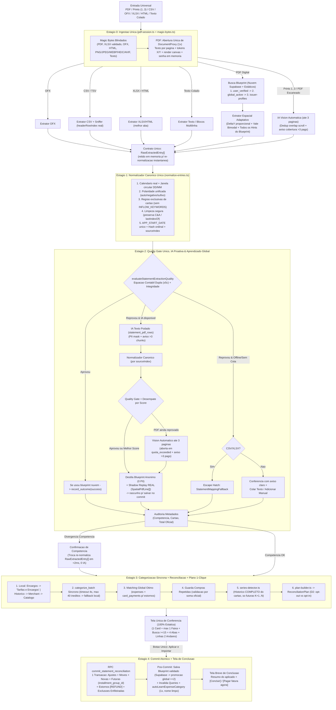

# Plano de Reestruturação Canônica — Motor Universal & Autoevolutivo de Importação de Faturas

> **Status:** 100% Fechado — Alinhado via `/grill-me` + Fase 0 de Refinamento Validada no Código Real (Pronto para Onda 1)
> **Classificação (`AGENTS.md §10.5`):** Fluxo Completo (Refatoração de Módulo Central + Novas Migrations/RPCs SQL + Ajuste Edge Function + Redesign UI/UX)
> **Fontes consolidadas:** `docs/diagnostics/AUDITORIA_COMPLETA_IMPORTACAO_FATURA.md` + Proposta Externa ("Coringa" + Zero-Fricção) + 12 Decisões Fechadas + 7 Refinamentos de Produto, Arquitetura, FinOps e UX validados contra `/src`, `/supabase/functions` e `/supabase/migrations`.
> **Objetivo:** Reconstruir a importação de faturas de cartão de crédito para operar com **precisão máxima em qualquer banco**, **inteligência invisível e autoevolutiva na nuvem (custo ~1 por banco, 0 PII)**, **persistência 100% atômica e reversível até o clique final**, **14 guardas anti-erro** e **UI/UX limpa, estática e 100% conforme `AGENTS.md` / `DESIGN_SYSTEM.md`**.

---

## 0. Decisões Fechadas de Produto e Engenharia (D1–D12)

| # | Eixo | Decisão Fechada |
|---|---|---|
| **D1** | **Poda de Complexidade & Inteligência Invisível** | Remover `StatementBlockClipperStep` (`block-clipper`), `line_curator`, `statement-mapping-cache.ts`, `visionEscalationOffer`, autoevolução em `localStorage` global (`statement-blueprint-store.ts`), código legado de conta corrente, botão `"Reanalisar com IA"` (com toda lógica de `reanalyzeNonce` / `deriveSaltedSha256Hex`) e selos técnicos de origem (`"Leitura assistida"`, `"Layout aprendido"`, `"Estruturado com IA"`, `"Leitura local"`). Manter `StatementMappingFallback` enxuto e corrigido (preservando `headerRowIndex` real) apenas como escape hatch para CSV/XLSX offline ou via ação discreta `"Ajustar colunas"`. |
| **D2** | **1-Clique Inteligente (`opt-out` vs `opt-in`)** | **Pré-marcados (`opt-out`):** novas compras válidas, parcelas futuras faltantes (`K+1..N`), estornos não conciliados e microajustes `<= R$ 0,05` com **match forte** (sinal textual/categoria/parcela positivo). **Aprovação explícita (`opt-in`):** mover despesa de mês vizinho (`crossCompetenceMatch`), ajustes `> R$ 0,05` ou matches fracos, e marcação de exclusão de duplicatas/itens `"Só no app"`. |
| **D3** | **Parcelas Passadas (`K >= 2`)** | Projetar **exclusivamente parcelas futuras (`K+1..N`)**, protegendo faturas passadas já fechadas/pagas contra alterações retroativas. Exibir apenas selo informativo quando não houver histórico anterior. |
| **D4** | **Categorização IA Síncrona (`categorize_batch`) + Reserva de Crédito** | Roda **antes de abrir a conferência** (1 lote de até 40 estabelecimentos inéditos priorizados por impacto financeiro, timeout curto de `4s` com degradação graciosa para local). **Reserva do último crédito:** se a pré-checagem de `user_ai_quotas` indicar cota diária restante `<= 1`, pula automaticamente o `categorize_batch` síncrono (preservando o crédito para extração). A tela de conferência abre **100% estática**, sem saltos nem race conditions em background. |
| **D5** | **Cascata 100% Automática & Vision Paralelo Cancelável** | Na entrada do arquivo, o pipeline executa de forma invisível e exaustiva até aprovação no Quality Gate: **Motor Local/Blueprint → (se reprovar) IA Texto podado → (se PDF ainda reprovar) Vision automático até 3 páginas em paralelo controlado (`AbortController` + botão `"Cancelar"` sempre responsivo)**, selecionando sempre o candidato de maior `qualityScore` contábil antes do `categorize_batch`. Pré-checagem de `user_ai_quotas` antes de disparar lote Vision multi-página; aborta imediatamente em `quota_exceeded` e exibe aviso claro de cobertura se `> 3` páginas Vision ou `> 3` chunks de texto. Se restar divergência após a cascata, exibe status objetivo (`Diferença de R$ X`) com edição/adição/remoção, `"Trocar arquivo"` e (só CSV/XLSX) `"Ajustar colunas"`. |
| **D6** | **Cotas FinOps Generosas & Reupload a Custo Zero (`batch_calls`)** | Elevar tetos com limite rígido de segurança: **Trial:** `10/dia · 30/mês`; **Pro / Lifetime / Admin:** `30/dia · 120/mês` (em `AI_QUOTA_LIMITS.batch_calls`). **Anti-loop `"colocar e tirar"`:** sem salt de reanálise e com `created_at: new Date().toISOString()` no `upsert` de `receipt_extractions_cache`, reenviar o mesmo arquivo acerta o cache LGPD `(user_id, sha256, mode)` com **0 débito de cota e 0 chamada ao LLM**. |
| **D7** | **Aprendizado Global Blindado no Supabase (0 PII / LGPD)** | Quando a IA resolve uma fatura inédita e passa no **Shadow Replay Real** (`SpatialPdfLine[]` reais com paginação e `fontSize`, `score >= 90` e `diffCents <= 5`): **(1) Nível Usuário (imediato):** salva em `public.statement_layout_blueprints` (`scope = 'user'`, sincronizado entre celular e desktop); **(2) Nível Global (todos os usuários):** promoção automática para `scope = 'global', status = 'active'` exige **`distinct_users_verified >= 2`** (pelo menos 2 usuários distintos com `exact_checksum_hit`, rastreados por hash anônimo irreversível — 0 PII). Se 1 único usuário validar 2 meses diferentes, o layout segue ativo em `scope = 'user'` para ele e entra em `scope = 'global', status = 'pending_review'` para aprovação em 1 clique no Painel Admin. **Self-healing por escopo:** suspende após 2 falhas consecutivas em `scope = 'user'`, mas exige falhas de **`>= 2` usuários distintos** em `scope = 'global'`. |
| **D8** | **Busca & Ordenação Adaptativa** | Barra compacta de busca (estabelecimento/valor) e ordenação (Data / Maior valor) exibida automaticamente quando a fatura possuir **`>= 15` lançamentos**, mantendo faturas curtas minimalistas. |
| **D9** | **Staging 100% Reversível (Zero Mutação Prematura)** | Exclusões marcadas nas abas `Atenção (Duplicatas no App)` e `Só no app` são **enfileiradas** (`p_delete_expense_ids`) com opção `"Desfazer"` até o clique final em `"Aplicar e importar"`. Se o usuário fechar/cancelar o modal, **nenhum dado foi alterado no banco**. |
| **D10** | **Modo Negócio (PF/PJ e Dedutibilidade)** | Em cartões mistos (`scope === "mixed"`) com Modo Negócio ativo: toggle compacto `PF/PJ` na linha + `"Tudo PJ / Tudo PF"` na toolbar. Dedutibilidade fiscal (`is_tax_deductible`) inferida automaticamente e editável dentro do `<StatementItemForm />` (para cartões PJ e Mistos). |
| **D11** | **Tela Breve de Conclusão Pós-Commit** | Após o commit atômico bem-sucedido, exibe um estado limpo de conclusão dentro do modal com resumo exato do que foi aplicado (novas, parcelas futuras, ajustes, estornos, exclusões) e dois botões no `ModalFooter`: **`Concluir`** e **`Pagar fatura agora`** (quando houver saldo em aberto, abrindo o `PaymentDialog` já existente). |
| **D12** | **Coerência Sistêmica (Encargos & Estornos Existentes)** | Encargos detectados (`tax`, `interest`, `fine`, `bank_fee`) são vinculados automaticamente à categoria reservada **`"Tarifas e Encargos"`** (`migration 0150`). Estornos (`refund`) são conciliados contra `useCardPayments(card.id)` existentes + idempotência via `statement_hash` em `card_payments`, evitando duplicação em reimportações. |

---

## 1. Matriz das 14 Guardas Invioláveis Anti-Erro

Nenhuma onda é dada como concluída sem testes automatizados cobrindo as guardas aplicáveis:

| ID | Guarda | Garantia Técnica |
|---|---|---|
| **G1** | **Calendário Real Estrito** | `normalizeDateToISO` valida `1 <= mês <= 12` e `1 <= dia <= diasDoMês(ano, mês)` (incluindo ano bissexto). Decimais como `12.50` nunca viram data. |
| **G2** | **Janela de Ano Ancorada no Ciclo (`DD/MM`)** | Datas sem ano resolvem ano usando o teto superior do ciclo da fatura (`cycleCeilingDate`: `closing_day - 1` de `competenceMonth` — ou fim de `competenceMonth` quando ausente/dia 1 — somado a `+5` dias de margem de processamento). Qualquer `DD/MM` que cair no futuro além de `cycleCeilingDate` recua para `compYear - 1` (cobrindo parcelas `12/12` de `15/12/2025` numa fatura `2026-11` e `15/05` numa fatura `2026-04`). A exceção `compMonth === 12 && txMonth === 1 -> compYear + 1` só vale quando `Date(compYear + 1, 1, txDay) <= cycleCeilingDate`. Trocar competência re-normaliza `RawExtractedEntry[]` em `< 2ms` (0 IA). |
| **G3** | **Domínio Exclusivo de Cartão** | Zero heurística de conta corrente (`INFLOW_KEYWORDS`). Compras como `"Depósito de Bebidas"` permanecem `purchase`; pagamentos usam `isPaymentOrSettlement` de forma idêntica em todos os formatos. |
| **G4** | **Preservação de Índice da IA** | `RawExtractedEntry` carrega `sourceIndex` explícito; nenhum filtro intermediário pode desalinhar `entryType` (`purchase`/`refund`/`payment`/`charge`) ou parcelas vindas da IA. |
| **G5** | **Limpeza Não-Destrutiva** | Remoção de `C/D` restrita ao sufixo de polaridade junto ao valor extraído (preserva `"C&A"`, `"D PEDRO"`, `"C V C"`). Valor removido da linha sempre via última ocorrência (`lastIndexOf`). |
| **G6** | **Fonte Única de Qualidade Contábil** | `evaluateStatementExtractionQuality` (Equação Contábil Dupla: `cycle_net` ou `statement_balance` `±5c`) alimenta simultaneamente a decisão de fallback IA e os números exibidos no Card de Diagnóstico. |
| **G7** | **Piso Anti-Falso-Match & Match Forte** | `diffCents === 0 && diffDays === 0` com `jaccard === 0` (sem encargo/parcela coincidente) tem teto **70 (`probable_match`)**, nunca `exact_match`. Matching 1:1 global por `score DESC`. Microajustes `<= R$ 0,05` pré-marcados exigem match forte (`score >= 65` + sinal textual/categoria/parcela positivo). |
| **G8** | **Compras Repetidas Validadas por Soma** | Ocorrências idênticas no mesmo dia permanecem `selected: true` (selo `2x no dia`) se, incluídas, fecharem o Total Oficial (`±5c`). Só viram suspeita de duplicata se estourarem a soma, sem total oficial ou em prints com risco de overlap. |
| **G9** | **Histórico Completo, `date` & Unicidade de Parcelas** | `detectInstallmentSeriesState` consulta **todas as competências do cartão** (`useCardExpenses`), impedindo duplicação de parcelas futuras já cadastradas e projetando apenas `K+1..N`. Toda despesa com `installments_total > 1` recebe `installment_group_id` válido (honrando o `CHECK ((installments_total > 1) = (installment_group_id IS NOT NULL))` em `public.expenses`), com índice único parcial `(user_id, card_id, installment_group_id, installment_number)` e `date` alinhada ao contrato mensal do app (detalhado no Estágio 4). |
| **G10** | **Conciliação de Estornos & Categoria Reservada** | Estornos da fatura são comparados contra `useCardPayments(card.id)` existentes (não duplicam em reimportação); encargos (`tax`/`interest`/`fine`/`bank_fee`) associam-se automaticamente à categoria reservada `"Tarifas e Encargos"`. |
| **G11** | **Commit Atômico, Exclusão Cirúrgica & Lotes `> 500`** | Nenhuma mutação no banco ocorre durante a revisão. Ao clicar `"Aplicar e importar"`, `commit_statement_reconciliation` executa ajustes, moves, novas compras, parcelas futuras, estornos pareados (`[REFUND]{id}`) e exclusões **estritamente cirúrgicas por `id`** (jamais cascadeando parcelas irmãs) em transação única (para faturas `> 500` itens, `chunking.ts` preserva séries íntegras, envia exclusões/ajustes/moves/estornos no Lote 1 e `use-statement-commit.ts` oferece `"Tentar novamente"` apenas dos lotes pendentes). |
| **G12** | **Seleção Escopada & Tela 100% Estática** | `"Marcar aba"` / `"Desmarcar aba"` opera apenas em `filteredItems`. `categorize_batch` é síncrono (`<= 4s`) antes de montar a tela — zero mutação em background após abertura. |
| **G13** | **Blueprint Global Blindado (0 PII + `>= 2` Usuários Distintos)** | Destilação rejeita qualquer dado pessoal/loja/valor/data (whitelist estrutural), valida via Shadow Replay sobre `SpatialPdfLine[]` reais e aplica todos os hints no parser espacial. Promoção automática para `global` exige **`distinct_users_verified >= 2`** (1 usuário × 2 meses permanece `user` + `pending_review` no Admin); self-healing exige 2 falhas consecutivas em `user` e falhas de **`>= 2` usuários distintos** em `global` (rastreamento via hash unidirecional anônimo, zero PII). |
| **G14** | **FinOps Generoso, Anti-Loop, Cancelável & Higiene SQL** | Reupload do mesmo arquivo acerta cache LGPD `(user_id, sha256, mode)` com `created_at` atualizado no `upsert` (0 cota, 0 LLM); pré-checagem de `user_ai_quotas` antes de Vision multi-página e reserva do último crédito (`<= 1` pula `categorize_batch`); Vision até 3 páginas em paralelo controlado com `AbortController` + `"Cancelar"`; timeouts alinhados (Edge `7s+9s=16s`, Cliente `22s` extração / `4s` categorize); zero escrita de `line_curator` em `receipt_extractions_cache`; `merchantLearning` grava apenas nome limpo uma única vez pós-commit. |

---

## 2. Arquitetura Técnica Completa — Funil Universal & Autoevolutivo (5 Estágios)



---

## 3. Especificação Detalhada dos Componentes Críticos

### 3.1. Estágio 0 — Ingestão Única (`pdf-session.ts` e `magic-bytes.ts`)
* **`magic-bytes.ts`:**
  * Suporta `%PDF-`, `PK\x03\x04` (**validando presença de `xl/workbook.xml` ou `xl/worksheets/`** para diferenciar `.xlsx` real de `.docx`/`.zip`), OLE2/BIFF8 (`.xls` legado com mensagem orientativa), PNG, JPEG, WEBP, **HEIC/HEIF/AVIF** (box `ftyp` bytes 4–7), OFX (`OFXHEADER`/`<OFX>`/`<STMTTRN>`) e HTML/SpreadsheetML.
* **`src/services/pdf-session.ts`:**
  * Abre `unpdf.getDocumentProxy` **uma única vez** por arquivo (suportando senha em memória sem persistir em disco/storage).
  * Expõe `getTotalPages()`, `extractPageTexts()`, `extractSpatialPages()` e `renderPageToBlob(pageNum)` sobre a mesma instância, com `dispose()` no fechamento do modal ou troca de arquivo.
* **Imagens unificadas:** 1..3 imagens seguem um único caminho `ingestVisionImages()`, com `detectStatementMetadata`, verificação de `competence_conflict` e aviso de cobertura quando `files.length > 3`.

### 3.2. Estágio 1 — Extratores "Burros" + Normalizador Canônico Único
* **Extrator Espacial Adaptativo (`extractors/spatial-pdf-extractor.ts`):**
  * **Tolerância vertical adaptativa:** `Math.abs(yA - yB) <= Math.max(2.5, Math.min(6, fontSize * 0.35))`.
  * **Bimodalidade por vale real de densidade X:** histograma horizontal entre 30% e 70% de `pageWidth` (buckets de 10pt) encontrando o maior corredor vertical vazio (`gutterX >= 14pt`) com `>= 2` pares `Data + Valor` independentes em cada lado.
  * **Honra 100% dos hints do Blueprint:** `startMarkers`, `pauseMarkers`, `boletoMarkers`, `totalLabels`, `ignoredTotalLabels`, `strictStartZone`, `columnMode`, `polarity`, `dateFormatHint`.
  * **Limpeza segura na extração (G5):** isola valor via `lastIndexOf(amountExtracted.fullMatch)` e remove apenas o sufixo `C`/`D` vinculado ao valor (preserva `"C&A"`, `"D PEDRO"`, `"C V C"`).
* **Normalizador Canônico Único (`normalize-entries.ts`):**
  * **Calendário real (G1):** função pura `isValidCalendarDate(year, month, day)` bloqueando `31/02`, `45/20`, `12/50`.
  * **Janela circular `DD/MM` (G2):** resolve ano comparando `txMonth` com `compMonth` (`txMonth - compMonth >= 2` → `compYear - 1`; `compMonth === 12 && txMonth === 1` → `compYear + 1`).
  * **Polaridade unificada:** quando `signHint === "auto"`, detecta faturas com compras negativas (`-120,00`) inclusive em PDFs digitais sem blueprint.
  * **Regras exclusivas de cartão (G3):** `isPaymentOrSettlement(text, isCredit)` sem `isLikelyIncomeDescription` / `INFLOW_KEYWORDS`.
  * **Preservação de `sourceIndex` (G4):** nunca alinha metadados da IA pelo índice do array filtrado.
  * **Constante única:** `APP_START_DATE` importada de `@/lib/constants`.
  * **Separação limpa:** `merchantCleanRaw` (sem data/valor) armazenado para `merchantLearning`, distinto de `rawLine`.

### 3.3. Estágio 2 — Quality Gate Único, IA Proativa e Aprendizado Global na Nuvem

#### A. Cotas FinOps e Edge Function (`ai-schemas.ts` + `ai-financial-assistant/index.ts`)
* **Novos tetos em `AI_QUOTA_LIMITS` (D6):**
  ```ts
  trial: {
    receipt_calls: { month: 15, day: 5 },
    batch_calls:   { month: 15, day: 5 }, // antes: month 5, day 2
  },
  pro: {
    receipt_calls: { month: 100, day: 15 },
    batch_calls:   { month: 60,  day: 15 }, // antes: month 20, day 5
  },
  ```
* **Cascata e Timeouts Alinhados:**
  * Edge Function: 2 modelos (`gemini-3.5-flash-lite` 7s → `gemini-3.5-flash` 9s = teto 16s).
  * Cliente: `22s` para `statement_pdf_rows` (texto/Vision) e `4s` para `categorize_batch` síncrono.
* **Correção de Cache LGPD:** `upsert` em `receipt_extractions_cache` sempre envia `created_at: new Date().toISOString()`, eliminando cache miss permanente após TTL.
* **Vision Automático até 3 páginas (D5):**
  * Se PDF digital reprova no Quality Gate após IA Texto (e sem `quota_exceeded`/`offline`), executa Vision automaticamente nas até 3 páginas candidatas via `pdfSession.renderPageToBlob`.
  * Reanálise manual (`"Reanalisar com IA"`): se a extração atual foi local, executa IA Texto → Vision; se já foi IA Texto em PDF, pula direto para Vision com salt de bypass de cache.
  * Aviso explícito sempre que `candidatePages.length > 3` (PDF) ou `images.length > 3` ou `textChunks.length > 3`.

#### B. Aprendizado Global de Layouts no Supabase (`statement_layout_blueprints` — D7 & G13)

Nova tabela em `supabase/migrations/20260101000156_statement_layout_blueprints.sql`:

```sql
CREATE TABLE public.statement_layout_blueprints (
  id uuid PRIMARY KEY DEFAULT gen_random_uuid(),
  fingerprint text NOT NULL,                       -- ex.: "pdf:sicredi:a1b2c3d4"
  issuer_key text NOT NULL,                        -- ex.: "sicredi"
  issuer_name text NOT NULL,                       -- ex.: "Sicredi"
  file_kind text NOT NULL CHECK (file_kind IN ('pdf_text', 'text')),
  scope text NOT NULL CHECK (scope IN ('user', 'global')),
  owner_user_id uuid REFERENCES public.profiles (id) ON DELETE CASCADE,
  status text NOT NULL DEFAULT 'active'
    CHECK (status IN ('active', 'suspended', 'pending_review')),
  rules_json jsonb NOT NULL,                       -- startMarkers, pauseMarkers, boletoMarkers, totalLabels, ignoredTotalLabels, columnMode, strictStartZone, polarity, dateFormatHint
  exact_checksum_hits integer NOT NULL DEFAULT 1,
  distinct_users_verified integer NOT NULL DEFAULT 1,
  consecutive_failures integer NOT NULL DEFAULT 0,
  promoted_at timestamptz,
  created_at timestamptz NOT NULL DEFAULT now(),
  updated_at timestamptz NOT NULL DEFAULT now(),
  UNIQUE NULLS NOT DISTINCT (scope, owner_user_id, fingerprint)
);
```

**Regras de Segurança, LGPD e Promoção Automática:**
1. **Filtro Estrito Anti-PII (Cliente + SQL):**
   * Somente strings curtas estruturais (2–6 tokens alfabéticos sem dígitos, sem CPF/CNPJ, sem nomes próprios fora de vocabulário bancário, sem valores monetários, sem datas/meses).
   * Validação dupla via Zod no cliente **e** validação de tamanho/formato no RPC `upsert_statement_layout_blueprint` (nenhum dado financeiro ou pessoal jamais entra na tabela).
2. **Shadow Replay REAL (obrigatório antes de salvar):**
   * Roda `extractTransactionsFromSpatialLines(realSpatialLines, { blueprintHints })` usando os **mesmos `SpatialPdfLine[]` originais com `pageNumber` e `fontSize` reais** extraídos pelo `PdfDocumentSession`.
   * Só aprova se `extracted.transactions.length > 0 && qualityGate.score >= 90 && qualityGate.diffCents <= 5`.
3. **Resolução por Precedência (Online First):**
   * Ao abrir um PDF digital, o cliente busca em `statement_layout_blueprints` (via query TanStack cacheada `staleTime: 10min`) com precedência:
     1. `scope = 'user' AND owner_user_id = auth.uid() AND status = 'active'` (fingerprint exato → fallback por `issuer_key`)
     2. `scope = 'global' AND status = 'active'` (fingerprint exato → fallback por `issuer_key`)
     3. Catálogo estático curado em código (`issuer-profiles.ts`)
4. **Promoção Automática para Global + Self-Healing (RPC `record_statement_blueprint_outcome`):**
   * **Sucesso (`exact_checksum_hit = true`):** incrementa `exact_checksum_hits` e reseta `consecutive_failures = 0`. Se o blueprint for `scope = 'user'` e atingir **`>= 2` validações exatas (`±R$ 0,05`)** (em importações distintas — ex.: 2 meses diferentes do mesmo banco, ou 2 usuários distintos com o mesmo `fingerprint`), o RPC promove uma cópia limpa para `scope = 'global', owner_user_id = NULL, status = 'active'` (sem vincular nenhum `user_id`!).
   * **Aprovação / Revisão Admin:** o painel Admin também pode listar blueprints, promover manualmente (`status = 'active', scope = 'global'`) ou suspender um layout problemático.
   * **Self-Healing:** 2 falhas consecutivas (`consecutive_failures >= 2`) mudam `status = 'suspended'`, fazendo o pipeline cair automaticamente para IA e reaprender o novo layout do banco caso o emissor tenha mudado o PDF.
5. **RLS Estrito:**
   * `SELECT`: `authenticated` pode ler linhas onde `(scope = 'global' AND status = 'active') OR (scope = 'user' AND owner_user_id = auth.uid())`.
   * `INSERT`/`UPDATE`/`DELETE`: bloqueado diretamente para `authenticated`; toda escrita passa exclusivamente pelos RPCs `SECURITY DEFINER` (`upsert_statement_layout_blueprint`, `record_statement_blueprint_outcome`, e ações de admin).

### 3.4. Estágio 3 — Categorização Síncrona, Reconciliação Ótima e `ReconciliationPlan`

1. **Encargos → Categoria Reservada (D12):**
   * Antes de qualquer heurística de histórico/IA, se `tx.inferredChargeKind` ∈ `('tax', 'interest', 'fine', 'bank_fee')`, resolve diretamente para a categoria reservada `"Tarifas e Encargos"` do usuário (quando presente em `categories`).
2. **Categorização Síncrona (D4):**
   * Camadas 1–3 locais (`History → merchantLearning → Catálogo Canônico`) rodam em `< 2ms`.
   * Para estabelecimentos ainda desconhecidos, envia **1 lote de até 40 descrições** (priorizadas por `amountCents` somado) para `categorizeDescriptionsBatchWithAi` com **`timeout = 4.000ms`**.
   * Aplica `friendlyName` (preservando `statementHash` original) e `categoryId` (whitelist) **antes** do matching e da abertura da tela. Se der timeout ou cota, prossegue imediatamente com a categoria local.
3. **Matching Global Ótimo (G7) + Estornos contra `card_payments` (G10):**
   * Despesas: ordena globalmente todos os pares `(tx, existingExpense)` com `score >= 40` por `score DESC` e casa 1:1. Piso de segurança: `scoreText === 0 && bonusCharge === 0 && bonusInstallment <= 0` → teto `70` (`probable_match`).
   * Estornos (`tx.isRefund === true`): compara contra `existingRefunds` de `useCardPayments(card.id)` na competência ativa (mesmo valor em centavos + data `±3` dias ou mesmo `statement_hash`) → se já existir, marca como `exact_match` (`Conciliado`, desmarcado); se inédito, entra pré-marcado para o commit atômico (D2).
4. **Guarda de Compras Repetidas (G8):**
   * Se `qualityGate.effectiveTargetCents !== null` e `qualityGate.diffCents <= 5`, ocorrências idênticas no mesmo dia são confirmadas como legítimas (`repeatedSameDayConfirmed: true`, `selected: true`).
5. **Séries Parceladas sobre Histórico Completo (D3 & G9):**
   * `detectInstallmentSeriesState` recebe todas as despesas de `useCardExpenses(card.id)` sem filtro de competência. Projeta exclusivamente `K+1..N` faltantes.
6. **`ReconciliationPlan` (`plan-builder.ts` — D2 & D9):**
   * **Pré-marcados (`opt-out`):**
     * `newExpensesToCreate`
     * `futureInstallmentsToProject` (`K+1..N` faltantes)
     * `refundsToRegister` (estornos inéditos)
     * `microAdjustmentsToApply` (`diffCents <= 5 && score >= 65 && hasSemanticSignal`)
   * **Aprovação explícita (`opt-in`, reversível com `"Desfazer"`):**
     * `competenceMovesToApply` (`crossCompetenceMatch`)
     * `manualLinkAdjustments` (`probable_match` fora do critério de microajuste forte)
     * `expenseIdsToDelete` (duplicatas no app ou itens `"Só no app"` marcados para excluir — D9)

### 3.5. Estágio 4 — RPC Transacional Único (`commit_statement_reconciliation`)

Migration `supabase/migrations/20260101000155_commit_statement_reconciliation_rpc.sql`:
* Adiciona coluna opcional `statement_hash text` em `public.card_payments` + índice único parcial `idx_card_payments_user_card_statement_hash ON card_payments (user_id, card_id, statement_hash) WHERE statement_hash IS NOT NULL` (garantindo idempotência absoluta de estornos importados!).
* Cria `public.commit_statement_reconciliation`:
  ```sql
  CREATE OR REPLACE FUNCTION public.commit_statement_reconciliation(
    p_card_id uuid,
    p_competence_month text,
    p_expenses jsonb DEFAULT '[]'::jsonb,
    p_link_adjustments jsonb DEFAULT '[]'::jsonb,
    p_competence_moves jsonb DEFAULT '[]'::jsonb,
    p_refunds jsonb DEFAULT '[]'::jsonb,
    p_delete_expense_ids uuid[] DEFAULT '{}'::uuid[]
  ) RETURNS jsonb
  LANGUAGE plpgsql
  SECURITY DEFINER
  SET search_path = public, pg_temp
  ```
* **Execução em 1 única transação PostgreSQL:**
  1. Valida `auth.uid()`, `is_current_user_active()`, `can_current_user_write_module('cards')`, posse de `credit_cards` e `p_competence_month ~ '^\d{4}-\d{2}$'`.
  2. **Bloco A (`p_delete_expense_ids`):** valida posse `(user_id, card_id)` e remove apenas despesas pertencentes ao usuário e cartão (se houver vínculo de racha/auditoria, aplica a mesma regra segura de exclusão única).
  3. **Bloco B (`p_link_adjustments`):** valida posse e `new_value > 0`, atualiza `value`, `base_amount` (proporcional a `report_weight`) e `statement_hash`.
  4. **Bloco C (`p_competence_moves`):** valida posse e `target_competence ~ '^\d{4}-\d{2}$'`, atualiza `bill_competence` e `statement_hash`.
  5. **Bloco D (`p_expenses` — novas + parcelas futuras):** valida `date >= '2026-01-01'`, `value > 0`, `installments_total BETWEEN 1 AND 60`, `installment_number BETWEEN 1 AND installments_total`, `report_weight BETWEEN 0 AND 1`, `charge_kind` whitelist, `scope` herdado do cartão, `bill_competence` próprio, `installment_group_id` compartilhado entre `K/N` e `K+1..N`, e `ON CONFLICT (user_id, card_id, statement_hash) WHERE statement_hash IS NOT NULL DO NOTHING` (com `statement_hash` determinístico também para parcelas futuras).
  6. **Bloco E (`p_refunds`):** para cada estorno (`amount > 0`, `date >= '2026-01-01'`), insere em `card_payments` com `ON CONFLICT ... DO NOTHING` via `statement_hash` e, quando inserido, cria a renda automática somente-leitura na categoria reservada `"Estorno"` com marcador `[REFUND]{payment_id}` (paridade 100% com `create_refund` de `ESPECIFICACAO_TECNICA.md`).
  7. Grava 1 evento consolidado em `audit_events` (`action = 'commit_statement_reconciliation'`) e retorna contagens detalhadas (`inserted_count`, `projected_count`, `skipped_count`, `adjusted_count`, `moved_count`, `refunds_count`, `deleted_count`).
* **Pós-commit no cliente:**
  * Invalida `cardExpensesKey`, `cardPaymentsKey`, `expensesKey`, `incomesKey` (se `refunds_count > 0`) e `budgetsKey`.
  * Executa `autoLearnExpenseCategory` **1 única vez** por estabelecimento distinto importado usando `cleanDescription` + `merchantCleanRaw` (sem data/valor).
  * Se houver rascunho de blueprint aprovado no Shadow Replay real, persiste na nuvem via `upsert_statement_layout_blueprint` (não-bloqueante).
  * Transita para a **Tela Breve de Conclusão (D11)**.

---

## 4. Estrutura de Diretórios Alvo (100% Aderente ao `PROJECT_STRUCTURE.md`)

```text
src/domain/reconciliation/
├── index.ts                          # Barrel público
├── contracts.ts                      # RawExtractedEntry, StatementTransaction, ReconciliationItem, ReconciliationPlan
├── extractors/
│   ├── index.ts
│   ├── magic-bytes.ts                # Magic bytes (PDF, XLSX validado, OFX, HTML, PNG/JPEG/WEBP/HEIC/AVIF)
│   ├── issuer-profiles.ts            # Perfis estáticos curados (13 emissores BR)
│   ├── spatial-pdf-extractor.ts      # Motor espacial adaptativo (ΔY proporcional, vale bimodal real, 100% hints)
│   ├── csv-extractor.ts              # RFC-4180 + sep= + UTF-8/Latin-1
│   ├── ofx-extractor.ts              # SGML/XML + metadados OFX
│   ├── spreadsheet-extractor.ts      # XLSX nativo (ZIP/XML), HTML, SpreadsheetML
│   ├── text-extractor.ts             # Blocos multilinhas + delimitadores + texto livre seguro
│   └── type-sniffer.ts               # Sniff colunas + confiança + calendário real + parseAmountToCents
├── blueprints/
│   ├── index.ts
│   ├── types.ts                      # Schema Zod estrito 0-PII + conversão p/ SpatialBlueprintHints
│   ├── fingerprint.ts                # Fingerprint estrutural anônimo (<kind>:<issuerKey>:<headerHash>)
│   ├── distiller.ts                  # Destilador anti-PII + Shadow Replay REAL (sobre SpatialPdfLine[])
│   └── matcher.ts                    # Resolução: user_verified -> global_active -> issuer-profiles
├── normalize-entries.ts              # NORMALIZADOR CANÔNICO ÚNICO (G1..G5)
├── clean.ts                          # Limpeza segura + classificação exclusiva de cartão (sem conta corrente)
├── hash.ts                           # Hash ordinal determinístico
├── installments.ts                   # Extração de parcelas blindada contra datas
├── statement-preprocessor.ts         # Extração de totais do resumo (usando blueprint labels) + poda/chunking IA
├── statement-metadata.ts             # Detecção de competência, vencimento, final do cartão e banco
├── quality-gate.ts                   # QUALITY GATE ÚNICO (Equação Contábil Dupla)
├── scorer.ts                         # Matching Global Ótimo (expenses + refunds) + piso textual + guarda repetidas
├── series-detector.ts                # Análise 4 estados sobre histórico completo do cartão + projeção futura
├── app-duplicates.ts                 # Detecção de duplicatas já cadastradas no app
├── plan-builder.ts                   # Monta ReconciliationPlan (D2 + D9)
└── chunking.ts                       # Particionamento preservando séries íntegras

src/data/
├── repositories/statement-blueprints.ts   # Leitura/escrita de statement_layout_blueprints (Supabase)
└── rpc/transactions.ts                    # Wrapper tipado commitStatementReconciliation

src/state/
├── queries/use-statement-blueprints.ts    # Query cacheada (staleTime 10min) de blueprints user + global
└── mutations/use-statement-mutations.ts   # useCommitStatementReconciliation + useSaveStatementBlueprint

src/services/
├── pdf-session.ts                    # Abertura única de DocumentProxy (unpdf) + render canvas + senha
└── ai-assistant.ts                   # Cliente HTTP fino (22s extração, 4s categorize_batch síncrono)

src/features/cards/components/statement-import/
├── index.ts                          # Exporta StatementImportDialog
├── statement-import-pipeline.ts      # Orquestra Estágios 0 -> 1 -> 2 -> Categorização Síncrona
├── use-statement-ingestion.ts        # Upload, senha PDF, troca competência (<2ms), reanálise inteligente
├── use-statement-reconciliation.ts   # Estado, busca/ordenação (>=15), seleção por aba, staging reversível, isDirty
├── use-statement-commit.ts           # Commit atômico, persistência de blueprint nuvem, aprendizado limpo
├── statement-import-dialog.tsx       # Shell Modal (`size="2xl"`), Stepper 2 passos, ModalFooter único
├── statement-upload-step.tsx         # Passo 1: Dropzone universal + Colar texto + Senha PDF + Status progressivo
├── statement-competence-conflict.tsx # Confirmação limpa de competência (ícone Nível 1)
├── statement-mapping-fallback.tsx    # Escape hatch CSV/XLSX sem IA (preserva headerRowIndex real)
├── statement-reconcile-step.tsx      # Passo 2: Card Diagnóstico + max 1 Faixa + Busca (>=15) + 4 Abas + Lista
├── statement-summary-header.tsx      # Card Único (3 KPIs + 1 Badge contábil + Resumo do Plano)
├── statement-transaction-row.tsx     # Linha previsível em 2 andares (React.memo real)
├── statement-app-rows.tsx            # StatementAppOnlyRow + StatementAppDuplicateRow (com enfileirar + Desfazer)
├── statement-item-form.tsx           # Formulário unificado (Editar + Adicionar) com <FormField /> (16px mobile)
├── statement-success-step.tsx        # Tela breve de conclusão (resumo + Concluir / Pagar fatura agora)
└── category-pill.tsx                 # Seletor rápido de categoria (Input >= 16px no mobile)

supabase/
├── functions/ai-financial-assistant/index.ts   # Cascata 2 modelos (7s+9s), created_at no upsert cache
├── functions/_shared/ai-schemas.ts             # AI_QUOTA_LIMITS ampliados (Trial 5/15 | Pro 15/60)
└── migrations/
    ├── 20260101000155_commit_statement_reconciliation_rpc.sql
    └── 20260101000156_statement_layout_blueprints.sql
```

*(Atualizar `docs/architecture/PROJECT_STRUCTURE.md` e `docs/roadmap/ROADMAP.md` junto na conclusão — `AGENTS.md §8`.)*

---

## 5. Especificação Completa de UI/UX (100% Aderente ao `AGENTS.md §4`)

### 5.1. Fluxo Visual em 2 Passos + Conclusão
1. **Passo 1 — Enviar:** Dropzone único (PDF, print 1–3, CSV, OFX, Excel) + aba `"Colar texto"`. Feedback progressivo calmo (`"Lendo fatura..."` → `"Refinando leitura com IA..."` → `"Organizando categorias..."`). Senha de PDF e conflito de competência aparecem inline sem modais aninhados e sem `autoFocus`.
2. **Passo 2 — Conferir e importar (Tela 100% Estática):**
   * **Card de Diagnóstico Único (`StatementSummaryHeader`):** `rounded-2xl border border-border/80 bg-surface p-3 sm:p-4 shadow-xs`.
     * Topo: título `Conferência da fatura` + badge contábil único (`Soma conferida` verde ou `Diferença de R$ X` âmbar usando `<MoneyText />` / `formatCurrency`, lido diretamente de `qualityGate`) + badge discreto opcional (`Leitura assistida` / `Layout aprendido`). Ação secundária discreta `"Reanalisar com IA"` (apenas se divergência ou baixa qualidade e IA disponível) e `"Ajustar colunas"` (apenas CSV/XLSX).
     * Grid de **3 KPIs** (`grid-cols-2 sm:grid-cols-3 gap-2.5`): `Fatura lida`, `A importar (N)`, `Total oficial` (ou `Já no app` quando sem total oficial).
     * Linha de resumo do plano em linguagem humana: *"Pronto para importar 12 compras, projetar 6 parcelas futuras, registrar 1 estorno e ajustar 1 valor."*
   * **No máximo 1 Faixa de Atenção (Slot Único Prioritário):** `Erro bloqueante` > `Aviso de cobertura/cota/offline` > `Divergência de cartão` > `Prompt de propagação de categoria`. Zero banners duplicados de duplicatas ou "Só no app".
   * **Busca & Ordenação Adaptativa (D8 — apenas se `items.length >= 15`):** `<Input />` com `text-base sm:text-sm` (busca por estabelecimento/valor) + `<Select />` compacto (`Ordem da fatura` | `Mais recentes` | `Maior valor`).
   * **4 Abas (`<Tabs fullWidth={false} />`):**
     1. `A importar (N)` — novos lançamentos prontos (aba padrão).
     2. `Atenção (N)` — estornos pré-marcados, ajustes de centavos (microajustes `<= R$ 0,05` pré-marcados + demais opt-in), compras em mês vizinho (`crossCompetenceMatch` com ação em lote no topo desta aba) e duplicatas (arquivo/app).
     3. `Conciliados (N)` — despesas e estornos já presentes no app + pagamentos ignorados.
     4. `Só no app (N)` — despesas no app ausentes no extrato (só aparece se `> 0`).
   * **Toolbar limpa:** `"Adicionar"`, `"Tudo PJ / Tudo PF"` (apenas cartão misto + Modo Negócio) e `"Marcar aba / Desmarcar aba"` (escopo estrito à aba ativa).
   * **Linha de Transação em 2 Andares (`StatementTransactionRow`):**
     * *Andar 1:* `<Checkbox />` + nome em `line-clamp-2 break-words` (zero `truncate` cego) + `<MoneyText />` à direita.
     * *Andar 2:* data `font-mono text-[11px]` + **máx. 1 `<Badge size="xs" />`** + `<CategoryPill />` + (se cartão misto) toggle `PF/PJ` + ícones Editar e Remover (`size-8 !w-8 !min-w-8 p-0`).
     * *Faixa contextual opcional (máx. 1 linha):* checkbox de projeção `K+1..N`, checkbox de ajuste de valor, checkbox de estorno ou checkbox de mover competência.
     * *Em `StatementAppOnlyRow` e `StatementAppDuplicateRow`:* botão `"Marcar para excluir"` alterna o item para estado riscado com botão `"Desfazer"` (D9).
   * **`ModalFooter` único:** `Voltar` (aciona `DiscardConfirmDialog` nativo do `<Modal>` se `isDirty`) e **`Aplicar e importar (N ações)`** (com `sensoryIntent={false}`).
3. **Tela Breve de Conclusão (`StatementSuccessStep` — D11):**
   * Ícone editorial limpo (`CheckCircle2`), título `"Fatura conciliada com sucesso"`, lista compacta dos números aplicados (novas, parcelas futuras, ajustes, estornos, exclusões) e `ModalFooter` simétrico: **`Concluir`** (outline) + **`Pagar fatura agora`** (primary, quando houver saldo aberto na competência, fechando o modal e abrindo o `PaymentDialog`).

### 5.2. Checklist Obrigatório de Conformidade (`AGENTS.md §4`)
- [ ] **Regras 4 & 15:** `<StatementItemForm />` unificado usando `<FormField />` (zero `<label>` cru).
- [ ] **Regras 7 & 8:** Zero controles HTML nativos; zero emojis/Unicode decorativos.
- [ ] **Regra 11:** Zero `.toLocaleString("pt-BR", ...)` em UI; todo valor usa `<MoneyText />` / `formatCurrency`.
- [ ] **Regra 13:** Ícones sóbrios Nível 1 (`size-4`) nos cards e alertas internos do modal; zero caixas decorativas `size-9/size-10`.
- [ ] **Regra 14 & §5:** Todo estado vazio usa `<EmptyState tone="default" />`.
- [ ] **Regra 16:** Superfícies e divisores padronizados em `border-border/80 bg-surface shadow-xs` (zero `border-border/60`).
- [ ] **Regra 17:** Zero duplos disparos sensoriais (`sensoryIntent={false}` em botões com feedback de resultado no handler).
- [ ] **Regra 18:** `ModalFooter` simétrico em todos os passos + `DiscardConfirmDialog` nativo do `<Modal>`.
- [ ] **Regra 20:** Zero `autoFocus` e todos os `<Input />` (busca, `CategoryPill`, `StatementItemForm`) com `text-base sm:text-sm` (16px mobile).
- [ ] **Regras 23 & 24:** Zero `truncate` cego em títulos; escala responsiva de KPIs.

---

## 6. Plano de Implementação em 4 Ondas e Matriz de Validação

### Onda 1 — Blindagem Crítica de Dados, SQL e Cotas (P0)
1. **Migrations SQL:**
   * `20260101000155_commit_statement_reconciliation_rpc.sql`: `card_payments.statement_hash` + índice único + RPC transacional `commit_statement_reconciliation` (`p_expenses`, `p_link_adjustments`, `p_competence_moves`, `p_refunds`, `p_delete_expense_ids`).
   * `20260101000156_statement_layout_blueprints.sql`: tabela `statement_layout_blueprints`, RLS estrito, RPCs `upsert_statement_layout_blueprint` e `record_statement_blueprint_outcome` (promoção global `>= 2` validações exatas + self-healing `>= 2` falhas).
2. **Edge Function & Schemas:**
   * Ampliar `AI_QUOTA_LIMITS.batch_calls` (Trial `5/15`, Pro `15/60`).
   * Corrigir `created_at` no `upsert` de `receipt_extractions_cache`.
   * Alinhar cascata de modelos (`7s + 9s = 16s`) e timeouts cliente (`22s` extração, `4s` categorize síncrono).
3. **Correções Críticas de Domínio:**
   * Calendário real + janela circular de ano (G1, G2).
   * Remover `isLikelyIncomeDescription` / código legado de conta corrente (G3).
   * Preservar `sourceIndex` na IA (G4).
   * Matching Global Ótimo + piso anti-falso-match + match forte `<= R$ 0,05` + conciliação de estornos contra `card_payments` (G7, G10).
   * Guarda de compras repetidas por soma (G8).
   * Histórico completo do cartão em `series-detector.ts` + projeção apenas de futuras `K+1..N` (D3, G9).
   * Encargos vinculados automaticamente à categoria reservada `"Tarifas e Encargos"` (D12).

### Onda 2 — Funil Universal "Coringa", Aprendizado Global e Poda
1. Criar `contracts.ts` (`RawExtractedEntry`), `normalize-entries.ts` e `plan-builder.ts` (regras D2 + D9).
2. Refatorar extratores (`spatial-pdf-extractor.ts` adaptativo honrando 100% dos hints + `issuer-profiles.ts`, `csv-extractor.ts`, `ofx-extractor.ts`, `spreadsheet-extractor.ts`, `text-extractor.ts`, `magic-bytes.ts` com HEIC/AVIF + validação ZIP).
3. Implementar `blueprints/distiller.ts` (anti-PII estrito + Shadow Replay REAL sobre `SpatialPdfLine[]`), `data/repositories/statement-blueprints.ts` e `state/queries/use-statement-blueprints.ts`.
4. Consolidar `quality-gate.ts` como único avaliador (removendo `evaluateDeterministicStatementQuality`).
5. Remover `line_curator` do cliente, `block-clipper`, `statement-blueprint-store.ts`, `statement-mapping-cache.ts` e `visionEscalationOffer`.
6. Tornar `categorize_batch` síncrono (`4s`, máx. 40 itens) antes de abrir a conferência (D4) e higienizar `merchantLearning`.

### Onda 3 — Decomposição Modular e Performance
1. Criar `src/services/pdf-session.ts` (abertura única de `DocumentProxy`).
2. Decompor `use-statement-import.ts` e `statement-import-helpers.ts` em `statement-import-pipeline.ts`, `use-statement-ingestion.ts`, `use-statement-reconciliation.ts` e `use-statement-commit.ts` (`<= 350 LOC` cada).
3. Unificar fluxo de 1..3 imagens + Vision automático até 3 páginas + reanálise inteligente por estágio + aviso explícito `> 3` páginas / `> 3` chunks (D5).
4. Implementar re-normalização instantânea de `RawExtractedEntry[]` em `handleSwitchCompetence` (`< 2ms`, 0 IA).
5. Garantir `isDirty` completo (incluindo exclusões enfileiradas) + recálculo de `occurrenceIndex`, `statementHash` e `seriesAnalysis` em edição/adição manual.
6. Estabilizar `React.memo` com `useCallback` + renderização incremental/windowing para faturas `> 80` itens.

### Onda 4 — Redesign UI/UX Zero-Fricção, Tela de Conclusão e Documentação
1. Construir os componentes padronizados em `src/features/cards/components/statement-import/` (2 passos + `StatementSummaryHeader` + slot único prioritário + busca/ordenação `>= 15` itens + 4 abas + linhas em 2 andares + `<StatementItemForm />` + `StatementMappingFallback` + `StatementSuccessStep` com `"Pagar fatura agora"` conectado ao `PaymentDialog`).
2. Validar desktop (1280px+) e mobile (375px) nos temas claro e escuro + zero violações do checklist `AGENTS.md §4`.
3. Atualizar `docs/architecture/PROJECT_STRUCTURE.md` e `docs/roadmap/ROADMAP.md` (`AGENTS.md §8`).
4. Rodar `npm run verify:full` e bump `MINOR` no `package.json` ao finalizar a feature.

---

### Matriz Obrigatória de Testes de Regressão

| Dimensão | Cenários Obrigatórios |
|---|---|
| **Multi-Banco (Local)** | PDFs digitais 1 e 2 colunas (incluindo assimétricos 55/45): Nubank (`DD MMM`), Itaú, Bradesco, Santander, Inter, C6, BTG, BB, Caixa, Nomad, XP. CSV com preâmbulo de 6 linhas. OFX SGML/XML. XLSX multi-aba e HTML disfarçado de `.xls`. |
| **Guardas de Parsing (G1–G5)** | `"12.50"` não vira data; `"31/02/2026"` rejeitada; virada Dez/Jan (`28/12` em fatura `2027-01` → `2026-12-28`, troca de competência re-normalizando sem IA); `"DEPOSITO DE BEBIDAS"` permanece compra; `"C&A"` e `"D PEDRO"` intactos; PDF negativo (`-120,00`); IA com linha descartada preservando `entryType` via `sourceIndex`. |
| **Reconciliação, Parcelas & Encargos (G6–G10, D2–D3, D12)** | Farmácia R$ 50 vs Posto R$ 50 no mesmo dia → `probable_match` (`<= 70`); microajuste `<= R$ 0,05` forte pré-marcado vs fraco opt-in; estorno pré-marcado e reconciliado contra `card_payments` na reimportação; IOF/Juros/Anuidade auto-vinculados a `"Tarifas e Encargos"`; 2 corridas Uber fechando total oficial → ambas `selected: true`; fatura com rotativo → `Soma conferida`; `2/10` com `3..10` no banco → `state_4_already_projected`; `3/10` órfã projeta apenas `4..10`. |
| **IA, Aprendizado Global & FinOps (G13–G14, D4–D7)** | `categorize_batch` síncrono (`< 4s` vs timeout degradando p/ local); Vision automático até 3 páginas abortando em `quota_exceeded`; aviso explícito `> 3` páginas ou `> 3` chunks; destilação rejeitando PII (CPF/nome/loja/valor); Shadow Replay REAL sobre `SpatialPdfLine[]`; promoção para `global_active` na 2ª validação exata; self-healing suspendendo após 2 falhas; `upsert` cache atualizando `created_at`. |
| **Transação SQL & UI (G11–G12, D8–D11)** | Rollback total de `commit_statement_reconciliation` em erro de 1 item; idempotência de novas, futuras e estornos `[REFUND]{id}`; exclusão enfileirada + `"Desfazer"` não toca o banco ao cancelar modal; `"Marcar aba"` não altera outras abas; busca/ordenação visível apenas se `>= 15` itens; tela de conclusão abrindo `PaymentDialog` via `"Pagar fatura agora"`; `npm run verify:full` 100% verde. |
