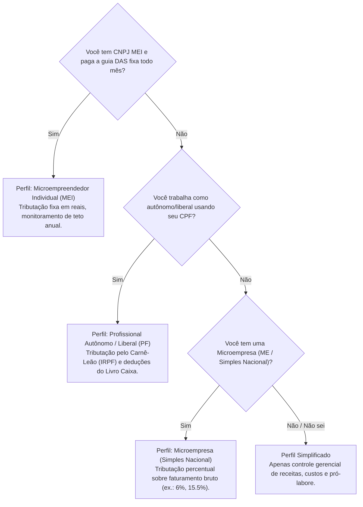
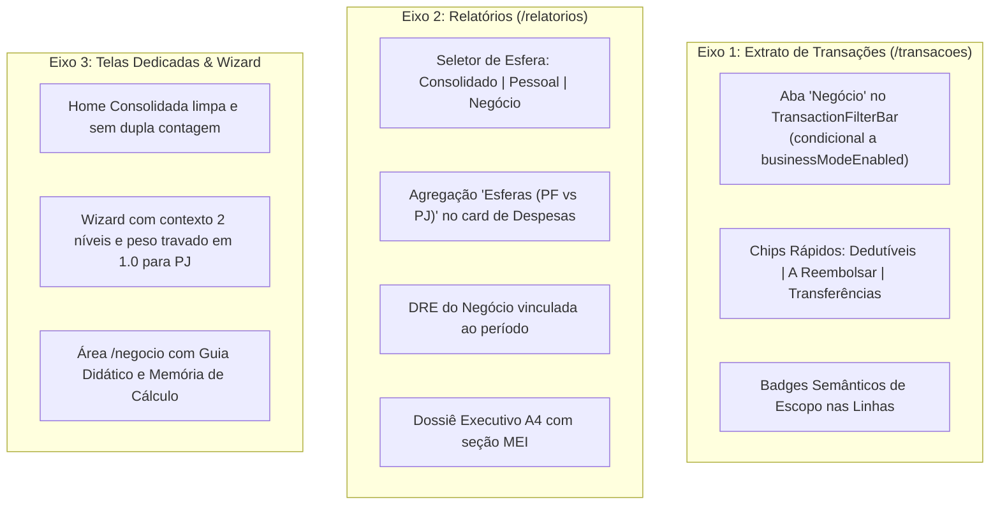
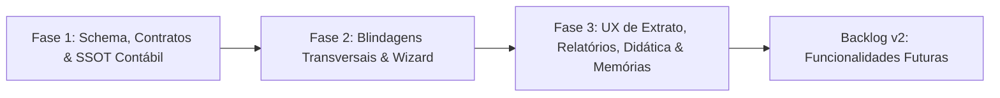

# AUDITORIA ARQUITETURAL, MATEMÁTICA & PLANO DE REFINAMENTO v2.0: MODO NEGÓCIO (MEI / AUTÔNOMO)

> **Documento Canônico de Auditoria, Blindagem Contábil, Didática ao Usuário e Plano de Execução**  
> **Status:** Aprovado para Execução  
> **Versão:** 2.0 (Consolidada com Meta-Análise, Guia Didático e Memória de Cálculo)  
> **Data:** Novembro de 2026  
> **Público-alvo:** Engenheiros de Software, Product Designers e Auditores de Governança Financeira

---

## 1. VISÃO GERAL & DIRETRIZ DE PRODUTO

O **Modo Negócio** do Axir foi concebido para atender o microempreendedor individual (MEI), profissional autônomo, freelancer e dono de microempresa no Brasil. 

### 1.1 Diretriz Inegociável: Isolamento Opt-In Total (Espelho do Modo Família)
1. **Zero Atrito para quem não usa:** Se `businessModeEnabled === false` (padrão), o aplicativo comporta-se exatamente como uma gestão financeira pessoal pura. Não há botões extras, chamadas de API adicionais, campos obrigatórios, processamento desnecessário nem lentidão.
2. **Sem Falsa Complexidade ERP:** O usuário autônomo não quer um SAP ou Totvs. Ele quer saber se a empresa dele dá lucro, quanto pode retirar de pró-labore para a família, se vai estourar o teto do MEI e quanto gasta no cartão pessoal para a empresa.
3. **Área Dedicada (`/negocio`):** A inteligência pesada da empresa (DRE, Teto MEI, Ponto de Equilíbrio, Benefício Fiscal e Transferências) vive em uma rota dedicada, sem poluir a navegação do dia a dia.
4. **Respeito aos Princípios Contábeis Fundamentais:**
   - **Princípio da Entidade:** O patrimônio da empresa não se confunde com o patrimônio da pessoa física.
   - **Princípio da Competência:** Receitas e despesas pertencem ao período em que o fato gerador ocorreu (DRE), independentemente do recebimento ou pagamento.
   - **Princípio de Caixa:** O dinheiro disponível para honrar compromissos imediatos obedece às entradas e saídas físicas de moeda.

---

## 2. DIAGNÓSTICO DO ANTIPATTERN REMOVIDO: O SWITCHER GLOBAL

### 2.1 O que era o `<ViewScopeSwitcher />` (`[ Tudo | Pessoal | Negócio ]`)
Na implementação inicial da Fase 2A, foi inserido um componente flutuante no topo de todas as telas principais (`page-shell.tsx`) com três botões: `Tudo`, `Pessoal` e `Negócio`.

### 2.2 Por que a eliminação deste filtro foi mandatória (Auditada e Corrigida):
- **Sobrecarga Cognitiva e Fadiga Visual (*Accent Fatigue*):** O usuário abria a Home ou o Extrato e se deparava com um seletor permanente disputando atenção com o saldo e os cartões.
- **Conflito com o Modelo Mental de Área Dedicada:** No Modo Família, não existe um switcher global `[ Tudo | Individual | Família ]` no topo da Home. O usuário gerencia a família em `/familia` e apenas categoriza os gastos no lançamento. O Modo Negócio deve seguir a mesma elegância.
- **A Solução Adotada (Opção 1 + Opção 3):**
  - **Home Consolidada (Opção 1):** A Home exibe a visão financeira consolidada real do usuário, identificando transações da empresa com um badge sutil `PJ`, e neutralizando transferências internas (como pró-labore) para não duplicar dinheiro.
  - **Filtro Contextual no Extrato (Opção 3):** O filtro por escopo é transferido exclusivamente para onde o usuário audita lançamentos: o Extrato de Transações (`/transacoes`), como uma aba natural e discreta.
  - **Visão Dedicada nos Relatórios (`/relatorios`):** Seletor de esfera analítica (Consolidado, Pessoal, Negócio) estritamente dentro da aba de Finanças & DRE.

---

## 3. AUDITORIA PROFUNDA DE FRAGILIDADES, INCONGRUÊNCIAS & MATEMÁTICA FINANCEIRA

Abaixo está o levantamento exaustivo de todas as variáveis e incongruências que surgem ao relacionar Pessoa Física e Negócio, com a definição técnica de como o Axir soluciona cada uma.

```mermaid
flowchart TD
    subgraph INC["Fragilidades e Incongruências Auditadas"]
        I1["1. Saldo Bancário Único vs. Misto"]
        I2["2. Pró-Labore & Retiradas"]
        I3["3. Compras PJ no Cartão PF"]
        I4["4. Orçamentos por Categoria"]
        I5["5. Reserva de Emergência da Família"]
        I6["6. Dívidas & Empréstimos da PJ"]
        I7["7. Pesos Fracionados (report_weight)"]
        I8["8. Teto MEI Proporcional de Abertura"]
        I9["9. Faixa de Tolerância +20% MEI"]
        I10["10. Retenção de Tributos na Fonte (IRRF/ISS)"]
        I11["11. Capital de Giro Inicial (Aporte PF->PJ)"]
        I12["12. Importação Mista de Fatura de Cartão"]
    end

    subgraph SOL["Soluções Canônicas Axir"]
        S1["Caixa Operacional Derivado sem inflar Home"]
        S2["Transferência Pareada com transfer_group_id"]
        S3["Reembolso Patrimonial Neutro"]
        S4["Orçamento Doméstico isolado (scope='personal')"]
        S5["Cálculo de Reserva com base estrita pessoal"]
        S6["Contas a Receber como Ativo PJ"]
        S7["Trava de report_weight=1.0 + Split PF/PJ"]
        S8["Teto Pro-Rata por Data de Abertura"]
        S9["Semáforo de Tolerância e Enquadramento"]
        S10["Tratamento de Valor Bruto vs. Líquido"]
        S11["Aporte de Capital e Saldo de Abertura"]
        S12["Classificação Individual de Itens da Fatura"]
    end

    I1 --> S1
    I2 --> S2
    I3 --> S3
    I4 --> S4
    I5 --> S5
    I6 --> S6
    I7 --> S7
    I8 --> S8
    I9 --> S9
    I10 --> S10
    I11 --> S11
    I12 --> S12
```



---

### 3.1 A Fragilidade Crítica dos Pesos de Despesa e Receita (`report_weight`)

#### O que é o `report_weight` na Pessoa Física:
Originalmente, o campo `report_weight` (valor de 0.0 a 1.0) foi criado para expurgar gastos compartilhados da vida doméstica (ex.: *"paguei a conta do restaurante de R$ 300 para o grupo, mas meu consumo foi R$ 100, peso 0.33"* ou *"comprei algo que será reembolsado pelo plano de saúde, peso 0"*).

#### A Incongruência Contábil no Modo Negócio:
1. **No Faturamento e Teto do MEI (Receita Federal):**
   - A Receita Federal não aceita peso fracionado sobre notas fiscais. Se o MEI emitiu uma NF de R$ 5.000, o faturamento fiscal é rigorosamente R$ 5.000.
   - Se o sistema permitisse peso 0 ou 0.5 em uma receita PJ:
     - O termômetro do MEI contaria R$ 5.000 (peso fixo nominal).
     - O DRE contaria R$ 2.500 (ponderado).
     - **Incongruência:** O usuário veria números conflitantes dentro do próprio app sobre o quanto faturou.
2. **Nos Custos Operacionais e DRE da Empresa:**
   - Se o usuário cadastra uma compra de estoque de R$ 1.000 com peso 0.5, o DRE computaria apenas R$ 500 de custo.
   - **Incongruência:** O DRE geraria um "Lucro Líquido" artificialmente inflado, iludindo o empreendedor e gerando falsa impressão de lucratividade.
3. **No Benefício Fiscal (Despesas Dedutíveis):**
   - Reduzir o peso diminuiria artificialmente o benefício fiscal da despesa na apuração tributária do Livro Caixa.
4. **No Saldo Bancário Real:**
   - O extrato bancário debita 100% do dinheiro, independentemente do peso.

#### A Solução Canônica:
- **Trava de Integridade Contábil:** Para lançamentos com `scope = 'business'`, o `report_weight` é **sempre 1.0 (100% nominal)**.
- **Ocultação de Campo no Wizard:** Ao selecionar o contexto `Negócio` no `LaunchWizard`, o campo de "Peso no Relatório" fica **completamente oculto**, prevenindo distorções no DRE e na fiscalidade.
- **Despesas de Uso Misto Real (Split PF/PJ):** Quando uma despesa é verdadeiramente compartilhada (ex.: conta de internet de casa de R$ 200 utilizada 50% para a empresa e 50% para a família), o sistema não deve usar um peso que "apaga" os outros 50%. A solução limpa é o **Lançamento Dividido (Split PF/PJ)**: divide-se a transação em duas linhas legítimas de R$ 100 (uma pessoal e uma do negócio), ambas com peso 1.0 em seus respectivos livros contábeis.

---

### 3.2 As 12 Incongruências de Cálculo e Soluções Estruturais

#### Incongruência 1: Conta Bancária Única vs. Contas Separadas (Checkpoints de Saldo)
- **O Problema:** A grande maioria dos autônomos e MEIs no Brasil não possui conta PJ formal separada (ou mistura todas as transações na mesma conta bancária do dia a dia).
  - Se o app exigisse dois checkpoints separados ("Saldo Bancário Pessoal" e "Saldo Bancário do Negócio") e o usuário digitasse o saldo de sua conta única em ambos (ex.: R$ 8.000), a Home Consolidada somaria R$ 16.000, criando um saldo fantasma.
- **A Solução Canônica:**
  - O checkpoint bancário ("Bater com o banco") continua sendo o **saldo real da conta no banco**.
  - Na tela `/negocio`, o caixa da empresa é calculado como **Caixa Operacional Derivado**:
    $$\text{Caixa do Negócio} = \text{Saldo Inicial} + \text{Aportes PF}\rightarrow\text{PJ} + \text{Receitas PJ Recebidas} - \text{Custos PJ Pagos} - \text{Pró-labores Retirados} - \text{Reembolsos Pagos}$$
  - Isso dispensa a obrigatoriedade de conta bancária jurídica separada e mantém o saldo consolidado da Home 100% compatível com a vida real.

---

#### Incongruência 2: Pró-Labore e Retiradas (Receita da PF vs. Custo da PJ)
- **O Problema:** Quando a empresa fatura R$ 10.000 e transfere R$ 4.000 de pró-labore para a conta pessoal do empreendedor:
  - Se isso fosse lançado como uma despesa comum na PJ e uma receita comum na PF, a Home Consolidada mostraria:
    $$\text{Receitas Totais} = \text{R\$\,10.000 (clientes)} + \text{R\$\,4.000 (pró-labore)} = \text{R\$\,14.000}$$
    Isso geraria uma **falsa ilusão de riqueza**, pois o usuário não ganhou R$ 14.000; ganhou R$ 10.000 e apenas movimentou R$ 4.000 de um bolso para o outro.
- **A Solução Canônica:**
  - O mecanismo de **Transferências Internas Pareadas (`is_internal_transfer = true`, `transfer_kind = 'pro_labore'`, `transfer_group_id`)**:
    - **Na Home Consolidada:** É **100% neutralizada**. O fluxo de caixa consolidado registra apenas os R$ 10.000 externos de clientes.
    - **No DRE da Empresa (`/negocio`):** Faturamento Bruto R$ 10.000 $\rightarrow$ Custos $\rightarrow$ Lucro Operacional $\rightarrow$ Pró-Labore R$ 4.000 $\rightarrow$ Lucro Retido da Empresa.
    - **Nos Relatórios Pessoais (`/relatorios` - visão Pessoal):** Os R$ 4.000 aparecem exatamente como o salário/renda do mês com o qual o usuário paga o aluguel, condomínio e mercado da família.

---

#### Incongruência 3: Cartão de Crédito Misto e Reembolsos PJ $\rightarrow$ PF
- **O Problema:** O usuário comprou um insumo de R$ 600 para a empresa utilizando seu cartão de crédito pessoal. A fatura do cartão totalizou R$ 2.500 (R$ 1.900 pessoal + R$ 600 empresa).
  - Quando a empresa transfere R$ 600 para a conta pessoal para reembolsar esse gasto:
    - Se essa entrada fosse tratada como "Receita", distorceria o imposto de renda da PF (o usuário não teve acréscimo patrimonial, apenas recuperou um empréstimo feito à própria empresa).
    - Se a compra e o reembolso fossem computados como despesas na empresa, ela registraria R$ 1.200 de custo para uma despesa de R$ 600.
- **A Solução Canônica:**
  - O motor `card-reimbursement.ts` e o fluxo em 1 clique:
    - A despesa no cartão entra com `scope = 'business'`. Ela é o **Custo Contábil no DRE**.
    - O reembolso PJ $\rightarrow$ PF é classificado como **Devolução Patrimonial Neutra (`transfer_kind = 'card_reimbursement'`)**: não infla a renda pessoal nem dobra o custo da empresa.

---

#### Incongruência 4: Orçamentos Domésticos por Categoria (`budgets`)
- **O Problema:** O usuário estipulou uma meta de gastar no máximo R$ 800/mês com "Combustível".
  - Na vida pessoal gastou R$ 500.
  - Mas pela empresa viajou para visitar clientes e gastou R$ 600 de combustível.
  - Se os orçamentos misturarem tudo, a barra de progresso acusaria estouro (R$ 1.100 de R$ 800) em vermelho. O usuário ficaria frustrado, pois seu gasto pessoal cumpriu a meta, e o combustível da empresa foi um custo de venda que gerou faturamento.
- **A Solução Canônica:**
  - O módulo de Orçamentos e Limites de Gastos da família computa **estritamente despesas com `scope = 'personal'`** (mesmo em categorias compartilhadas como Combustível ou Alimentação).
  - A disciplina de custos da empresa é gerida pela **Margem de Lucro** e **Ponto de Equilíbrio** dentro da aba `/negocio`, e não por orçamentos domésticos.

---

#### Incongruência 5: Reserva de Emergência e Carteira de Investimentos
- **A armadilha:** O termômetro de Reserva de Emergência calcula 6 meses do custo de vida pessoal da família.
  - Se os custos da empresa (estoque, anúncios, fornecedores) fossem somados ao custo de vida pessoal, o app calcularia que a família gasta R$ 35.000/mês e exigiria uma reserva doméstica de R$ 210.000! Isso desregularia totalmente os aportes em ações, FIIs e previdência.
- **A Solução Canônica:**
  - O cálculo da **Reserva de Emergência Pessoal** baseia-se exclusivamente em **despesas com `scope = 'personal'`**.
  - A saúde de caixa da empresa é tratada de forma separada como **Capital de Giro Operacional** em `/negocio`.

---

#### Incongruência 6: Dívidas, Empréstimos e Clientes a Receber (`debts`)
- **A armadilha:** Empréstimos empresariais (ex.: Pronampe R$ 25.000 para capital de giro) ou faturas pendentes de clientes a receber:
  - Uma conta a receber de cliente PJ é um **Ativo Circulante**, não uma dívida pessoal.
  - Um boleto de fornecedor PJ a vencer não deve travar o Safe-to-Spend (saldo livre para compras do dia a dia) da família.
- **A Solução Canônica:**
  - No módulo `/dividas`, os compromissos PJ recebem badge semântico `PJ`.
  - No DRE da empresa (`/negocio`), os recebíveis de clientes entram no indicador específico **"Receitas Previstas a Receber"**, permitindo antecipar o fechamento do mês sem misturar com as finanças da casa.

---

#### Incongruência 7: Mutua Exclusão de Escopo e Família (`scope = 'business'` vs. `is_family = true`)
- **O Problema:** Um lançamento não pode ser simultaneamente despesa da empresa (dedutível no DRE) e despesa compartilhada do orçamento familiar (`is_family = true`).
  - No banco de dados, o RPC já forçava `is_family = false` quando `scope = 'business'`. Contudo, se o formulário do Wizard permitisse marcar ambos, criava descompasso e desorientação.
- **A Solução Canônica:**
  - No `LaunchWizard` e em `use-launch-wizard-submit.ts`, a seleção de contexto é mutuamente exclusiva:
    - Se selecionado `Negócio` $\rightarrow$ `scope = 'business'` e `is_family = false`.
    - Se selecionado `Família` $\rightarrow$ `scope = 'personal'` e `is_family = true`.
    - Se selecionado `Pessoal` $\rightarrow$ `scope = 'personal'` e `is_family = false`.

---

#### Incongruência 8: Teto Proporcional do MEI no Ano de Abertura
- **O Problema:** O teto anual do MEI (R$ 81.000 em 2026) aplica-se apenas a empresas abertas em anos anteriores.
  - Se o usuário abriu seu MEI em **Julho**, o limite legal não é R$ 81.000, mas sim:
    $$\text{Teto Proporcional} = (12 - 7 + 1) \times \text{R\$\,6.750} = 6 \times \text{R\$\,6.750} = \text{R\$\,40.500}$$
  - Se o app calcular com base em R$ 81.000, o usuário pode faturar R$ 60.000 achando que está seguro e ser desenquadrado pela Receita Federal com cobrança retroativa de impostos com multas e juros.
- **A Solução Canônica:**
  - Nas configurações do Modo Negócio, o usuário pode informar opcionalmente a **Data de Abertura do MEI**.
  - O motor `mei-limit.ts` calcula o teto pro-rata com base no mês de abertura no primeiro ano fiscal, e teto cheio nos anos seguintes.

---

#### Incongruência 9: Faixas de Tolerância do MEI (+20% vs. > 20%)
- **O Problema:** A legislação do MEI (Lei Complementar nº 123/2006) possui duas regras distintas de excesso de faturamento:
  1. **Excesso de até 20% (até R$ 97.200 em 2026):** O MEI não é desenquadrado de imediato no ano corrente. Ele paga o DAS normal até dezembro, recolhe uma guia complementar sobre o excesso em janeiro do ano seguinte e passa a ser Microempresa (ME) apenas a partir de 1º de janeiro seguinte.
  2. **Excesso superior a 20% (acima de R$ 97.200 em 2026):** O MEI é desenquadrado **retroativamente a 1º de janeiro do ano em curso**, tendo que pagar impostos como Simples Nacional retroativos sobre todo o faturamento do ano com multas e juros.
- **A Solução Canônica:**
  - O componente `MeiCeilingCard` e a memória de cálculo do teto dividem o monitoramento em três zonas semânticas:
    - **Zona Segura:** Faturamento acumulado $\le 100\%$ do teto legal.
    - **Zona de Atenção (Tolerância até +20%):** Alerta explicativo de migração planejada para ME no ano seguinte.
    - **Zona Crítica (Excesso > 20%):** Alerta grave de desenquadramento retroativo.

---

#### Incongruência 10: Retenção Tributária na Fonte (Faturamento Bruto vs. Valor Líquido)
- **O Problema:** Ao emitir uma nota fiscal de prestação de serviços de R$ 5.000 para uma pessoa jurídica média ou grande, pode haver retenção de IRRF (1,5%), ISS (2% a 5%) ou INSS. O cliente deposita na conta do MEI/autônomo o valor líquido (ex.: R$ 4.700).
  - Para o **Teto do MEI** e **Faturamento Bruto no DRE**, a receita fiscal foi de R$ 5.000.
  - Para o **Extrato Bancário**, entraram R$ 4.700.
- **A Solução Canônica:**
  - No cadastro de receita com `scope = 'business'`, permitir o preenchimento opcional de **Retenções na Fonte**:
    - `amount_cents`: R$ 5.000 (Faturamento Bruto / DRE / Teto MEI).
    - `tax_withheld_cents`: R$ 300 (Retenções na fonte / Deduções).
    - `net_cash_received_cents`: R$ 4.700 (Entrada real de caixa).
  - Isso garante perfeita conciliação bancária sem violar o faturamento fiscal.

---

#### Incongruência 11: Aporte de Capital PF $\rightarrow$ PJ e Saldo Inicial de Caixa
- **O Problema:** O empreendedor começa o ano colocando R$ 3.000 do seu bolso pessoal para capital de giro da empresa comprar matéria-prima.
  - Se lançado como "Receita de Cliente", inflaria o faturamento fiscal do MEI, aproximando o usuário do teto ilegalmente.
  - Se não for registrado, o Caixa Operacional da empresa ficaria negativo.
- **A Solução Canônica:**
  - Suporte ao tipo de transferência interna **Aporte de Capital (`transfer_kind = 'capital_injection'`)**:
    - Débito na conta pessoal $\rightarrow$ Crédito no caixa do negócio.
    - **Fiscal:** 0% de faturamento (não conta para DRE nem para Teto MEI).
    - **Financeiro:** Alimenta o Caixa Operacional da empresa para compras e pagamentos.

---

#### Incongruência 12: Importação e Conciliação de Fatura Mista de Cartão de Crédito
- **O Problema:** Ao importar um arquivo OFX de fatura de cartão de crédito pessoal, há compras domésticas (mercado, farmácia) misturadas com compras da empresa (hospedagem de site, ferramentas, correios).
- **A Solução Canônica:**
  - No fluxo de conciliação e edição de transações importadas, cada linha possui o seletor simplificado de contexto:
    - Botão toggle rápido `Pessoal` / `Negócio`.
    - Ao marcar `Negócio`, a linha é carimbada com `scope = 'business'`, e entra automaticamente na fila do **Card Reimbursement** para quitação com 1 clique pela empresa.

---

## 4. GUIA DIDÁTICO E EDUCACIONAL ("QUAL É O MEU PERFIL?")

Para eliminar atrito e insegurança do usuário leigo, a área `/negocio` e o diálogo de configuração inicial integram um **Guia Didático Interativo**, estruturado em linguagem simples, humana e sem jargões contábeis herméticos.

### 4.1 Questionário de Orientação Rápida (3 Perguntas Simples)



### 4.2 Tabela Comparativa de Perfis Tributários

| Perfil | Quem é? | Como paga imposto? | O que cadastrar no Axir? |
|---|---|---|---|
| **MEI (Microempreendedor Individual)** | Pequenos prestadores de serviços e comerciantes com faturamento até o teto anual. | Guia **DAS fixa mensal** (aprox. R$ 75 a R$ 85/mês, reajustada pelo salário mínimo). | **Regime:** MEI.<br/>**Alíquota %:** Deixe `0%` (o imposto é fixo, não percentual).<br/>**Ano de Abertura:** Para cálculo proporcional do teto. |
| **Autônomo / Profissional Liberal** | Médicos, advogados, dentistas, psicólogos, designers e consultores sem CNPJ. | **Carnê-Leão mensal** pela tabela progressiva do IRPF (até 27,5%) sobre o lucro. | **Regime:** Autônomo.<br/>**Alíquota %:** Alíquota média estimada (ex.: 15% ou 27,5%).<br/>**Escudo Fiscal:** Despesas com consultório e materiais reduzem o imposto. |
| **Microempresa (Simples Nacional - ME)** | Empresas com CNPJ de maior porte ou atividades não permitidas no MEI. | **Guia DAS calculada como %** sobre cada nota fiscal emitida (conforme Anexo I, III, IV ou V). | **Regime:** Simples ME.<br/>**Alíquota %:** Alíquota efetiva da sua empresa (ex.: 6% ou 15,5%, obtida com seu contador). |

---

### 4.3 Matriz de Transparência Inegociável: "O que o Modo Negócio AFETA vs. O que ele NÃO AFETA"

Para garantir conforto psicológico absoluto ao usuário, o aplicativo exibe em sua interface a matriz de clareza:

```
+---------------------------------------------------------------------------------------------------+
| MATRIZ DE TRANSPARÊNCIA AXIR: CONFORTO E SEGURANÇA TOTAL                                         |
+---------------------------------------------------------------------------------------------------+
| O QUE O MODO NEGÓCIO AFETA:                                                                       |
| 1. Gera o DRE Gerencial da sua empresa (Receitas, Custos, Pró-Labore e Lucro Líquido).            |
| 2. Acompanha o termômetro do teto anual do MEI com margem de segurança.                          |
| 3. Permite identificar compras da empresa no seu cartão de crédito pessoal e reembolsá-las.        |
| 4. Cria abas e filtros exclusivos em /transacoes e /relatorios para auditar seu negócio.          |
| 5. Emite o Dossiê Contábil A4 para facilitar sua declaração de faturamento ou envio ao contador.  |
+---------------------------------------------------------------------------------------------------+
| O QUE O MODO NEGÓCIO NÃO AFETA (SUA VIDA PESSOAL ESTÁ BLINDADA):                                  |
| 1. NÃO altera nem duplica o saldo real das suas contas bancárias na Home.                         |
| 2. NÃO mistura nem estoura os orçamentos de gastos da sua família (mercado, lazer, casa).       |
| 3. NÃO distorce a sua meta de Reserva de Emergência nem a taxa de poupança doméstica.            |
| 4. NÃO interfere no motor de rebalanceamento da sua carteira de investimentos (ações e FIIs).     |
| 5. NÃO cria burocracias de ERP tradicional nem emite notas fiscais sozinho.                       |
+---------------------------------------------------------------------------------------------------+
```

---

## 5. ESPECIFICAÇÃO COMPLETA DAS MEMÓRIAS DE CÁLCULO (`CalculationBreakdown`)

Em conformidade com o padrão visual do Axir, todos os cartões de inteligência de `/negocio` e `/relatorios` possuem um acionador discreto de **Memória de Cálculo** (ícone `HelpCircle` ou botão *"Ver memória de cálculo"*), abrindo uma folha explicativa com a fórmula matemática e os valores reais utilizados no período.

---

### 5.1 DRE Gerencial (`business-dre-card`)

#### Equação Canônica:
$$\begin{aligned}
\text{Receita Bruta} &= \sum \text{Receitas Externas PJ} \\
\text{Receita Líquida} &= \text{Receita Bruta} - \text{Deduções / Devoluções} \\
\text{Margem de Contribuição} &= \text{Receita Líquida} - \text{Custos Variáveis} \\
\text{Lucro Operacional (EBITDA)} &= \text{Margem de Contribuição} - \text{Despesas Fixas} \\
\text{Lucro Líquido Retido} &= \text{Lucro Operacional} - \text{Pró-Labore Retirado}
\end{aligned}$$

#### Modal / Popover da Memória de Cálculo:
- **Passo 1 (Faturamento Bruto):** Soma de todas as transações com `scope = 'business'` e `type = 'income'`, excluindo transferências internas (`is_internal_transfer = false`).
- **Passo 2 (Custos e Despesas Operacionais):** Soma de todas as saídas operacionais e fornecedores com `scope = 'business'`.
- **Passo 3 (Lucro Operacional):** Quanto a operação do negócio gerou antes de remunerar os sócios.
- **Passo 4 (Pró-Labore / Distribuição):** Total de transferências pareadas `transfer_kind = 'pro_labore'` transferidas para a pessoa física.
- **Passo 5 (Resultado Líquido Retido):** Saldo remanescente que fortalece o caixa do negócio para reinvestimento.

---

### 5.2 Termômetro do Teto do MEI (`mei-ceiling-card`)

#### Equação Canônica:
$$\text{Teto Vigente} = \begin{cases}
\text{R\$\,81.000,00} & \text{ano } 2026 \\
\text{R\$\,110.000,00} & \text{ano } 2027 \text{ (LC nº 238/2026)} \\
\text{R\$\,140.000,00} & \text{ano } 2028 \text{ (LC nº 238/2026)}
\end{cases}$$

$$\text{Teto Aplicável no Ano de Abertura} = \frac{\text{Teto Vigente}}{12} \times (12 - \text{Mês Abertura} + 1)$$

$$\text{Saldo Restante} = \text{Teto Aplicável} - \sum \text{Faturamento Acumulado no Ano Fiscal}$$

$$\text{Projeção de Faturamento Anual} = \frac{\sum \text{Faturamento Acumulado}}{\text{Meses Decorridos}} \times \text{Meses Ativos no Ano}$$

#### Zonas do Semáforo Legal:
1. **Verde ($\le 80\%$ do teto):** Operação confortável.
2. **Amarelo ($80\% < \text{faturamento} \le 100\%$):** Proximidade do limite.
3. **Laranja ($100\% < \text{faturamento} \le 120\%$):** Tolerância legal de +20%. Desenquadramento como Microempresa no ano seguinte, com pagamento de DAS complementar.
4. **Vermelho ($> 120\%$ do teto):** Desenquadramento retroativo obrigatório a 1º de janeiro.

---

### 5.3 Ponto de Equilíbrio Operacional vs. Ponto de Equilíbrio Digno (`break-even-card`)

O Axir introduz a distinção financeira fundamental entre o ponto em que a empresa "não quebra" e o ponto em que ela "sustenta a família com dignidade":

#### Equações:
1. **Margem de Contribuição Percentual ($MC\%$):**
   $$MC\% = \frac{\text{Receita Líquida} - \text{Custos Variáveis}}{\text{Receita Líquida}}$$

2. **Ponto de Equilíbrio Operacional ($PE_{op}$):**
   $$PE_{op} = \frac{\text{Despesas Fixas Operacionais}}{MC\%}$$
   *Interpretação:* Faturamento mínimo para pagar aluguel, sistemas e fornecedores fixos, sem sobrar nada para o sócio.

3. **Ponto de Equilíbrio Digno / Total ($PE_{total}$):**
   $$PE_{total} = \frac{\text{Despesas Fixas Operacionais} + \text{Pró-Labore Necessário da Família}}{MC\%}$$
   *Interpretação:* Faturamento necessário para cobrir os custos fixos da empresa E pagar o pró-labore que cobre as despesas básicas da casa.

---

### 5.4 Escudo Fiscal do Autônomo (`tax-shield-card`)

Para autônomos que tributam pelo Carnê-Leão (Livro Caixa):

#### Equação Canônica:
$$\text{Economia Tributária Real} = \sum \text{Despesas Operacionais Dedutíveis Escrituradas} \times \text{Alíquota Marginal do IRPF (ex.: 27,5\%)}$$

#### Memória de Cálculo Exibida:
*"Você escriturou R$ 3.200,00 de despesas operacionais no Livro Caixa (aluguel de sala, internet e materiais). Na faixa de 27,5% do IRPF, essas despesas reduziram sua base de cálculo e geraram uma economia real de imposto de R$ 880,00 neste período."*

---

### 5.5 Caixa Operacional Derivado do Negócio

Diferença entre Lucro Contábil (DRE) e Dinheiro Físico no Caixa:

#### Equação Canônica:
$$\begin{aligned}
\text{Caixa Derivado} = &\text{ Saldo Inicial da Empresa} \\
&+ \text{Aportes PF}\rightarrow\text{PJ} \\
&+ \text{Receitas PJ Efetivamente Compensadas} \\
&- \text{Despesas PJ Pagas em Conta Corrente} \\
&- \text{Pró-Labores Transferidos para a PF} \\
&- \text{Reembolsos Pagos à PF por Compras no Cartão}
\end{aligned}$$

---

### 5.6 Conciliação de Compras PJ no Cartão Pessoal (`card-reimbursement`)

#### Equação Canônica:
$$\text{Reembolso Pendente} = \sum \text{Despesas PJ pagas com Cartão PF} - \sum \text{Transferências Pareadas com } \texttt{transfer\_kind = 'card\_reimbursement'}$$

---

## 6. PLANO DE REFINAMENTO E IMPLEMENTAÇÃO: EIXOS 1 E 2

Com o `<ViewScopeSwitcher />` do shell devidamente eliminado, a experiência do usuário divide-se de forma limpa nos eixos abaixo:



---

### 6.1 Eixo 1 — Extrato de Transações (`/transacoes`)

1. **Aba "Negócio" na barra de abas (`Tabs` de `TransactionFilterBar`):**
   - No array `FILTER_TAB_ITEMS`, adicionar condicionalmente:
     ```tsx
     ...(isBusinessModeEnabled
       ? [{ value: "business", label: "Negócio", icon: <Briefcase className="size-4" aria-hidden="true" /> }]
       : [])
     ```
   - Ao selecionar a aba *"Negócio"*, o feed de transações filtra instantaneamente por `scope === 'business'`.
   - Mantém `fullWidth={false}` e rolagem horizontal suave no mobile (`overflow-x-auto no-scrollbar scroll-smooth`), em estrita conformidade com a **Regra 9 do `AGENTS.md`**.
2. **Chips Rápidos de Subfiltro (quando na aba Negócio):**
   - `Todos do Negócio` (padrão)
   - `Dedutíveis (Livro Caixa)`
   - `A Reembolsar (Cartão PF)`
   - `Pró-Labore & Aportes`
3. **Busca Textual Refinada:**
   - Adicionar parser em `use-transaction-list.ts` para que buscas por `"pj"`, `"negocio"` ou `"dedutivel"` filtrem os lançamentos sem exigir abertura de modais complexos.

---

### 6.2 Eixo 2 — Relatórios Financeiros (`/relatorios`)

1. **Seletor de Esfera no Topo da Aba "Finanças & DRE":**
   - Quando `businessModeEnabled === true`, a aba de finanças disponibiliza um controle de escopo elegante para o período selecionado:
     - **Consolidado:** Soma receitas e despesas reais de ambos os lados, neutralizando transferências internas.
     - **Pessoal:** Exibe a DRE Pessoal do indivíduo (incluindo o Pró-Labore recebido da PJ).
     - **Negócio (PJ):** Exibe a DRE Gerencial da empresa do período selecionado (Faturamento Bruto, Custos Operacionais, Pró-Labore retirado e Lucro Líquido).
2. **Agregação "Esferas (PF vs PJ)" no Detalhamento de Despesas:**
   - Em `FinancialExpensesBreakdownCard`, adicionar a opção **"Esferas"** ao lado de *"Categorias"*, *"Formas de Pgto"*, *"Dias da Semana"* e *"Encargos"*.
   - Exibe a proporção em reais e percentual entre Gastos Pessoais e Gastos do Negócio para o mês/ano.
3. **Dossiê Executivo A4 / Impressão (`FinancialCloseReportModal`):**
   - No documento impresso gerado no fechamento mensal, adicionar seção opcional de **Apuração MEI / Simples Nacional**, contendo o faturamento bruto acumulado do ano e a margem de segurança do teto.

---

### 6.3 Eixo 3 — Blindagens no Wizard, Orçamentos e Paridade Contábil

1. **Trava de Peso Contábil no Wizard:**
   - No `LaunchWizard` (Passo 2 / Detalhes), quando o contexto selecionado for `Negócio`:
     - O campo `report_weight` é fixado internamente em `1.0`.
     - O slider/seletor de peso é ocultado, evitando confusão para o usuário leigo.
2. **Split PF/PJ Atômico (Despesas Compartilhadas):**
   - Se o usuário precisar dividir uma despesa (ex.: internet de R$ 200), a UI disponibiliza a ação rápida *"Dividir entre Pessoal e Negócio"*, gerando 2 lançamentos atômicos de R$ 100 com peso 1.0 cada, sem fraudar a escrituração.
3. **Blindagem do Orçamento Pessoal:**
   - Em `use-budgets-page.ts`, despesas com `scope === 'business'` são excluídas do consumo dos orçamentos da família, mesmo quando a categoria for compartilhada.
4. **Vínculo Bidirecional de Transferências (`transfer_group_id`):**
   - Ao editar o valor ou excluir um lado da transferência interna no extrato, o sistema sincroniza ou solicita confirmação para o outro lado, impedindo que um pró-labore fique "órfão".

---

## 7. FASES SEQUENCIAIS DE EXECUÇÃO & QUALITY GATES



### Fase 1: Schema, Contratos de Dados & SSOT Contábil
- **Objetivo:** Estabelecer funções puras imutáveis em `src/domain/business/` com 100% de cobertura de testes matemáticos em centavos inteiros.
- **Entregáveis:**
  - `src/domain/business/mei-rules.ts`: Cálculo dinâmico do teto MEI (2026/2027/2028), pro-rata de abertura e zonas de tolerância (+20%).
  - `src/domain/business/break-even-calculator.ts`: Ponto de equilíbrio operacional vs. com pró-labore.
  - `src/domain/business/split-expense.ts`: Divisão atômica de lançamentos mistos PF/PJ com peso 1.0.
  - `src/domain/business/tax-calculator.ts`: Tratamento de retenções na fonte (valor bruto x líquido).
  - Testes unitários colocalizados (`*.test.ts`) para cada função pura.

### Fase 2: Blindagens Transversais & Wizard
- **Objetivo:** Isolar completamente a vida pessoal da vida do negócio nos módulos existentes.
- **Entregáveis:**
  - `src/features/transactions/wizard/`: Trava de `report_weight = 1.0` para PJ, ocultação do slider e ação de Split PF/PJ.
  - `src/features/transactions/services/transfer-sync.ts`: Integridade atômica com `transfer_group_id`.
  - `src/features/budgets/components/use-budgets-page.ts`: Filtro estrito de `scope === 'personal'`.
  - `src/domain/financial-context/`: Proteção da meta de Reserva de Emergência (base estrita pessoal).
  - Blindagem de Opt-Out (`businessModeEnabled === false`).

### Fase 3: UX de Extrato, Relatórios, Didática & Memórias de Cálculo
- **Objetivo:** Entregar a camada visual fluida, acessível e autoexplicativa.
- **Entregáveis:**
  - `src/features/transactions/components/list/transaction-filter-bar.tsx`: Aba "Negócio" contextual.
  - `src/features/business/components/educational-guide-modal.tsx`: Diálogo didático "Qual é o meu perfil?".
  - `src/features/business/components/calculation-breakdown-popover.tsx`: Memória de cálculo universal para os cartões de `/negocio`.
  - `src/features/reports/`: Seletor de esferas (Consolidado/Pessoal/PJ) e agregação no card de despesas.
  - `src/features/reports/components/financial-close-report-modal.tsx`: Seção contábil no Dossiê A4.

### Backlog v2 (Pós-Blindagem)
- **Extrator de Notas/Comprovantes com IA:** Extração automática de retenções e dedutibilidade com Gemini.
- **Alerta de Vencimento de DAS no Carrossel:** Notificação mensal entre os dias 15 e 20.
- **Radar de Projeção Linear de Desenquadramento:** Alerta de tendência de estouro no segundo semestre.

---

## 8. MATRIZ DE RASTREABILIDADE & DEFINITION OF DONE (DoD)

| Requisito / Invariante | Arquivos Envolvidos | Critério de Aceite Canônico |
|---|---|---|
| **Zero Switcher Global** | `src/components/layout/page-shell.tsx` | Eliminado sem resíduos. ViewScope global não interfere no shell. |
| **Aba Negócio no Extrato** | `src/features/transactions/components/list/transaction-filter-bar.tsx` | Aparece somente se `businessModeEnabled === true`. Filtra em tempo real sem duplicar scroll. |
| **Trava de Pesos PJ** | `src/features/transactions/wizard/step-details.tsx` | Oculta peso para lançamentos PJ e força `report_weight = 1.0`. |
| **Split PF/PJ Atômico** | `src/domain/business/split-expense.ts`, wizard | Divide conta mista em duas linhas nominais de peso 1.0. |
| **Teto MEI Pro-Rata & Dinâmico** | `src/domain/business/mei-rules.ts` | Respeita teto proporcional por mês de abertura e anos 2026/2027/2028. |
| **Zona de Tolerância +20%** | `src/features/business/components/mei-ceiling-card.tsx` | Exibe aviso diferenciado para excesso $\le 20\%$ vs. desenquadramento $> 20\%$. |
| **Memória de Cálculo Didática** | `src/features/business/components/calculation-breakdown-popover.tsx` | Permite inspecionar a fórmula e os valores de cada KPI com 1 clique. |
| **Guia "Qual é o meu perfil?"** | `src/features/business/components/educational-guide-modal.tsx` | Diálogo acessível sem jargões para orientar MEI, Autônomo e Simples. |
| **Relatórios Segmentados** | `src/features/reports/pages/reports-page.tsx`, `financial-tab.tsx` | Alterna visão Consolidada, Pessoal e PJ para DRE e detalhamento. |
| **Blindagem de Orçamentos** | `src/features/budgets/components/use-budgets-page.ts` | Gastos PJ não estouram orçamentos domésticos da família. |
| **Blindagem de Reserva** | `src/domain/financial-context/` | Custo de vida da família exclui despesas PJ no termômetro de reserva. |
| **Qualidade & Governança** | Vitest + TypeScript + ESLint | 100% de testes passando, 0 erros no typecheck e linter, conformidade total com `AGENTS.md`. |
