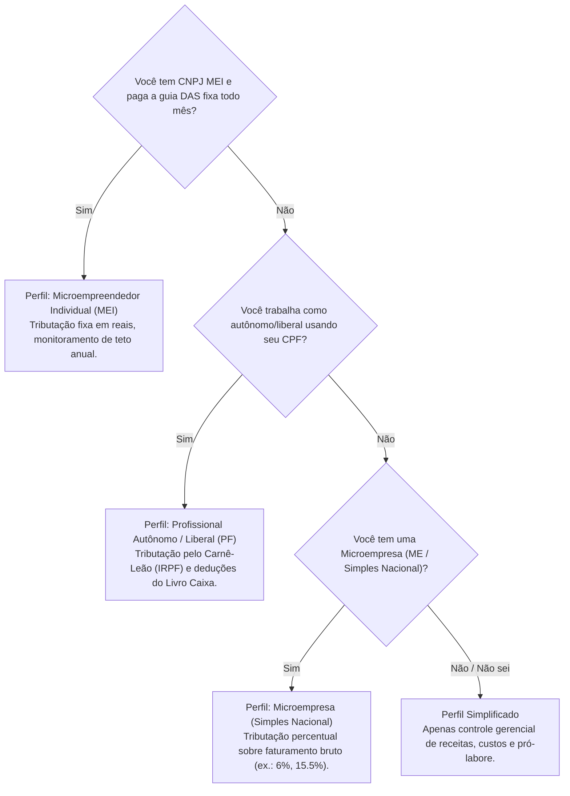
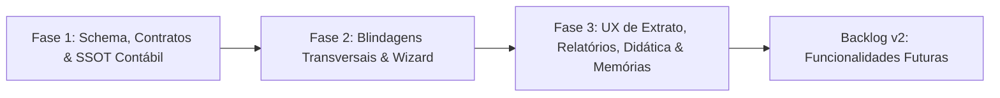

# AUDITORIA ARQUITETURAL, MATEMÁTICA & PLANO DE REFINAMENTO v2.1: MODO NEGÓCIO (MEI / AUTÔNOMO)

> **Documento Canônico de Auditoria, Blindagem Contábil, Didática ao Usuário e Plano de Execução**  
> **Status:** Concluído com Êxito — Fases 1, 2 e 3 Implementadas, Verificadas e Blindadas  
> **Versão:** 2.1 (Canônica: Auditada contra o Código Real + 5 Ajustes Cirúrgicos + 100% dos Quality Gates Aprovados)  
> **Data:** Novembro de 2026  
> **Público-alvo:** Engenheiros de Software, Product Designers e Auditores de Governança Financeira

---

## 1. VISÃO GERAL & DIRETRIZ DE PRODUTO

O **Modo Negócio** do Axir foi concebido para atender o microempreendedor individual (MEI), profissional autônomo, freelancer e dono de microempresa no Brasil. 

### 1.1 Diretriz Inegociável: Isolamento Opt-In Total (Espelho do Modo Família)
1. **Zero Atrito para quem não usa:** Se `businessModeEnabled === false` (padrão), o aplicativo comporta-se exatamente como uma gestão financeira pessoal pura. Não há botões extras, chamadas de API adicionais, campos obrigatórios, processamento desnecessário nem lentidão.
2. **Sem Falsa Complexidade ERP:** O usuário autônomo não quer um SAP ou Totvs. Ele quer saber se a empresa dele dá lucro, quanto pode retirar de pró-labore para a família, se vai estourar o teto do MEI e quanto gasta no cartão pessoal para a empresa.
3. **Área Dedicada (`/negocio`):** A inteligência pesada da empresa (DRE, Teto MEI, Ponto de Equilíbrio, Benefício Fiscal e Transferências) vive em uma rota dedicada, sem poluir a navegação do dia a dia.
4. **Respeito aos Princípios Contábeis Fundamentais:**
   - **Princípio da Entidade:** O patrimônio da empresa não se confunde com o patrimônio da pessoa física.
   - **Princípio da Competência:** Receitas e despesas pertencem ao período em que o fato gerador ocorreu (DRE), independentemente do recebimento ou pagamento.
   - **Princípio de Caixa:** O dinheiro disponível para honrar compromissos imediatos obedece às entradas e saídas físicas de moeda.

---

## 2. DIAGNÓSTICO DO ANTIPATTERN REMOVIDO: O SWITCHER GLOBAL

### 2.1 O que era o `<ViewScopeSwitcher />` (`[ Tudo | Pessoal | Negócio ]`)
Na implementação inicial da Fase 2A, foi inserido um componente flutuante no topo de todas as telas principais (`page-shell.tsx`) com três botões: `Tudo`, `Pessoal` e `Negócio`.

### 2.2 Por que a eliminação deste filtro foi mandatória (Auditada e Corrigida):
- **Sobrecarga Cognitiva e Fadiga Visual (*Accent Fatigue*):** O usuário abria a Home ou o Extrato e se deparava com um seletor permanente disputando atenção com o saldo e os cartões.
- **Conflito com o Modelo Mental de Área Dedicada:** No Modo Família, não existe um switcher global `[ Tudo | Individual | Família ]` no topo da Home. O usuário gerencia a família em `/familia` e apenas categoriza os gastos no lançamento. O Modo Negócio segue a mesma elegância.
- **A Solução Adotada (Opção 1 + Opção 3):**
  - **Home Consolidada (Opção 1):** A Home exibe a visão financeira consolidada real do usuário, identificando transações da empresa com um badge sutil `PJ`, e neutralizando transferências internas (como pró-labore) para não duplicar dinheiro.
  - **Filtro Contextual no Extrato (Opção 3):** O filtro por escopo é transferido exclusivamente para onde o usuário audita lançamentos: o Extrato de Transações (`/transacoes`), como uma aba natural e discreta com chips rápidos contextuais.
  - **Visão Dedicada nos Relatórios (`/relatorios`):** Seletor de esfera analítica (Consolidado, Pessoal, Negócio) estritamente dentro da aba de Finanças & DRE.

---

## 3. AUDITORIA PROFUNDA DE FRAGILIDADES, INCONGRUÊNCIAS & MATEMÁTICA FINANCEIRA

Abaixo está o levantamento exaustivo de todas as variáveis e incongruências auditadas contra o código real do repositório, com a definição técnica de como o Axir soluciona cada uma.

```mermaid
flowchart TD
    subgraph INC["Fragilidades e Incongruências Auditadas"]
        I1["1. Saldo Bancário Único vs. Misto"]
        I2["2. Pró-Labore & Retiradas"]
        I3["3. Compras PJ no Cartão PF"]
        I4["4. Orçamentos por Categoria"]
        I5["5. Reserva de Emergência da Família"]
        I6["6. Dívidas & Empréstimos da PJ"]
        I7["7. Pesos Fracionados (report_weight)"]
        I8["8. Teto MEI Proporcional de Abertura"]
        I9["9. Faixa de Tolerância +20% MEI"]
        I10["10. Retenção Tributária (Autônomo/Simples)"]
        I11["11. Saldo Inicial PJ vs. Checkpoint Bancário"]
        I12["12. Importação Mista de Fatura de Cartão"]
    end

    subgraph SOL["Soluções Canônicas Axir"]
        S1["Caixa Operacional Derivado sem inflar Home"]
        S2["Transferência Pareada via transfer_pair_id"]
        S3["Reembolso Patrimonial Neutro"]
        S4["Orçamento Doméstico isolado (scope='personal')"]
        S5["Cálculo de Reserva com base estrita pessoal"]
        S6["Contas a Receber como Ativo PJ"]
        S7["Trava de report_weight=1.0 + Split PF/PJ"]
        S8["Teto Pro-Rata por Data de Abertura (com clamp)"]
        S9["Semáforo de Tolerância e Enquadramento"]
        S10["Tratamento de Valor Bruto vs. Líquido"]
        S11["openingBalanceCents em BusinessProfileSettings"]
        S12["Classificação Individual de Itens da Fatura"]
    end

    I1 --> S1
    I2 --> S2
    I3 --> S3
    I4 --> S4
    I5 --> S5
    I6 --> S6
    I7 --> S7
    I8 --> S8
    I9 --> S9
    I10 --> S10
    I11 --> S11
    I12 --> S12
```



---

### 3.1 A Fragilidade Crítica dos Pesos de Despesa e Receita (`report_weight`)

#### O que é o `report_weight` na Pessoa Física:
Originalmente, o campo `report_weight` (valor de 0.0 a 1.0) foi criado para expurgar gastos compartilhados da vida doméstica (ex.: *"paguei a conta do restaurante de R$ 300 para o grupo, mas meu consumo foi R$ 100, peso 0.33"* ou *"comprei algo que será reembolsado pelo plano de saúde, peso 0"*).

#### A Incongruência Contábil no Modo Negócio:
1. **No Faturamento e Teto do MEI (Receita Federal):**
   - A Receita Federal não aceita peso fracionado sobre notas fiscais. Se o MEI emitiu uma NF de R$ 5.000, o faturamento fiscal é rigorosamente R$ 5.000.
   - Se o sistema permitisse peso 0 ou 0.5 em uma receita PJ:
     - O termômetro do MEI contaria R$ 5.000 (peso fixo nominal).
     - O DRE contaria R$ 2.500 (ponderado).
     - **Incongruência:** O usuário veria números conflitantes dentro do próprio app sobre o quanto faturou.
2. **Nos Custos Operacionais e DRE da Empresa:**
   - Se o usuário cadastra uma compra de estoque de R$ 1.000 com peso 0.5, o DRE computaria apenas R$ 500 de custo.
   - **Incongruência:** O DRE geraria um "Lucro Líquido" artificialmente inflado, iludindo o empreendedor e gerando falsa impressão de lucratividade.
3. **No Benefício Fiscal (Despesas Dedutíveis):**
   - Reduzir o peso diminuiria artificialmente o benefício fiscal da despesa na apuração tributária do Livro Caixa.
4. **No Saldo Bancário Real:**
   - O extrato bancário debita 100% do dinheiro, independentemente do peso.

#### A Solução Canônica:
- **Trava de Integridade Contábil:** Para lançamentos com `scope = 'business'`, o `report_weight` é **sempre 1.0 (100% nominal)**.
- **Ocultação de Campo no Wizard:** Ao selecionar o contexto `Negócio` no `LaunchWizard`, o campo de "Peso no Relatório" fica **completamente oculto**, prevenindo distorções no DRE e na fiscalidade.
- **Despesas de Uso Misto Real (Split PF/PJ):** Quando uma despesa é verdadeiramente compartilhada (ex.: conta de internet de casa de R$ 200 utilizada 50% para a empresa e 50% para a família), o sistema não deve usar um peso que "apaga" os outros 50%. A solução limpa é o **Lançamento Dividido (Split PF/PJ)**: divide-se a transação em duas linhas legítimas de R$ 100 (uma pessoal e uma do negócio), ambas com peso 1.0 em seus respectivos livros contábeis.

---

### 3.2 As 12 Incongruências de Cálculo e Soluções Estruturais

#### Incongruência 1: Conta Bancária Única vs. Mista & Saldo Inicial Virtual PJ
- **O Problema:** A grande maioria dos autônomos e MEIs no Brasil não possui conta PJ formal separada (mistura todas as transações na mesma conta bancária do dia a dia).
  - Se o app exigisse dois checkpoints separados ("Saldo Bancário Pessoal" e "Saldo Bancário do Negócio") e o usuário digitasse o saldo de sua conta única em ambos (ex.: R$ 8.000), a Home Consolidada somaria R$ 16.000, criando um saldo fantasma.
- **A Solução Canônica:**
  - O checkpoint bancário (`cash_checkpoints`) continua sendo restrito à **reconciliação bancária física real da conta**.
  - O saldo inicial de caixa da empresa não cria um checkpoint concorrente: ele é salvo como `openingBalanceCents` dentro de `BusinessProfileSettings` no `custom_settings`.
  - Na tela `/negocio`, o caixa da empresa é calculado como **Caixa Operacional Derivado**:
    $$\begin{aligned}
    \text{Caixa Derivado PJ} = &\text{ openingBalanceCents} \\
    &+ \sum \text{Aportes de Capital (PF }\rightarrow\text{ PJ)} \\
    &+ \sum (\text{Receita Bruta PJ} - \text{Retenções na Fonte}) \text{ [à vista/compensadas]} \\
    &- \sum \text{Despesas PJ Pagas em Conta/PIX/Débito} \\
    &- \sum \text{Pró-Labores Transferidos (PJ }\rightarrow\text{ PF)} \\
    &- \sum \text{Reembolsos Pagos à PF por Compras em Cartão PF}
    \end{aligned}$$
  - **Invariante Matemática:** Compras PJ feitas no cartão de crédito PF **NUNCA** saem do Caixa Derivado PJ na data da compra; saem estritamente quando quitadas via `card_reimbursement`.

---

#### Incongruência 2: Pró-Labore e Retiradas (Receita da PF vs. Custo da PJ)
- **O Problema:** Quando a empresa fatura R$ 10.000 e transfere R$ 4.000 de pró-labore para a conta pessoal do empreendedor:
  - Se isso fosse lançado como uma despesa comum na PJ e uma receita comum na PF, a Home Consolidada mostraria:
    $$\text{Receitas Totais} = \text{R\$\,10.000 (clientes)} + \text{R\$\,4.000 (pró-labore)} = \text{R\$\,14.000}$$
    Isso geraria uma **falsa ilusão de riqueza**, pois o usuário não ganhou R$ 14.000; ganhou R$ 10.000 e apenas movimentou R$ 4.000 de um bolso para o outro.
- **A Solução Canônica:**
  - O mecanismo de **Transferências Internas Pareadas (`is_internal_transfer = true`, `transfer_kind = 'pro_labore'`, `transfer_pair_id`)**:
    - **Na Home Consolidada:** É **100% neutralizada**. O fluxo de caixa consolidado registra apenas os R$ 10.000 externos de clientes.
    - **No DRE da Empresa (`/negocio`):** Faturamento Bruto R$ 10.000 $\rightarrow$ Custos $\rightarrow$ Lucro Operacional $\rightarrow$ Pró-Labore R$ 4.000 $\rightarrow$ Lucro Retido da Empresa.
    - **Nos Relatórios Pessoais (`/relatorios` - visão Pessoal):** Os R$ 4.000 aparecem exatamente como o salário/renda do mês com o qual o usuário paga o aluguel, condomínio e mercado da família.
    - **Integridade Atômica no Banco:** O trigger PostgreSQL `guard_paired_transfer_mutation()` já impede alterações ou exclusões desbalanceadas com erro `42501`. Na UI, a exclusão/edição opera sobre o par completo via `delete_internal_transfer_pair`.

---

#### Incongruência 3: Cartão de Crédito Misto e Reembolsos PJ $\rightarrow$ PF
- **O Problema:** O usuário comprou um insumo de R$ 600 para a empresa utilizando seu cartão de crédito pessoal. A fatura do cartão totalizou R$ 2.500 (R$ 1.900 pessoal + R$ 600 empresa).
  - Quando a empresa transfere R$ 600 para a conta pessoal para reembolsar esse gasto:
    - Se essa entrada fosse tratada como "Receita", distorceria o imposto de renda da PF (o usuário não teve acréscimo patrimonial, apenas recuperou um empréstimo feito à própria empresa).
    - Se a compra e o reembolso fossem computados como despesas na empresa, ela registraria R$ 1.200 de custo para uma despesa de R$ 600.
- **A Solução Canônica:**
  - O motor `card-reimbursement.ts` e o fluxo em 1 clique:
    - A despesa no cartão entra com `scope = 'business'`. Ela é o **Custo Contábil no DRE**.
    - O reembolso PJ $\rightarrow$ PF é classificado como **Devolução Patrimonial Neutra (`transfer_kind = 'card_reimbursement'`)**: não infla a renda pessoal nem dobra o custo da empresa.
    - **Cartão Parcelado:** O reembolso opera **fatura a fatura** via `bill_competence`. Uma compra de 3x R$ 100 gera R$ 100 a reembolsar em cada mês respectivo, mantendo paridade com o desembolso da fatura da PF.

---

#### Incongruência 4: Orçamentos Domésticos por Categoria (`budgets`)
- **O Problema:** O usuário estipulou uma meta de gastar no máximo R$ 800/mês com "Combustível".
  - Na vida pessoal gastou R$ 500.
  - Mas pela empresa viajou para visitar clientes e gastou R$ 600 de combustível.
  - Com o switcher do shell removido, `effectiveViewScope` em `/orcamentos` vale `"all"`. As despesas da empresa somavam-se às da casa, fazendo o orçamento estourar em R$ 1.100 (vermelho).
- **A Solução Canônica:**
  - O módulo de Orçamentos e Limites de Gastos da família computa **estritamente despesas com `scope = 'personal'`** (mesmo em categorias compartilhadas como Combustível ou Alimentação).
  - A disciplina de custos da empresa é gerida pela **Margem de Lucro** e **Ponto de Equilíbrio** dentro da aba `/negocio`, e não por orçamentos domésticos.

---

#### Incongruência 5: Reserva de Emergência e Carteira de Investimentos
- **A armadilha:** O termômetro de Reserva de Emergência calcula 6 meses do custo de vida pessoal da família.
  - Em `src/state/selectors/use-user-financial-context.ts:234-246`, o hook utilizava `effectiveViewScope` (que na Home é `"all"`). Compras de estoque ou insumos da empresa (ex.: R$ 20.000) inflavam o custo de vida mensal e exigiam uma reserva doméstica irreal de R$ 120.000 adicionais!
- **A Solução Canônica:**
  - O cálculo da **Reserva de Emergência Pessoal, Média de Gastos e Taxa de Poupança** baseia-se exclusivamente em **despesas com `scope = 'personal'`** (`filterExpensesByViewScope(..., 'personal', { mode: 'dre' })`).
  - A saúde de caixa da empresa é tratada de forma separada como **Capital de Giro Operacional** em `/negocio`.

---

#### Incongruência 6: Dívidas, Empréstimos e Clientes a Receber (`debts`)
- **A armadilha:** Empréstimos empresariais (ex.: Pronampe R$ 25.000 para capital de giro) ou faturas pendentes de clientes a receber:
  - Uma conta a receber de cliente PJ é um **Ativo Circulante**, não uma dívida pessoal.
  - Um boleto de fornecedor PJ a vencer não deve travar o Safe-to-Spend pessoal da família.
- **A Solução Canônica:**
  - No módulo `/dividas`, os compromissos PJ recebem badge semântico `PJ`.
  - No DRE da empresa (`/negocio`), os recebíveis de clientes entram no indicador específico **"Receitas Previstas a Receber"**, permitindo antecipar o fechamento do mês sem misturar com as finanças da casa.

---

#### Incongruência 7: Mutua Exclusão de Escopo e Família (`scope = 'business'` vs. `is_family = true`)
- **O Problema:** Um lançamento não pode ser simultaneamente despesa da empresa (dedutível no DRE) e despesa compartilhada do orçamento familiar (`is_family = true`).
  - No banco de dados, o RPC já forçava `is_family = false` quando `scope = 'business'`.
- **A Solução Canônica:**
  - No `LaunchWizard` e em `use-launch-wizard-submit.ts`, a seleção de contexto é mutuamente exclusiva:
    - Se selecionado `Negócio` $\rightarrow$ `scope = 'business'` e `is_family = false`.
    - Se selecionado `Família` $\rightarrow$ `scope = 'personal'` e `is_family = true`.
    - Se selecionado `Pessoal` $\rightarrow$ `scope = 'personal'` e `is_family = false`.

---

#### Incongruência 8: Teto Proporcional do MEI no Ano de Abertura
- **O Problema:** O teto anual do MEI (R$ 81.000 em 2026) aplica-se apenas a empresas com atividade em anos anteriores.
  - Se o usuário abriu seu MEI em **Julho** do ano corrente, o limite legal é:
    $$\text{Teto Proporcional} = (12 - \text{Mês Abertura} + 1) \times \text{R\$\,6.750} = 6 \times \text{R\$\,6.750} = \text{R\$\,40.500}$$
- **A Solução Canônica (com Clamp e Proteção):**
  - O cálculo pro-rata `(12 - mesAbertura + 1)` aplica-se **estritamente quando `anoAbertura === anoAtual`**, com clamp de segurança $\ge 1$ e guarda contra data futura no mesmo ano. Nos anos posteriores, aplica-se o teto integral do ano vigente.

---

#### Incongruência 9: Faixas de Tolerância do MEI (+20% vs. > 20%)
- **O Problema:** A legislação do MEI (Lei Complementar nº 123/2006) possui duas regras distintas de excesso de faturamento:
  1. **Excesso de até 20% (até R$ 97.200 em 2026):** O MEI não é desenquadrado de imediato no ano corrente. Ele paga o DAS normal até dezembro, recolhe uma guia complementar sobre o excesso em janeiro do ano seguinte e passa a ser Microempresa (ME) apenas a partir de 1º de janeiro seguinte.
  2. **Excesso superior a 20% (acima de R$ 97.200 em 2026):** O MEI é desenquadrado **retroativamente a 1º de janeiro do ano em curso**, tendo que pagar impostos como Simples Nacional retroativos sobre todo o faturamento do ano com multas e juros.
- **A Solução Canônica:**
  - O componente `MeiCeilingCard` e a memória de cálculo do teto dividem o monitoramento em três zonas semânticas:
    - **Zona Segura:** Faturamento acumulado $\le 100\%$ do teto legal.
    - **Zona de Atenção (Tolerância até +20%):** Alerta explicativo de migração planejada para ME no ano seguinte com DAS complementar.
    - **Zona Crítica (Excesso > 20%):** Alerta grave de desenquadramento retroativo a 1º de janeiro.

---

#### Incongruência 10: Retenção Tributária na Fonte (Autônomo PF / Simples ME)
- **O Problema:** Ao emitir um RPA ou nota fiscal de prestação de serviços de R$ 5.000 para uma pessoa jurídica, pode haver retenção de IRRF (1,5%) e ISS (2% a 5%). O cliente deposita na conta o valor líquido de R$ 4.700.
  - Para o **DRE Gerencial** e **Faturamento Fiscal**, a receita foi de R$ 5.000.
  - Para o **Saldo Bancário Real (Extrato)**, entraram fisicamente R$ 4.700.
  - *(Nota Contábil: O MEI goza de imunidade/isenção de retenção na fonte conforme art. 13 da LC 123/2006; este tratamento aplica-se a Autônomos e Simples Nacional).*
- **A Solução Canônica:**
  - Migration `0149_business_tax_withheld.sql` adiciona `tax_withheld numeric(12, 2) not null default 0` em `public.incomes`.
  - `amount_cents`: R$ 5.000 (Faturamento Bruto no DRE).
  - `tax_withheld_cents`: R$ 300 (Retenções na fonte).
  - `net_cash_received_cents`: R$ 4.700 (Entrada real de caixa calculada em memória; debita `tax_withheld` do saldo real da Home em `cash-ledger.ts`).

---

#### Incongruência 11: Aporte de Capital PF $\rightarrow$ PJ e Conservação Exata de Caixa
- **O Problema:** O empreendedor coloca R$ 2.000 do bolso pessoal para capital de giro da empresa comprar matéria-prima.
- **A Solução Canônica:**
  - Aporte registrado via `create_internal_transfer_pair` com `transfer_kind = 'capital_injection'`.
  - **DRE e Fiscal:** 0% de faturamento (não conta para DRE nem para Teto MEI).
  - **Caixa Derivado PJ:** +R$ 2.000.
  - **Safe-to-Spend Pessoal (Home):**
    - Em conta única compartilhada, o Safe-to-Spend pessoal deduz **estritamente `max(0, derivedBusinessCashCents)`** (dinheiro físico real que pertence à operação da empresa).
    - **NUNCA** deduz metas intangíveis como `targetWorkingCapitalCents`, impedindo dedução de dinheiro que não existe.

---

#### Incongruência 12: Importação e Conciliação de Fatura Mista de Cartão de Crédito
- **O Problema:** Ao importar um arquivo OFX/CSV de fatura de cartão de crédito pessoal, há compras domésticas misturadas com compras da empresa.
- **A Solução Canônica:**
  - No modal de conciliação de fatura de cartão, cada linha dispõe de toggle rápido `Pessoal` / `Negócio`.
  - Ao marcar `Negócio`, a linha é carimbada com `scope = 'business'` e entra automaticamente na fila do **Card Reimbursement** para quitação com 1 clique pela empresa.

---

## 4. GUIA DIDÁTICO E EDUCACIONAL ("QUAL É O MEU PERFIL?")

Para eliminar atrito e insegurança do usuário leigo, a área `/negocio` e o diálogo de configuração inicial integram um **Guia Didático Interativo**, estruturado em linguagem simples, humana e sem jargões contábeis herméticos.

### 4.1 Questionário de Orientação Rápida (3 Perguntas Simples)



### 4.2 Tabela Comparativa de Perfis Tributários

| Perfil | Quem é? | Como paga imposto? | O que cadastrar no Axir? |
|---|---|---|---|
| **MEI (Microempreendedor Individual)** | Pequenos prestadores de serviços e comerciantes com faturamento até o teto anual. | Guia **DAS fixa mensal** (vigente 2026: **R$ 82,05 a R$ 87,05/mês**, conforme atividade). | **Regime:** MEI.<br/>**Alíquota %:** Deixe `0%` (o imposto é fixo, não percentual).<br/>**Ano de Abertura:** Para cálculo proporcional do teto. |
| **Autônomo / Profissional Liberal** | Médicos, advogados, dentistas, psicólogos, designers e consultores sem CNPJ. | **Carnê-Leão mensal** pela tabela progressiva do IRPF (até 27,5%) sobre o lucro. | **Regime:** Autônomo.<br/>**Alíquota %:** Alíquota média estimada (ex.: 15% ou 27,5%).<br/>**Escudo Fiscal:** Despesas com consultório e materiais reduzem o imposto. |
| **Microempresa (Simples Nacional - ME)** | Empresas com CNPJ de maior porte ou atividades não permitidas no MEI. | **Guia DAS calculada como %** sobre cada nota fiscal emitida (conforme Anexo I, III, IV ou V). | **Regime:** Simples ME.<br/>**Alíquota %:** Alíquota efetiva da sua empresa (ex.: 6% ou 15,5%, obtida com seu contador). |

---

### 4.3 Matriz de Transparência Inegociável: "O que o Modo Negócio AFETA vs. O que ele NÃO AFETA"

```
+---------------------------------------------------------------------------------------------------+
| MATRIZ DE TRANSPARÊNCIA AXIR: CONFORTO E SEGURANÇA TOTAL                                         |
+---------------------------------------------------------------------------------------------------+
| O QUE O MODO NEGÓCIO AFETA:                                                                       |
| 1. Gera o DRE Gerencial da sua empresa (Receitas, Custos, Pró-Labore e Lucro Líquido).            |
| 2. Acompanha o termômetro do teto anual do MEI com margem de segurança e projeção.                |
| 3. Permite identificar compras da empresa no seu cartão pessoal e reembolsá-las fatura a fatura.  |
| 4. Cria abas e chips exclusivos em /transacoes e /relatorios para auditar seu negócio.            |
| 5. Emite o Dossiê Contábil A4 para facilitar sua declaração de faturamento ou envio ao contador.  |
+---------------------------------------------------------------------------------------------------+
| O QUE O MODO NEGÓCIO NÃO AFETA (SUA VIDA PESSOAL ESTÁ BLINDADA):                                  |
| 1. NÃO altera nem duplica o saldo real das suas contas bancárias na Home.                         |
| 2. NÃO mistura nem estoura os orçamentos de gastos da sua família (mercado, lazer, casa).       |
| 3. NÃO distorce a sua meta de Reserva de Emergência nem a taxa de poupança doméstica.            |
| 4. NÃO interfere no motor de rebalanceamento da sua carteira de investimentos (ações e FIIs).     |
| 5. NÃO cria burocracias de ERP tradicional nem emite notas fiscais sozinho.                       |
+---------------------------------------------------------------------------------------------------+
```

---

## 5. ESPECIFICAÇÃO COMPLETA DAS MEMÓRIAS DE CÁLCULO (`CalculationBreakdown`)

Todos os cartões de inteligência de `/negocio` e `/relatorios` possuem acionador discreto de **Memória de Cálculo** (ícone `HelpCircle` ou botão *"Ver memória de cálculo"*).

---

### 5.1 DRE Gerencial (`business-dre-card`)

#### Equação Canônica:
$$\begin{aligned}
\text{Receita Bruta} &= \sum \text{Receitas Externas PJ (Faturamento Bruto)} \\
\text{Receita Líquida} &= \text{Receita Bruta} - \text{Deduções / Devoluções} \\
\text{Margem de Contribuição} &= \text{Receita Líquida} - \text{Custos Variáveis} \\
\text{Lucro Operacional (EBITDA)} &= \text{Margem de Contribuição} - \text{Despesas Fixas} \\
\text{Lucro Líquido Retido} &= \text{Lucro Operacional} - \text{Pró-Labore Retirado}
\end{aligned}$$

---

### 5.2 Termômetro do Teto do MEI (`mei-ceiling-card`)

#### Escalonamento Legal da LC nº 238/2026:
$$\text{Teto Anual Base} = \begin{cases}
\text{R\$\,81.000,00} & \text{ano } 2026 \\
\text{R\$\,110.000,00} & \text{ano } 2027 \text{ (condicionado à LOA conforme Art. 3º)} \\
\text{R\$\,140.000,00} & \text{ano } 2028 \text{ (condicionado à LOA conforme Art. 3º)}
\end{cases}$$

$$\text{Teto Aplicável} = \begin{cases}
\frac{\text{Teto Base}}{12} \times \max(1, 12 - \text{Mês Abertura} + 1) & \text{se } \text{Ano Abertura} == \text{Ano Vigente} \\
\text{Teto Base} & \text{se } \text{Ano Abertura} < \text{Ano Vigente}
\end{cases}$$

$$\text{Meses Ativos Decorridos} = \begin{cases}
\max(1, \text{Mês Vigente} - \text{Mês Abertura} + 1) & \text{se } \text{Ano Abertura} == \text{Ano Vigente} \\
\max(1, \text{Mês Vigente}) & \text{se } \text{Ano Abertura} < \text{Ano Vigente}
\end{cases}$$

$$\text{Projeção de Faturamento Anual} = \frac{\sum \text{Faturamento Acumulado}}{\text{Meses Ativos Decorridos}} \times \text{Meses Ativos no Ano}$$

---

### 5.3 Ponto de Equilíbrio Operacional vs. Total Digno (`break-even-card`)

#### Equações & Fallback Matemático:
1. **Margem de Contribuição Percentual ($MC\%$):**
   $$MC\% = \frac{\text{Receita Líquida} - \text{Custos Variáveis}}{\text{Receita Líquida}}$$

2. **Ponto de Equilíbrio Ponderado por Margem ($MC\% > 5\%$ e $\text{Receita Líquida} > 0$):**
   $$PE_{op} = \frac{\text{Despesas Fixas}}{MC\%}, \quad PE_{total} = \frac{\text{Despesas Fixas} + \text{Pró-Labore Desejado}}{MC\%}$$

3. **Fallback Aditivo Blindado ($\text{Receita Líquida} \le 0$ ou $MC\% \le 5\%$):**
   $$PE_{total} = \text{Despesas Fixas} + \text{Custos Variáveis} + \text{Impostos} + \text{Pró-Labore Desejado}$$
   *Justificativa clara exibida na UI:* *"Como a receita do período é incipiente ou a margem percentual é baixa/negativa, o ponto de equilíbrio foi apurado pelo método aditivo direto dos custos e pró-labore necessários."*

---

### 5.4 Escudo Fiscal do Autônomo (`tax-shield-card`)
$$\text{Economia Tributária Real} = \sum \text{Despesas Dedutíveis (Livro Caixa)} \times \text{Alíquota Marginal do IRPF (27,5\%)}$$

---

### 5.5 Caixa Operacional Derivado do Negócio
$$\begin{aligned}
\text{Caixa Derivado PJ} = &\text{ openingBalanceCents} \\
&+ \sum \text{Aportes de Capital (PF }\rightarrow\text{ PJ)} \\
&+ \sum (\text{Receita Bruta PJ} - \text{Retenções na Fonte}) \text{ [à vista/compensadas]} \\
&- \sum \text{Despesas PJ Pagas em Conta/PIX/Débito} \\
&- \sum \text{Pró-Labores Transferidos (PJ }\rightarrow\text{ PF)} \\
&- \sum \text{Reembolsos Pagos à PF por Compras em Cartão PF}
\end{aligned}$$

---

## 6. TABELA DE VERDADES CONTÁBEIS (VITEST INVARIANTS SSOT)

Esta matriz é o contrato inegociável verificado nos testes unitários da Fase 1 (`src/domain/business/`):

| Cenário de Lançamento | Escopo | Tipo / Meio | Faturamento DRE | Caixa Derivado PJ | Saldo Real Home | Safe-to-Spend Pessoal (c/ Caixa PJ prévio) | Faturamento Fiscal / Teto MEI |
|---|---|---|---|---|---|---|---|
| **Venda à Vista Cliente** | `business` | Receita PIX (R$ 5.000) | +R$ 5.000 | +R$ 5.000 | +R$ 5.000 | Neutro (Reserva PJ protege) | +R$ 5.000 |
| **Serviço Autônomo c/ IRRF** | `business` | Receita Bruta R$ 4.000 (Retido R$ 600) | +R$ 4.000 | +R$ 3.400 | +R$ 3.400 | Neutro (Reserva PJ protege) | N/A p/ MEI (+R$ 4.000 Carnê-Leão) |
| **Compra Estoque à Vista** | `business` | Despesa Débito (R$ 1.200) | -R$ 1.200 | -R$ 1.200 | -R$ 1.200 | Neutro | 0 |
| **Compra PJ no Cartão PF** | `business` | Despesa Cartão (R$ 600) | -R$ 600 | **0 (Não sai de caixa)** | **0 (Sai na fatura)** | -R$ 600 (Fatura aberta) | 0 |
| **Reembolso PJ $\rightarrow$ PF** | `internal` | Transferência `card_reimbursement` (R$ 600) | **0 (Neutro)** | -R$ 600 | **0 (Neutralizado)** | +R$ 600 (Compensa fatura) | 0 |
| **Retirada de Pró-Labore** | `internal` | Transferência `pro_labore` (R$ 3.000) | -R$ 3.000 (Dedução) | -R$ 3.000 | **0 (Neutralizado)** | +R$ 3.000 (Renda PF livre) | 0 |
| **Aporte Capital PF $\rightarrow$ PJ** | `internal` | Transferência `capital_injection` (R$ 2.000) | **0 (Neutro)** | +R$ 2.000 | **0 (Neutralizado)** | -R$ 2.000 (Saiu da PF) | **0 (Isento)** |
| **Despesa Mista Split (R$ 200)** | `split` | Débito/PIX: 50% PF (R$ 100) + 50% PJ (R$ 100) | -R$ 100 | -R$ 100 | -R$ 200 | -R$ 100 (PF) | 0 |

---

## 7. FASES SEQUENCIAIS DE EXECUÇÃO & QUALITY GATES



### Fase 1: Schema, Contratos de Dados & SSOT Contábil (CONCLUÍDO)
- **Status:** 100% Implementado & Verificado em Testes
- **Objetivo:** Estabelecer a migration `0149` e as funções puras imutáveis em `src/domain/business/` com 100% de cobertura de testes matemáticos em centavos inteiros.
- **Entregáveis:**
  - [x] `supabase/migrations/20260101000149_business_tax_withheld.sql`: Coluna `tax_withheld` em `incomes` e atualização de RPC.
  - [x] `src/domain/business/mei-rules.ts`: Cálculo dinâmico do teto MEI (2026/2027/2028), pro-rata com clamp de abertura e zonas de tolerância (+20%).
  - [x] `src/domain/business/break-even.ts`: Ponto de equilíbrio operacional vs. com pró-labore e fallback aditivo justificado.
  - [x] `src/domain/business/split-expense.ts`: Divisão atômica de lançamentos mistos PF/PJ com peso 1.0.
  - [x] `src/domain/business/derived-cash.ts`: Cálculo canônico do Caixa Derivado PJ (com `openingBalanceCents`).
  - [x] Atualização de `src/domain/cash/cash-ledger.ts`: Abate de `tax_withheld` do saldo bancário real e suporte a dedução de Caixa Derivado PJ no Safe-to-Spend.
  - [x] Testes unitários colocalizados (`*.test.ts`) para cada função pura cobrindo toda a Tabela de Verdades Contábeis (`tabela-verdades-contabeis.test.ts` — 8 cenários).

### Fase 2: Blindagens Transversais & Wizard (CONCLUÍDO)
- **Status:** 100% Implementado & Verificado em Testes
- **Objetivo:** Isolar completamente a vida pessoal da vida do negócio nos módulos existentes.
- **Entregáveis:**
  - [x] `src/features/transactions/wizard/`: Trava de `report_weight = 1.0` para PJ, ocultação do slider, campo de retenção na fonte e ação de Split PF/PJ (50/50, 70/30).
  - [x] `src/features/transactions/components/use-expense-detail-actions.ts` & `use-income-detail-actions.ts`: Tratamento amigável de erro `42501` em mutação de transferências pareadas.
  - [x] `src/features/budgets/components/use-budgets-page.ts`: Filtro estrito de `scope === 'personal'`.
  - [x] `src/state/selectors/use-user-financial-context.ts`: Filtro estrito de `scope === 'personal'` para custo de vida, taxa de poupança e termômetro de reserva de emergência.
  - [x] `src/state/queries/use-business-mode.ts`: Alerta de confirmação para recorrências PJ ativas no Opt-Out do Modo Negócio.

### Fase 3: UX de Extrato, Relatórios, Didática & Memórias de Cálculo (CONCLUÍDO)
- **Status:** 100% Implementado & Verificado em Testes
- **Objetivo:** Entregar a camada visual fluida, acessível e autoexplicativa.
- **Entregáveis:**
  - [x] `src/features/transactions/components/list/transaction-filter-bar.tsx`: Aba "Negócio" contextual com Chips Rápidos (`Todos`, `Dedutíveis`, `A Reembolsar`, `Transferências`) no Feed.
  - [x] `src/features/cards/components/`: Toggle rápido `Pessoal` / `Negócio` por linha e botões de lote (`Tudo PJ` / `Tudo PF`) na importação de fatura de cartão.
  - [x] `src/features/business/components/educational-guide-modal.tsx`: Diálogo didático "Qual é o meu perfil?" com quiz interativo em 3 passos e guia comparativo de enquadramentos fiscais.
  - [x] `src/domain/calculation-memory/builders/business-breakdown.ts`: Memória de cálculo universal para o Caixa Real PJ (`buildDerivedCashBreakdown`), conectada via `CalculationMemoryModal` na Home de Negócios.
  - [x] `src/features/reports/components/tabs/financial-period-toolbar.tsx`: Seletor de esferas contábeis (`Consolidado`, `Pessoal`, `Negócio`) no Extrato & DRE.
  - [x] `src/features/reports/components/financial-close/FinancialBusinessDreSection.tsx` & `financial-close-report-modal.tsx`: DRE Gerencial do Negócio no Relatório Executivo A4 de Fechamento.

### Backlog v2 (Fora de Escopo / Não Implementar)
> **Decisão de Produto:** Conforme alinhamento e diretriz do usuário, o escopo encerra-se com a entrega integral das Fases 1, 2 e 3. As funcionalidades abaixo permanecem catalogadas apenas como registro histórico e não serão implementadas:
- **Extrator de Notas/Comprovantes com IA:** Extração automática de retenções e dedutibilidade com Gemini (Não implementado).
- **Alerta de Vencimento de DAS no Carrossel da Home:** (Não implementado).
- **Radar de Projeção Linear Proativo no Carrossel da Home:** (Não implementado).

---

## 8. MATRIZ DE RASTREABILIDADE & DEFINITION OF DONE (DoD)

| Requisito / Invariante | Arquivos Envolvidos | Critério de Aceite Canônico |
|---|---|---|
| **Zero Switcher Global** | `src/components/layout/page-shell.tsx` | Eliminado sem resíduos. ViewScope global não interfere no shell. |
| **Aba Negócio & Chips no Extrato** | `src/features/transactions/components/list/transaction-filter-bar.tsx` | Aparece somente se `businessModeEnabled = true`. Chips contextuais filtram sem busca mágica. |
| **Trava de Pesos PJ** | `src/features/transactions/wizard/step-details.tsx` | Oculta peso para lançamentos PJ e força `report_weight = 1.0`. |
| **Split PF/PJ Atômico** | `src/domain/business/split-expense.ts`, wizard | Divide conta mista em duas linhas nominais de peso 1.0. |
| **Teto MEI Pro-Rata & Dinâmico** | `src/domain/business/mei-rules.ts` | Respeita teto proporcional no ano de abertura (clamp $\ge 1$) e teto 2026/2027/2028. |
| **Caixa Derivado PJ SSOT** | `src/domain/business/derived-cash.ts` | Baseado em `openingBalanceCents`, faturamento líquido e desembolsos reais de conta. |
| **Safe-to-Spend com Caixa PJ** | `src/domain/cash/cash-ledger.ts` | Deduz estritamente `max(0, derivedBusinessCashCents)` em conta compartilhada. |
| **Retenção na Fonte (IRRF/ISS)** | Migration 0149, `cash-ledger.ts`, DRE | Abate retenção do caixa físico sem diminuir faturamento fiscal. |
| **Blindagem de Orçamentos** | `src/features/budgets/components/use-budgets-page.ts` | Gastos PJ não estouram orçamentos domésticos da família. |
| **Blindagem de Reserva & Contexto** | `src/state/selectors/use-user-financial-context.ts` | Custo de vida da família exclui despesas PJ no termômetro de reserva. |
| **Qualidade & Governança** | Vitest + TypeScript + ESLint | 100% de testes passando, 0 erros no typecheck e linter, conformidade total com `AGENTS.md`. |
