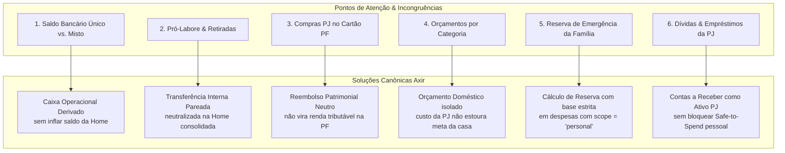
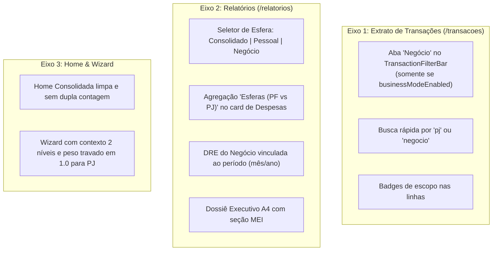

# AUDITORIA ARQUITETURAL, MATEMÁTICA & PLANO DE REFINAMENTO: MODO NEGÓCIO (MEI / AUTÔNOMO)

> **Documento Canônico de Auditoria, Blindagem Contábil e Plano de Execução**  
> **Status:** Aprovado para Execução  
> **Versão:** 1.0  
> **Data:** Novembro de 2026  
> **Público-alvo:** Engenheiros de Software, Product Designers e Auditores de Governança Financeira

---

## 1. VISÃO GERAL & DIRETRIZ DE PRODUTO

O **Modo Negócio** do Axir foi concebido para atender o microempreendedor individual (MEI), profissional autônomo, freelancer e dono de microempresa no Brasil. 

### 1.1 Diretriz Inegociável: Isolamento Opt-In Total (Espelho do Modo Família)
1. **Zero Atrito para quem não usa:** Se `businessModeEnabled === false` (padrão), o aplicativo comporta-se exatamente como uma gestão financeira pessoal pura. Não há botões extras, chamadas de API adicionais, campos obrigatórios nem lentidão.
2. **Sem Falsa Complexidade ERP:** O usuário autônomo não quer um SAP ou Totvs. Ele quer saber se a empresa dele dá lucro, quanto pode tirar de pró-labore para a família, se vai estourar o teto do MEI e quanto gasta no cartão pessoal para a empresa.
3. **Área Dedicada (`/negocio`):** A inteligência pesada da empresa (DRE, Teto MEI, Ponto de Equilíbrio, Benefício Fiscal e Transferências) vive em uma rota dedicada, sem poluir a navegação do dia a dia.

---

## 2. DIAGNÓSTICO DO ANTIPATTERN REMOVIDO: O SWITCHER GLOBAL

### 2.1 O que era o `<ViewScopeSwitcher />` (`[ Tudo | Pessoal | Negócio ]`)
Na implementação inicial da Fase 2A, foi inserido um componente flutuante no topo de todas as telas principais (`page-shell.tsx`) com três botões: `Tudo`, `Pessoal` e `Negócio`.

### 2.2 Por que a eliminação deste filtro foi mandatória (Auditada e Corrigida):
- **Sobrecarga Cognitiva e Fadiga Visual (*Accent Fatigue*):** O usuário abria a Home ou o Extrato e se deparava com um seletor permanente disputando atenção com o saldo e os cartões.
- **Conflito com o Modelo Mental de Área Dedicada:** No Modo Família, não existe um switcher global `[ Tudo | Individual | Família ]` no topo da Home. O usuário gerencia a família em `/familia` e apenas categoriza os gastos no lançamento. O Modo Negócio devia seguir a mesma elegância.
- **A Solução Adotada (Opção 1 + Opção 3):**
  - **Home Consolidada (Opção 1):** A Home exibe a visão financeira consolidada real do usuário, identificando transações da empresa com um badge sutil `PJ`, e neutralizando transferências internas (como pró-labore) para não duplicar dinheiro.
  - **Filtro Contextual no Extrato (Opção 3):** O filtro por escopo é transferido exclusivamente para onde o usuário audita lançamentos: o Extrato de Transações (`/transacoes`), como uma aba natural e discreta.

---

## 3. AUDITORIA PROFUNDA DE FRAGILIDADES, INCONGRUÊNCIAS & MATEMÁTICA FINANCEIRA

Abaixo está o levantamento exaustivo de todas as variáveis e incongruências que surgem ao relacionar Pessoa Física e Negócio, com a definição de como o Axir soluciona cada uma.

---

### 3.1 A Fragilidade Crítica dos Pesos de Despesa e Receita (`report_weight`)

#### O que é o `report_weight` na Pessoa Física:
Originalmente, o campo `report_weight` (valor de 0.0 a 1.0) foi criado para expurgar gastos compartilhados da vida doméstica (ex.: *"paguei a conta do restaurante de R$ 300 para o grupo, mas meu consumo foi R$ 100, peso 0.33"* ou *"comprei algo que será reembolsado pelo plano de saúde, peso 0"*).

#### A Incongruência Contábil no Modo Negócio:
1. **No Faturamento e Teto do MEI (Receita Federal):**
   - A Receita Federal não aceita peso fracionado sobre notas fiscais. Se o MEI emitiu uma NF de R$ 5.000, o faturamento fiscal é rigorosamente R$ 5.000.
   - Se o sistema permitisse peso 0 ou 0.5 em uma receita PJ:
     - O termômetro do MEI contaria R$ 5.000 (peso fixo nominal).
     - O DRE contaria R$ 2.500 (ponderado).
     - **Incongruência:** O usuário veria números conflitantes dentro do próprio app sobre o quanto faturou.
2. **Nos Custos Operacionais e DRE da Empresa:**
   - Se o usuário cadastra uma compra de estoque de R$ 1.000 com peso 0.5, o DRE computaria apenas R$ 500 de custo.
   - **Incongruência:** O DRE geraria um "Lucro Líquido" artificialmente inflado, iludindo o empreendedor e gerando falsa impressão de lucratividade.
3. **No Benefício Fiscal (Despesas Dedutíveis):**
   - Reduzir o peso diminuiria artificialmente o benefício fiscal da despesa na apuração tributária.
4. **No Saldo Bancário Real:**
   - O extrato bancário debita 100% do dinheiro, independentemente do peso.

#### A Solução Canônica:
- **Trava de Integridade Contábil:** Para lançamentos com `scope = 'business'`, o `report_weight` é **sempre 1.0 (100% nominal)**.
- **Ocultação de Campo no Wizard:** Ao selecionar o contexto `Negócio` no `LaunchWizard`, o campo de "Peso no Relatório" fica **completamente oculto**, prevenindo distorções no DRE e na fiscalidade.
- **Despesas de Uso Misto Real (Split PF/PJ):** Quando uma despesa é verdadeiramente compartilhada (ex.: internet de casa de R$ 200 utilizada 50% para a empresa e 50% para a família), o sistema não deve usar um peso que "apaga" os outros 50%. A solução limpa é o **Lançamento Dividido (Split PF/PJ)**: divide-se a transação em duas linhas legítimas de R$ 100 (uma pessoal e uma do negócio), ambas com peso 1.0 em seus respectivos livros contábeis.

---

### 3.2 As 6 Incongruências de Cálculo e Soluções Estruturais



---

#### Incongruência 1: Conta Bancária Única vs. Contas Separadas (Checkpoints de Saldo)
- **O Problema:** A grande maioria dos autônomos e MEIs no Brasil não possui conta PJ formal separada (ou mistura todas as transações na mesma conta bancária do dia a dia).
  - Se o app exigisse dois checkpoints separados ("Saldo Bancário Pessoal" e "Saldo Bancário do Negócio") e o usuário digitasse o saldo de sua conta única em ambos (ex.: R$ 8.000), a Home Consolidada somaria R$ 16.000, criando um saldo fantasma.
- **A Solução Canônica:**
  - O checkpoint bancário ("Bater com o banco") continua sendo o **saldo real da conta no banco**.
  - Na tela `/negocio`, o caixa da empresa é calculado como **Caixa Operacional Derivado**:
    $$\text{Caixa do Negócio} = \text{Receitas PJ Recebidas} - \text{Custos PJ Pagos} - \text{Pró-labores Retirados}$$
  - Isso dispensa a obrigatoriedade de conta bancária jurídica separada e mantém o saldo consolidado da Home 100% compatível com a vida real.

---

#### Incongruência 2: Pró-Labore e Retiradas (Receita da PF vs. Custo da PJ)
- **O Problema:** Quando a empresa fatura R$ 10.000 e transfere R$ 4.000 de pró-labore para a conta pessoal do empreendedor:
  - Se isso fosse lançado como uma despesa comum na PJ e uma receita comum na PF, a Home Consolidada mostraria:
    $$\text{Receitas Totais} = \text{R\$\,10.000 (clientes)} + \text{R\$\,4.000 (pró-labore)} = \text{R\$\,14.000}$$
    Isso geraria uma **falsa ilusão de riqueza**, pois o usuário não ganhou R$ 14.000; ganhou R$ 10.000 e apenas movimentou R$ 4.000 de um bolso para o outro.
- **A Solução Canônica:**
  - O mecanismo de **Transferências Internas Pareadas (`is_internal_transfer = true`, `transfer_kind = 'pro_labore'`)**:
    - **Na Home Consolidada:** É **100% neutralizada**. O fluxo de caixa consolidado registra apenas os R$ 10.000 externos de clientes.
    - **No DRE da Empresa (`/negocio`):** Faturamento Bruto R$ 10.000 $\rightarrow$ Custos $\rightarrow$ Lucro Operacional $\rightarrow$ Pró-Labore R$ 4.000 $\rightarrow$ Lucro Retido da Empresa.
    - **Nos Relatórios Pessoais (`/relatorios` - visão Pessoal):** Os R$ 4.000 aparecem exatamente como o salário/renda do mês com o qual o usuário paga o aluguel, condomínio e mercado da família.

---

#### Incongruência 3: Cartão de Crédito Misto e Reembolsos PJ $\rightarrow$ PF
- **O Problema:** O usuário comprou um insumo de R$ 600 para a empresa utilizando seu cartão de crédito pessoal Nubank. A fatura do cartão totalizou R$ 2.500 (R$ 1.900 pessoal + R$ 600 empresa).
  - Quando a empresa transfere R$ 600 para a conta pessoal para reembolsar esse gasto:
    - Se essa entrada fosse tratada como "Receita", distorceria o imposto de renda da PF (o usuário não teve acréscimo patrimonial, apenas recuperou um empréstimo feito à própria empresa).
    - Se a compra e o reembolso fossem computados como despesas, a empresa registraria R$ 1.200 de custo para uma despesa de R$ 600.
- **A Solução Canônica:**
  - O motor `card-reimbursement.ts` e o fluxo em 1 clique já implementados:
    - A despesa no cartão entra com `scope = 'business'`. Ela é o **Custo Contábil no DRE**.
    - O reembolso PJ $\rightarrow$ PF é classificado como **Devolução Patrimonial Neutra (`transfer_kind = 'card_reimbursement'`)**: não infla a renda pessoal nem dobra o custo da empresa.

---

#### Incongruência 4: Orçamentos Domésticos por Categoria (`budgets`)
- **O Problema:** O usuário estipulou uma meta de gastar no máximo R$ 800/mês com "Combustível".
  - Na vida pessoal gastou R$ 500.
  - Mas pela empresa viajou para visitar clientes e gastou R$ 600 de combustível.
  - Se os orçamentos misturarem tudo, a barra de progresso acusaria estouro (R$ 1.100 de R$ 800) em vermelho. O usuário ficaria frustrado, pois seu gasto pessoal cumpriu a meta, e o combustível da empresa foi um custo de venda que gerou faturamento.
- **A Solução Canônica:**
  - O módulo de Orçamentos e Limites de Gastos da família computa **estritamente despesas com `scope = 'personal'`** (mesmo em categorias compartilhadas como Combustível ou Alimentação).
  - A disciplina de custos da empresa é gerida pela **Margem de Lucro** e **Ponto de Equilíbrio** dentro da aba `/negocio`, e não por orçamentos domésticos.

---

#### Incongruência 5: Reserva de Emergência e Carteira de Investimentos
- **A armadilha:** O termômetro de Reserva de Emergência calcula 6 meses do custo de vida pessoal da família.
  - Se os custos da empresa (estoque, anúncios, fornecedores) fossem somados ao custo de vida pessoal, o app calcularia que a família gasta R$ 35.000/mês e exigiria uma reserva doméstica de R$ 210.000! Isso desregularia totalmente os aportes em ações, FIIs e previdência.
- **A Solução Canônica:**
  - O cálculo da **Reserva de Emergência Pessoal** baseia-se exclusivamente em **despesas com `scope = 'personal'`**.
  - A saúde de caixa da empresa é tratada de forma separada como **Capital de Giro Operacional** em `/negocio`.

---

#### Incongruência 6: Dívidas, Empréstimos e Clientes a Receber (`debts`)
- **A armadilha:** Empréstimos empresariais (ex.: Pronampe R$ 25.000 para capital de giro) ou faturas pendentes de clientes a receber:
  - Uma conta a receber de cliente PJ é um **Ativo Circulante**, não uma dívida pessoal.
  - Um boleto de fornecedor PJ a vencer não deve travar o Safe-to-Spend (saldo livre para compras do dia a dia) da família.
- **A Solução Canônica:**
  - No módulo `/dividas`, os compromissos PJ recebem badge semântico `PJ`.
  - No DRE da empresa (`/negocio`), os recebíveis de clientes entram no indicador específico **"Receitas Previstas a Receber"**, permitindo antecipar o fechamento do mês sem misturar com as finanças da casa.

---

## 4. PLANO DE REFINAMENTO E IMPLEMENTAÇÃO: EIXOS 1 E 2

Com o `<ViewScopeSwitcher />` do shell devidamente eliminado, a experiência do usuário se divide de forma limpa nos eixos abaixo:



---

### 4.1 Eixo 1 — Extrato de Transações (`/transacoes`)

1. **Aba "Negócio" na barra de abas (`Tabs` de `TransactionFilterBar`):**
   - No array `FILTER_TAB_ITEMS`, adicionar condicionalmente:
     ```tsx
     ...(isBusinessModeEnabled
       ? [{ value: "business", label: "Negócio", icon: <Briefcase className="size-4" aria-hidden="true" /> }]
       : [])
     ```
   - Ao selecionar a aba *"Negócio"*, o feed de transações filtra instantaneamente por `scope === 'business'`.
   - Mantém `fullWidth={false}` e rolagem horizontal suave no mobile (`overflow-x-auto no-scrollbar scroll-smooth`), em estrita conformidade com a **Regra 9 do `AGENTS.md`**.
2. **Busca Textual Refinada:**
   - Adicionar parser em `use-transaction-list.ts` para que buscas por `"pj"`, `"negocio"` ou `"dedutivel"` filtrem os lançamentos sem exigir abertura de modais complexos.

---

### 4.2 Eixo 2 — Relatórios Financeiros (`/relatorios`)

1. **Seletor de Esfera no Topo da Aba "Finanças & DRE":**
   - Quando `businessModeEnabled === true`, a aba de finanças disponibiliza um controle de escopo elegante para o período selecionado:
     - **Consolidado:** Soma receitas e despesas reais de ambos os lados, neutralizando transferências internas.
     - **Pessoal:** Exibe a DRE Pessoal do indivíduo (incluindo o Pró-Labore recebido da PJ).
     - **Negócio (PJ):** Exibe a DRE Gerencial da empresa do período selecionado (Faturamento Bruto, Custos Operacionais, Pró-Labore retirado e Lucro Líquido).
2. **Agregação "Esferas (PF vs PJ)" no Detalhamento de Despesas:**
   - Em `FinancialExpensesBreakdownCard`, adicionar a opção **"Esferas"** ao lado de *"Categorias"*, *"Formas de Pgto"*, *"Dias da Semana"* e *"Encargos"*.
   - Exibe a proporção em reais e percentual entre Gastos Pessoais e Gastos do Negócio para o mês/ano.
3. **Dossiê Executivo A4 / Impressão (`FinancialCloseReportModal`):**
   - No documento impresso gerado no fechamento mensal, adicionar seção opcional de **Apuração MEI / Simples Nacional**, contendo o faturamento bruto acumulado do ano e a margem de segurança do teto.

---

### 4.3 Eixo 3 — Blindagens no Wizard e Orçamentos

1. **Trava de Peso Contábil no Wizard:**
   - No `LaunchWizard` (Passo 2 / Detalhes), quando o contexto selecionado for `Negócio`:
     - O campo `report_weight` é fixado internamente em `1.0`.
     - O slider/seletor de peso é ocultado, evitando confusão para o usuário leigo.
2. **Blindagem do Orçamento Pessoal:**
   - Em `use-budgets-page.ts`, despesas com `scope === 'business'` são excluídas do consumo dos orçamentos da família, mesmo quando a categoria for compartilhada.

---

## 5. SUGESTÕES DE MELHORIAS ADICIONAIS DE ALTO VALOR

1. **Radar de Desenquadramento do MEI (Projeção Linear):**
   - Calcular a velocidade média mensal de faturamento. Se a projeção anual indicar risco de ultrapassar os R$ 81.000, exibir um aviso preventivo suave em `/negocio`: *"No ritmo atual, você atingirá o teto do MEI em Outubro. Planeje a migração para ME ou controle emissões"*.
2. **Alerta de DAS do MEI:**
   - No carrossel da Home, nos dias 15 a 20 de cada mês, exibir um lembrete do vencimento da guia DAS do MEI, com botão de 1 clique para baixar/pagar ou marcar como pago.
3. **Extrator de Notas/Recibos PJ com IA:**
   - Ao anexar um comprovante no modo negócio, o Gemini extrai automaticamente se há retenção de tributos ou se a despesa é dedutível, sugerindo a categoria PJ correta.

---

## 6. MATRIZ DE RASTREABILIDADE & DEFINITION OF DONE

| Requisito | Arquivos Envolvidos | Critério de Aceite |
|---|---|---|
| **Zero Switcher Global** | `src/components/layout/page-shell.tsx` | Eliminado sem resíduos. ViewScope global não interfere no shell. |
| **Aba Negócio no Extrato** | `src/features/transactions/components/list/transaction-filter-bar.tsx` | Aparece somente se `businessModeEnabled = true`. Filtra em tempo real. |
| **Relatórios Segmentados** | `src/features/reports/pages/reports-page.tsx`, `financial-tab.tsx` | Permite alternar visão Consolidada, Pessoal e PJ para DRE e detalhamento. |
| **Trava de Pesos PJ** | `src/features/transactions/wizard/step-details.tsx` | Oculta peso para lançamentos PJ e força `report_weight = 1.0`. |
| **Blindagem de Orçamentos** | `src/features/budgets/components/use-budgets-page.ts` | Gastos PJ não estouram orçamentos pessoais da casa. |
| **Qualidade e Testes** | Vitest + TypeScript + ESLint | 100% de testes passando, 0 erros no typecheck e no linter. |
