# Plano de Implementação — Refinamento e Elevação de Notificações Bancárias & Comprovantes OCR

> **Data de Criação:** 04/11/2026  
> **Status:** Pronto para Execução (Night Shift / Argos Sandbox)  
> **Escopo:**  
> 1. Notificações Financeiras Nativas (Exclusivo Android / APK via NotificationListenerService).  
> 2. Leitura e Extração de Comprovantes OCR (Universal: PWA, Web e APK).  
> 3. Relatório de Viabilidade Técnica para Notificações de Apps de Transporte/Serviços (Uber, 99, iFood).  

---

## 1. Visão Geral & Objetivos Estratégicos

Este plano tem como objetivo elevar a robustez, precisão e inteligência de duas funcionalidades críticas do ecossistema **financasnew**:

1. **Identificação de Despesas e Rendas por Notificações (Android / APK)**:
   - Expandir a cobertura para mais de 30 instituições bancárias, corretoras, cooperativas e carteiras digitais (Google Wallet e Samsung Wallet).
   - Eliminar falsos positivos causados por notificações de marketing sofisticadas (ofertas de empréstimo, aumento de limite, faturas fechadas, cupons e dicas).
   - Introduzir detecção heurística de parcelamentos com base nos múltiplos padrões adotados por cada banco.
   - Refinar a auto-resolução de cartões de crédito e contas bancárias cadastradas, utilizando os últimos 4 dígitos e a bandeira do cartão.
   - Fortalecer a memória contínua de categorização do usuário (`merchant-memory.ts`) e o catálogo semântico de estabelecimentos.
   - Emitir parecer e relatório de viabilidade para aplicativos de transporte/serviços (Uber, 99, iFood), avaliando o risco de duplicação com cartões de crédito (sem implementar código executável no momento).

2. **Identificação e Anexo de Comprovantes OCR (Universal: PWA, Web e APK)**:
   - Aprimorar o tratamento de ruídos ópticos e visuais (letras trocadas, prefixos monetários danificados, fotos escuras ou de baixa resolução).
   - Desenvolver algoritmo de busca reversa (bottom-up) para cupons fiscais extensos (DANFE NFC-e / SAT / restaurantes / supermercados), capturando com precisão cirúrgica o **Total a Pagar / Total Líquido**, sem confundir com itens individuais do cupom.
   - Extrair parcelamento explícito e discernir o valor da parcela vs valor total financiado em carnês e comprovantes de maquininhas (POS / TEF).
   - Garantir paridade e alta performance no PWA / Web (Tesseract.js dinâmico + unpdf) e no Android nativo (Google ML Kit Text Recognition + PdfRenderer).

---

## 2. Estrutura do Plano de Implementação

O plano é dividido em **8 Fases**, cada uma contendo etapas detalhadas em formato de checklist Markdown (`- [ ]`) e finalizando com um **Portão de Qualidade** obrigatório.

```mermaid
flowchart TD
    F1["Fase 1: Matriz de Bancos, Carteiras & Filtro Anti-Marketing (Notificações)"] --> Q1{"Portão de Qualidade 1"}
    Q1 --> F2["Fase 2: Motor de Parcelamento em Notificações"]
    F2 --> Q2{"Portão de Qualidade 2"}
    Q2 --> F3["Fase 3: Auto-Resolução de Cartões, Contas & Memória de Categorias"]
    F3 --> Q3{"Portão de Qualidade 3"}
    Q3 --> F4["Fase 4: Relatório de Viabilidade de Apps de Transporte (Uber/99/iFood)"]
    F4 --> Q4{"Portão de Qualidade 4"}
    Q4 --> F5["Fase 5: Pré-Processamento Óptico & Resiliência a Ruídos (OCR)"]
    F5 --> Q5{"Portão de Qualidade 5"}
    Q5 --> F6["Fase 6: Extração de Totais em Cupons com Múltiplos Itens (NFC-e/SAT)"]
    F6 --> Q6{"Portão de Qualidade 6"}
    Q6 --> F7["Fase 7: Ampliação de Comprovantes (Pix, Boletos, Carnês & Slips)"]
    F7 --> Q7{"Portão de Qualidade 7"}
    Q7 --> F8["Fase 8: Homologação Transversal, Documentação, Build APK & Argos"]
```



---

## Fase 1: Matriz de Bancos, Carteiras & Filtro Anti-Marketing (Notificações Android)

O objetivo desta fase é expandir o catálogo de pacotes bancários suportados e blindar a camada nativa e o domínio contra notificações promocionais ou informativas que não representem transações financeiras reais.

- [ ] **Tarefa 1.1: Expansão do Catálogo de Pacotes Bancários no Android Nativo**
  - Atualizar `DEFAULT_MONITORED_PACKAGES` em `android/app/src/main/java/com/guiafinanceiro/app/BankNotificationListenerService.java`:
    - Adicionar novos bancos digitais e tradicionais: Sofisa Direto (`br.com.sofisa.direto`), Banco Pan (`br.com.bancopan.app`), BV (`br.com.bv.banco`), Avenue (`us.avenue.app`), Cora PJ (`com.cora.app`), Inter Empresas (`br.com.intermedium.pj`), C6 Empresas (`com.c6bank.empresa`), BTG Empresas (`com.btgpactual.empresas`), PagBank Vendedor (`br.com.uol.ps.seller`).
    - Adicionar pacotes de Carteira Google (`com.google.android.apps.walletnfcrel`) e Samsung Wallet (`com.samsung.android.spay`, `com.samsung.android.raja.spay`, `com.samsung.android.app.spay`).
  - Sincronizar o mapeamento no TypeScript em `BANK_PACKAGE_MAP` (`src/domain/notifications/bank-parser.ts`).

- [ ] **Tarefa 1.2: Aprimoramento da Captura de Carteiras Digitais (Google Wallet & Samsung Wallet)**
  - Tratar chamadas de notificações do Google Play Services (`com.google.android.gms`) que indicam pagamentos NFC por aproximação no `BankNotificationListenerService.java`.
  - No `src/domain/notifications/bank-parser.ts`, melhorar a função `resolveBankName` e `mergeWalletWithBank` para preservar a bandeira do cartão e os 4 dígitos capturados pela carteira digital até que o banco emissor envie a notificação definitiva.

- [ ] **Tarefa 1.3: Blindagem da Blacklist Semântica Anti-Marketing e Falsos Positivos**
  - Expandir a lista de expressões regulares em `BLACKLIST_EXPRESSIONS` (`src/domain/notifications/bank-parser.ts`) e `BLACKLIST_MARKETING_PATTERN` (`BankNotificationListenerService.java`):
    - Rejeitar ofertas com iscas de valores ("Ganhe até R$ 50 de desconto", "Empréstimo de até R$ 20.000 pré-aprovado", "Transfira R$ 100 via Pix e concorra").
    - Rejeitar avisos de fatura ("Sua fatura fechou no valor de...", "Lembrete de pagamento da fatura de R$...", "Resumo da sua fatura: R$...").
    - Rejeitar recargas sugeridas ("Recarregue a partir de R$ 15").
    - Rejeitar compras com saldo insuficiente, transações canceladas ou cartões temporariamente bloqueados.

- [ ] **Tarefa 1.4: Refinamento da Identificação de Rendas Recebidas (Incomes)**
  - Reforçar o parser para identificar entradas reais:
    - Pix recebido: "Você recebeu um Pix de R$...", "Pix recebido de [Nome] no valor de R$...", "Transferência Pix de R$... recebida".
    - Salário e proventos: "Salário creditado no valor de...", "Depósito de salário...", "Proventos de ações creditados", "Dividendos recebidos".
    - Estornos: "Estorno de compra no valor de...", "Reembolso recebido de R$...".
  - Garantir que a propriedade `nature: "income"` e `type: "income"` seja atribuída com precisão determinística.

- [ ] **Portão de Qualidade 1:**
  - [ ] Executar: `npm run typecheck`
  - [ ] Executar: `npm run lint`
  - [ ] Executar: `npx vitest run src/domain/notifications/bank-parser.test.ts src/domain/notifications/bank-e2e-matrix.test.ts`
  - [ ] Executar compilação Android Java: `cd android && ./gradlew testReleaseUnitTest` (se aplicável).
  - [ ] **Commit & Push da Fase 1:** `git commit -m "feat(notifications): amplia bancos suportados e blinda filtro anti-marketing"`

---

## Fase 2: Motor de Parcelamento em Notificações Bancárias (Android)

Muitos bancos notificam compras parceladas de formas distintas. Esta fase implementa heurísticas completas para identificar parcelamentos diretamente no texto curto das notificações.

- [ ] **Tarefa 2.1: Expansão dos Padrões de Parcelamento em Notificações**
  - Atualizar `extractInstallmentInfo` em `src/domain/notifications/bank-parser.ts`:
    - Padrão Multiplicador Extenso: "em 6 vezes", "em 10 parcelas", "parcelado em 3x", "6x sem juros", "divido em 4x".
    - Padrão com Parcela Atual e Total: "Parcela 02 de 10", "Parc 2/10", "03/12 de R$ 50,00".
    - Padrão Combinado: "Compra de R$ 600,00 (6x de R$ 100,00)" ou "R$ 300,00 em 3x de R$ 100,00".
    - Padrão de Sufixo: "Compra aprovada R$ 150,00 Mercado Livre (3x)".

- [ ] **Tarefa 2.2: Discernimento Matemático entre Valor Total e Valor da Parcela**
  - Se a notificação cita "em 3x de R$ 50,00", o valor da transação deve ser registrado como **R$ 150,00** (total financiado), com `installments: 3` e `installmentAmountCents: 5000`.
  - Se a notificação cita "Compra de R$ 150,00 em 3x", o valor total é **R$ 150,00**, com `installments: 3` e `installmentAmountCents: 5000`.
  - Se a notificação é de controle mensal ("Parcela 2 de 5 de R$ 80,00"), registrar o lançamento da competência com `currentInstallment: 2` e `installments: 5`.

- [ ] **Tarefa 2.3: Testes de Matriz de Sintaxes de Parcelamento Multi-Bancos**
  - Criar testes dedicados em `src/domain/notifications/bank-parser.test.ts` simulando pushes reais de Nubank, Itaú, Santander, Bradesco, C6, Inter e Banco do Brasil com compras parceladas em 2x até 24x.

- [ ] **Portão de Qualidade 2:**
  - [ ] Executar: `npm run typecheck`
  - [ ] Executar: `npm run lint`
  - [ ] Executar: `npx vitest run src/domain/notifications/bank-parser.test.ts src/domain/notifications/installment-extractor.test.ts`
  - [ ] **Commit & Push da Fase 2:** `git commit -m "feat(notifications): adiciona motor heuristico de parcelamento em notificacoes"`

---

## Fase 3: Auto-Resolução de Cartões, Contas & Memória de Categorias

Aumentar a taxa de acerto do assistente, vinculando a notificação ao cartão ou à conta bancária cadastrada pelo usuário e selecionando a categoria certa com base em memória adaptativa.

- [ ] **Tarefa 3.1: Resolução de Cartões por 4 Últimos Dígitos e Bandeira**
  - Aprimorar `src/domain/notifications/card-resolution.ts`:
    - Casamento unívoco pelos últimos 4 dígitos informados na notificação (ex: "final 1234", "cartão terminado em 5678", "com o cartão **** 9012").
    - Desempate por bandeira (Visa, Mastercard, Elo, Amex) quando o usuário possui mais de um cartão do mesmo banco.
    - Suporte a cartões virtuais vs físicos com identificadores distintos.

- [ ] **Tarefa 3.2: Auto-Resolução de Conta Bancária para Débito e Pix**
  - Criar função pura `resolveBestMatchingBankAccount` em `src/domain/notifications/card-resolution.ts`:
    - Quando o método de pagamento for "debit", "pix" ou "transfer", buscar nas contas bancárias (`BankAccount[]`) cadastradas pelo usuário a conta com nome ou instituição correspondente (ex: "Inter", "Nubank", "Itaú", "C6").
    - Atribuir o `accountId` sugerido para que a transação não fique órfã de conta de liquidação.

- [ ] **Tarefa 3.3: Memória Contínua de Categorização e Estabelecimentos (`merchant-memory.ts`)**
  - Aprimorar `recordMerchantLearning` e `findLearnedMerchant`:
    - Quando o usuário cadastra ou confirma uma transação pelo Banner de Sugestões ou Diálogo, memorizar a tríade: Estabelecimento + Categoria Escolhida + Método/Cartão Utilizado.
    - Implementar incremento de confiança (`usageCount` e `lastUsedAt`).
    - Permitir que variações de escrita de um mesmo estabelecimento ("Uber *Trip", "UBER BR", "Uber Eats") herdem a categoria aprendida.

- [ ] **Tarefa 3.4: Enriquecimento do Catálogo de Palavras-Chave de Categorias (`category-inference.ts`)**
  - Expandir os termos em `KEYWORD_GROUPS`:
    - Saúde: farmácias regionais, drogarias, laboratórios, clínicas, planos de saúde.
    - Alimentação: padarias, cafeterias, fast foods, delivery, restaurantes, açougues.
    - Transporte: postos de combustível (Ipiranga, Shell, Petrobras, BR), pedágios (Sem Parar, Veloe, ConectCar), estacionamentos.
    - Assinaturas: streaming, nuvem, softwares, academias (Smart Fit, Bluefit).
    - Mercado: redes regionais, atacadistas, hortifrutis.

- [ ] **Portão de Qualidade 3:**
  - [ ] Executar: `npm run typecheck`
  - [ ] Executar: `npm run lint`
  - [ ] Executar: `npx vitest run src/domain/notifications/card-resolution.test.ts src/domain/notifications/merchant-memory.test.ts src/domain/notifications/category-inference.test.ts`
  - [ ] **Commit & Push da Fase 3:** `git commit -m "feat(notifications): auto-resolucao de cartoes e contas com memoria adaptativa de categorias"`

---

## Fase 4: Relatório de Viabilidade Técnica de Notificações de Apps de Transporte (Uber, 99, iFood)

Conforme instrução expressa, esta fase dedica-se a realizar a **análise técnica aprofundada de viabilidade** de monitoramento de apps de transporte/serviços, sem implementar alterações em código executável no momento.

- [ ] **Tarefa 4.1: Levantamento de Pacotes e Estrutura de Notificações dos Apps de Transporte**
  - Mapear pacotes Android: Uber (`com.ubercab`, `com.ubercab.eats`), 99 Tecnologia (`com.taxis99`), iFood (`br.com.brainweb.ifood`).
  - Analisar estrutura de textos típicos de push pós-corrida e pós-pedido ("Sua viagem com o motorista Carlos de R$ 24,90 foi concluída", "Seu pedido de R$ 68,00 no Habib's está a caminho").

- [ ] **Tarefa 4.2: Análise Crítica do Risco de Duplicação com Notificações Bancárias**
  - Avaliar o cenário em que o usuário utiliza cartão de crédito cadastrado na Uber/99/iFood:
    - O usuário recebe a notificação da Uber ("Viagem concluída: R$ 24,90").
    - Segundos depois, recebe a notificação do Nubank ("Compra de R$ 24,90 aprovada em Uber *Trip").
    - Avaliar impactos no fluxo do usuário: risco de gerar duas transações pendentes para a mesma despesa real.

- [ ] **Tarefa 4.3: Redação do Relatório Formal de Viabilidade & Recomendações**
  - Elaborar o documento `docs/reports/VIABILIDADE_NOTIFICACOES_APPS_SERVICOS.md` contendo:
    - Prós e Contras da captura direta de apps de terceiros.
    - Solução técnica recomendada para o futuro (janela de tolerância temporal e deduplicação de transações entre App de Serviço e Banco).
    - Conclusão e parecer: manter o foco atual na notificação bancária oficial (fonte primária e líquida da movimentação financeira).

- [ ] **Portão de Qualidade 4:**
  - [ ] Verificar integridade e formatação do relatório `docs/reports/VIABILIDADE_NOTIFICACOES_APPS_SERVICOS.md`.
  - [ ] **Commit & Push da Fase 4:** `git commit -m "docs(reports): adiciona relatorio de viabilidade tecnica para notificacoes de servicos"`

---

## Fase 5: Pré-Processamento Óptico & Resiliência a Ruídos Visuais (Comprovantes OCR)

Garantir que comprovantes capturados por fotos de celular, escaneamentos ou impressões térmicas de baixa qualidade tenham o texto devidamente corrigido antes do parsing.

- [ ] **Tarefa 5.1: Expansão do Higienizador de Ruídos Ópticos (`ocr-cleaner.ts`)**
  - Suportar prefixos monetários danificados: `B$`, `RS`, `P$`, `A$`, `h$`, `F$`, `8$`, `k$`, convertendo para `R$`.
  - Reparar valores fraturados por espaçamento irregular do OCR: `1. 250, 00` -> `1.250,00` e `45 , 90` -> `45,90`.
  - Corrigir pontuações acidentais: apóstrofos e traços em centavos (`42'90`, `42-90`, `42 90`) -> `42,90`.
  - Remover ruídos de linhas decorativas e bordas pontilhadas (`- - - - -`, `* * * * *`, `===========`).

- [ ] **Tarefa 5.2: Otimização do Pipeline OCR no Web/PWA (`web-ocr.ts` & Canvas Preprocessing)**
  - Adicionar etapa de normalização de imagem no navegador via `<canvas>` antes do envio ao Tesseract:
    - Ajuste de contraste e conversão para escala de cinza (grayscale).
    - Redimensionamento suave para imagens excessivamente grandes (> 2500px), reduzindo o tempo de processamento sem perder nitidez nos textos.

- [ ] **Tarefa 5.3: Tratamento de Orientação e Rotação no Android Nativo (`ReceiptOcrHelper.java`)**
  - Garantir que fotos tiradas em modo paisagem ou com orientação EXIF invertida sejam corrigidas para a orientação vertical antes da inferência no Google ML Kit.

- [ ] **Portão de Qualidade 5:**
  - [ ] Executar: `npm run typecheck`
  - [ ] Executar: `npm run lint`
  - [ ] Executar: `npx vitest run src/domain/notifications/ocr-cleaner.test.ts`
  - [ ] **Commit & Push da Fase 5:** `git commit -m "feat(ocr): aprimora pre-processamento optico e tolerancia a ruidos visuais"`

---

## Fase 6: Extração de Totais em Cupons com Múltiplos Itens (DANFE NFC-e / SAT / Restaurantes)

Cupons de supermercado, farmácia e restaurante contêm dezenas de linhas de itens com preços parciais. Esta fase implementa algoritmo para isolar exclusivamente o valor final consolidado.

- [ ] **Tarefa 6.1: Algoritmo de Busca Reversa (Bottom-Up) para Totalizador Fiscal**
  - Modificar `extractDanfeTotalCents` em `src/domain/notifications/danfe-nfc-parser.ts`:
    - Varrer as linhas do texto a partir do final (onde os totalizadores fiscais residem por especificação da SEFAZ).
    - Priorizar marcadores oficiais: "VALOR A PAGAR R$", "TOTAL A PAGAR", "TOTAL LIQUIDO R$", "TOTAL R$", "VALOR TOTAL R$".
    - Eliminar confusão com subtotais de itens, descontos, troco ("TROCO R$ 10,00") ou número de itens ("QTD TOTAL DE ITENS: 15").

- [ ] **Tarefa 6.2: Extração de Razão Social e Nome Fantasia em Cupons Fiscais**
  - Aprimorar `extractDanfeIssuer`:
    - Filtrar títulos operacionais ("VIA CONSUMIDOR", "EXTRATO SAT", "DANFE NFC-e").
    - Capturar o nome do estabelecimento emitente nas primeiras linhas e higienizar prefixos e sufixos fiscais (LTDA, S/A, ME, EPP).
    - Associar o CNPJ capturado à memória de estabelecimentos para herdar a categoria correta.

- [ ] **Tarefa 6.3: Fallback Semântico para Recibos Genéricos de Múltiplos Itens (`universal-receipt-parser.ts`)**
  - Aprimorar `parseGenericReceipt` para que, ao se deparar com listas de compras (restaurantes, oficinas, farmácias avulsas), busque explicitamente a linha de total antes de recorrer ao primeiro valor monetário encontrado.

- [ ] **Portão de Qualidade 6:**
  - [ ] Executar: `npm run typecheck`
  - [ ] Executar: `npm run lint`
  - [ ] Executar: `npx vitest run src/domain/notifications/danfe-nfc-parser.test.ts src/domain/notifications/universal-receipt-parser.test.ts`
  - [ ] **Commit & Push da Fase 6:** `git commit -m "feat(ocr): busca reversa para extracao precisa de totais fiscais em cupons com multiplos itens"`

---

## Fase 7: Ampliação de Comprovantes (Pix, Boletos, Carnês & Slips)

Suporte exaustivo aos comprovantes bancários mais emitidos no Brasil, extraindo dados de parcelamento, beneficiário e instituição.

- [ ] **Tarefa 7.1: Matriz Universal de Comprovantes Pix (`pix-receipt-parser.ts`)**
  - Atualizar regex e campos de comprovantes Pix emitidos por: Nubank, Inter, Itaú, Bradesco, Santander, Banco do Brasil, Caixa, C6 Bank, BTG, Mercado Pago e PicPay.
  - Extrair: Nome do Destinatário/Beneficiário, CPF/CNPJ mascarado, Instituição Financeira de Destino, Data/Hora e Chave Pix.

- [ ] **Tarefa 7.2: Extração de Parcelamento em Comprovantes de Maquininha (`card-slip-parser.ts`)**
  - Aprimorar o parsing de slips POS/TEF (Cielo, Rede, Stone, PagBank, Getnet):
    - Extração do número de parcelas ("PARC: 03", "3X", "PARCELADO EM 6X").
    - Distinção clara entre: Crédito à Vista, Crédito Parcelado Loja, Crédito Parcelado Emissor e Débito.
    - Captura da bandeira e dos 4 últimos dígitos do cartão.

- [ ] **Tarefa 7.3: Boletos Bancários e Carnês de Pagamento (`bank-slip-parser.ts`)**
  - Suportar carnês de lojas com parcelas ("PARCELA 03 DE 12").
  - Extrair linha digitável (47 ou 48 dígitos), data de vencimento e beneficiário principal.

- [ ] **Tarefa 7.4: Integração de Resolução de Cartão e Categoria no Diálogo de Anexo (`AttachReceiptDialog.tsx`)**
  - Garantir que, após o OCR ler o comprovante, os dados sejam enriquecidos com a memória de categorias e o cartão mais aderente seja selecionado automaticamente no formulário pré-preenchido.

- [ ] **Portão de Qualidade 7:**
  - [ ] Executar: `npm run typecheck`
  - [ ] Executar: `npm run lint`
  - [ ] Executar: `npx vitest run src/domain/notifications/pix-receipt-parser.test.ts src/domain/notifications/card-slip-parser.test.ts src/domain/notifications/bank-slip-parser.test.ts src/domain/notifications/receipt-e2e-matrix.test.ts`
  - [ ] **Commit & Push da Fase 7:** `git commit -m "feat(ocr): amplia suporte a comprovantes pix, boletos carnes e slips de maquininhas"`

---

## Fase 8: Homologação Transversal, Documentação, Build Web, Build APK & Despacho Argos

Consolidação de todo o trabalho realizado, execução dos testes integrados, compilação dos artefatos de produção e envio do relatório final ao fundador no Telegram via robô ARGOS.

- [ ] **Tarefa 8.1: Execução da Suíte Completa de Testes Automatizados**
  - Rodar typecheck global: `npm run typecheck`.
  - Rodar linting: `npm run lint`.
  - Rodar todos os testes de notificações e OCR: `npx vitest run src/domain/notifications/ src/services/native/`.

- [ ] **Tarefa 8.2: Atualização dos Documentos de Arquitetura e Governança**
  - Atualizar `docs/architecture/ESPECIFICACAO_TECNICA.md` documentando os novos bancos suportados, algoritmos de parcelamento e o motor bottom-up de cupons fiscais.
  - Atualizar `docs/architecture/ARCHITECTURE.md` refletindo as melhorias na camada de notificações e OCR.

- [ ] **Tarefa 8.3: Compilação Web de Produção e Sincronização com o Capacitor**
  - Executar: `npm run build`.
  - Executar sincronização nativa: `npx cap sync android`.

- [ ] **Tarefa 8.4: Compilação dos APKs Android de Produção (Debug & Release Assinado)**
  - Executar o script oficial de empacotamento:
    ```bash
    bash scripts/build-apk.sh
    ```
  - Validar a integridade dos artefatos em `android/app/build/outputs/apk/` e o preenchimento de `version.json` com SHA-256 e tamanho em MB.

- [ ] **Tarefa 8.5: Commit e Push Final da Homologação**
  - Sincronizar todos os arquivos alterados com a branch principal (`git push origin main`).

- [ ] **Tarefa 8.6: Despacho do Relatório Executivo ao Fundador via Bot ARGOS (Telegram)**
  - Executar o despachante de notificação no Telegram com o resumo detalhado de todas as melhorias entregues:
    ```bash
    npx tsx scripts/notify-telegram.ts --summary "Refinamento Integral de Notificações e Comprovantes OCR concluído com sucesso."
    ```

- [ ] **Portão de Qualidade Final:**
  - [ ] 100% da suíte de testes de notificações e OCR aprovada sem falhas.
  - [ ] Build Web e APK Android Release gerados e validados.
  - [ ] Documentação técnica sincronizada.
  - [ ] Notificação Telegram entregue pelo bot ARGOS com o relatório executivo.
  - [ ] Repositório sincronizado no GitHub (`git push origin main`).
