# Plano de Implementação — Refinamento e Elevação de Notificações Bancárias & Comprovantes OCR

> **Data de Atualização:** 04/11/2026  
> **Status:** Pronto para Execução (Night Shift / Argos Sandbox)  
> **Escopo:**  
> 1. Notificações Financeiras Nativas (Exclusivo Android / APK via NotificationListenerService).  
> 2. Leitura e Extração de Comprovantes OCR (Universal: PWA, Web e APK).  
> 3. Relatório de Viabilidade Técnica para Notificações de Apps de Transporte/Serviços (Uber, 99, iFood).  

---

## 1. Visão Geral & Casos Reais de Auditoria

Este plano tem como objetivo elevar a robustez, precisão e inteligência de duas funcionalidades críticas do ecossistema **financasnew**:

### Incidentes Reais Identificados na Auditoria de Produção:
1. **Caso Nomad (Conta Global / Internacional) Não Identificado**:
   - Usuário realizou compra internacional em cartão Nomad e a notificação não gerou transação no app.
   - *Causas identificadas:* 
     - A regex `AMOUNT_PATTERN` em Java exigia o símbolo monetário obrigatoriamente antes do valor, falhando em notificações com notação posterior (`15.00 USD`, `15.00 US$`, `15,00 USD`).
     - A validação de sinais financeiros `hasFinancialSignal` em Java possuía termos engessados e omitia palavras centrais como `"cartão"`, `"cartao"`, `"conta"` e `"estabelecimento"`, descartando mensagens legítimas da Nomad como *"Cartão Nomad: US$ 15.00 aprovado em Target"*.
     - Falta de desempacotamento de notificações agrupadas (*Group Summary Notifications* no Android), que enviam resumos vazios antes da notificação filha com o valor.
2. **Caso Notificação Promocional Invasiva com Falso-Positivo**:
   - Uma mensagem de marketing enviada por banco com valor monetário de isca disparou push interativo no celular dizendo *"Transação detectada · R$ 50,00"*.
   - *Causas identificadas:* 
     - O serviço Java `BankNotificationListenerService` disparava `postInteractivePush` nativamente antes da validação profunda em TypeScript.
     - Mensagens promocionais com termos condicionais (*"A cada compra de R$ 50 concorra..."*, *"Ganhe R$ 20 de bônus no seu cartão"*, *"Crédito de R$ 5.000 liberado para suas compras"*) continham `"r$"` e `"compra"`, passando pela trava `hasFinancialSignal` e furando a blacklist rasa.
3. **Descompasso entre UI de Configurações e SharedPreferences Nativo**:
   - O método `syncMonitoredPackages` existia no plugin Capacitor, mas nunca era acionado na tela de Configurações (`BankingAssistantCard.tsx`), deixando o serviço Android em segundo plano desincronizado das preferências salvas pelo usuário no React.
4. **Vulnerabilidade em Cupons Fiscais com Dezenas de Itens**:
   - Em cupons extensos de supermercados ou restaurantes (DANFE NFC-e / Extrato SAT), variações sutis no rótulo do total ativavam um fallback que lia o primeiro item do cupom (ex: R$ 4,50 de pão) em vez do total da compra (R$ 180,00).

---

## 2. Estrutura do Plano de Implementação

O plano é dividido em **8 Fases**, cada uma contendo etapas detalhadas em formato de checklist Markdown (`- [ ]`) e finalizando com um **Portão de Qualidade** obrigatório.

```mermaid
flowchart TD
    F1["Fase 1: Matriz de Bancos, Moedas Globais (Nomad) & Escudo Anti-Marketing"] --> Q1{"Portão de Qualidade 1"}
    Q1 --> F2["Fase 2: Motor Heurístico de Parcelamento em Notificações"]
    F2 --> Q2{"Portão de Qualidade 2"}
    Q2 --> F3["Fase 3: Auto-Resolução de Cartões, Contas & Sincronização UI-Nativa"]
    F3 --> Q3{"Portão de Qualidade 3"}
    Q3 --> F4["Fase 4: Relatório de Viabilidade de Apps de Transporte (Uber/99/iFood)"]
    F4 --> Q4{"Portão de Qualidade 4"}
    Q4 --> F5["Fase 5: Pré-Processamento Óptico & Resiliência a Ruídos (OCR)"]
    F5 --> Q5{"Portão de Qualidade 5"}
    Q5 --> F6["Fase 6: Extração Precisa de Totais em Cupons com Múltiplos Itens (NFC-e/SAT)"]
    F6 --> Q6{"Portão de Qualidade 6"}
    Q6 --> F7["Fase 7: Ampliação de Comprovantes (Pix, Boletos, Carnês & Slips)"]
    F7 --> Q7{"Portão de Qualidade 7"}
    Q7 --> F8["Fase 8: Homologação Transversal, Documentação, Build APK & Argos"]
```



---

## Fase 1: Matriz de Bancos, Moedas Globais (Nomad) & Escudo Anti-Marketing

Resolver as falhas críticas de identificação de compras em contas globais (Nomad, Wise) e eliminar de forma definitiva os falsos positivos de notificações publicitárias no Android nativo e no domínio.

- [x] **Tarefa 1.1: Suporte a Moedas Globais com Sufixo e Prefixo (Caso Nomad)**
  - Atualizar `AMOUNT_PATTERN` em `BankNotificationListenerService.java`:
    - Suportar símbolo monetário **antes ou depois** do número: `US$ 15.00`, `15.00 USD`, `15.00 US$`, `$15.00`, `15,00 USD`, `15.00 EUR`, `15.00 €`, `R$ 50,00`, `50,00 BRL`.
  - Atualizar `extractCentsFromText` em `src/domain/notifications/bank-parser.ts` para espelhar a mesma flexibilidade bidirecional de moedas internacionais e nacionais.

- [x] **Tarefa 1.2: Refinamento de `hasFinancialSignal` e Suporte a Contas Globais no Java**
  - Em `BankNotificationListenerService.java`:
    - Adicionar `"cartão"`, `"cartao"`, `"conta"`, `"card"`, `"nomad"`, `"wise"`, `"avenue"` na lista `channelSignals`.
    - Garantir que frases como *"Cartão Nomad: US$ 15.00 aprovado em Target"* ou *"Transação aprovada no seu cartão Nomad"* ativem o sinal financeiro com sucesso.
    - Tratar notificações agrupadas (`Notification.FLAG_GROUP_SUMMARY`): se a notificação for um resumo de grupo sem texto ou sem valor, não descartar nem emitir push falso; buscar dados nos extras filhos ou aguardar a notificação detalhada da transação.

- [x] **Tarefa 1.3: Escudo Reforçado Anti-Marketing e Falsos Positivos (Java e TS)**
  - Em `BankNotificationListenerService.java` (`BLACKLIST_MARKETING_PATTERN`) e `src/domain/notifications/bank-parser.ts` (`BLACKLIST_EXPRESSIONS`):
    - Bloquear expressões condicionais e de incentivo:
      - `"ganhe"`, `"concorra"`, `"a cada compra"`, `"próxima compra"`, `"faça compras acima de"`, `"desconto de até"`, `"cupom de"`, `"cashback de até"`.
      - Ofertas de crédito e limite: `"limite especial"`, `"crédito disponível para você"`, `"empréstimo liberado"`, `"dinheiro extra"`, `"simule agora"`, `"contrate já"`.
      - Rendimentos diários passivos que geram ruído: `"rendeu hoje"`, `"rendimento da sua conta"`, `"seu saldo rendeu"`.
      - Faturas e cobranças futuras: `"sua fatura fechou"`, `"lembrete de fatura"`, `"resumo de fatura"`, `"fatura com vencimento em"`.
    - Exigir sinal de **fato financeiro consumado e efetivado** (ex.: `"aprovada"`, `"realizada"`, `"confirmada"`, `"pago"`, `"debitado"`, `"enviado"`, `"recebeu"`).

- [x] **Tarefa 1.4: Expansão do Catálogo de Bancos no Android e TypeScript**
  - Sincronizar os novos bancos digitais e PJ no `DEFAULT_MONITORED_PACKAGES` (`BankNotificationListenerService.java`) e `BANK_PACKAGE_MAP` (`bank-parser.ts`):
    - Sofisa Direto (`br.com.sofisa.direto`), Banco Pan (`br.com.bancopan.app`), BV (`br.com.bv.banco`), Avenue (`us.avenue.app`), Cora PJ (`com.cora.app`), Inter Empresas (`br.com.intermedium.pj`), C6 Empresas (`com.c6bank.empresa`), BTG Empresas (`com.btgpactual.empresas`), PagBank Vendedor (`br.com.uol.ps.seller`).
    - Carteira Google (`com.google.android.apps.walletnfcrel`) e Samsung Wallet (`com.samsung.android.spay`, `com.samsung.android.raja.spay`, `com.samsung.android.app.spay`).

- [x] **Tarefa 1.5: Identificação Precisa de Rendas Recebidas (Incomes)**
  - Blindar a detecção de receitas para que Pix recebido, salário creditado e estornos sejam categorizados inequivocamente como `nature: "income"`, mesmo quando a mensagem citar termos comerciais.

- [x] **Portão de Qualidade 1:**
  - [x] Executar: `npm run typecheck`
  - [x] Executar: `npm run lint`
  - [x] Executar: `npx vitest run src/domain/notifications/bank-parser.test.ts src/domain/notifications/bank-e2e-matrix.test.ts`
  - [x] **Commit & Push da Fase 1:** `git commit -m "feat(notifications): suporte a moedas globais nomad e escudo anti-marketing robusto"`

---

## Fase 2: Motor Heurístico de Parcelamento em Notificações Bancárias (Android)

Implementar heurísticas universais para identificar compras parceladas em notificações bancárias, suportando as variações sintáticas de cada banco.

- [x] **Tarefa 2.1: Expansão dos Padrões de Parcelamento em Notificações**
  - Atualizar `extractInstallmentInfo` em `src/domain/notifications/bank-parser.ts`:
    - Multiplicador por extenso: "em 6 vezes", "em 10 parcelas", "parcelado em 3x", "6x sem juros", "dividido em 4x".
    - Parcela atual e total: "Parcela 02 de 10", "Parc 2/10", "03/12 de R$ 50,00".
    - Padrão Combinado: "Compra de R$ 600,00 (6x de R$ 100,00)" ou "R$ 300,00 em 3x de R$ 100,00".
    - Padrão de Sufixo: "Compra aprovada R$ 150,00 Mercado Livre (3x)".

- [x] **Tarefa 2.2: Discernimento Matemático entre Valor Total e Valor da Parcela**
  - "em 3x de R$ 50,00" -> Total financiado: **R$ 150,00**, `installments: 3`, `installmentAmountCents: 5000`.
  - "Compra de R$ 150,00 em 3x" -> Total financiado: **R$ 150,00**, `installments: 3`, `installmentAmountCents: 5000`.
  - "Parcela 2 de 5 de R$ 80,00" -> Competência mensal: `currentInstallment: 2`, `installments: 5`.

- [x] **Tarefa 2.3: Testes de Matriz de Sintaxes de Parcelamento Multi-Bancos**
  - Criar testes dedicados em `src/domain/notifications/bank-parser.test.ts` simulando pushes de Nubank, Itaú, Santander, Bradesco, C6, Inter e Banco do Brasil.

- [x] **Portão de Qualidade 2:**
  - [x] Executar: `npm run typecheck`
  - [x] Executar: `npm run lint`
  - [x] Executar: `npx vitest run src/domain/notifications/bank-parser.test.ts src/domain/notifications/installment-extractor.test.ts`
  - [x] **Commit & Push da Fase 2:** `git commit -m "feat(notifications): motor de parcelamento para notificacoes bancarias"`

---

## Fase 3: Auto-Resolução de Cartões, Contas & Sincronização UI-Nativa

Garantir que a seleção de bancos na UI do app sincronize em tempo real com o serviço Android nativo e auto-vincule cartões de crédito e contas correntes.

- [x] **Tarefa 3.1: Sincronização em Tempo Real entre UI e SharedPreferences (`syncMonitoredPackages`)**
  - Conectar `syncMonitoredPackages` ao hook `useBankAssistantPreferences` e ao componente `BankingAssistantCard.tsx`:
    - Sempre que o usuário marcar/desmarcar um banco ou ativar/desativar a captura passiva, despachar imediatamente a lista de pacotes atualizada para o Android via Capacitor Plugin.
    - O `BankNotificationListenerService` passa a utilizar a lista exata e atualizada de pacotes autorizados.

- [x] **Tarefa 3.2: Resolução de Cartões por 4 Últimos Dígitos e Bandeira**
  - Aprimorar `src/domain/notifications/card-resolution.ts`:
    - Casamento unívoco pelos 4 últimos dígitos informados no push ("final 1234", "terminado em 5678", "**** 9012").
    - Desempate por bandeira (Visa, Mastercard, Elo, Amex) quando o usuário possui mais de um cartão do mesmo banco.
    - Suporte a cartões virtuais vs físicos com identificadores distintos.

- [x] **Tarefa 3.3: Auto-Resolução de Conta Bancária para Débito e Pix**
  - Criar `resolveBestMatchingBankAccount` em `src/domain/notifications/card-resolution.ts`:
    - Quando o método for "debit", "pix" ou "transfer", buscar nas contas bancárias (`BankAccount[]`) cadastradas pelo usuário a conta com nome ou instituição correspondente.
    - Atribuir o `accountId` sugerido para que a transação não fique órfã de conta de liquidação.

- [x] **Tarefa 3.4: Gravação Automática de Aprendizado no Wizard Rápido**
  - Quando o usuário altera a categoria ou o cartão de uma sugestão no Wizard rápido, disparar `recordMerchantLearning` (`merchant-memory.ts`):
    - Salvar a tríade: Estabelecimento + Categoria Escolhida + Método/Cartão Utilizado.
    - Próximas notificações do mesmo estabelecimento virão 100% calibradas automaticamente.

- [x] **Tarefa 3.5: Enriquecimento do Catálogo de Palavras-Chave de Categorias (`category-inference.ts`)**
  - Expandir os termos em `KEYWORD_GROUPS`:
    - Saúde: farmácias regionais, drogarias, laboratórios, clínicas, planos de saúde.
    - Alimentação: padarias, cafeterias, fast foods, delivery, restaurantes, açougues.
    - Transporte: postos de combustível (Ipiranga, Shell, Petrobras, BR), pedágios, estacionamentos.
    - Assinaturas: streaming, nuvem, softwares, academias.
    - Mercado: redes regionais, atacadistas, hortifrutis.

- [x] **Portão de Qualidade 3:**
  - [x] Executar: `npm run typecheck`
  - [x] Executar: `npm run lint`
  - [x] Executar: `npx vitest run src/domain/notifications/card-resolution.test.ts src/domain/notifications/merchant-memory.test.ts src/domain/notifications/category-inference.test.ts`
  - [x] **Commit & Push da Fase 3:** `git commit -m "feat(notifications): sincronizacao ui-nativa de pacotes e auto-resolucao de contas e cartoes"`

---

## Fase 4: Relatório de Viabilidade Técnica de Notificações de Apps de Transporte (Uber, 99, iFood)

Análise técnica detalhada sobre viabilidade de monitoramento de apps de transporte/serviços, sem implementar código executável no momento.

- [x] **Tarefa 4.1: Mapeamento de Pacotes e Estrutura de Pushes de Serviços**
  - Mapear pacotes Android: Uber (`com.ubercab`, `com.ubercab.eats`), 99 Tecnologia (`com.taxis99`), iFood (`br.com.brainweb.ifood`).
  - Analisar estrutura de textos pós-corrida e pós-pedido.

- [x] **Tarefa 4.2: Análise Crítica do Risco de Duplicação com Notificações Bancárias**
  - Avaliar o cenário em que o usuário utiliza cartão de crédito:
    - Push Uber: "Sua viagem de R$ 24,90 terminou".
    - Push Banco: "Compra de R$ 24,90 aprovada em Uber *Trip".
    - Análise de impacto no extrato e risco de transações duplicadas.

- [x] **Tarefa 4.3: Redação do Relatório Formal de Viabilidade & Recomendações**
  - Elaborar o documento `docs/reports/VIABILIDADE_NOTIFICACOES_APPS_SERVICOS.md` contendo:
    - Prós e Contras da captura direta de apps de terceiros.
    - Solução técnica recomendada para o futuro (janela de tolerância temporal e deduplicação de transações entre App de Serviço e Banco).
    - Parecer formal: manter o foco na notificação bancária oficial (fonte primária e líquida da movimentação financeira).

- [x] **Portão de Qualidade 4:**
  - [x] Validar formatação do relatório `docs/reports/VIABILIDADE_NOTIFICACOES_APPS_SERVICOS.md`.
  - [x] **Commit & Push da Fase 4:** `git commit -m "docs(reports): adiciona relatorio de viabilidade tecnica para apps de servicos"`

---

## Fase 5: Pré-Processamento Óptico & Resiliência a Ruídos Visuais (Comprovantes OCR)

Garantir que comprovantes capturados por fotos de celular, escaneamentos ou impressões térmicas desgastadas tenham o texto corrigido antes do parsing.

- [x] **Tarefa 5.1: Expansão do Higienizador de Ruídos Ópticos (`ocr-cleaner.ts`)**
  - Suportar prefixos monetários danificados: `B$`, `RS`, `P$`, `A$`, `h$`, `F$`, `8$`, `k$`, convertendo para `R$`.
  - Reparar valores fraturados por espaçamento irregular do OCR: `1. 250, 00` -> `1.250,00` e `45 , 90` -> `45,90`.
  - Corrigir pontuações acidentais: apóstrofos e traços em centavos (`42'90`, `42-90`, `42 90`) -> `42,90`.
  - Remover ruídos de linhas decorativas e bordas pontilhadas (`- - - - -`, `* * * * *`, `===========`).

- [x] **Tarefa 5.2: Otimização do Pipeline OCR no Web/PWA (`web-ocr.ts` & Canvas Preprocessing)**
  - Adicionar normalização de imagem no navegador via `<canvas>` antes do envio ao Tesseract:
    - Ajuste de contraste e conversão para escala de cinza (grayscale).
    - Redimensionamento suave para imagens excessivamente grandes (> 2500px), acelerando o processamento sem perda de nitidez.

- [x] **Tarefa 5.3: Tratamento de Orientação e Rotação no Android Nativo (`ReceiptOcrHelper.java`)**
  - Corrigir orientação EXIF de fotos tiradas de lado ou invertidas antes do envio ao Google ML Kit Text Recognition.

- [x] **Portão de Qualidade 5:**
  - [x] Executar: `npm run typecheck`
  - [x] Executar: `npm run lint`
  - [x] Executar: `npx vitest run src/domain/notifications/ocr-cleaner.test.ts`
  - [x] **Commit & Push da Fase 5:** `git commit -m "feat(ocr): aprimora pre-processamento optico e tolerancia a ruidos visuais"`

---

## Fase 6: Extração Precisa de Totais em Cupons com Múltiplos Itens (DANFE NFC-e / SAT / Restaurantes)

Eliminar o risco de captura de valores parciais de itens individuais em cupons de supermercado, farmácia e restaurante, isolando o total consolidado.

- [x] **Tarefa 6.1: Algoritmo de Busca Reversa (Bottom-Up) para Totalizador Fiscal**
  - Modificar `extractDanfeTotalCents` em `src/domain/notifications/danfe-nfc-parser.ts`:
    - Varrer as linhas do texto a partir do final (onde os totalizadores fiscais residem por especificação da SEFAZ).
    - Priorizar marcadores oficiais: "VALOR A PAGAR R$", "TOTAL A PAGAR", "TOTAL LIQUIDO R$", "TOTAL R$", "VALOR TOTAL R$".
    - Eliminar confusão com subtotais de itens, descontos, troco ("TROCO R$ 10,00") ou número de itens ("QTD TOTAL DE ITENS: 15").

- [x] **Tarefa 6.2: Extração de Razão Social e Nome Fantasia em Cupons Fiscais**
  - Aprimorar `extractDanfeIssuer`:
    - Filtrar títulos operacionais ("VIA CONSUMIDOR", "EXTRATO SAT", "DANFE NFC-e").
    - Capturar o nome do estabelecimento emitente nas primeiras linhas e higienizar prefixos e sufixos fiscais (LTDA, S/A, ME, EPP).
    - Associar o CNPJ capturado à memória de estabelecimentos para herdar a categoria correta.

- [x] **Tarefa 6.3: Fallback Semântico para Recibos Genéricos de Múltiplos Itens (`universal-receipt-parser.ts`)**
  - Aprimorar `parseGenericReceipt` para que, ao se deparar com listas de compras (restaurantes, oficinas, farmácias avulsas), busque explicitamente a linha de total antes de recorrer ao primeiro valor monetário encontrado.

- [x] **Portão de Qualidade 6:**
  - [x] Executar: `npm run typecheck`
  - [x] Executar: `npm run lint`
  - [x] Executar: `npx vitest run src/domain/notifications/danfe-nfc-parser.test.ts src/domain/notifications/universal-receipt-parser.test.ts`
  - [x] **Commit & Push da Fase 6:** `git commit -m "feat(ocr): busca reversa bottom-up para extracao precisa de totais fiscais"`

---

## Fase 7: Ampliação de Comprovantes (Pix, Boletos, Carnês & Slips)

Suporte exaustivo aos comprovantes bancários mais emitidos no Brasil, extraindo dados de parcelamento, beneficiário e instituição.

- [ ] **Tarefa 7.1: Matriz Universal de Comprovantes Pix (`pix-receipt-parser.ts`)**
  - Atualizar regex e campos de comprovantes Pix emitidos por: Nubank, Inter, Itaú, Bradesco, Santander, Banco do Brasil, Caixa, C6 Bank, BTG, Mercado Pago e PicPay.
  - Extrair: Nome do Destinatário/Beneficiário, CPF/CNPJ mascarado, Instituição Financeira de Destino, Data/Hora e Chave Pix.

- [ ] **Tarefa 7.2: Extração de Parcelamento em Comprovantes de Maquininha (`card-slip-parser.ts`)**
  - Aprimorar parsing de slips POS/TEF (Cielo, Rede, Stone, PagBank, Getnet):
    - Extração do número de parcelas ("PARC: 03", "3X", "PARCELADO EM 6X").
    - Distinção entre: Crédito à Vista, Crédito Parcelado Loja, Crédito Parcelado Emissor e Débito.
    - Captura da bandeira e dos 4 últimos dígitos do cartão.

- [ ] **Tarefa 7.3: Boletos Bancários e Carnês de Pagamento (`bank-slip-parser.ts`)**
  - Suportar carnês de lojas com parcelas ("PARCELA 03 DE 12").
  - Extrair linha digitável (47 ou 48 dígitos), data de vencimento e beneficiário principal.

- [ ] **Tarefa 7.4: Integração de Resolução de Cartão e Categoria no Diálogo de Anexo (`AttachReceiptDialog.tsx`)**
  - Garantir que, após o OCR ler o comprovante, os dados sejam enriquecidos com a memória de categorias e o cartão mais aderente seja selecionado automaticamente no formulário pré-preenchido.

- [ ] **Portão de Qualidade 7:**
  - [ ] Executar: `npm run typecheck`
  - [ ] Executar: `npm run lint`
  - [ ] Executar: `npx vitest run src/domain/notifications/pix-receipt-parser.test.ts src/domain/notifications/card-slip-parser.test.ts src/domain/notifications/bank-slip-parser.test.ts src/domain/notifications/receipt-e2e-matrix.test.ts`
  - [ ] **Commit & Push da Fase 7:** `git commit -m "feat(ocr): amplia suporte a comprovantes pix, boletos carnes e slips de maquininhas"`

---

## Fase 8: Homologação Transversal, Documentação, Build Web, Build APK & Despacho Argos

Consolidação de todo o trabalho realizado, execução dos testes integrados, compilação dos artefatos de produção e envio do relatório final ao fundador no Telegram via robô ARGOS.

- [ ] **Tarefa 8.1: Execução da Suíte Completa de Testes Automatizados**
  - Rodar typecheck global: `npm run typecheck`.
  - Rodar linting: `npm run lint`.
  - Rodar todos os testes de notificações e OCR: `npx vitest run src/domain/notifications/ src/services/native/`.

- [ ] **Tarefa 8.2: Atualização dos Documentos de Arquitetura e Governança**
  - Atualizar `docs/architecture/ESPECIFICACAO_TECNICA.md` documentando os novos bancos suportados, algoritmos de parcelamento e o motor bottom-up de cupons fiscais.
  - Atualizar `docs/architecture/ARCHITECTURE.md` refletindo as melhorias na camada de notificações e OCR.

- [ ] **Tarefa 8.3: Compilação Web de Produção e Sincronização com o Capacitor**
  - Executar: `npm run build`.
  - Executar sincronização nativa: `npx cap sync android`.

- [ ] **Tarefa 8.4: Compilação dos APKs Android de Produção (Debug & Release Assinado)**
  - Executar o script oficial de empacotamento:
    ```bash
    bash scripts/build-apk.sh
    ```
  - Validar a integridade dos artefatos em `android/app/build/outputs/apk/` e o preenchimento de `version.json` com SHA-256 e tamanho em MB.

- [ ] **Tarefa 8.5: Commit e Push Final da Homologação**
  - Sincronizar todos os arquivos alterados com a branch principal (`git push origin main`).

- [ ] **Tarefa 8.6: Despacho do Relatório Executivo ao Fundador via Bot ARGOS (Telegram)**
  - Executar o despachante de notificação no Telegram com o resumo detalhado de todas as melhorias entregues:
    ```bash
    npx tsx scripts/notify-telegram.ts --summary "Refinamento Integral de Notificações e Comprovantes OCR concluído com sucesso."
    ```

- [ ] **Portão de Qualidade Final:**
  - [ ] 100% da suíte de testes de notificações e OCR aprovada sem falhas.
  - [ ] Build Web e APK Android Release gerados e validados.
  - [ ] Documentação técnica sincronizada.
  - [ ] Notificação Telegram entregue pelo bot ARGOS com o relatório executivo.
  - [ ] Repositório sincronizado no GitHub (`git push origin main`).
