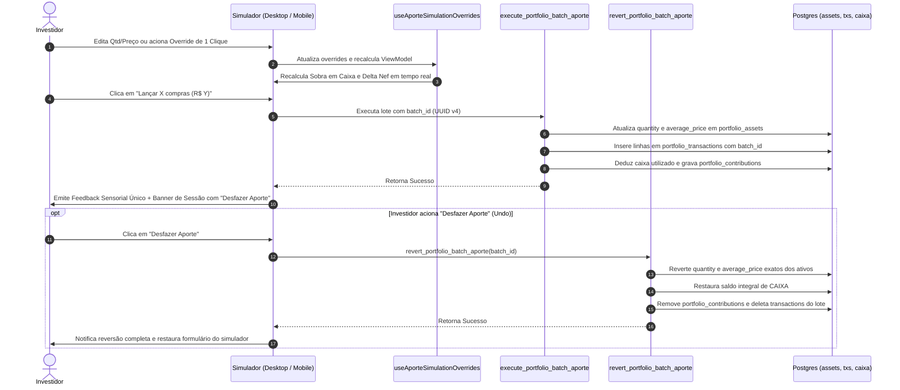

# Plano Unificado: Motor de Rebalanceamento Inteligente, Concentração em Camadas e Refatoração de UI/UX de Ponta a Ponta

> **Documento Canônico Definitivo:** Consolidação do *Plano Mestre de Rebalanceamento, Concentração e Correlação* com a *Refatoração de UI/UX e Ergonomia do Simulador*.  
> **Status:** Aprovado para Execução Incremental  
> **Área:** Engenharia de Portfólios, Arquitetura de Software & UX Financeira  
> **Módulos Afetados:** `src/domain/portfolio/`, `src/features/investments/`, `src/components/modules/aporte-result/`, `src/data/rpc/`  
> **Versão de Referência:** v3.13.0+  
> **Diretrizes de Governança:** [AGENTS.md](file:///home/gabrielsales/meus_apps/financasnew/AGENTS.md) (Zero emojis, tipagem estrita sem `any`, funções puras em `domain/`, testes Vitest colocalizados, mobile-first, zero duplicação de componentes, design tokens padronizados e sem elementos nativos despadronizados).

---

## 1. Sumário Executivo & Objetivos de Ponta a Ponta

Este plano unifica e resolve simultaneamente a **profundidade matemática do motor financeiro** e a **ergonomia visual da interface de rebalanceamento** (`Simulador de Aporte`).

### 1.1. Os Três Objetivos Centrais
1. **Sanear a Lógica Financeira no Domínio Puro:** Garantir que tetos prudenciais (ativo 15%, setor 35%/25%, macro-setor 45%/35%, emissor de crédito privado R$ 250k / 30% RF), corte de qualidade fundamentalista (nota $\le 5$) e anti-pulverização (`minTicketBRL` R$ 100) operem de forma consistente nos modos `optimized` e `proportional`.
2. **Eliminar Redundâncias e Desobstruir a Tomada de Decisão:** Acabar com o monólito vertical que exigia 65% de scroll no desktop, remover gráficos e cartões duplicados, compactar o topo e trazer a tabela de execução imediatamente **acima da dobra** (*above the fold*).
3. **Garantir Conforto Operacional Nativo em 3 Breakpoints:** Layout assimétrico em 2 colunas no desktop, transição equilibrada no tablet, e no mobile uma experiência PWA limpa com cards em modo leitura por padrão, expansão sob toque para edição (sem auto-focus ou auto-zoom) e barra fixa inferior de execução com suporte a safe-area (`pb-safe`).

---

## 2. Diagnóstico da Auditoria do Código Real & Causas Raízes

### 2.1. Problemas de UI/UX Auditados na Interface em Uso
1. **Monólito Vertical com Rolagem Excessiva:** O investidor precisava rolar mais da metade da página para ver quais ativos comprar e executar a ordem.
2. **Redundâncias Quádruplas no Topo:** O valor do aporte aparecia repetido em 4 pontos distintos; os blocos `Distribuição Macro por Classe` e `Distribuição Meso por Setor` duplicavam as informações já apresentadas no gráfico de barras horizontais; textos explicativos do motor hierárquico apareciam duplicados.
3. **"Sopa de Caixas":** Aninhamento excessivo de bordas arredondadas e cards dentro de cards no formulário de entrada.
4. **Baixa Eficiência Gráfica nas `Drift Bars`:** O eixo fixo de 0% a 100% deixava cerca de 70% do espaço à direita vazio, comprimindo a expansão do aporte a um traço imperceptível de 1px a 2px.
5. **Conflito Cognitivo e Poluição na Tabela de Ordens:** Cada linha acumulava Checkbox, Input de Quantidade, Input de Preço, Botão de Tese, Botão "Comprar no Wizard" avulso e a pílula estática "Pendente", competindo diretamente com o botão principal `Lançar compras no extrato (N)`.

### 2.2. Causas Raízes das Anomalias de Lógica Diagnosticadas no Código Real
1. **Anomalia 1: Por que `KLBN4` (Nota 5/10) recebeu aporte em vez de entrar em `quality_lock`?**
   - **Causa Raiz:** No arquivo `src/domain/portfolio/aporte-execution-mapper.ts` (linhas 148–161), ao converter `PortfolioAsset` para `AporteAssetInput`, os campos `last_reviewed_at` e `score_criteria` **não foram repassados** (ficaram `undefined`). Em `src/domain/portfolio/aporte.ts` (linhas 623–627), a função `isAssetQualityLocked` exige que o ativo já tenha sido avaliado (`hasBeenReviewed`). Como os campos estavam indefinidos, o motor assumiu que o ativo estava em onboarding e desarmou a trava de qualidade para todos os ativos em produção.
2. **Anomalia 2: Por que foram geradas micro-ordens abaixo de `minTicketBRL` (R$ 100) no aporte de R$ 651,43?**
   - **Causa Raiz:** Em `src/domain/portfolio/aporte.ts` (linha 1261), a trava de reconcentração anti-pulverização só estava ativada para `strategy === "proportional"`. No modo padrão `strategy === "optimized"`, a alocação roda um loop guloso sequencial (linhas 1307–1335) que preenche o headroom do primeiro ativo e vai jogando as sobras para os seguintes sem nunca verificar se o valor restante atinge o piso mínimo de R$ 100.
3. **Dívida Técnica Crítica: Baseline de TypeScript Quebrado (41 Erros):**
   - Ao executar `tsc -b`, identificou-se que faltam re-exports essenciais no barrel `src/domain/portfolio/index.ts` (`AporteOverflowEvent`, `PausedAssetDiagnostic` e conflito de `FixedIncomeIssuerGroup`), narrowing incorreto de tipos (`number | undefined`) em `aporte-execution-mapper.ts`, prop `tone="warning"` inválida de `<MoneyText />` em `aporte-overflow-ledger-drawer.tsx` e tipagens desatualizadas de testes. O pipeline de typecheck precisa ser zerado antes de qualquer alteração de UI.

---

## 3. Fundamentação Matemática, Financeira & de Risco

### 3.1. Índices de Descentralização: HHI e Número Efetivo ($N_{ef}$)
O modelo adota a formalização canônica de Meucci (*Effective Number of Bets*) e o Índice Herfindahl-Hirschman (HHI):

$$HHI_{\text{global}} = \sum_{k=1}^{m} w_k^2 \quad \text{onde} \quad w_k = \frac{\text{ValorExposiçãoBRL}_k}{\text{PatrimônioTotalBRL}}$$

$$N_{ef}^{\text{global}} = \frac{1}{\sum_{k=1}^{m} w_k^2} = \frac{1}{HHI_{\text{global}}}$$

#### Regras de Consolidação de Risco:
1. **Emissor de Renda Fixa Privada:** Títulos com a mesma instituição emissora (`issuerKey`, via `parseIssuerFromTicker`) são consolidados no mesmo vetor de risco $w_{\text{emissor}}$, impedindo que múltiplos CDBs do mesmo banco mascarem a concentração.
2. **Sobreposição de Benchmark em ETFs:** Ativos que compartilham o mesmo índice subjacente (ex.: `BOVA11` e `BRAX11`) são consolidados.
3. **Descentralização em Renda Variável:**
   $$HHI_{\text{Ações}} = \sum_{i \in \text{Ações}} \left(\frac{\text{ValorAtivoBRL}_i}{\text{PatrimônioAçõesBRL}}\right)^2, \quad N_{ef}^{\text{Ações}} = \frac{1}{HHI_{\text{Ações}}}$$

### 3.2. Modelo de Headroom em Camadas com Trava Sextúpla
Para cada ativo $i$, o valor máximo admissível no aporte respeita o gargalo mais restritivo:

$$\text{HeadroomEfetivo}_i = \max\Big(0, \; \min\big(\text{GapMeta}_i, \; \text{CapAtivo}_i, \; \text{CapSetorNaClasse}_s, \; \text{CapSetorGlobal}_s, \; \text{CapMacroSetor}_m, \; \text{CapEmissorRF}_e\big)\Big)$$

1. **$\text{GapMeta}_i$:** $\max(0, \text{TargetValueBRL}_i - \text{CurrentValueBRL}_i)$.
2. **$\text{CapAtivo}_i$:** $\max(0, 0.15 \times \text{PatrimônioPósAporte} - \text{CurrentBRL}_i - \text{AlocadoNestaSim}_i)$ *(40% global para ETFs neutros e Tesouro)*.
3. **$\text{CapSetorNaClasse}_s$:** $\max(0, 0.35 \times \text{ClasseAlvoBRL} - \text{CurrentSetorBRL}_s - \text{AlocadoSetorNestaSim}_s)$.
4. **$\text{CapSetorGlobal}_s$:** $\max(0, 0.25 \times \text{PatrimônioPósAporte} - \text{CurrentSetorBRL}_s - \text{AlocadoSetorNestaSim}_s)$.
5. **$\text{CapMacroSetor}_m$:** $\max(0, \min(0.45 \times \text{ClasseAlvoBRL}, 0.35 \times \text{PatrimônioPósAporte}) - \text{CurrentMacroBRL}_m - \text{AlocadoMacroNestaSim}_m)$.
6. **$\text{CapEmissorRF}_e$:** $\max(0, \min(0.30 \times \text{RFAlvoBRL}, 0.15 \times \text{PatrimônioPósAporte}, \text{R\$} 250.000,00) - \text{CurrentEmissorBRL}_e - \text{AlocadoEmissorNestaSim}_e)$.

### 3.3. Transbordamento em Cascata (*Cascading Overflow*) & Anti-Pulverização
1. **Saturação Setorial:** Se $\sum_{i \in s} \text{HeadroomEfetivo}_i = 0$, 100% da verba orçada para o setor $s$ transborda auditada para o próximo setor da classe com headroom livre, registrando o evento no *Overflow Ledger*.
2. **Anti-Pulverização Consolidada:** O motor nunca distribui fatias abaixo de `minTicketBRL` (R$ 100). Em aportes modestos, concentra nos top $K = \max(1, \lfloor \text{orçamento} / \text{minTicketBRL} \rfloor)$ ativos mais deficitários com alta convicção.
3. **Residual Greedy Pack Seguro:** Resíduos de cotas inteiras da B3 são canalizados para ativos já selecionados na rodada com folga de headroom ou frações de Tesouro Direto. NUNCA abre um ticker novo abaixo de R$ 100.

---

## 4. Especificação de UI/UX, Componentes e Responsividade

### 4.1. Arquitetura Responsiva nos 3 Breakpoints

```
DESKTOP (> 1024px) — 2 Colunas Assimétricas
┌─────────────────────────────────┬──────────────────────────────────────────┐
│ COLUNA ESQUERDA (38%, STICKY)   │ COLUNA DIREITA (62%, ROLÁVEL PRINCIPAL)  │
│ • Comando de Aporte Compacto    │ • Cabeçalho: Título + SegmentedControl   │
│ • Switch Caixa + Atalhos        │   [Prioridade | Árvore] +                │
│ • Faixa Métrica (1 linha)       │   CTA: [ Lançar 3 compras (R$ 651,43) ]  │
│   Total · Alocado · Sobra       │ • Tabela de Execução Acima da Dobra:     │
│   [Chips: ΔNef + Diluição]      │   - Checkbox seleção                     │
│ • Drift Bars com Zoom           │   - Ticker + Badges Alerta Reais         │
│   (MaxEscala + Botão Ledger)    │   - Inputs Ghost (Qtd, Preço)            │
│ • Rodapé CVM Discreto           │   - Ações de Ícone (Wizard, Override)    │
│                                 │ • Acordeão: Pausados / Tetos             │
└─────────────────────────────────┴──────────────────────────────────────────┘

TABLET (640px – 1024px) — Topo Balanceado + Execução Total
┌────────────────────────────────┬───────────────────────────────────────────┐
│ Comando de Aporte & Saldo      │ Drift Bars Comparativas Antes/Depois      │
├────────────────────────────────┴───────────────────────────────────────────┤
│ Faixa Métrica de Impacto (Total · Alocado · Sobra · ΔNef)                  │
├────────────────────────────────────────────────────────────────────────────┤
│ Detalhamento dos Aportes em Largura Total (Tabela Densidade Compacta)      │
└────────────────────────────────────────────────────────────────────────────┘

MOBILE (< 640px) — Fluxo PWA com Bottom Safe-Area
┌────────────────────────────────────────────────────────────────────────────┐
│ Comando de Aporte Compacto (p-3.5)                                         │
├────────────────────────────────────────────────────────────────────────────┤
│ Faixa Métrica Adaptativa (grid-cols-3) + Acordeão Drift Bars               │
├────────────────────────────────────────────────────────────────────────────┤
│ Cards em Modo Leitura por Padrão:                                          │
│ ┌────────────────────────────────────────────────────────────────────────┐ │
│ │ [✓] ITUB4 · Bancos                       R$ 499,80                     │ │
│ │     14 cotas x R$ 35,70                  [Editar]                      │ │
│ │     Motivo: Setor em déficit                                           │ │
│ └────────────────────────────────────────────────────────────────────────┘ │
│ ┌────────────────────────────────────────────────────────────────────────┐ │
│ │ [✓] TAEE11 · Elétricas (Modo Edição Expandido)                         │ │
│ │     Cotas: [ 22 ]   Preço: [ R$ 36,36 ]  (16px - Sem auto-zoom)        │ │
│ └────────────────────────────────────────────────────────────────────────┘ │
├────────────────────────────────────────────────────────────────────────────┤
│ BARRA FIXA INFERIOR (pb-safe + pb-28 no contêiner):                        │
│ [ Lançar 2 compras selecionadas · R$ 651,43 ]                              │
└────────────────────────────────────────────────────────────────────────────┘
```

### 4.2. Recalibração Visual das `Drift Bars`
- **Fórmula de Zoom Dinâmico:**
  $$\text{MaxEscala} = \min\Big(100, \; \max\big(\text{maiorAtual}, \; \text{maiorProjetado}, \; \text{maiorMeta}, \; \text{maiorTeto}\big) + 8\Big)$$
- **Informação de Aporte na Própria Barra:** Cabeçalho de cada barra exibe `+R$ X` (ex.: `Ações · +R$ 546,71 · 26,9% -> 27,2%`).
- **Ancoragem Canônica:** Botão `Trilha de Decisão (N)` acoplado diretamente no cabeçalho das barras, com badge sutil do total de transbordamentos.

### 4.3. Refinamento da Tabela Desktop & Overrides
- **Fim da Pílula "Pendente":** Itens ativos na tabela não exibem badge redundante de pendência. Badges ficam restritos a exceções (`Editado`, `Override` ou `Teto`).
- **Inputs *Subtle/Ghost*:** `NumericInput` com fundo neutro, realce apenas no foco e `tabular-nums`. Indicador discreto `(sug: N)` se editado.
- **Ações Secundárias:** Ícones compactos com tooltip (`AporteRowActions`), liberando 80px na tabela.
- **Botão de Override de 1 Clique:** Ativos limitados por teto ou qualidade exibem botão `Ignorar teto` ou `Liberar aporte`, recalculando o headroom instantaneamente sem sair da tela.

---

## 5. Fluxo de Edição Inline, Execução em Lote e Desfazer (*Undo*)



---

## 6. Roadmap Canônico de Execução com Portões de Qualidade (Fases 0 a 5)

```
[Fase 0: Saneamento do Baseline TS] ──> [Fase 1: Correção do Motor & ViewModel]
                                                        │
[Fase 3: Recalibração Drift Bars & Tabela] <── [Fase 2: Layout Responsivo & Topo]
             │
[Fase 4: Ergonomia Mobile & Barra Fixa] ──> [Fase 5: Polimento, Undo & Validação E2E]
```

---

### Fase 0 — Saneamento do Baseline de Tipagem (Pré-Requisito Mandatório)
**Diretiva:** Estabelecer a linha de base limpa (`tsc -b` verde). Nenhuma lógica de UI ou cálculo novo é implementada aqui.
- Corrigir a falta de exports no barrel `src/domain/portfolio/index.ts` (`AporteOverflowEvent`, `PausedAssetDiagnostic` e conflito de re-export de `FixedIncomeIssuerGroup`);
- Corrigir narrowings de tipo (`number | undefined`) em `src/domain/portfolio/aporte-execution-mapper.ts` e `src/domain/portfolio/aporte.ts`;
- Corrigir a propriedade `tone="warning"` inválida de `<MoneyText />` em `src/components/modules/aporte-result/aporte-overflow-ledger-drawer.tsx` (substituir por tom suportado);
- Corrigir tipagens desatualizadas de testes em `target-sectors-card.test.tsx` e `portfolio-insights-carousel.tsx`.
- **Portão de Qualidade — Gate 0:** Rodar `npm run typecheck` (`tsc -b`). Confirmar **0 erros de TypeScript**. Entregar evidência e aguardar autorização para a Fase 1.

---

### Fase 1 — Saneamento do Motor (Anomalias de Lógica) & ViewModel de Impacto
**Diretiva:** Ajustar o núcleo de domínio puro e estender o ViewModel para alimentar a UI.
- **Correção da Anomalia 1 (`KLBN4` Nota 5):** Em `aporte-execution-mapper.ts`, mapear `last_reviewed_at` e `score_criteria` a partir de `rawAsset`, ativando o soft lock de qualidade para ativos avaliados com nota $\le 5$;
- **Correção da Anomalia 2 (Pulverização < R$ 100):** Em `aporte.ts`, estender a regra de anti-pulverização baseada em `minTicketBRL` também para a estratégia `optimized`, consolidando as ordens nos top $K = \max(1, \lfloor \text{orçamento} / \text{minTicketBRL} \rfloor)$ ativos ou retendo resíduos no caixa;
- **ViewModel de Impacto e Overrides:** Estender `buildAporteSimulationViewModel` para calcular e expor:
  - $\Delta N_{ef}$ (descentralização atual vs. projetada pós-aporte via `calculatePortfolioDiversification`);
  - Diluição percentual do maior ativo da carteira;
  - Mapa de overrides de 1 clique (`ignoreQualityLock`, `ignoreAssetCeiling`);
  - Total alocado em BRL por classe e setor (pronto para as *Drift Bars*).
- **Testes:** Criar testes unitários Vitest colocalizados validando a trava de nota 5 e a ausência de ordens < R$ 100 em aportes modestos.
- **Portão de Qualidade — Gate 1:** Rodar `vitest` e `tsc -b`. Confirmar zero regressões nos modos `optimized` e `proportional`. Entregar relatório e aguardar autorização.

---

### Fase 2 — Reestruturação do Layout Responsivo & Limpeza do Topo
**Diretiva:** Eliminar redundâncias e construir a nova grade responsiva nos 3 breakpoints.
- **Remoção de Redundâncias:** Excluir os blocos `Distribuição Macro` e `Meso` em `aporte-summary-section.tsx`, as faixas textuais explicativas repetidas e transformar o card da CVM em rodapé discreto;
- **Faixa Métrica Densa:** Criar componente compacto de métricas em 1 linha com `Total` · `Alocado` · `Sobra` + chips de $\Delta N_{ef}$ e diluição;
- **Card de Comando:** Simplificar `aporte-input-card.tsx` com atalhos rápidos de caixa e seletor compacto de estratégia (`Menos Movimentações` | `Proporcional`);
- **Grade Responsiva da Página:**
  - Desktop (`> 1024px`): 2 colunas assimétricas (Coluna Esquerda 38% `sticky` com comando + faixa métrica + *Drift Bars*; Coluna Direita 62% protagonista rolável com a execução);
  - Tablet (`640px - 1024px`): Topo 2 colunas (50/50) + Execução em largura total abaixo;
  - Mobile (`< 640px`): Coluna única com áreas de toque $\ge 44\text{px}$.
- **Portão de Qualidade — Gate 2:** Rodar `tsc -b`, `lint` e `npm run build`. Validar ausência de scroll horizontal no mobile (360px) e contenção da coluna sticky no desktop. Entregar evidência e aguardar autorização.

---

### Fase 3 — Recalibração das `Drift Bars` & Tabela Desktop com Overrides
**Diretiva:** Dar eficiência visual aos gráficos e limpar a tabela de ordens sugeridas.
- **Drift Bars com Zoom Inteligente:** Atualizar `allocation-drift-bars.tsx` com a fórmula $MaxEscala$, exibir `+R$ X` no cabeçalho de cada barra e ancorar o botão do *Overflow Ledger* com badge de contagem de eventos;
- **Tabela Desktop:** Atualizar `aporte-desktop-table.tsx`:
  - Remover a pílula "Pendente";
  - Adotar inputs *subtle/ghost* com `tabular-nums`;
  - Transformar ações secundárias em ícones compactos (`AporteRowActions`);
  - Adicionar botão de override de 1 clique (`Ignorar teto` / `Liberar aporte`);
  - Suavizar badges de motivo, reservando cores fortes exclusivamente para alertas reais.
- **Portão de Qualidade — Gate 3:** Rodar `tsc -b`, `lint`, `vitest` e `npm run build`. Validar aderência rigorosa a `AGENTS.md`. Entregar relatório e aguardar autorização.

---

### Fase 4 — Ergonomia Mobile & Barra Fixa Inferior (`pb-safe`)
**Diretiva:** Garantir experiência PWA impecável no smartphone.
- **Cards Mobile em Modo Leitura:** Atualizar `aporte-mobile-card-list.tsx` para renderizar cards resumidos em texto puro por padrão, expandindo inputs de quantidade e preço apenas ao tocar em `Editar`;
- **Prevenção de Auto-Zoom:** Garantir `text-base sm:text-sm` em todos os campos editáveis no mobile;
- **Barra Fixa Inferior de Execução:** Implementar botão flutuante fixo no rodapé mobile com `pb-safe` e compensação de padding (`pb-28`) no contêiner principal;
- **Acordeão de Ativos Pausados:** Manter acordeão colapsado limpo no rodapé com affordance de liberação individual por override.
- **Portão de Qualidade — Gate 4:** Rodar `tsc -b`, `lint` e `npm run build`. Testar em viewport mobile de 360px e 390px (iOS Safari e Android Chrome). Entregar evidência e aguardar autorização.

---

### Fase 5 — Polimento Final, Undo Contábil & Validação E2E
**Diretiva:** Blindar o ciclo completo de execução, feedback e reversão.
- **Validação do Fluxo de Execução e Undo:**
  - Testar execução em lote gerando `batch_id`;
  - Validar feedback sensorial único (`triggerSensory`) sem duplicação de disparos táteis (Regra 17);
  - Validar exibição do Toast de 60 segundos e do Banner de Sessão de 5 minutos com reversão via `revertPortfolioBatchAporte`;
  - Confirmar restauração exata de quantidades, preços médios e saldo de caixa após Undo;
- **Tratamento de Casos de Borda:** Carteira 100% saturada, edições manuais que estouram o aporte informado e ausência de cotações;
- **Portão de Qualidade Final — Gate 5:** Suíte completa verde (`tsc -b`, `npm run lint`, `npm test` e `npm run build`).

---

## 7. Regras Universais dos Portões de Qualidade

1. **Trava Rígida de Escopo:** Em nenhuma hipótese deve-se adiantar código de fases subsequentes. Cada fase só inicia após o aceite formal da anterior.
2. **Evidência Real de Execução:** Cada relatório de término de fase deve conter os logs reais das ferramentas de inspeção (`tsc -b`, `npm run lint`, `vitest` e `npm run build`).
3. **Parada Obrigatória:** Ao término de cada fase, o agente pausa suas operações, reporta o sumário objetivo das alterações e aguarda a autorização expressa do usuário para prosseguir.
