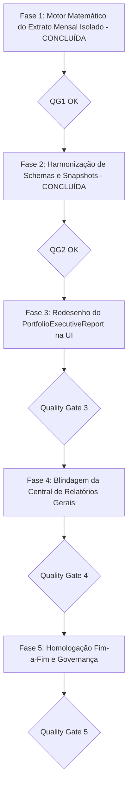

# PLANO DE IMPLEMENTAÇÃO 02 — PRECISÃO MATEMÁTICA, EXTRATOS MENSAIS DE SNAPSHOTS E GOVERNANÇA DE RELATÓRIOS

> **Documento Canônico de Engenharia Financeira, Arquitetura e Governança de Software**  
> **Status:** Concluído · Quality Gate QG5 Atingido · 100% Homologado  
> **Arquivo:** `docs/plans/completed/02_PLANO_PRECISAO_RENTABILIDADE_E_SNAPSHOTS_INVESTIMENTOS.md`  
> **Ordem de Implementação:** **2º (Precisão Matemática & Experiência de Investimentos)**  
> **Módulos Afetados:** `src/domain/portfolio/`, `src/features/investments/`, `src/features/reports/`, `docs/architecture/`  
> **Governança:** TypeScript Estrito (Zero `any`/`@ts-ignore`) · Funções Puras no Domínio · Moeda em Centavos · Padrões CVM/ANBIMA (TWR / Modified Dietz) · Zero Controles Nativos · Zero Emojis (`local/no-decorative-unicode`) · Portões de Qualidade por Fase  
> **Ambientes:** Web Desktop, Web PWA & Android Nativo (Capacitor Pro)  

---

## 1. DIRETRIZ FUNDAMENTAL: SEGREGAÇÃO ARQUITETURAL DOS RELATÓRIOS

O sistema estabelece uma distinção conceitual nítida entre os dois relatórios da plataforma de investimentos:

```
┌──────────────────────────────────────────────────────────────────────────────────────────────────────────────────┐
│                                   ARQUITETURA DUAL DE RELATÓRIOS PATRIMONIAIS                                    │
└──────────────────────────────────────────────────────────────────────────────────────────────────────────────────┘
                                                          │
                  ┌───────────────────────────────────────┴───────────────────────────────────────┐
                  ▼                                                                               ▼
   [MÓDULO DE INVESTIMENTOS: SNAPSHOTS]                                            [CENTRAL DE RELATÓRIOS GERAIS]
   (PortfolioExecutiveReport / Fechamentos)                                       (WealthTearSheetModal / Dossiê A4)
   
   • Natureza: EXTRATO MENSAL DA COMPETÊNCIA                                       • Natureza: DOSSIÊ ESTRATÉGICO CONSOLIDADO
   • Escopo: ESTRITAMENTE AQUELE MÊS                                               • Escopo: HISTÓRICO GERAL & CUSTÓDIA VIVA
   • Objetivo: Fotografia fiel da competência                                      • Objetivo: Visão holística da riqueza
   • Métricas Contidas:                                                            • Métricas Contidas:
     - Saldo Patrimonial no último dia do mês                                        - Patrimônio Líquido Total Vigente
     - Rentabilidade isolada daquele mês (% TWR do Mês)                              - Rentabilidade Acumulada da Vida Inteira (TWR)
     - Resultado Financeiro do Mês (P&L gerado em R$)                                - Retorno Efetivo do Bolso (TIR / XIRR a.a.)
     - Proventos auferidos EXCLUSIVAMENTE naquele mês                                - Comparativo de Evolução Mês a Mês (Gráficos)
     - Movimentações ocorridas EXCLUSIVAMENTE naquele mês                            - Matrizes de Alocação (Target vs Actual)
     - Custódia congelada no fechamento daquele mês                                  - Raios-X de Subalocação & Termômetro de Risco
```

### 1.1 Diagnóstico da Causa Raiz
1. **Contaminação Temporal:** O relatório de snapshot do mês passado calculava métricas acumuladas de anos (Retorno Contábil sobre Custo médio antigo) em vez de calcular a **Rentabilidade Isolada daquele mês**.
2. **Conflito de Fórmulas:** No mês atual, exibia o TWR acumulado da vida inteira. No mês anterior, exibia retorno estático sobre custo.
3. **Harmonização com o Plano 05:** A automação e materialização definitiva de snapshots via servidor (`pg_cron`) foi delegada para o **Plano 05**. O escopo do Plano 02 concentra-se estritamente na **apuração e renderização fiel dos extratos mensais na UI**, garantindo que não haja duplicidade de mutações de cliente concorrentes.

---

## 2. ESPECIFICAÇÃO MATEMÁTICA DO EXTRATO MENSAL ISOLADO

Para qualquer competência $M$, o relatório obedece rigorosamente às equações contábeis do mês:

### 2.1 Rentabilidade Isolada do Mês ($r_M$ — Modified Dietz ANBIMA/GIPS)
$$r_M = \frac{\text{Saldo}_{\text{Fim}} - \text{Saldo}_{\text{Início}} - \text{FluxoLíquido}_M}{\text{Saldo}_{\text{Início}} + \sum_{i} (W_i \cdot \text{Fluxo}_i)}$$
Onde:
- $\text{Saldo}_{\text{Fim}}$ = Saldo de fechamento da carteira no último dia do mês $M$ (ativos valorados + caixa + reserva elegível).
- $\text{Saldo}_{\text{Início}}$ = Saldo de fechamento do mês anterior $M-1$.
- $\text{FluxoLíquido}_M$ = $\text{Aportes Externos}_M - \text{Resgates Externos}_M$ ocorridos no mês $M$.
- $W_i = \frac{\text{DiasNoMês} - \text{DiaDoFluxo} + 1}{\text{DiasNoMês}}$ = Ponderação do fluxo por tempo de permanência.

#### Tratamento de Casos de Borda:
1. **Mês Inaugural / Marco Zero ($\text{Saldo}_{\text{Início}} = 0$):** O denominador adota o capital médio ponderado dos aportes iniciais ($\sum W_i \cdot \text{Fluxo}_i$).
2. **Salvaguarda contra Colapso de Denominador:** Se saques maciços deixarem o denominador $< \text{R\$} 10,00$, o motor neutraliza a taxa percentual (`monthRatePct = null`) e exibe o P&L financeiro em reais.
3. **Mês Corrente em Andamento (MTD Parcial):** O extrato exibe os proventos **efetivamente recebidos**. Proventos futuros no mesmo mês são indicados como provisões auxiliares.

---

## 3. FASES DE EXECUÇÃO DETALHADAS & CHECKLIST



---

## Fase 1: Motor Matemático do Extrato Mensal Isolado (✅ CONCLUÍDA)

- [x] **Tarefa 1.1: Função Pura de Apuração da Competência (`monthly-statement.ts`)**
  - Implementada em `src/domain/portfolio/monthly-statement.ts` com suíte `monthly-statement.test.ts`.
- [x] **Tarefa 1.2: Integração com o Motor Point-in-Time (`point-in-time.ts`)**
  - Incorporação do resultado no `PointInTimeResult.monthlyStatement` e `PointInTimeResult.monthDividendsTotalBRL`.
- [x] **Tarefa 1.3: Depreciação Formal de `portfolioReturnPct` (`summary.ts`)**

- [x] **Portão de Qualidade 1 (QG1):**
  - [x] Executar: `npx vitest run src/domain/portfolio/monthly-statement.test.ts src/domain/portfolio/point-in-time.test.ts`
  - [x] Executar: `npm run typecheck`

---

## Fase 2: Harmonização de Schemas e Snapshots (✅ CONCLUÍDA)

- [x] **Tarefa 2.1: Regra Canônica de Patrimônio e Custo no Snapshot**
  - `total_value`: Ativos valorados + Saldo de Caixa + Reserva Elegível.
  - `total_cost`: Custo de aquisição total dos ativos + Saldo de Caixa 1:1.
- [x] **Tarefa 2.2: Alinhamento Arquitetural de Persistência**
  - Concorrência de escrita no cliente eliminada; persistência automatizada transferida para o Plano 05.

- [x] **Portão de Qualidade 2 (QG2):**
  - [x] Executar: `npm run typecheck`
  - [x] Executar: `npm run lint`

---

## Fase 3: Redesenho do Relatório Executivo como Extrato Mensal da Competência

> **Objetivo:** Fazer com que o `PortfolioExecutiveReport` seja 100% focado na fotografia daquele mês específico, exibindo os dados daquele mês sem misturar com métricas globais.

- [x] **Tarefa 3.1: Reestruturação dos 4 KPIs da Síntese Executiva (`portfolio-executive-report.tsx`)**
  - **Arquivo:** `src/features/investments/components/portfolio-executive-report.tsx`.
  - Conectar os KPIs aos campos de competência isolada de `monthlyPositionQuery.data`:
    1. **Patrimônio no Fechamento:** `effectiveTotalBRL` consolidado no último dia daquele mês com subtexto de ativos em custódia.
    2. **Rentabilidade da Competência (TWR):** `monthlyPositionQuery.data?.monthlyStatement?.monthRatePct` (TWR do mês isolado), com subtexto *"Variação isolada do mês (Padrão CVM)"*.
    3. **Resultado Líquido do Mês (P&L):** `monthlyPositionQuery.data?.monthlyStatement?.monthNetPnlBRL` (em R$ com cor semântica verde/vermelho).
    4. **Proventos da Competência:** `monthlyPositionQuery.data?.monthDividendsTotalBRL` (recebidos estritamente naquele mês).

- [x] **Tarefa 3.2: Inclusão do Painel de Movimentações da Competência**
  - **Arquivo:** `src/features/investments/components/portfolio-executive-report.tsx`.
  - Exibir bloco de fluxo de caixa da competência consumindo:
    * `monthlyStatement.monthBuysBRL` (Compras do mês)
    * `monthlyStatement.monthSellsBRL` (Vendas/Resgates do mês)
    * `monthlyStatement.monthDividendsBRL` (Proventos do mês)
    * `monthlyStatement.monthNetContributionBRL` (Aporte líquido injetado no mês)

- [x] **Tarefa 3.3: Ajustes no Extrato Analítico Tabular (`portfolio-snapshots-dialog.tsx`)**
  - **Arquivo:** `src/features/investments/components/portfolio-snapshots-dialog.tsx`.
  - Coluna `Mês (TWR %)` destacada como a performance periódica isolada.
  - Coluna de proventos auferidos no respectivo mês (`monthDividendsBRL`).

- [x] **Portão de Qualidade 3 (QG3):**
  - [x] Executar: `npx vitest run src/features/investments/components/portfolio-executive-report.test.tsx`
  - [x] Executar: `npm run typecheck`
  - [x] Executar: `npm run lint`
  - [x] **Commit & Push da Fase 3:** `git commit -m "feat(portfolio): extrato mensal focado na competencia e kpis isolados"`

---

## Fase 4: Blindagem da Central de Relatórios Gerais

> **Objetivo:** Manter a Central de Relatórios (`WealthTearSheetModal`) como o Dossiê Geral robusto de toda a carteira viva, corrigindo o fallback de gráficos históricos.

- [x] **Tarefa 4.1: Correção do Fallback de Gráfico no Tear Sheet (`wealth-tear-sheet-modal.tsx`)**
  - No gráfico comparativo mês a mês (`performanceSeries`), utilizar estritamente taxas mensais periódicas (`twrMonthPct`).
  - Nunca mais atribuir `totalReturnPct` (taxa acumulada de 20%+) como fallback em colunas mensais.
  - Caso haja menos de 2 fechamentos registrados, exibir empty state calmo informando a necessidade de histórico mensal.

- [x] **Tarefa 4.2: Confirmação da Separação Estrutural na UI**
  - Títulos da Central de Relatórios identificam formalmente o documento como *"Dossiê Executivo da Posição Vigente Consolidada"*.
  - Manter banner informativo direcionando para Fechamentos & Snapshots para quem deseja auditar fotografias mensais isoladas.

- [x] **Portão de Qualidade 4 (QG4):**
  - [x] Executar: `npx vitest run src/features/reports/components/wealth-tear-sheet-modal.test.tsx`
  - [x] Executar: `npm run typecheck`
  - [x] Executar: `npm run lint`
  - [x] **Commit & Push da Fase 4:** `git commit -m "fix(reports): segregacao estrita entre dossie historico e extrato de fechamento"`

---

## Fase 5: Homologação Fim-a-Fim, Testes & Governança

- [x] **Tarefa 5.1: Suíte Completa de Testes de Portfólio (Vitest)**
  - Rodar Vitest em todos os arquivos de `src/domain/portfolio/`, `src/features/investments/` e `src/features/reports/` (65 arquivos, 668 testes aprovados).

- [x] **Tarefa 5.2: Typecheck e Lint**
  - `npm run typecheck` e `npm run lint` 100% verdes.

- [x] **Tarefa 5.3: Sincronização Documental**
  - Atualizar `ESPECIFICACAO_TECNICA.md`, `FINANCIAL_MATH_SPEC.md`, `PROJECT_STRUCTURE.md`, `ROADMAP.md` e mover este plano para `docs/plans/completed/`.

- [x] **Portão de Qualidade 5 (QG5):**
  - [x] Executar: `npm run typecheck`
  - [x] Executar: `npm run lint`
  - [x] Executar: `npx vitest run src/domain/portfolio/ src/features/investments/ src/features/reports/`
  - [x] Executar: `npm run build`
  - [x] **Commit & Push da Fase 5:** `git commit -m "chore(release): homologacao e conclusao do plano 02 de precisao matematica de investimentos"`

---

## 4. DEFINITION OF DONE (DoD)

1. O relatório do snapshot do mês reflete 100% os dados daquele mês (rentabilidade periódica TWR, P&L do mês, proventos do mês e movimentações).
2. Se a carteira recuou no mês, a taxa exibida no snapshot do mês é obrigatoriamente negativa.
3. Central de Relatórios preservada como a visão geral robusta da carteira viva.
4. Código 100% coberto por testes unitários e de integração com Vitest.
5. Plano concluído e arquivado em `docs/plans/completed/`.
