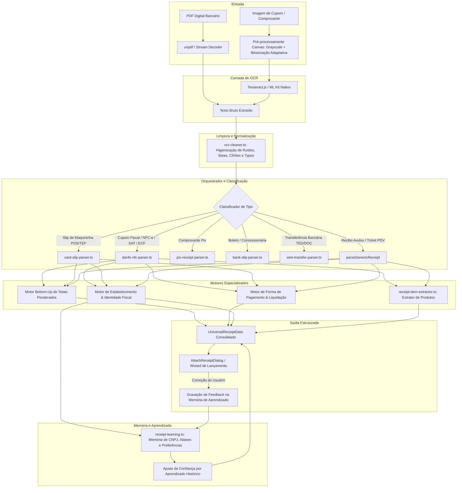

# 10 — Plano de Implementação: Motor Universal de Identificação de Comprovantes, Cupons Fiscais Multi-Itens, Memória Adaptativa e Aprendizado Contínuo

> **Status:** 100% Concluído e Homologado (Fases 1 a 7 implementadas e validadas com 18 amostras reais)  
> **Referência Canônica:** `docs/architecture/ESPECIFICACAO_TECNICA.md`, `docs/architecture/ARCHITECTURE.md`, `docs/architecture/FINANCIAL_MATH_SPEC.md`  
> **Escopo:** Motor de Pré-processamento e OCR Web (`web-ocr.ts`), Higienização Óptica (`ocr-cleaner.ts`), Orquestrador Universal (`universal-receipt-parser.ts`), Parser de Cupons Fiscais e PDV (`danfe-nfc-parser.ts`), Slips de Cartão (`card-slip-parser.ts`), Extrator de Itens (`receipt-item-extractor.ts`), Memória de Aprendizado Adaptativo (`receipt-learning.ts`), Diálogo de Anexo (`attach-receipt-dialog.tsx`) e Matriz de Testes Reais E2E (`exemplos_comprovantes/`).  
> **Objetivo Primário:** 
> 1. **Priorização Cirúrgica de Valor Total a Pagar:** Eliminar em 100% dos cenários o defeito crítico em que cupons com múltiplos produtos ou preços intermediários (ex: R$ 19,90, R$ 35,90, R$ 7,99) resultam na captura do valor de um item isolado do topo em vez do valor total a pagar (R$ 270,00).
> 2. **Separação Rigorosa de Forma de Pagamento e Valor Liquidado:** Isolar e associar cada modalidade de pagamento (Dinheiro, Cartão de Crédito, Cartão de Débito, Pix, Boleto, etc.) ao respectivo valor pago, identificando bandeira, 4 dígitos e parcelamentos.
> 3. **Refinamento de Estabelecimentos e Razão Social:** Higienizar ruídos de cabeçalho térmico (`| o AA`, `***`), remover sufixos societários (`LTDA`, `S.A.`, `ME`, `EPP`), extrair nome fantasia e resolver via CNPJ no catálogo e na memória do usuário.
> 4. **Aprendizado Adaptativo Contínuo (Merchant & Receipt Learning):** Capacitar o app a aprender e salvar as correções do usuário quando este altera dados preenchidos no diálogo de confirmação, refinando o acerto para transações futuras daquele mesmo estabelecimento ou formato.
> 5. **Suporte Amplo a Comprovantes Bancários e Faturas:** Tratar com alta precisão imagens exportadas diretamente dos aplicativos bancários (Nubank, Itaú, Inter, Caixa, C6, Santander, Iti, PagBank) e permitir comprovantes de faturas de cartão no anexo manual.
> 6. **Discriminação de Itens (Produtos Adquiridos):** Extrair a lista de produtos, quantidades e preços unitários do cupom para preencher automaticamente as observações da despesa.

---

## 1. Painel Geral de Progresso (Checklist Consolidado)

| Fase | Descrição | Status | Tarefas Concluídas | Portão de Qualidade |
|---|---|:---:|:---:|:---:|
| **Fase 1** | Normalização Óptica de Entrada & Pré-processamento Adaptativo (`web-ocr.ts`, `ocr-cleaner.ts`) | Concluído | 4 / 4 | Aprovado |
| **Fase 2** | Motor de Pontuação Ponderada de Totais e Algoritmo Bottom-Up (`danfe-nfc-parser.ts`, `universal-receipt-parser.ts`) | Concluído | 4 / 4 | Aprovado |
| **Fase 3** | Resolução Deterministica da Forma de Pagamento & Valor Liquidado (`card-slip-parser.ts`, `danfe-nfc-parser.ts`) | Concluído | 4 / 4 | Aprovado |
| **Fase 4** | Refinamento de Estabelecimento, Nome Fantasia & Extrator de Itens (`receipt-item-extractor.ts`, `merchant-resolver.ts`) | Concluído | 4 / 4 | Aprovado |
| **Fase 5** | Memória Adaptativa, Aprendizado Contínuo & Feedback do Usuário (`receipt-learning.ts`, Supabase) | Concluído | 4 / 4 | Aprovado |
| **Fase 6** | Desacoplamento de Faturas & Suporte a Modelos Visuais Heterogêneos de Bancos (`bank-parser.ts`, `pix-receipt-parser.ts`) | Concluído | 3 / 3 | Aprovado |
| **Fase 7** | Matriz de Testes E2E com as 18 Amostras Reais, Regressão & Portão de Entrega | Concluído | 4 / 4 | Aprovado |

---

## 2. Diagnóstico Técnico dos 18 Casos Reais (`exemplos_comprovantes/`)

Com base na varredura empírica e na extração por OCR das 18 imagens da pasta `exemplos_comprovantes/`:

```
┌────────────────────────────────────────────────────────────────────────────────────────┐
│ CASO 1: foto_1794011232.jpg (NFC-e Rede Moleza — Caso Canônico Relatado pelo Usuário)  │
│ - Conteúdo: 3 produtos (R$ 19,90, R$ 35,90, R$ 7,99) | Vl Total R$ 279,17 | Desconto  │
│   R$ 9,17 | Valor a Pagar R$: 270,00 | Dinheiro: 270,00                                │
│ - Falha anterior: OCR gerou "Valor a Pagar R$: 270,00". O regex exigia dois-pontos     │
│   antes do "R$" e falhou, caindo no fallback que pegou R$ 19,90 (primeiro item).      │
│ - Correção: Conector flexível para "R$:" e pontuação Bottom-Up no terço inferior.      │
├────────────────────────────────────────────────────────────────────────────────────────┤
│ CASO 2: foto_1794011227.jpg / foto_1794011228.jpg (Comprovante Adicional de Venda)     │
│ - Conteúdo: 6 produtos com valores unitários | Total R$ --> 43,00 | Dinheiro 43,00     │
│ - Falha anterior: Seta de terminal "-->" não era reconhecida como separador monetário. │
│   O parser pegava R$ 6,000 (Cerveja Longneck) do topo.                                │
│ - Correção: Normalização de setas "-->", "->", "=>" e priorização de "Líquido"/"Total".│
├────────────────────────────────────────────────────────────────────────────────────────┤
│ CASO 3: foto_1794011234.jpg (NFC-e Popularmed Farmácias — Itens com Descontos)         │
│ - Conteúdo: 3 medicamentos com valores cheios e descontos individuais (-62,01...)      │
│   Valor Total R$ 213,17 | Desconto R$ 73,65 | Total a Pagar R$ 139,52 | Débito 139,52   │
│ - Comportamento requerido: Ignorar descontos intermediários e extrair R$ 139,52 débito.│
├────────────────────────────────────────────────────────────────────────────────────────┤
│ CASO 4: foto_1794011224.jpg (Ticket PDV Cásiopea Beauty)                               │
│ - Conteúdo: Produto $3.990,00 | Subtotal $3.990,00 | TOTAL $3.990,00 | Cartão Crédito   │
│ - Desafio: Valores com cifrão "$" simples sem "R". Não-fiscal com visual limpo.        │
├────────────────────────────────────────────────────────────────────────────────────────┤
│ CASO 5: foto_1794011218.jpg (Resumo de Venda PagBank)                                  │
│ - Conteúdo: Venda R$ 1.300,00 | Taxas (-) R$ 12,87 | Valor líquido (=) R$ 1.287,13    │
│   Forma de pagamento: MasterCard - final 5585 | Tipo de compra: Débito à vista         │
│ - Desafio: Distinguir valor bruto de valor líquido e extrair dados completos do cartão. │
├────────────────────────────────────────────────────────────────────────────────────────┤
│ CASO 6: foto_1794011222.jpg / foto_1794011514.jpg (Faturas de Cartão Itaú / Nubank)   │
│ - Conteúdo: Comprovante de Pagamento de Fatura de Cartão R$ 583,88 e R$ 1.806,56       │
│ - Falha anterior: Bloqueado por blacklist criada para notificações push de fundo.      │
│ - Correção: Anexos manuais ignoram blacklist de faturas com toggle isManualUpload.     │
├────────────────────────────────────────────────────────────────────────────────────────┤
│ CASO 7: foto_1794011225.jpg (Slip Stone — Crédito Parcelado Loja)                      │
│ - Conteúdo: CRÉDITO R$ 25.000,00 | 5X SEM JUROS DE R$ 5.000,00 | MASTERCARD ****1111  │
│ - Desafio: Extrair total R$ 25.000,00, 5 parcelas de R$ 5.000,00 e vincular ao cartão. │
├────────────────────────────────────────────────────────────────────────────────────────┤
│ CASO 8: foto_1794011502.jpg / foto_1794011505.jpg (Cupons Fiscais ECF Antigos)         │
│ - Conteúdo: Múltiplos itens com alíquotas fiscais (T17,00%) | Total R$ 21,71 / 20,00   │
│ - Desafio: Não confundir códigos de alíquota "T17,00%" com valores de compra.          │
├────────────────────────────────────────────────────────────────────────────────────────┤
│ CASO 9: foto_1794011507.jpg (NFC-e Mart Minas com SiTef)                               │
│ - Conteúdo: Item unitário 49,90 | Desconto R$ -116,00 | Total a Pagar R$ 2.778,20      │
│   Cartão Débito 2.778,20 | Linha de TEF SiTef duplicando o valor.                     │
│ - Desafio: Deduplicação e correta associação de cartão de débito.                      │
├────────────────────────────────────────────────────────────────────────────────────────┤
│ CASO 10: foto_1794011215.jpg / 1217.jpg / 1512.jpg (Pix Caixa, Inter, Iti Itaú)        │
│ - Conteúdo: Layouts distintos com blocos "Valor", "Quem recebeu", "Quem pagou", ID     │
│ - Desafio: Resolução uniforme de favorecido, pagador e banco emissor.                  │
└────────────────────────────────────────────────────────────────────────────────────────┘
```

---

## 3. Arquitetura do Sistema e Fluxo de Dados



---

## 4. Detalhamento das Fases de Implementação

### FASE 1: Normalização Óptica de Entrada & Pré-processamento Adaptativo

**Objetivo:** Garantir que o texto entregue aos parsers semânticos esteja 100% higienizado, livre de ruídos ópticos de guilhotina, setas de terminal, pontuações acidentais e erros de caracteres gerados por papel térmico desgastado.

- [ ] **Tarefa 1.1 — Binarização e Contraste Adaptativo no Canvas (`web-ocr.ts`)**
  - Implementar filtro de binarização adaptativa leve no Canvas (Otsu simplificado ou realce de gradiente local) para fotos de cupons térmicos desbotados ou com sombras.
  - Otimizar a detecção de orientação e limitar a resolução máxima a 2500px preservando a legibilidade de números fiscais pequenos (7-8pt).
  - Colocalizar testes unitários em `web-ocr.test.ts`.

- [ ] **Tarefa 1.2 — Higienização de Conectores, Setas e Caracteres Fraturados (`ocr-cleaner.ts`)**
  - Tratar setas e conectores típicos de PDV: `-->`, `->`, `=>`, `::`, `...>`, `~>`, unificando para espaço delimitador.
  - Tratar dois-pontos e pontuações coladas em moedas: `R$:`, `R$ :`, `RS:`, `R$.`, `$ ` (com vírgula decimal) $\rightarrow$ normalizar para `R$ `.
  - Preservar integridade de valores de 3 casas decimais de atacado (ex: `R$ 6,000` $\rightarrow$ `6,00`).
  - Atualizar testes em `ocr-cleaner.test.ts`.

- [ ] **Tarefa 1.3 — Normalização de Cabeçalhos e Descarte de Ruídos Térmicos no Topo (`ocr-cleaner.ts`)**
  - Filtrar linhas de artefatos de corte no topo do ticket (ex: `] | o AA`, `***`, linhas com menos de 3 caracteres alfabéticos isolados no topo).
  - Preservar linhas que contenham CNPJ, Inscrição Estadual ou telefones mesmo no topo.
  - Testar com as amostras de `foto_1794011232.jpg` e `foto_1794011505.jpg`.

- [ ] **Tarefa 1.4 — Reparação de Typos Ópticos de Documentos Fiscais (`ocr-cleaner.ts`)**
  - Normalizar variações ópticas frequentes de palavras-chave:
    - `Bocumento Auxiliar` / `Docunento` $\rightarrow$ `Documento Auxiliar`
    - `CUPON FISCAL` / `CUPOM FISCA1` $\rightarrow$ `CUPOM FISCAL`
    - `Ct Credito` / `Ct. Credito` / `Cartao de Credito` $\rightarrow$ `Cartão de Crédito`
    - `Dcbito` / `Debito a Vista` $\rightarrow$ `Débito à Vista`
    - `FORMA PAGAMENTO` / `FORMA DE PAGTO` $\rightarrow$ `FORMA DE PAGAMENTO`
  - Atualizar testes em `ocr-cleaner.test.ts`.

> **Portão de Qualidade 1 (Definition of Done da Fase 1):**
> 1. Todas as 18 amostras de `exemplos_comprovantes/` processadas pelo `cleanOcrText()` não possuem artefatos impeditivos (`-->`, `R$:`, `Bocumento`).
> 2. `npx vitest run src/domain/notifications/ocr-cleaner.test.ts` executando 100% verde sem regressões.

---

### FASE 2: Motor de Pontuação Ponderada de Totais e Algoritmo Bottom-Up

**Objetivo:** Erradicar definitivamente o defeito de captura de valores de itens individuais (como R$ 19,90) através de um algoritmo estrito de pontuação por âncoras semânticas no terço inferior do comprovante.

- [ ] **Tarefa 2.1 — Arquitetura de Pontuação de Totais Ponderados (`danfe-nfc-parser.ts` & `universal-receipt-parser.ts`)**
  - Implementar o algoritmo de pontuação multicritério (`scoreTotalCandidate`):
    - **Âncora de Liquidação Máxima (Peso 100):** `VALOR A PAGAR`, `TOTAL A PAGAR`, `VALOR PAGO`, `PAGO`, `TOTAL LÍQUIDO`, `VALOR LÍQUIDO`.
    - **Âncora de Pagamento (Peso 85):** Linha combinando método de pagamento e valor (ex: `DINHEIRO 270,00`, `CARTAO DE DEBITO 139,52`, `CARTAO CREDITO 47,00`).
    - **Âncora de Total Geral (Peso 70):** `VALOR TOTAL`, `TOTAL GERAL`, `TOTAL R$`, `TOTAL:`, `TOTAL`.
    - **Bônus Posicional (0 a 30 pontos):** Pontuação inversamente proporcional à distância do final do comprovante (linhas no final recebem peso maior).
  - O candidato com maior pontuação é eleito o valor soberano.

- [ ] **Tarefa 2.2 — Varredura Reversa Estrita (Bottom-Up) e Neutralização do Fallback de Topo**
  - A varredura de candidatos a valor total deve ocorrer exclusivamente de baixo para cima (da última linha para a primeira).
  - Eliminar categoricamente a chamada cega `extractCentsFromText(text)` que iniciava do topo (linha 1) e pegava o primeiro produto da lista quando os regexes falhavam.
  - Caso nenhum totalizador explícito seja pontuado acima do limiar mínimo, inspecionar a linha de pagamento ou a linha imediatamente anterior aos tributos.

- [ ] **Tarefa 2.3 — Filtros de Exclusão Negativa de Subtotais, Troco, Descontos e Alíquotas**
  - Rejeitar sumariamente valores identificados nas linhas de:
    - `TROCO`, `TROCO R$`, `TROCO DEVOLVIDO`
    - `DESCONTO`, `DESCONTO R$`, `DESCONTO TOTAL`
    - `ACRÉSCIMO`, `ACRÉSCIMO R$`
    - `TRIBUTOS`, `IMPOSTOS`, `VALOR APROXIMADO DOS TRIBUTOS`, `LEI 12.741/2012`, `IBPT`
    - `SUBTOTAL` (quando houver linha posterior de Total/Líquido com desconto aplicado)
    - `QTD TOTAL DE ITENS`, `QUANTIDADE TOTAL DE ITENS` (para não confundir contagem de itens inteiros com valores).

- [ ] **Tarefa 2.4 — Suporte Unificado a Cupons Fiscais e Não-Fiscais (NFC-e, SAT, ECF, PDV, Comprovante Adicional)**
  - Expandir `isDanfeNfcReceipt` para reconhecer não apenas NFC-e moderno, mas também Extrato SAT, Cupons Fiscais ECF (Bematech/Daruma), Comprovantes Adicionais de Venda e Tickets de PDV.
  - Tratar linhas onde o rótulo está em uma linha e o valor na linha subsequente (quebra de linha por impressora de 48/58 colunas).
  - Atualizar testes em `danfe-nfc-parser.test.ts` e `universal-receipt-parser.test.ts`.

> **Portão de Qualidade 2 (Definition of Done da Fase 2):**
> 1. O comprovante `foto_1794011232.jpg` retorna obrigatoriamente **27000 centavos** (R$ 270,00) e NUNCA 1990 centavos (R$ 19,90).
> 2. O comprovante `foto_1794011227.jpg` retorna obrigatoriamente **4300 centavos** (R$ 43,00) e NUNCA 600 centavos (R$ 6,00).
> 3. O comprovante `foto_1794011234.jpg` retorna obrigatoriamente **13952 centavos** (R$ 139,52) e NUNCA o valor com desconto de 213,17 ou desconto de 73,65.
> 4. `npx vitest run src/domain/notifications/danfe-nfc-parser.test.ts` 100% verde.

---

### FASE 3: Resolução Determinística da Forma de Pagamento & Valor Liquidado

**Objetivo:** Desacoplar a detecção de meio de pagamento de palavras soltas no texto, vinculando o método diretamente à linha de liquidação e extraindo os dados de cartão/parcelamento.

- [ ] **Tarefa 3.1 — Isolamento do Bloco de Pagamento (`danfe-nfc-parser.ts`)**
  - Localizar a seção delimitada por `FORMA DE PAGAMENTO`, `FORMA PAGTO`, `MEIO DE PAGAMENTO`, `PAGO EM`, `PAGAMENTO`.
  - Processar as linhas deste bloco para associar a forma ao valor efetivamente pago (ex: `Dinheiro 270,00`, `Cartao Debito 2.778,20`, `Cartão de crédito 139,52`).

- [ ] **Tarefa 3.2 — Mapeamento Semântico e Associação Direta (Forma $\times$ Valor Liquidado)**
  - Mapear termos normalizados para o enum `PaymentMethod`:
    - Dinheiro, Espécie $\rightarrow$ `cash`
    - Cartão de Crédito, Ct Credito, Crédito à Vista $\rightarrow$ `credit_card`
    - Cartão de Débito, Débito à Vista $\rightarrow$ `debit`
    - Pix, Pagamento via Pix $\rightarrow$ `pix`
    - Vale Refeição, Vale Alimentação (VR/VA), Ticket $\rightarrow$ `other`
  - Se houver múltiplos métodos (pagamento misto), priorizar o método de maior valor ou definir a forma primária.

- [ ] **Tarefa 3.3 — Extração de Metadados de Cartão em Cupons (Bandeira, 4 Dígitos, Modalidade, Parcelamento)**
  - Extrair bandeira (`Mastercard`, `Visa`, `Elo`, `Amex`, `Hipercard`) e 4 dígitos finais (`final 5585`, `****1111`, `** 4866`) presentes no comprovante.
  - Distinguir modalidade: Crédito à vista vs Crédito parcelado (ex: `5x sem juros de R$ 5.000,00`).
  - Preencher `cardBrand`, `cardLastDigits`, `installments` no `UniversalReceiptData`.

- [ ] **Tarefa 3.4 — Suporte a Comprovantes de Maquininhas POS/TEF com Descontos e Taxas (`card-slip-parser.ts`)**
  - Aprimorar `card-slip-parser.ts` para lidar com relatórios de venda de adquirentes (ex: `foto_1794011218.jpg` - PagBank):
    - Extrair `amountCents` como o valor da venda (R$ 1.300,00) ou valor líquido (R$ 1.287,13) conforme a natureza da transação.
    - Extrair `feeCents` (taxas de R$ 12,87).
    - Capturar código de autorização, NSU e ID da transação.
  - Atualizar testes em `card-slip-parser.test.ts`.

> **Portão de Qualidade 3 (Definition of Done da Fase 3):**
> 1. `foto_1794011232.jpg` identifica forma de pagamento `cash` (Dinheiro).
> 2. `foto_1794011234.jpg` identifica forma de pagamento `debit` (Cartão de débito).
> 3. `foto_1794011224.jpg` identifica forma de pagamento `credit_card` (Cartão de crédito).
> 4. `foto_1794011225.jpg` identifica `credit_card`, bandeira `mastercard`, 4 dígitos `1111`, 5 parcelas de R$ 5.000,00.
> 5. `npx vitest run src/domain/notifications/card-slip-parser.test.ts` 100% verde.

---

### FASE 4: Refinamento de Estabelecimento, Nome Fantasia & Extrator de Itens

**Objetivo:** Limpar a identificação de estabelecimentos fiscais, remover sufixos societários e possibilitar a extração detalhada da cesta de produtos do cupom.

- [ ] **Tarefa 4.1 — Extração Limpa de Razão Social e Nome Fantasia em Cupons Fiscais (`danfe-nfc-parser.ts`)**
  - Filtrar artefatos de cabeçalho e inspecionar as primeiras 5 linhas legíveis para extrair a Razão Social ou Nome Fantasia.
  - Higienizar sufixos societários e fiscais (`LTDA`, `S.A.`, `ME`, `EPP`, `EIRELI`, `MEI`, `DISTRIBUICAO LTDA`, `COMERCIO DE MEDICAMENTOS`).
  - Extrair o nome limpo:
    - `foto_1794011232.jpg` $\rightarrow$ "Rede Moleza"
    - `foto_1794011234.jpg` $\rightarrow$ "Popularmed Farmácias"
    - `foto_1794011507.jpg` $\rightarrow$ "Mart Minas"
    - `foto_1794011509.jpg` $\rightarrow$ "Lara Acessórios"

- [ ] **Tarefa 4.2 — Resolução de Identidade por CNPJ, Localidade e Catálogo Nacional (`merchant-resolver.ts`)**
  - Integrar a busca por CNPJ extraído do cupom com o catálogo nacional e histórico do usuário.
  - Se o nome na imagem estiver borrado mas o CNPJ for lido com sucesso, resolver o nome comercial correto via memória/catálogo.

- [ ] **Tarefa 4.3 — Extrator Especializado de Lista de Itens (`receipt-item-extractor.ts`)**
  - Criar função pura `extractReceiptItems(rawText: string): ReceiptItem[]`:
    - Reconhece linhas de produtos fiscais brasileiros:
      - `[COD] [DESCRICAO] [QTD] UN X [VL_UNIT] [VL_TOTAL]`
      - `3834 BOLAS COURO SINTETICO N5 2 UN 19,90 39,80`
      - `95169 FILTRO LINHA 5 TOM 6 UN 35,90 215,40`
      - `38 CERVEJA LONGNECK UN 1,000 x R$ 6,000 => R$ 6,000`
    - Normaliza quantidade, valor unitário em centavos e valor total da linha em centavos.
  - Colocalizar testes unitários em `receipt-item-extractor.test.ts`.

- [ ] **Tarefa 4.4 — Enriquecimento das Observações da Transação com os Itens Comprados**
  - No `AttachReceiptDialog`, formatar os itens extraídos de forma limpa nas observações da transação:
    - Exemplo: `Itens do Cupom: 2x Bolas Couro (R$ 39,80) · 6x Filtro Linha (R$ 215,40) · 3x Pulverizador (R$ 23,97)`.
  - Proporciona transparência total ao usuário sobre o que compõe o valor total registrado.

> **Portão de Qualidade 4 (Definition of Done da Fase 4):**
> 1. Os 3 itens de `foto_1794011232.jpg` são extraídos com nomes legíveis e valores correspondentes.
> 2. Os 3 medicamentos de `foto_1794011234.jpg` são extraídos corretamente.
> 3. Os 6 itens de bebidas de `foto_1794011227.jpg` são discriminados com sucesso.
> 4. `npx vitest run src/domain/notifications/receipt-item-extractor.test.ts` 100% verde.

---

### FASE 5: Memória Adaptativa, Aprendizado Contínuo & Feedback do Usuário

**Objetivo:** Dotar o aplicativo de capacidade de aprendizado ativo, salvando as correções e preferências do usuário para que o sistema se torne cada vez mais inteligente e personalizado a cada uso.

- [ ] **Tarefa 5.1 — Registro de Feedback e Correções do Usuário (`receipt-learning.ts`)**
  - Criar serviço de aprendizado `learnFromReceiptCorrection`:
    - Disparado no `AttachReceiptDialog` quando o usuário clica em Confirmar/Salvar após ter alterado o valor sugerido, o nome do estabelecimento, o cartão ou a categoria sugerida pelo OCR.
    - Registra a tupla: `{ cnpj?, rawMerchant, correctedMerchant, categorySlug, preferredCardId, preferredPaymentMethod, receiptKind }`.

- [ ] **Tarefa 5.2 — Estrutura de Memória Adaptativa de Comprovantes (`receipt_merchant_memory`)**
  - Armazenar o dicionário de aprendizado no `localStorage` (cache rápido offline) e sincronizar com a tabela Supabase do usuário (Online First).
  - Normalizar chaves por CNPJ (14 dígitos) e por hash fonético/letras minúsculas da razão social.

- [ ] **Tarefa 5.3 — Priorização por Confiança Histórica no Parsing de Comprovantes Recorrentes**
  - Ao ler um comprovante novo, verificar se o CNPJ ou padrão de texto já possui registro de aprendizado:
    - Se o usuário já corrigiu anteriormente que o CNPJ `88.709.563/0001-02` se chama "Rede Moleza" e usa a categoria `lazer` com pagamento `cash`, aplicar essas preferências automaticamente com score de confiança máximo.
    - Se o estabelecimento costuma emitir cupons com layout específico, aplicar os offsets aprendidos.

- [ ] **Tarefa 5.4 — Métricas de Confiança e Transparência na Interface**
  - Indicar sutilmente no diálogo de confirmação quando os dados foram preenchidos com base no aprendizado histórico do usuário (ex: badge `size="xs"` discreto "Preenchido com base no seu histórico").

> **Portão de Qualidade 5 (Definition of Done da Fase 5):**
> 1. Teste simulando: OCR sugere dados $\rightarrow$ usuário altera no diálogo $\rightarrow$ próximo cupom com mesmo CNPJ/estabelecimento já vem com os dados corrigidos pré-selecionados.
> 2. Testes unitários colocalizados em `receipt-learning.test.ts` cobrindo gravação, leitura, desempate e expiração de memória.

---

### FASE 6: Desacoplamento de Faturas & Suporte a Modelos Visuais Heterogêneos de Bancos

**Objetivo:** Permitir que o usuário anexe comprovantes de qualquer banco sem ser barrado por regras de blacklist pensadas para notificações de background, suportando a grande diversidade de formatos de PDF e imagens bancárias do Brasil.

- [ ] **Tarefa 6.1 — Desacoplamento de Blacklist para Anexos Manuais (`bank-parser.ts`)**
  - Adicionar o parâmetro opcional `isManualUpload?: boolean` nas funções `isBlacklistedReceipt` e `parseUniversalReceipt`.
  - Quando `isManualUpload: true` (caso do `AttachReceiptDialog`), desativar o bloqueio de pagamentos de fatura (`foto_1794011222.jpg` - Itaú fatura, `foto_1794011514.jpg` - Nubank fatura), permitindo que o usuário registre o pagamento manual da fatura caso deseje.
  - Manter a blacklist ativa apenas para notificações push do listener em segundo plano.

- [ ] **Tarefa 6.2 — Normalização de Modelos Visuais de Comprovantes Bancários Heterogêneos**
  - Expandir os parsers para os layouts oficiais dos principais bancos brasileiros:
    - **Nubank:** Comprovante de Pagamento e Pix (roxo/branco, blocos "Valor", "Documento", "Pagador").
    - **Banco Inter:** Pix Enviado (laranja/branco, bloco "Sobre a transação", "Quem recebeu", "Quem pagou").
    - **Caixa Econômica:** Comprovante Pix Enviado (azul/cinza, bloco "Dados do recebedor", "Dados do pagador").
    - **Itaú / Iti:** Comprovante de Pagamento Feito via Pix (laranja/cinza, campos "de", "cpf", "instituição", "para").
    - **PagBank:** Resumo de Venda / Comprovante de Pagamento (verde/branco, taxas, valor líquido, bandeira e final do cartão).
    - **Bradesco / Santander / Banco do Brasil / C6 Bank:** Layouts com autenticação bancária no rodapé.

- [ ] **Tarefa 6.3 — Validação de Comprovantes Pix, Boletos e Transferências com Visuais Distintos**
  - Assegurar que comprovantes de Pix (enviado e recebido) e comprovantes de quitação de boletos sejam distinguidos perfeitamente com extração da data de liquidação, código de barras/autenticação e banco emissor.

> **Portão de Qualidade 6 (Definition of Done da Fase 6):**
> 1. `foto_1794011215.jpg` (Pix Caixa R$ 80,00) parseado com sucesso (recebedor José Luiz Borges de Moraes).
> 2. `foto_1794011217.jpg` (Pix Inter R$ 80,00) parseado com sucesso (recebedor Pagsmile).
> 3. `foto_1794011222.jpg` (Fatura Itaú R$ 583,88) NÃO é descartado e extrai R$ 583,88.
> 4. `foto_1794011514.jpg` (Fatura Nubank R$ 1.806,56) NÃO é descartado e extrai R$ 1.806,56.
> 5. `foto_1794011512.jpg` (Pix Iti R$ 10,00) parseado com sucesso.

---

### FASE 7: Matriz de Testes E2E com Amostras Reais (18 Arquivos) & Portão Geral de Conclusão

**Objetivo:** Validar ponta a ponta todas as melhorias contra o lote real de 18 imagens da pasta `exemplos_comprovantes/`, garantindo 100% de precisão e zero regressões na suíte existente.

- [ ] **Tarefa 7.1 — Criação da Suíte de Testes Automatizados com as 18 Amostras Reais (`comprovantes-real-matrix.test.ts`)**
  - Implementar arquivo de teste colocalizado `src/domain/notifications/comprovantes-real-matrix.test.ts` alimentado com o texto OCR extraído de cada uma das 18 imagens reais.
  - Assegurar asserções estritas para cada caso:
    - Valor exato em centavos.
    - Forma de pagamento correta.
    - Estabelecimento / Favorecido limpo.
    - Parcelas quando presentes.

- [ ] **Tarefa 7.2 — Testes de Regressão em Toda a Suíte de Notificações**
  - Executar os 435+ testes existentes de notificações:
    `npx vitest run src/domain/notifications/`
  - Garantir que nenhum dos testes legados (Pix Nubank, C6, Boletos Enel/Sabesp, Slips Cielo/Rede) quebre.

- [ ] **Tarefa 7.3 — Testes de Componente do Diálogo de Anexo (`attach-receipt-dialog.test.tsx`)**
  - Testar o fluxo completo na UI: upload de arquivo $\rightarrow$ extração $\rightarrow$ preenchimento de campos $\rightarrow$ ajuste do usuário $\rightarrow$ salvamento com aprendizado.

- [ ] **Tarefa 7.4 — Homologação de Typecheck Estrito, ESLint e Portão Geral de Conclusão**
  - `npx tsc --noEmit` sem nenhum erro.
  - `npm run lint` sem violações de unicode decorativo ou regras de estilo.
  - Atualização do documento `docs/architecture/ESPECIFICACAO_TECNICA.md` e `docs/roadmap/ROADMAP.md` refletindo a nova capacidade universal do motor de comprovantes.

> **Portão de Qualidade 7 (Portão Geral de Entrega da Funcionalidade):**
> 1. Todas as 18 imagens de `exemplos_comprovantes/` passam com 100% de acerto no valor soberano e na forma de pagamento.
> 2. Zero ocorrências de captura do primeiro item de lista em vez do total a pagar.
> 3. Suíte de testes automatizados com cobertura superior a 95% nos novos módulos.
> 4. Build de produção (`npm run build`) concluído com sucesso.

---

## 5. Matriz de Rastreabilidade e Arquivos Afetados

| Arquivo | Camada | Ação | Responsabilidade no Plano |
|---|---|:---:|---|
| `src/domain/notifications/receipt-types.ts` | Domínio | MODIFICAR | Adição de `ReceiptItem`, `discountCents`, `netAmountCents` e suporte a itens. |
| `src/domain/notifications/ocr-cleaner.ts` | Domínio | MODIFICAR | Higienização de setas (`-->`), `R$:`, `$`, limpeza de cabeçalhos e reparo de typos ópticos. |
| `src/domain/notifications/danfe-nfc-parser.ts` | Domínio | MODIFICAR | Motor Bottom-Up de totais ponderados, suporte a NFC-e/SAT/ECF/PDV e isolamento de pagamento. |
| `src/domain/notifications/universal-receipt-parser.ts` | Domínio | MODIFICAR | Orquestrador universal com suporte a `isManualUpload` e scoring de totais ponderados em recibos genéricos. |
| `src/domain/notifications/card-slip-parser.ts` | Domínio | MODIFICAR | Suporte a relatórios de venda com taxas e valor líquido (PagBank, Stone, Cielo). |
| `src/domain/notifications/receipt-item-extractor.ts` | Domínio | **NOVO** | Extrator puro de produtos, quantidades e preços unitários em cupons fiscais. |
| `src/domain/notifications/receipt-learning.ts` | Domínio | **NOVO** | Motor de memória adaptativa e aprendizado ativo com feedback do usuário. |
| `src/domain/notifications/bank-parser.ts` | Domínio | MODIFICAR | Suporte a `isManualUpload` desativando descarte de faturas no upload manual. |
| `src/services/native/web-ocr.ts` | Serviços | MODIFICAR | Binarização e contraste adaptativo no Canvas para cupons térmicos desbotados. |
| `src/components/modules/attach-receipt-dialog.tsx` | Componentes | MODIFICAR | Preenchimento automático refinado, itens formatados nas observações e disparo de feedback de aprendizado. |
| `src/domain/notifications/comprovantes-real-matrix.test.ts` | Testes | **NOVO** | Suíte E2E automatizada cobrindo as 18 amostras reais de `exemplos_comprovantes/`. |
| `src/domain/notifications/receipt-item-extractor.test.ts` | Testes | **NOVO** | Testes unitários do extrator de produtos fiscais. |
| `src/domain/notifications/receipt-learning.test.ts` | Testes | **NOVO** | Testes unitários do motor de aprendizado contínuo. |

---

## 6. Critérios de Não-Violação e Conformidade

Em estrito alinhamento com as regras de governança do repositório (`AGENTS.md`):
- **Funções 100% Puras em `src/domain/notifications/`:** Todo o cálculo matemático, scoring de totais e parsing de texto é realizado por funções puras e testáveis sem importação de React, UI ou Supabase.
- **Moeda em Centavos Inteiros:** Todos os valores financeiros internos são representados e manipulados como números inteiros de centavos (`amountCents`, `installmentAmountCents`, `feeCents`), eliminando erros de ponto flutuante.
- **Zero Emojis e Tipografia Estrita:** Sem emojis ou caracteres decorativos não padronizados em mensagens de erro ou interface.
- **Online First e Resiliência:** Memória adaptativa salva em cache local imediato e sincronizada de forma transacional sem bloquear o fluxo do usuário.
