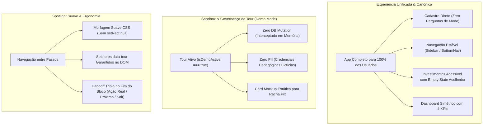

# 🧭 PLANO DE IMPLEMENTAÇÃO 11 — UNIFICAÇÃO DA EXPERIÊNCIA CANÔNICA, ERRADICAÇÃO DA BIFURCAÇÃO DE MODOS & BLINDAGEM DO TOUR GUIADO

> **Documento Canônico de Arquitetura de Produto, Engenharia de Software e Governança de UX**  
> **Status:** Em Execução e Refinado com Portões de Qualidade Estritos  
> **Versão Alvo do Roadmap:** **v3.07**  
> **Arquivo:** `docs/plans/11_PLANO_MODERNIZACAO_E_BLINDAGEM_DO_TOUR_GUIADO.md`  
> **Módulos Afetados:** `src/features/auth/`, `src/components/layout/`, `src/features/investments/`, `src/features/overview/`, `src/features/settings/`, `src/features/transactions/`, `src/features/debts/`, `src/domain/demo-simulation/`, `src/components/modules/`, `docs/`  
> **Governança:** TypeScript Estrito (Zero `any` / `@ts-ignore`) · Zero Emojis no Produto (`local/no-decorative-unicode`) · Regras 13/18/19 de Design System · Mobile-First

---

## 1. SUMÁRIO EXECUTIVO & DIAGNÓSTICO PROFUNDO

A análise crítica da experiência de usuário e da arquitetura do Áxis Finance identificou uma fragilidade estrutural que vinha fragmentando o produto: **a introdução artificial da bifurcação "Modo Essencial vs. Modo Investidor" (Plano 07)**.

Na prática:
1. **Falsa Simplificação:** O "Modo Essencial" não simplificava a complexidade real do app — apenas ocultava a aba "Investimentos" e o respectivo KPI, mantendo inalteradas as outras 9 áreas densas do sistema.
2. **Fricção Decisória Prematura no Cadastro:** Novos usuários eram submetidos a uma escolha arriscada antes de conhecer o app ("Qual o seu objetivo: Organizar Contas ou Gerenciar Carteira?"), gerando medo de bloqueio e abandono.
3. **Falsa Sensação de Paywall / App Bloqueado:** Ao acessar `/investments`, usuários em modo essencial encontravam uma landing page promocional interna (`InvestorModePromoView`), parecendo um recurso pago ou travado.
4. **Desequilíbrio Visual no Dashboard:** A grade de KPIs fundamentais (projetada para 4 colunas simétricas) era reduzida a 3 colunas desproporcionais.
5. **Vulnerabilidades e Instabilidades no Tour Guiado:** Mutação real no banco de dados (`public_shares`), vazamento de PII (`email`, `pixKey`), seletores ausentes no DOM gerando telas pretas e transições com flicker.

**A Solução Canônica:** Unificar 100% da experiência. O Áxis Finance volta a ser uma aplicação completa, sem barreiras de modo, com menu íntegro e investimentos nativos acompanhados de *empty state* acolhedor para novos poupadores. Paralelamente, o Tour Guiado é blindado com sandbox estrita, zero PII, apresentação ilustrada e transições de spotlight suaves.

---

## 2. ARQUITETURA DE SOLUÇÃO & GOVERNANÇA

---

## 3. ESTRUTURA DE FASES, ETAPAS & CRITÉRIOS DE EXECUÇÃO

### FASE 1: Unificação Canônica do Aplicativo & Erradicação da Bifurcação de Modos

* **Etapa 1.1 — Remoção do Seletor no Cadastro (`RegisterPage` & `data/auth.ts`):**
  - Remover a pergunta e os botões de seleção de "objetivo inicial" em `src/features/auth/pages/register-page.tsx`.
  - Simplificar a assinatura de `signUpWithEmail` em `src/data/auth.ts` e `use-auth.ts`, eliminando metadados de modo.
* **Etapa 1.2 — Estabilidade da Navegação (Sidebar, BottomNav e MoreMenuSheet):**
  - Remover a lógica de filtragem condicional de `isInvestorMode` em `nav-items.tsx`, `sidebar.tsx`, `bottom-nav.tsx` e `more-menu-sheet.tsx`.
  - A aba "Investimentos" permanece visível e acessível para todos os usuários em todas as plataformas.
* **Etapa 1.3 — Acesso Direto com Empty State Acolhedor em Investimentos:**
  - Remover a barreira de bloqueio `InvestorModePromoView` em `src/features/investments/pages/investments-page.tsx`.
  - A rota `/investments` carrega diretamente a carteira com seu *Empty State* nativo didático e estimulante para quem ainda não possui ativos.
* **Etapa 1.4 — Simetria do Dashboard & Limpeza em Configurações:**
  - Restaurar a grade executiva fixa de 4 KPIs na `OverviewPage` (`grid-cols-2 lg:grid-cols-4`).
  - Remover o banner condicional insistente de sobra de caixa (`InvestorModeSurplusBanner`).
  - Remover o card `AppModeCard` de `src/features/settings/components/tabs/appearance-tab.tsx`.

---

### FASE 2: Blindagem do Tour, Sandbox Estrita & Erradicação de PII e Mutações

* **Etapa 2.1 — Trava de Mutação no Banco Durante o Tour:**
  - Adicionar suporte a `isSimulation?: boolean` no `SplitExpenseDialog` e assistentes disparados pelo tour.
  - Bloquear qualquer chamada real a `createPublicShareMutation` ou inserção em banco quando `isDemoActive === true`.
* **Etapa 2.2 — Sanitização Completa de PII (Zero Exposição de Dados Reais):**
  - Usar dados fictícios padronizados durante a simulação:
    - Titular: `"Gabriel (Demonstração)"`
    - Chave Pix: `"pix.demo@exemplo.com"`
    - Descrição: `"Churrasco com Amigos"`
  - Bloquear a leitura de `profile?.email` e chaves Pix salvas reais do usuário no modal de demonstração.

---

### FASE 3: Apresentação Ilustrada para Recursos Compartilhados (`SplitPreviewMockupCard`)

* **Etapa 3.1 — Refinamento do Componente de Mockup:**
  - Ajustar `SplitPreviewMockupCard` em `src/components/modules/`:
    - Tipagem estrita de variantes de badge (`variant="muted"` com borda suave).
    - Remoção de imports mortos.
    - Exibição limpa de valores, QR Code ilustrado e chave didática.
* **Etapa 3.2 — Integração com a Rota de Transações & Passos do Tour:**
  - Integrar o modal de demonstração com o mockup em `src/features/transactions/pages/transaction-list-page.tsx` acionado pelo parâmetro seguro `?racha_preview=1`.
  - Atualizar os passos correspondentes em `src/domain/demo-simulation/tour-steps.ts`.

---

### FASE 4: Correção Cirúrgica de Seletores Ausentes no DOM

* **Etapa 4.1 — Feed de Transações:**
  - Inserir `data-tour="transactions-feed-card"` no contêiner do feed e empty state em `src/features/transactions/pages/transaction-list-page.tsx`.
* **Etapa 4.2 — Contas & Dívidas:**
  - Inserir `data-tour="debts-payable-section"` e `data-tour="debts-receivable-section"` em `src/features/debts/pages/debts-page.tsx`.
* **Etapa 4.3 — Auditoria dos Seletores:**
  - Garantir que todos os 40+ seletores referenciados em `tour-steps.ts` existam no DOM renderizado.

---

### FASE 5: Motor de Spotlight Estabilizado, Morfagem Suave e Eliminação de Flickers

* **Etapa 5.1 — Transições Contínuas sem setRect(null):**
  - Manter as coordenadas do retângulo anterior durante a transição de passos em `src/components/modules/demo-tour-spotlight.tsx`, aplicando transição fluida por CSS sem que a tela fique 100% preta.
* **Etapa 5.2 — Delay de Estabilização de Layout (150ms):**
  - Implementar tolerância para finalização de animações de abertura de modais antes de medir as dimensões finais do elemento alvo.

---

### FASE 6: Modularização dos 4 Blocos & Handoff de Ação Tripla

* **Etapa 6.1 — Handoff de Ação Tripla no Popover:**
  - No último passo de cada bloco temático (`finances`, `shared_finances`, `investments`, `settings_support`), renderizar o componente de handoff no popover:
    - **Ação 1 (Prática Real):** Botão primário para abrir o assistente correspondente na conta real.
    - **Ação 2 (Próximo Bloco):** Botão para avançar diretamente para o próximo bloco de aprendizado.
    - **Ação 3 (Sair / Explorar):** Botão discreto para fechar o tour e navegar livremente.
* **Etapa 6.2 — Sincronização dos Identificadores de Trilhas:**
  - Ajustar `handoff.ts` com os identificadores canônicos de trilhas (`settings_support`).

---

### FASE 7: Verificação, Testes Automatizados e Portões de Qualidade

* **Etapa 7.1 — Atualização da Suíte de Testes:**
  - Adaptar testes unitários e de integração de navegação, auth, overview e settings que dependiam de `isInvestorMode`.
  - Garantir cobertura para o `SplitPreviewMockupCard` e o motor de handoff.
* **Etapa 7.2 — Execução da Bateria de Verificação:**
  - Execução de Typecheck (`npm run typecheck`).
  - Execução de Linter (`npm run lint`).
  - Execução dos testes automatizados (`npm run test:run`).
  - Execução do build de produção (`npm run build`).

---

## 4. PORTÕES DE QUALIDADE (QUALITY GATES)

| Portão | Foco | Critério de Aceite Inegociável |
|---|---|---|
| **QG0 — Unificação Completa** | Experiência de Produto | Zero bifurcação de modo no cadastro; Investimentos visível e acessível para 100% dos usuários. |
| **QG1 — Zero Mutação em Tour** | Integridade do Banco | Nenhuma linha gravada em `public_shares` ou tabelas financeiras durante a demonstração. |
| **QG2 — Zero Vazamento de PII** | Privacidade e LGPD | Nenhum e-mail real, CPF ou chave Pix do usuário logado renderizado na interface do tour. |
| **QG3 — Cobertura de Seletores** | Integridade do DOM | 100% dos seletores de `tour-steps.ts` localizados no DOM sem timeout ou tela preta. |
| **QG4 — Zero Flicker no Spotlight** | Qualidade Visual | Transição morfada suave entre passos sem apagão total de iluminação. |
| **QG5 — Handoff de Ação Tripla** | Ergonomia de Saída | Fim de bloco oferece ação real no Wizard, avanço para próximo bloco ou saída limpa. |
| **QG6 — Testes Automatizados** | Confiabilidade | 100% dos testes unitários e de integração do Vitest aprovados. |
| **QG7 — Padrões de Código & Build** | Governança Técnica | `typecheck` zerado, `lint` sem violações e `build` de produção finalizado com sucesso. |
