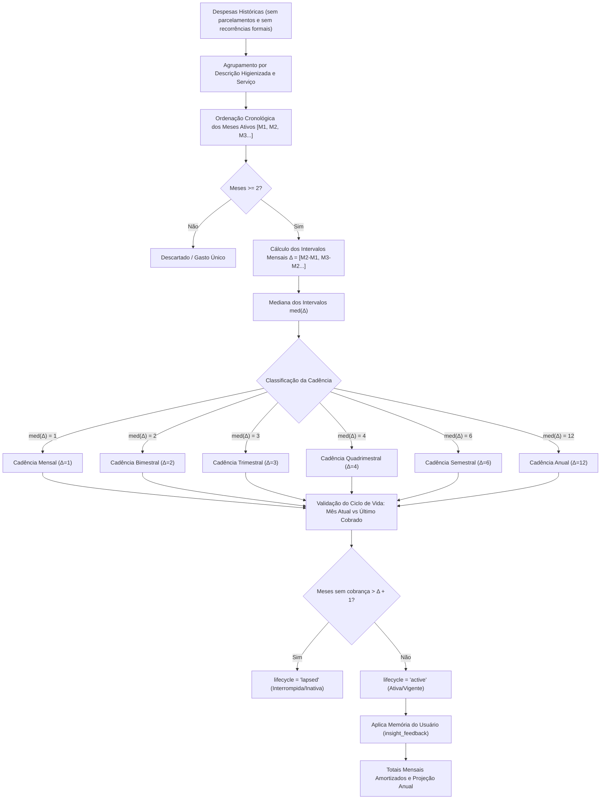

# 🗺️ PLANO DE IMPLEMENTAÇÃO 13 — REESTRUTURAÇÃO DA AUDITORIA DE RECORRÊNCIAS, MEMÓRIA DE APRENDIZADO UNIFICADA, FREQUÊNCIAS MULTI-MESES E EVOLUÇÃO DE PREÇO EM TRANSAÇÕES

> **Documento Canônico de Arquitetura de Produto, Engenharia Financeira e Governança de UX**  
> **Status:** Pronto para Execução (Planejamento Concluído)  
> **Versão Alvo do Roadmap:** **v3.09**  
> **Arquivo:** `planos/13_PLANO_REESTRUTURACAO_AUDITORIA_RECORRENCIAS_MEMORIA_E_EVOLUCAO_PRECOS.md`  
> **Módulos Afetados:** `src/domain/insights/`, `src/domain/subscriptions/`, `src/features/transactions/`, `src/features/insights/`, `src/state/queries/`, `src/components/modules/`, `docs/`  
> **Governança:** TypeScript Estrito (Zero `any` / `@ts-ignore`) · Zero Emojis no Produto (`local/no-decorative-unicode`) · Regras DRY e Design System §§4/13/18 · Precisão Contábil em Centavos Inteiros · Zero Chamadas a LLMs (100% Determinístico e Gratuito) · SSOT com `insight_feedback`

---

## 1. SUMÁRIO EXECUTIVO & DIAGNÓSTICO PROFUNDO

### 1.1 O Problema Identificado
Uma funcionalidade recente introduziu um motor paralelo em `src/domain/subscriptions/audit.ts` (`auditSubscriptions`) e exibiu um card expansível gigante de *Auditoria de Assinaturas & Planos* no topo da listagem de transações (`transaction-list-page.tsx`).

Essa abordagem causou 5 falhas graves de experiência e consistência:
1. **Falsos Positivos Críticos (Classificador Cego):** Qualquer descrição repetida $\ge 2$ vezes que não fosse parcelamento foi promovida a "Assinatura" (*Janta com Natielley*, *Hambúrguer*, *Almoço*, *Almoço Sabor do Bem*, *Refrigerante*, *Churrasco*, *Taxa de Estacionamento*), inflando projeções anuais de forma irrealista (ex.: R$ 15.073,44/ano).
2. **Cegueira Temporal / Recorrências Zumbis:** O motor vasculhava 6 meses para trás e tratava gastos encerrados no mês 06 como assinaturas vigentes no mês 11, alertando reajustes defasados há quase meio ano.
3. **Desconexão da Memória de Aprendizado:** O motor novo ignorava 100% da tabela `insight_feedback`. Mesmo que o usuário já tivesse marcado *Academia* como `[Essencial]` ou descartado despesas pontuais na tela de Insights, a auditoria em transações continuava exibindo tudo sem respeitar as escolhas feitas.
4. **Invasão da Área Operacional em Transações:** Transações é um extrato diário de fluxo de caixa; o card de topo causava sobrecarga cognitiva, poluição visual e concorrência com os KPIs e a busca.
5. **Lacuna de Periodicidades Estendidas:** O sistema presumia que toda repetição é mensal, falhando ao reconhecer compromissos legítimos bimestrais (2 meses), trimestrais (3 meses), semestrais (6 meses) ou anuais (12 meses).

### 1.2 A Solução Canônica
1. **Unificação Total no Motor Canônico (`SSOT`):** Todo o cálculo de recorrências passa a ser governado exclusivamente por `src/domain/insights/recurrences.ts`, lendo e gravando na tabela `insight_feedback`. O motor paralelo `domain/subscriptions/audit.ts` e o hook `useSubscriptionsAudit` são completamente saneados/aposentados.
2. **Detecção Determinística de Cadência Multi-Meses ($\Delta$):** Cálculo de distância mediana entre ocorrências para detectar automaticamente padrões Mensais ($\Delta=1$), Bimestrais ($\Delta=2$), Trimestrais ($\Delta=3$), Quadrimestrais ($\Delta=4$), Semestrais ($\Delta=6$) e Anuais ($\Delta=12$).
3. **Ciclo de Vida Dinâmico Anti-Zumbis:** Uma recorrência só é considerada ativa se tiver ocorrência dentro da janela de tolerância de sua própria cadência ($\Delta + 1$ meses). Gastos paralisados há mais tempo são classificados como `lapsed` (encerrados) e não entram nos totais mensais ativos nem nas projeções vigentes.
4. **Remoção do Card em Transações e Inteligência Contextual na Despesa:**
   - O card gigante de auditoria é **removido** do topo de Transações.
   - Na linha da despesa (`ExpenseRow`), é mantido apenas um badge sutil (`+X%`) em caso de aumento recente.
   - No diálogo de detalhes da despesa (`ExpenseDetailDialog`), é adicionado um card limpo de **Evolução do Gasto**, comparando o valor atual com: (a) o mês anterior, (b) a média dos meses anteriores e (c) o valor de estreia (primeira ocorrência histórica).
5. **Auditoria Centralizada em Insights com Botoeira Direta de 1 Toque:** A tela de Insights (aba Recorrências) torna-se o local oficial da **Auditoria de Recorrências & Planos**, oferecendo botões diretos de calibração vinculados a `useSetFeedback()`:
   - `[Essencial]` (`essential`)
   - `[Já Cancelei]` (`already_cancelled`)
   - `[Gasto Pontual]` (`one_off`)
   - `[Não é Assinatura]` (`not_subscription`)
   - `[Ajustar Frequência]` (seletor modal de cadência manual)
   - `[Confirmar]` (`confirm`)

---

## 2. MATRIZ DE FRAGILIDADES & SOLUÇÕES DE ENGENHARIA

| # | Fragilidade / Risco | Causa Raiz Potencial | Solução Canônica de Engenharia |
|---|---|---|---|
| **1** | **Falsos positivos em gastos alimentares e variáveis** (*Almoço*, *Churrasco*, *Estacionamento*). | Agrupamento ingênuo por string repetida sem checagem de categoria, catálogo ou dispersão de datas. | **Motor Canônico com Segmentação:** Validação contra catálogo de assinaturas, palavras-chave de serviços conhecidos e dispersão intramês. Se não for serviço fixo conhecido, exige cadência estável ou confirmação explícita do usuário. |
| **2** | **Recorrências encerradas inflando custos ativos** (*Almoço Sabor do Bem* parado há 4 meses). | Janela estática de lookback (6 meses) sem conferência da data da última cobrança em relação à data atual. | **Vigência Relativa à Cadência ($\Delta + 1$):** Recorrência mensal sem cobrança há $\ge 2$ meses (ou trimestral há $\ge 4$ meses) recebe `lifecycle: "lapsed"`. Sai dos totais mensais ativos e da projeção anual, sendo movida para a gaveta histórica. |
| **3** | **Incongruência de Memória entre Telas.** | Auditoria de transações não lia nem escrevia em `insight_feedback`. | **SSOT com `useFeedback()` / `useSetFeedback()`:** Ocorrência identificada pela mesma chave determinística (`occurrence_key`). Ações refletem instantaneamente em Insights, Transações e Visão Geral via cache TanStack Query com rollback otimista. |
| **4** | **Falso descarte de compromissos trimestrais/bimestrais.** | Algoritmo presumia cobrança todo mês; no mês vazio, considerava o gasto "atrasado" ou "morto". | **Cálculo da Distância Mediana ($\Delta$):** Identificação de $\Delta=2, 3, 4, 6, 12$ meses. Próxima data prevista calculada por $\text{ÚltimoMês} + \Delta$. Sem alertas falsos nos meses intermediários de intervalo normal. |
| **5** | **Distorção no Orçamento Mensal por gastos não-mensais.** | Somar o valor integral de um seguro trimestral de R$ 300,00 como se fosse custo mensal de R$ 300,00. | **Valor Mensal Amortizado:** Toda recorrência calcula $\text{CustoMensalAmortizado} = \text{ValorPorCiclo} / \Delta$. Ex.: Seguro trimestral de R$ 300 $\to$ R$ 100/mês na régua orçamentária e R$ 1.200/ano na projeção. |
| **6** | **Poluição e Concorrência Visual em Transações.** | Card expansível ocupando centenas de pixels antes do feed diário de lançamentos. | **Remoção Completa do Card de Topo:** Transações permanece limpa e focada no fluxo de caixa. A auditoria completa reside em Insights. Apenas pílula de aumento sutil na linha e card de evolução no modal da transação. |

---

## 3. ARQUITETURA DO MOTOR DE MULTI-FREQUÊNCIAS ($\Delta$)

---

## 4. FASES DE EXECUÇÃO & PORTÕES DE QUALIDADE

```mermaid
graph LR
    Fase1["Fase 1: Motor Matemático de Cadências & Ciclo de Vida"] --> QG1["Portão 1 (Vitest 100%)"]
    QG1 --> Fase2["Fase 2: Botoeira Direta e Memória na Auditoria de Insights"]
    Fase2 --> QG2["Portão 2 (UX / Feedback)"]
    QG2 --> Fase3["Fase 3: Limpeza de Transações & Evolução no Modal da Despesa"]
    Fase3 --> QG3["Portão 3 (Transações Limpa)"]
    QG3 --> Fase4["Fase 4: Saneamento de Código Legado, Build & Docs"]
    Fase4 --> QG4["Portão 4 (Prontidão Final)"]
```

---

### FASE 1 — Motor Matemático de Cadências Multi-Meses & Ciclo de Vida Dinâmico
**Objetivo:** Evoluir `src/domain/insights/recurrences.ts` para calcular intervalos medianos, suportar cadências bimestrais/trimestrais/anuais, amortização contábil e regra rigorosa de vigência temporal anti-zumbis.

- **Etapa 1.1 — Algoritmo de Intervalo Mediano ($\Delta$):**
  - Implementar cálculo da diferença de meses entre ocorrências sucessivas: `calculateMonthIntervals(months: string[]): number[]`.
  - Inferir cadência (`monthly`, `bimonthly`, `quarterly`, `quadrimonthly`, `semiannual`, `annual`).
  - Calcular valor amortizado por mês: `monthlyAmortizedCents = Math.round(cycleValueCents / deltaMonths)`.
- **Etapa 1.2 — Ciclo de Vida Relativo à Cadência:**
  - Atualizar `estimateNextDueDate`:
    - Se a distância entre o mês atual e o último mês cobrado for $> (\Delta + 1)$ meses $\to$ `lifecycle: "lapsed"` (encerrada/inativa).
    - Se a distância estiver dentro de $\Delta$, calcular a próxima data prevista sem alertar falso atraso.
    - Se estiver no mês previsto ($\Delta$) e o dia típico já tiver passado $\to$ `missingThisMonth: true` (pendente no ciclo).
- **Etapa 1.3 — Diagnóstico de Evolução de Preço de 3 Níveis:**
  - Extrair função pura de comparação de histórico para qualquer despesa:
    1. Variação em relação ao ciclo anterior ($M_{\text{atual}} \text{ vs } M_{\text{anterior}}$).
    2. Variação em relação à mediana histórica dos ciclos anteriores.
    3. Variação acumulada em relação à primeira ocorrência histórica registrada (marco zero).
- **Etapa 1.4 — Suíte de Testes Unitários de Domínio:**
  - Colocalizar testes exaustivos em `src/domain/insights/recurrences.test.ts` cobrindo gastos bimestrais, trimestrais, despesas inativas (antigas) sendo classificadas como `lapsed`, e despesas ativas recentes.

> **Portão de Qualidade 1 (QG1):**
> - Suíte de testes do motor de recorrências 100% verde (`npm test src/domain/insights/recurrences.test.ts`).
> - Zero dependências de DOM ou Supabase em `src/domain/`.
> - Moeda tratada estritamente em centavos inteiros.

---

### FASE 2 — Auditoria Centralizada em Insights com Botoeira Direta de 1 Toque
**Objetivo:** Renomear a visão para "Auditoria de Recorrências & Planos", exibir as cadências estendidas e disponibilizar botões de calibração imediata integrados à tabela `insight_feedback`.

- **Etapa 2.1 — Régua de Ações Diretas no Card / Lista (`InsightList` / `RecurrencesTab`):**
  - Adicionar botões de calibração rápida de 1 toque no item da recorrência e no popover de calibração:
    - `[Essencial]` $\to$ grava `essential` em `insight_feedback`.
    - `[Já Cancelei]` $\to$ grava `already_cancelled` em `insight_feedback` (celebra economia anual).
    - `[Pontual]` $\to$ grava `one_off` em `insight_feedback` (silencia no ciclo).
    - `[Não é Assinatura]` $\to$ grava `not_subscription` em `insight_feedback` (rebaixa probabilidade).
- **Etapa 2.2 — Seletor Manual de Frequência no `RecurrenceAuditModal`:**
  - No modal de auditoria detalhada da recorrência, incluir seletor de cadência:
    `[Mensal (1m)] [Bimestral (2m)] [Trimestral (3m)] [Semestral (6m)] [Anual (12m)]`.
  - Permitir que o usuário force ou ajuste a frequência se o algoritmo tiver identificado cadência diferente.
- **Etapa 2.3 — Seção de Recorrências Interrompidas / Encerradas:**
  - Criar gaveta colapsável no final da aba de Recorrências para abrigar itens `lifecycle: "lapsed"`.
  - Garante que almoços ou serviços de meses atrás (ex.: *Almoço Sabor do Bem*) fiquem arquivados com transparência, sem poluir a lista ativa nem somar no comprometimento do mês corrente.

> **Portão de Qualidade 2 (QG2):**
> - Ações de feedback atualizam o estado imediatamente via otimismo TanStack Query (`useSetFeedback`).
> - Nenhuma string arbitrária; uso exclusivo dos enums e tokens canônicos.
> - Verificação visual responsiva (Desktop e Mobile sem overflow).

---

### FASE 3 — Limpeza da Tela de Transações & Evolução de Preço no Detalhe da Despesa
**Objetivo:** Despoluir a tela de Transações, eliminando o card invasivo de auditoria do topo e posicionando a inteligência financeira contextual diretamente no lançamento.

- **Etapa 3.1 — Remoção do Card do Topo de Transações:**
  - Remover a renderização de `<SubscriptionsAuditCard />` em `src/features/transactions/pages/transaction-list-page.tsx`.
  - Eliminar o estado local e os nós de layout que inflavam o topo da tela antes dos lançamentos.
- **Etapa 3.2 — Pílula Sutil de Variação na Linha (`ExpenseRow`):**
  - Preservar na linha do lançamento apenas o `<PriceIncreaseBadge />` sutil (ex.: `+15%`) quando houver aumento real em relação ao histórico.
  - Ao clicar no badge, abrir o modal de detalhes da despesa na aba de histórico/evolução.
- **Etapa 3.3 — Bloco de Histórico & Evolução no `ExpenseDetailDialog`:**
  - Adicionar ao modal de detalhes do lançamento (`ExpenseDetailDialog`) uma seção elegante:
    - **vs. Mês Anterior:** $\pm\Delta\%$ e valor monetário.
    - **vs. Média Histórica:** comparação com o padrão dos últimos meses.
    - **Marco Inicial:** data e valor em que o gasto foi registrado pela primeira vez no app.
    - Atalho para auditoria completa em Insights caso a despesa seja recorrente.

> **Portão de Qualidade 3 (QG3):**
> - A tela de Transações volta a ter carregamento enxuto, sem cards estáticos pesados no topo.
> - O modal de detalhes da despesa respeita a governança de modais (§18: responsivo, sem autoFocus, com padding adaptativo).
> - Testes de página de transações atualizados e passando.

---

### FASE 4 — Saneamento de Código Legado, Build & Governança da Documentação
**Objetivo:** Remover arquivos e hooks duplicados, assegurar typecheck rigoroso e atualizar a documentação de arquitetura.

- **Etapa 4.1 — Remoção de Arquivos Duplicados:**
  - Remover com segurança `src/domain/subscriptions/audit.ts` e `src/domain/subscriptions/audit.test.ts`.
  - Remover `src/state/queries/use-subscriptions-audit.ts`.
  - Remover `src/features/transactions/components/subscriptions-audit-card.tsx` e `subscription-adjustment-modal.tsx` (já absorvido pelo `RecurrenceAuditModal`).
  - Atualizar os barrels `src/components/modules/index.ts`, `src/features/transactions/components/index.ts`, `src/state/index.ts` e `src/domain/subscriptions/index.ts`.
- **Etapa 4.2 — Typecheck, Lint e Testes Globais:**
  - Executar `npx tsc --noEmit` garantindo zero erros de tipagem estrita.
  - Executar `npm run lint` assegurando conformidade com `no-decorative-unicode`.
  - Executar suíte de testes com Vitest (`npm test`).
- **Etapa 4.3 — Atualização da Documentação Canônica:**
  - Atualizar `docs/architecture/ESPECIFICACAO_TECNICA.md` e `docs/architecture/ARCHITECTURE.md` para registrar a detecção multi-cadência ($\Delta$) e a governança de auditoria em Insights.
  - Atualizar `docs/roadmap/ROADMAP.md` e `AGENTS.md` se aplicável.

> **Portão de Qualidade 4 (QG4):**
> - `npm run build` ou `npx tsc --noEmit` executa com sucesso e zero warnings.
> - Zero arquivos mortos ou exportações quebradas.
> - Documentação em `docs/` sincronizada com o código implementado.

---

## 5. PLANO DE VERIFICAÇÃO & TESTES AUTOMATIZADOS

### 5.1 Testes Unitários de Domínio (Vitest)
1. **Detecção de Cadências Multi-Meses:**
   - Série mensal: `["2026-08", "2026-09", "2026-10", "2026-11"]` $\to$ cadência `monthly` ($\Delta=1$).
   - Série bimestral: `["2026-06", "2026-08", "2026-10"]` $\to$ cadência `bimonthly` ($\Delta=2$).
   - Série trimestral: `["2026-03", "2026-06", "2026-09"]` $\to$ cadência `quarterly` ($\Delta=3$).
   - Série anual: `["2025-01", "2026-01"]` $\to$ cadência `annual` ($\Delta=12$).
2. **Ciclo de Vida Dinâmico:**
   - Despesa com última cobrança em `2026-06` e data atual em `2026-11` (4 meses de hiato em despesa mensal) $\to$ `lifecycle: "lapsed"`, `missingThisMonth: false`.
   - Despesa trimestral com última cobrança em `2026-09` e data atual em `2026-11` $\to$ `lifecycle: "active"`, próxima cobrança em `2026-12`.
3. **Amortização Contábil:**
   - Valor de R$ 300,00 a cada 3 meses $\to$ `monthlyAmortizedCents: 10000`, `annualProjectedCents: 120000`.
4. **Memória de Aprendizado:**
   - Item com feedback `essential` $\to$ `tier: "essential"`, `savingsIfCutCents: 0`.
   - Item com feedback `already_cancelled` $\to$ sai de `active` e vai para `ignored`.

### 5.2 Testes de Componentes e Páginas (React Testing Library)
1. `transaction-list-page.test.tsx`:
   - Verifica que `SubscriptionsAuditCard` **não** é renderizado na tela de transações.
   - Verifica que o badge de aumento aparece na linha e abre os detalhes.
2. `recurrences-tab.test.tsx`:
   - Valida clique nos botões de micro-feedback direto (`essential`, `already_cancelled`, etc.).
   - Valida renderização correta de tags de cadência (*Bimestral*, *Trimestral*).
   - Valida que itens `lapsed` ficam na gaveta colapsável sem sujar os totais ativos.
3. `expense-detail-dialog.test.tsx`:
   - Valida exibição dos comparativos de evolução (vs mês anterior, média e primeiro registro).

---

## 6. CONCLUSÃO & PRONTIDÃO

Este plano resolve cirurgicamente a fragmentação arquitetural, reestabelece a verdade contábil, devolve a limpeza operacional à tela de Transações e entrega uma Auditoria de Recorrências inteligente, dinâmica para qualquer perfil de usuário e rigorosamente fiel às escolhas salvas na memória do assistente.
