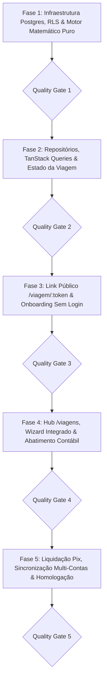

# PLANO DE IMPLEMENTAÇÃO 14 — MODO VIAGEM COMPARTILHADO, LIQUIDAÇÃO MÚTUA & INTEGRAÇÃO CONTÁBIL PESSOAL

> **Documento Canônico de Arquitetura, Engenharia de Dados e Governança de Software**  
> **Status:** Concluído / Implementado — v1.0 (Evoluções e Refinamentos Multi-Usuário Consolidados no Plano 16)  
> **Arquivo:** `planos/completed/14_PLANO_MODO_VIAGEM_COMPARTILHADO_E_LIQUIDACAO_MUTUA.md`  
> **Ordem de Implementação:** **14º (Módulo de Finanças Compartilhadas Temporárias & Liquidação Mútua)**  
> **Módulos Afetados:** `supabase/migrations/`, `src/types/`, `src/domain/trips/`, `src/data/repositories/`, `src/data/rpc.ts`, `src/state/`, `src/hooks/`, `src/features/trips/`, `src/features/transactions/`, `src/features/public-share/`, `docs/`  
> **Governança:** TypeScript Estrito (Zero `any`/`@ts-ignore`) · RLS Hermético (D4 — Zero Data Bleed) · Moeda em Centavos Inteiros · Zero Controles Nativos Crus · Zero Emojis (`local/no-decorative-unicode`) · Portões de Qualidade (QG) por Fase  
> **Ambientes:** Web Desktop, Web PWA (iOS/Android) & Android Nativo (Capacitor Pro)  

---

## 1. SUMÁRIO EXECUTIVO: COMO ESTÁ HOJE vs. COMO VAI FUNCIONAR

```
┌────────────────────────────────────────────────────────────────────────────────────────────────────────┐
│                              ECOSSISTEMA DO MODO VIAGEM (ÁXIS FINANCE)                                 │
└────────────────────────────────────────────────────────────────────────────────────────────────────────┘
                                                    │
                   ┌────────────────────────────────┼────────────────────────────────┐
                   ▼                                ▼                                ▼
       ┌───────────────────────┐        ┌───────────────────────┐        ┌───────────────────────┐
       │   PERFIL A: TITULAR   │        │  PERFIL B: CONVIDADO  │        │   PERFIL C: MEMBRO    │
       │    (APP COMPLETO)     │        │     (SEM CONTA)       │        │     (COM CONTA)       │
       │                       │        │                       │        │                       │
       │ - Cria a viagem       │        │ - Acesso web mobile   │        │ - Já tem Áxis Finance │
       │ - Vincula transação   │        │   via /viagem/:token  │        │ - Aceita vínculo      │
       │   ao seu cartão       │        │ - Lança gastos s/ app │        │ - Lança no seu extrato│
       │ - Abatimento no seu   │        │ - Vê quanto deve/recebe│       │ - Sincroniza em grupo │
       │   extrato ao receber  │        │ - Copia chave Pix     │        │ - Confirmação mútua   │
       └───────────┬───────────┘        └───────────┬───────────┘        └───────────┬───────────┘
                   │                                │                                │
                   └────────────────────────────────┼────────────────────────────────┘
                                                    ▼
                               ┌────────────────────────────────────────┐
                               │       LIVRO-RAZÃO DA VIAGEM (HUB)      │
                               │  - Despesas pagas por múltiplos amigos │
                               │  - Divisões iguais ou personalizadas   │
                               │  - Histórico de fotos/comprovantes     │
                               │  - Alertas de saldo em tempo real      │
                               └────────────────────┬───────────────────┘
                                                    ▼
                               ┌────────────────────────────────────────┐
                               │     MOTOR DE COMPENSAÇÃO LÍQUIDA       │
                               │  (Simplificação de Grafo de Dívidas)   │
                               │  - Reduz N transferências ao mínimo    │
                               │  - Geração de Chave Pix em 1 toque     │
                               └────────────────────┬───────────────────┘
                                                    ▼
                               ┌────────────────────────────────────────┐
                               │    CONCILIAÇÃO NO EXTRATO PESSOAL      │
                               │  - Abatimento contábil automático      │
                               │  - Sem inflar receitas com repasses    │
                               │  - Preservação da fatura do cartão     │
                               └────────────────────────────────────────┘
```

### 1.1 Estado Atual (Antes do Plano 14)
1. **Racha Pix (`/r/:token`):** Rateio pontual de uma única despesa pessoal (`expenses`), pago por 1 anfitrião e rateado entre convidados. Não atende a dinâmica de múltiplos amigos pagando despesas diferentes ao longo de dias.
2. **Modo Família (`/familia`):** Orçamento contínuo mensal para cônjuges/dependentes fixos. Criar uma família para uma viagem de 4 dias com amigos é inviável e mistura finanças domiciliares com turismo.
3. **Controle Manual Externo:** O usuário precisa recorrer ao *Splitwise* (que agora cobra paywall e restringe lançamentos) ou planilhas de WhatsApp, sofrendo para transferir manualmente a despesa real para o Áxis e sem conciliação com a fatura do cartão.

### 1.2 Estado Futuro (Com o Plano 14)
1. **Centro de Custo Transitório:** O usuário cria a viagem ("Mochilão Chapada"), adiciona amigos e gera um link público protegido por token (`/viagem/:token`).
2. **Acesso Sem Barreiras:** Convidados sem conta lançam despesas via web mobile em menos de 10 segundos, sem download nem cadastro.
3. **Membros Conectados do Áxis:** Amigos que já usam o app conectam suas contas, visualizando a viagem no seu próprio painel.
4. **Vínculo Transacional com Abatimento Automático:** Uma despesa lançada no cartão do titular ou de um membro é vinculada à viagem. O valor bruto permanece na fatura para conciliação bancária, enquanto o peso contábil (`report_weight`) reflete apenas sua cota real. Ao receber o ressarcimento Pix, a baixa é registrada automaticamente sem inflar falsamente a renda do mês.
5. **Algoritmo de Compensação Mútua:** Ao final da viagem, o motor matemático puro calcula a matriz líquida mínima de transferências Pix, simplificando as dívidas de forma determinística e com centavos exatos.

---

## 2. MATRIZ DE FRAGILIDADES, RISCOS & SALVAGUARDAS ARQUITETURAIS

| # | Fragilidade Diagnosticada | Impacto no Usuário / Negócio | Salvaguarda Blindada de Engenharia |
|---|---|---|---|
| **F1** | **Barreira de Entrada ("Taxa de Download/Login")** | Se os amigos forem obrigados a baixar o app e criar conta, 80% do grupo abandona a ferramenta e volta ao WhatsApp. | **Link Público com Token Criptográfico (`/viagem/:token`):** Convidados sem conta acessam interface web mobile ultrarrápida, selecionam seu nome na lista e lançam despesas em 2 toques sem senha nem cadastro prévio. |
| **F2** | **Contaminação do Orçamento Pessoal (Distorção do Livro-Razão)** | O titular paga R$ 4.000 de chalé no cartão. Seu extrato acusa que ele gastou R$ 4.000 sozinho, estourando seu teto do mês. | **Mecanismo de Peso Ponderado (`report_weight`) + Abatimento por Ressarcimento:** O valor bruto (R$ 4.000) vai para a fatura do cartão para permitir conciliação bancária, mas a despesa pessoal recebe cota ponderada (`report_weight = 0.25`), contabilizando apenas R$ 1.000 no orçamento real do titular. |
| **F3** | **Distorção de Renda ("Receita Falsa de Repasse")** | Quando os amigos transferem os R$ 3.000 via Pix de volta, o app soma como se fosse "nova renda/salário", falseando o fluxo de caixa anual. | **Classificação Contábil Transitória (`is_reimbursement = true`):** Os repasses de ressarcimento são creditados diretamente contra a despesa de origem ou em categoria de compensação neutra (peso 0%), sem inflar o gráfico de receitas líquidas do ano. |
| **F4** | **Vandalismo e Conflitos no Link Público** | Um amigo zombeteiro ou desatento apaga ou edita a despesa de outro membro no link público. | **Ledger Imutável com Auditoria e PIN Opcional:** Toda despesa registra autor original (`created_by_member_id`) e data. Apenas o criador da despesa ou o anfitrião da viagem possuem autorização de edição/exclusão. Viagens privadas podem exigir um PIN simples de 4 dígitos. |
| **F5** | **Restos de Centavos em Divisões Desiguais** | R$ 100,00 dividido entre 3 pessoas resulta em R$ 33,33 x 3 = R$ 99,99. Falta 1 centavo, gerando saldos perpétuos de R$ 0,01. | **Algoritmo Determinístico de Resíduo (`trip-math.ts`):** O centavo residual é sempre atribuído determinísticamente ao pagador da despesa, garantindo invariante estrita: $\sum \text{cotas} = \text{valor original em centavos}$. |
| **F6** | **Colisão entre Duas Contas do Áxis Finance** | Dois usuários reais do app participam da mesma viagem; se ambos lançarem despesas, pode haver vazamento de contas bancárias de um para o outro. | **Isolamento de RLS com Visibilidade Seletiva:** A RPC `get_public_trip_ledger` e `get_user_trip_details` retornam apenas os dados da despesa da viagem (`amount_cents`, `description`, `category`, `paid_by_name`). Informações confidenciais (número da conta, limite de cartão, saldo) nunca saem do banco do titular. |
| **F7** | **Despesas Exclusivas ("Quem não bebeu não paga a cerveja")** | O racha igualitário força membros a pagarem por itens que não consumiram, gerando atritos no grupo. | **Modos de Partilha Flexíveis por Item:** Cada lançamento permite divisão igual (`all_equal`), participantes selecionados (`subset_equal`) ou cotas exatas manuais (`exact_cents`). |
| **F8** | **Acúmulo de Viagens Mortas no Dashboard** | Grupos finalizados continuam poluindo a tela inicial e os seletores do usuário. | **Máquina de Estados Finita do Ciclo de Vida:** Estados formais: `planning` -> `active` -> `settling` -> `completed` -> `archived`. Viagens arquivadas saem de todos os seletores ativos e viram histórico somente-leitura. |

---

## 3. ARQUITETURA DE DADOS NO SUPABASE (POSTGRES + RLS)

### 3.1 DDL Relacional

```sql
-- 1. GRUPOS DE VIAGEM (Hub Central)
CREATE TABLE public.trips (
    id UUID PRIMARY KEY DEFAULT gen_random_uuid(),
    host_user_id UUID NOT NULL REFERENCES auth.users(id) ON DELETE CASCADE,
    title VARCHAR(120) NOT NULL,
    destination VARCHAR(120),
    start_date DATE NOT NULL,
    end_date DATE NOT NULL,
    status VARCHAR(20) NOT NULL DEFAULT 'active' CHECK (status IN ('planning', 'active', 'settling', 'completed', 'archived')),
    currency VARCHAR(3) NOT NULL DEFAULT 'BRL',
    public_token VARCHAR(64) NOT NULL UNIQUE,
    passcode_hash VARCHAR(128),
    cover_photo_url TEXT,
    created_at TIMESTAMPTZ NOT NULL DEFAULT timezone('utc'::text, now()),
    updated_at TIMESTAMPTZ NOT NULL DEFAULT timezone('utc'::text, now())
);

-- 2. PARTICIPANTES DA VIAGEM
CREATE TABLE public.trip_members (
    id UUID PRIMARY KEY DEFAULT gen_random_uuid(),
    trip_id UUID NOT NULL REFERENCES public.trips(id) ON DELETE CASCADE,
    name VARCHAR(80) NOT NULL,
    user_id UUID REFERENCES auth.users(id) ON DELETE SET NULL,
    pix_key VARCHAR(140),
    pix_key_type VARCHAR(20) CHECK (pix_key_type IN ('cpf', 'cnpj', 'email', 'phone', 'random')),
    is_host BOOLEAN NOT NULL DEFAULT false,
    created_at TIMESTAMPTZ NOT NULL DEFAULT timezone('utc'::text, now()),
    CONSTRAINT uq_trip_member_name UNIQUE (trip_id, name)
);

-- 3. DESPESAS DA VIAGEM
CREATE TABLE public.trip_expenses (
    id UUID PRIMARY KEY DEFAULT gen_random_uuid(),
    trip_id UUID NOT NULL REFERENCES public.trips(id) ON DELETE CASCADE,
    paid_by_member_id UUID NOT NULL REFERENCES public.trip_members(id) ON DELETE RESTRICT,
    amount_cents INTEGER NOT NULL CHECK (amount_cents > 0),
    description VARCHAR(140) NOT NULL,
    category_name VARCHAR(60) NOT NULL DEFAULT 'Geral',
    expense_date DATE NOT NULL,
    split_type VARCHAR(20) NOT NULL DEFAULT 'equal' CHECK (split_type IN ('equal', 'custom', 'shares')),
    receipt_url TEXT,
    created_by_member_id UUID REFERENCES public.trip_members(id) ON DELETE SET NULL,
    linked_personal_expense_id UUID REFERENCES public.expenses(id) ON DELETE SET NULL,
    created_at TIMESTAMPTZ NOT NULL DEFAULT timezone('utc'::text, now()),
    updated_at TIMESTAMPTZ NOT NULL DEFAULT timezone('utc'::text, now())
);

-- 4. DIVISÃO DAS COTAS (Splits por Membro)
CREATE TABLE public.trip_expense_splits (
    id UUID PRIMARY KEY DEFAULT gen_random_uuid(),
    expense_id UUID NOT NULL REFERENCES public.trip_expenses(id) ON DELETE CASCADE,
    member_id UUID NOT NULL REFERENCES public.trip_members(id) ON DELETE CASCADE,
    share_cents INTEGER NOT NULL CHECK (share_cents >= 0),
    CONSTRAINT uq_trip_split_member UNIQUE (expense_id, member_id)
);

-- 5. ACERTOS E LIQUIDAÇÕES (Settlements)
CREATE TABLE public.trip_settlements (
    id UUID PRIMARY KEY DEFAULT gen_random_uuid(),
    trip_id UUID NOT NULL REFERENCES public.trips(id) ON DELETE CASCADE,
    from_member_id UUID NOT NULL REFERENCES public.trip_members(id) ON DELETE RESTRICT,
    to_member_id UUID NOT NULL REFERENCES public.trip_members(id) ON DELETE RESTRICT,
    amount_cents INTEGER NOT NULL CHECK (amount_cents > 0),
    status VARCHAR(20) NOT NULL DEFAULT 'pending' CHECK (status IN ('pending', 'confirmed')),
    confirmed_at TIMESTAMPTZ,
    pix_transaction_id VARCHAR(100),
    created_at TIMESTAMPTZ NOT NULL DEFAULT timezone('utc'::text, now()),
    CONSTRAINT chk_trip_settlement_distinct_members CHECK (from_member_id <> to_member_id)
);
```

### 3.2 Políticas de RLS & RPCs Canônicas

1. **Isolamento de Escrita:** Somente o `host_user_id` ou membros autorizados podem mutar registros.
2. **RPC `get_public_trip_ledger(p_token TEXT, p_passcode TEXT)`:**
   - Retorna os dados sanitizados da viagem, membros, lista de despesas com comprovantes e balanço líquido de cada participante.
   - Bloqueia totalmente qualquer vazamento de IDs de cartão ou contas bancárias.
3. **RPC `add_public_trip_expense(...)`:**
   - Permite inclusão de despesas via link público com validação transacional da soma de centavos das cotas.
4. **RPC `settle_trip_balance(p_trip_id UUID)`:**
   - Executa a simplificação líquida no banco e grava os pagamentos devidos em `trip_settlements`.

---

## 4. INTEGRAÇÃO CONTÁBIL PESSOAL: LANÇAMENTO, VINCULAÇÃO E ABATIMENTO

### 4.1 O Ciclo de Vida da Despesa Vinculada

```
                               CICLO DA DESPESA VINCULADA
┌───────────────────────────────────────────────────────────────────────────────────────┐
│ 1. LANÇAMENTO NO APP (LaunchWizard ou Transação Rápida):                              │
│    - Gabriel paga R$ 600,00 no Cartão Nubank ("Jantar Frutos do Mar").                │
│    - Ativa o toggle: [ x ] Vincular à viagem "Praia de Pipa".                         │
│    - Seleciona a divisão: "Dividir igualmente entre Gabriel, Pedro e Tiago".          │
└──────────────────────────────────────────┬────────────────────────────────────────────┘
                                           │
                                           ▼
┌───────────────────────────────────────────────────────────────────────────────────────┐
│ 2. ESTADO INICIAL NO EXTRATO PESSOAL:                                                 │
│    - Valor na Fatura do Cartão: R$ 600,00 (100% conciliado para o fechamento).        │
│    - Cota Real do Gabriel: R$ 200,00 (33,33%).                                        │
│    - Peso Contábil (`report_weight`): 0.333333 (calculado automaticamente).          │
│    - Impacto nos Relatórios de Despesa: apenas R$ 200,00!                             │
│    - Badge no Extrato: [ Viagem: Praia de Pipa (Aguardando R$ 400,00) ]               │
└──────────────────────────────────────────┬────────────────────────────────────────────┘
                                           │
                                           ▼
┌───────────────────────────────────────────────────────────────────────────────────────┐
│ 3. REGISTRO AUTOMÁTICO NO HUB DA VIAGEM:                                              │
│    - A despesa de R$ 600,00 surge instantaneamente na lista da viagem.                │
│    - Gabriel consta como credor de R$ 400,00.                                         │
│    - Pedro deve R$ 200,00; Tiago deve R$ 200,00.                                      │
└──────────────────────────────────────────┬────────────────────────────────────────────┘
                                           │
                                           ▼
┌───────────────────────────────────────────────────────────────────────────────────────┐
│ 4. LIQUIDAÇÃO / RESSARCIMENTO (Pedro e Tiago pagam Gabriel via Pix):                  │
│    - O grupo finaliza a viagem ou o membro confirma o Pix no app/link.                │
│    - Ao confirmar a entrada do Pix:                                                   │
│      Opção A (Abatimento Direto): A despesa no cartão tem seu saldo líquido ajustado. │
│      Opção B (Receita Compensatória Neutra): Criação automática de transação de       │
│      "Ressarcimento de Viagem" com categoria especial de peso neutro (sem inflar      │
│      salário/renda).                                                                  │
│    - Badge no Extrato passa para: [ Viagem: Praia de Pipa (100% Liquidado) ]          │
└───────────────────────────────────────────────────────────────────────────────────────┘
```

---

## 5. FASES DE EXECUÇÃO DETALHADAS & PORTÕES DE QUALIDADE (QUALITY GATES)



---

### Fase 1: Infraestrutura Postgres, RLS & Motor Matemático Puro

> **Objetivo:** Estabelecer o schema de dados relacional hermético, RPCs transacionais e o motor puro de simplificação de dívidas com cobertura total de testes unitários.

- [ ] **Tarefa 1.1: Migration de Viagens (`supabase/migrations/20260101000085_create_trips_and_shared_ledger.sql`)**
  - Criação das tabelas `trips`, `trip_members`, `trip_expenses`, `trip_expense_splits` e `trip_settlements`.
  - Índices em `public_token`, `trip_id`, `(trip_id, name)` e `linked_personal_expense_id`.
  - Habilitação de RLS em todas as tabelas com policies herméticas de tenant e membresia.

- [ ] **Tarefa 1.2: RPCs Transacionais de Segurança (`src/data/rpc.ts`)**
  - Implementação de `get_public_trip_ledger`: leitura sanitizada pública via token criptográfico.
  - Implementação de `add_public_trip_expense`: adição atômica de despesa e cotas de partilha.
  - Implementação de `settle_trip_balance`: fechamento contábil e geração das linhas de liquidação.

- [ ] **Tarefa 1.3: Tipagem TypeScript Estrita (`src/types/trips.ts`)**
  - Definição dos tipos de domínio: `Trip`, `TripMember`, `TripExpense`, `TripExpenseSplit`, `TripSettlement`, `TripStatus`, `SplitMode`.
  - Schemas zod para validação de entrada de dados no cliente e na borda da API.

- [x] **Tarefa 1.4: Motor Matemático Puro em Centavos (`src/domain/trips/trip-math.ts`)**
  - Função pura `calculateEqualSplits(totalCents, memberIds, payerId)` com alocação determinística de centavos residuais ao pagador.
  - Função pura `calculateMemberBalances(members, expenses, splits)`: computa o saldo líquido de cada membro em centavos inteiros ($\sum \text{pago} - \sum \text{devido}$), com recalculo dinâmico para despesas de divisão igualitária (`split_type !== 'custom'`) para garantir equilíbrio justo mesmo quando novos membros entram após despesas anteriores.
  - Função pura `calculateSimplifiedSettlements(balances)`: algoritmo ótimo de minimização de fluxo de caixa (*Min-Cash-Flow via Zero-Sum Subset Partitioning com Bitmask DP* para até 15 integrantes e fallback greedy), gerando o menor número absoluto de transferências Pix possíveis entre os integrantes.
  - Testes unitários colocalizados em `src/domain/trips/trip-math.test.ts` cobrindo cenários com 2 a 15 participantes, restos de centavos, participantes zerados e conferência da invariante $\sum \text{créditos} = \sum \text{débitos}$.

- [ ] **Portão de Qualidade 1 (QG1):**
  - [ ] Executar: `npx vitest run src/domain/trips/trip-math.test.ts` (100% de aprovação).
  - [ ] Executar: `npm run typecheck` (zero erros de tipagem).
  - [ ] Executar: `npm run lint` (zero violações de lint e emojis).
  - [ ] **Commit da Fase 1:** `git commit -m "feat(trips): schema postgres, rpcs e motor matematico de compensacao liquida"`

---

### Fase 2: Repositórios, TanStack Queries & Estado da Viagem

> **Objetivo:** Construir a camada de acesso a dados (`data/`), hooks reativos (`state/queries/`) e gestão de estado em conformidade estrita com o `PROJECT_STRUCTURE.md`.

- [ ] **Tarefa 2.1: Repositório de Viagens (`src/data/repositories/trips.ts`)**
  - Métodos autenticados: `getUserTrips`, `getTripById`, `createTrip`, `updateTrip`, `deleteTrip`, `addTripMember`, `removeTripMember`.
  - Métodos públicos desacoplados: `fetchPublicTripLedger(token)`, `submitPublicExpense(token, payload)`.

- [ ] **Tarefa 2.2: TanStack Queries & Mutations (`src/state/queries/use-trips.ts`)**
  - Hooks reativos: `useUserTrips()`, `useTripDetails(tripId)`, `usePublicTrip(token)`.
  - Mutations otimistas: `useCreateTripMutation()`, `useAddTripExpenseMutation()`, `useSettleTripMutation()`.
  - Invalidação cirúrgica de cache via `queryClient.invalidateQueries`.

- [ ] **Tarefa 2.3: Inscrições em Tempo Real (Supabase Realtime)**
  - Integração do hook `useTripRealtime(tripId)` para escutar eventos de `INSERT`/`UPDATE` em `trip_expenses` e refletir na tela dos participantes sem necessidade de refresh manual.

- [ ] **Portão de Qualidade 2 (QG2):**
  - [ ] Executar: `npx vitest run src/data/repositories/trips.test.ts src/state/queries/use-trips.test.ts`
  - [ ] Executar: `npm run typecheck`
  - [ ] Executar: `npm run lint`
  - [ ] **Commit da Fase 2:** `git commit -m "feat(trips): repositorios, queries reativas e suporte a realtime"`

---

### Fase 3: Link Público Colaborativo (`/viagem/:token`) & Onboarding Sem Login

> **Objetivo:** Criar a interface web mobile para os amigos que não possuem o aplicativo, garantindo velocidade instantânea, zero fricção de entrada e ergonomia tátil impecável.

- [ ] **Tarefa 3.1: Rota Pública Desacoplada (`src/features/public-share/pages/trip-public-page.tsx`)**
  - Layout limpo e responsivo sem dependência de autenticação do usuário.
  - Cabeçalho canônico institucional: Título da viagem, destino, data e lista de amigos participantes com chips visuais.
  - Barra de filtro por participante: *"Exibir gastos de [Todos | Gabriel | Pedro | Tiago]"*.

- [ ] **Tarefa 3.2: Card de Resumo Pessoal Interativo (`TripPersonalSummaryCard`)**
  - Seletor de participante: *"Quem é você nesta viagem?"*.
  - Exibição acolhedora: total pago pelo amigo, sua cota de gastos e seu saldo consolidado (*"Você tem R$ 120,00 a receber"* ou *"Você deve R$ 85,00"*).

- [ ] **Tarefa 3.3: Diálogo de Lançamento Rápido (`AddPublicTripExpenseDialog`)**
  - Modal mobile-first com ergonomia do Plano 08 (bottom-sheet no mobile, centralizado no desktop).
  - Campos: Valor em centavos (`MoneyInput`), Descrição (`Input`), Quem pagou (`Select` primitivo), Data e Divisão (Todos igualmente / Escolher participantes).
  - Upload opcional de comprovante/foto da notinha.
  - Zero `autoFocus` declarativo e fontes com tamanho seguro anti-zoom no iOS.

- [ ] **Tarefa 3.4: Aba de Acerto de Contas & Cópia de Pix (`TripSettlementList`)**
  - Lista de transferências necessárias geradas pelo algoritmo de minimização.
  - Botão *"Copiar Chave Pix"* em 1 toque com feedback háptico sensorial via `triggerSensory`.
  - Botão de exportação para WhatsApp: formata texto limpo com as instruções de acerto para envio no grupo.
  - Rodapé com CTA de conversão discreto para o Áxis Finance.

- [ ] **Portão de Qualidade 3 (QG3):**
  - [ ] Teste em dispositivos móveis (viewport 360px a 430px) e desktop (1920px).
  - [ ] Executar: `npx vitest run src/features/public-share/`
  - [ ] Executar: `npm run typecheck`
  - [ ] Executar: `npm run lint`
  - [ ] **Commit da Fase 3:** `git commit -m "feat(trips): interface publica colaborativa /viagem/:token sem friccao"`

---

### Fase 4: Hub Interno (`/viagens`), Wizard Integrado & Abatimento Contábil

> **Objetivo:** Entregar a experiência premium do titular no app Áxis Finance, com integração profunda ao extrato pessoal e cálculo automático de abatimento.

- [x] **Tarefa 4.1: Hub de Viagens no App (`src/features/trips/pages/trip-list-page.tsx`)**
  - Listagem de viagens ativas e histórico de viagens concluídas/arquivadas.
  - Card ativo na Home (`ActiveTripHomeBanner`): exibido durante as datas da viagem com saldo em tempo real e botão de atalho.
  - Acesso pelo Menu Mais (`more-menu-sheet.tsx`) e atalho no topo do extrato.

- [x] **Tarefa 4.2: Tela de Gestão Granular (`TripDetailsPage`)**
  - Visão geral de métricas: Total gasto, saldo individual de cada participante com badge semântico, maiores pagadores e lista cronológica de despesas.
  - Diálogo nativo `AddTripExpenseDialog` para lançamento direto de gastos na viagem com seleção flexível de participantes ou divisão igualitária.
  - Gerenciamento de participantes: adicionar amigo, vincular conta Áxis existente, editar chave Pix.
  - Botão de compartilhamento de link público com QR Code e botão de cópia.

- [x] **Tarefa 4.3: Integração no `LaunchWizard` e Edição de Despesas**
  - Adição do toggle *"Vincular à Viagem [Nome]"* no assistente de lançamento de despesas pessoais.
  - Ao ativar: o usuário seleciona como a despesa pessoal será dividida entre os amigos da viagem.
  - O sistema calcula o peso contábil `report_weight = cota_titular / valor_total` e grava a despesa na fatura do cartão com o valor cheio e no extrato pessoal com o valor ponderado.
  - Criação atômica do registro correspondente em `trip_expenses` apontando para `linked_personal_expense_id`.

- [x] **Tarefa 4.4: Mecanismo de Abatimento no Extrato Pessoal**
  - No extrato (`/transacoes`), a despesa vinculada recebe badge contextual:  
    `[Viagem: Chapada (Aguardando R$ 400 de repasse)]`.
  - Quando o membro confirma o pagamento ou o titular marca como recebido:
    - O sistema registra a baixa.
    - O extrato atualiza o badge para `[Viagem: Chapada (100% Liquidado)]`.
    - A entrada do dinheiro é categorizada como "Ressarcimento de Viagem" com peso 0%, sem gerar distorção na renda tributável ou no gráfico de receitas do ano.

- [x] **Portão de Qualidade 4 (QG4):**
  - [x] Teste de ponta a ponta do lançamento de despesa no cartão de crédito com vinculação à viagem e abatimento posterior.
  - [x] Executar: `npx vitest run src/features/trips/ src/features/transactions/`
  - [x] Executar: `npm run typecheck`
  - [x] Executar: `npm run lint`
  - [x] **Commit da Fase 4:** `git commit -m "feat(trips): hub interno, integracao no launch wizard e abatimento no extrato"`

---

### Fase 5: Liquidação Pix, Sincronização Multi-Contas & Homologação

> **Objetivo:** Conectar duas contas reais do Áxis Finance na mesma viagem, finalizar o fluxo de liquidação mútua, gerar relatórios executivos e auditar o sistema completo.

- [x] **Tarefa 5.1: Sincronização Mútua Entre Duas Contas do Áxis**
  - Ao convidar um amigo informando seu e-mail de conta Áxis, a viagem surge automaticamente no app dele.
  - Quando o amigo lança uma despesa no cartão dele com a tag da viagem, o registro sincroniza com o grupo do titular instantaneamente.
  - Ambos os usuários têm seus extratos pessoais conciliados com suas respectivas cotas ponderadas.

- [x] **Tarefa 5.2: Assistente de Liquidação e Fechamento da Viagem (`TripSettlementModal`)**
  - Mudança de status da viagem para `'settling'` e `'completed'`.
  - Resumo final: confirmação dos Pix realizados, recibos e arquivamento formal do grupo.
  - Viagens arquivadas saem dos seletores de despesas ativas e são preservadas para consulta histórica.

- [x] **Tarefa 5.3: Exportação e Relatório Executivo da Viagem**
  - Geração de relatório formatado em PDF/A4 utilizando o `ReportDocumentLayout` do design system.
  - Discriminação de custos por categoria (Hospedagem, Transporte, Alimentação, Lazer) e comprovantes anexados.

- [x] **Tarefa 5.4: Atualização da Documentação Oficial**
  - Atualização do `docs/architecture/ESPECIFICACAO_TECNICA.md` (regras de negócio do Modo Viagem).
  - Atualização do `docs/architecture/ARCHITECTURE.md` (rotas `/viagens`, `/viagem/:token`).
  - Atualização do `docs/architecture/PROJECT_STRUCTURE.md` (novas pastas e componentes).

- [x] **Portão de Qualidade 5 (QG5):**
  - [x] Executar: `npm run typecheck` (zero erros).
  - [x] Executar: `npm run lint` (zero erros ou warnings bloqueantes).
  - [x] Executar: `npm run test` (100% dos testes da suíte passando).
  - [x] Executar: `npm run build` (build de produção verde).
  - [x] **Commit de Conclusão:** `git commit -m "chore(release): conclusao da homologacao do modo viagem compartilhado"`

---

## 6. DEFINITION OF DONE (DoD) DO PLANO 14

Para que o módulo seja considerado concluído e pronto para os usuários finais:

1. **Zero Fricção para Convidados:** Um participante sem conta no Áxis consegue visualizar gastos, ver seu saldo e adicionar uma despesa em menos de 10 segundos via link público.
2. **Zero Poluição Orçamentária:** Uma despesa de R$ 3.000 lançada no cartão do titular afeta o fechamento da fatura com precisão bancária, mas reflete apenas sua cota real (ex.: R$ 1.000) no orçamento mensal do app.
3. **Zero Distorção de Receitas:** Repasses recebidos via Pix abatem o saldo devedor sem inflar falsamente a renda do usuário.
4. **Precisão Matemática Absoluta:** O motor matemático opera 100% em centavos inteiros, garantindo invariante estrita de soma zero e determinismo na divisão de restos.
5. **Conformidade com o Design System:** Zero controles nativos crus, zero emojis no produto, tipografia tabular para moeda e modais responsivos com ergonomia mobile refinada.
6. **Suíte de Testes Verde:** 100% de aprovação em testes unitários e de integração com Vitest.
