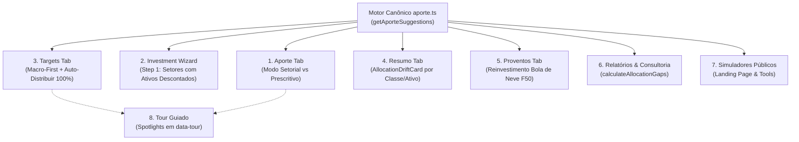

# PLANO MESTRE DE IMPLEMENTAÇÃO & AUDITORIA INTEGRAL — FASE 10: REFATORAÇÃO CANÔNICA DO REBALANCEAMENTO, CASCATA HIERÁRQUICA & WIZARD DE INVESTIMENTOS

> **Status:** ✅ Concluído e Auditado (v3.6.8)  
> **Data:** 14/11/2026  
> **Módulo:** Rebalanceamento de Carteira, Metas, Wizard de Investimentos & Ecossistema Conexo (`src/domain/portfolio/`, `src/features/investments/`, `src/features/reports/`, `src/features/tools/`, `src/state/`)  
> **Documentos Normativos de Referência:** `AGENTS.md` (Regras 4, 7–27), `DESIGN_SYSTEM.md`, `FINANCIAL_MATH_SPEC.md`, `37_PLANO_FASE_9_AUDITORIA_E_ARQUITETURA_REBALANCEAMENTO.md`

---

## 1. RESUMO EXECUTIVO & FILOSOFIA DE PRODUTO

A **Fase 10** executa a reformulação estrutural de ponta a ponta do ecossistema de metas, aportes e sugestões de investimento do Axir.

### 1.1 A Cascata Hierárquica Natural (*Graceful Fallback*)
O sistema estabelece uma cascata fluida em 3 níveis sem travas artificiais:

```
Nível 1: CLASSES (Macro — Obrigatório 100%)
   │  ↳ Sem metas de setores nem de ativos:
   │     o orçamento da classe é distribuído igualmente na Classe.
   ▼
Nível 2: SETORES (Meso — 100% Opcional)
   │  ↳ Se configurado: fatia o orçamento da classe entre os Setores da classe.
   │  ↳ Sem metas de ativos: o investidor escolhe livremente o ativo do setor (ou equipondera).
   ▼
Nível 3: ATIVOS (Micro — 100% Opcional)
      ↳ Se configurado: segue milimetricamente as metas individuais por ticker.
```

### 1.2 Os Três Perfis de Investidor Atendidos com Fluidez
- **Investidor Macro / Prático:** Preenche **apenas Classes** (soma 100%). O motor cuida do macro e dá liberdade total no tático.
- **Investidor Setorial / Value:** Preenche **Classes e Setores**. O motor orça os setores e lista os ativos com indicadores de desconto (`% vs Preço Médio`), permitindo alocar o orçamento integral do setor no ativo escolhido.
- **Investidor Detalhista / Micro:** Preenche **Classes, Setores e Ativos**. O motor calcula cotas prescritivas exatas por ticker.

---

## 2. MATRIZ INTEGRAL DE VULNERABILIDADES, BRECHAS & BLINDAGENS TÉCNICAS (B1 A B12)

| # | Vulnerabilidade / Brecha Diagnosticada | Causa-Raiz no Código Atual | Solução Defensiva Canônica na Fase 10 |
|---|---|---|---|
| **B1** | **Falha Parcial no Salvamento de Metas (Inconsistência de Banco)** | `targets-tab.tsx:351` executa loop sequencial `for (const c of classes) { await mutateAsync(...) }`. Se uma falhar, a base fica com soma quebrada e queries invalidam 6 vezes repetidas. | Salvar via `Promise.all` concorrente. Classes zeradas chamam `removeGroupTarget` para evitar registros órfãos. Invalidação única atômica ao final. |
| **B2** | **Cálculo Abortado com Aporte Zero ou Carteira Nova** | `aporte.ts:297` checa `if (!(patrimonioAlvo > 0)) return []`. No Wizard, o usuário abre sem digitar aporte, forçando o uso do motor paralelo em `tickers-catalog.ts`. | Modo adaptativo puro: se `aporte === 0`, o ranking utiliza o déficit percentual puro (`targetPct - currentPct`), calculando prioridades com exatidão mesmo antes de digitar dinheiro. |
| **B3** | **Classes com Meta mas sem Ativos Cadastrados** | Se o usuário define meta para uma classe nova (ex.: Cripto 15%), mas não tem ativos nela, o motor não tem onde alocar e a rota desaparecia sem explicação. | A Visão Macro exibe a classe defasada com callout suave: *"Classe sem ativos cadastrados no momento"*, acompanhado do botão direto *"Cadastrar primeiro ativo no Wizard"*. |
| **B4** | **Dessincronização de Cache após Ordem no Wizard** | Ao clicar em "Comprar no Wizard" no Aporte Tab e concluir a compra, o Aporte Tab precisava de reload manual se as chaves certas não fossem invalidadas. | O `onSuccess` do Wizard garante a invalidação atômica de `portfolioPositionKey`, `portfolioAssetsKey`, `contributionsKey` e `cashAssetKey`. |
| **B5** | **Ativos sem Cotação (`priceBRL <= 0`) Travando o Setor** | Ativos recém-cadastrados ou sem ticker da B3 travavam o cálculo de cotas do setor. | Isolamento defensivo: ativos sem preço são movidos para `skippedAssets` com badge *"Sem cotação disponível"*, enquanto os demais ativos do setor absorvem o orçamento normalmente. |
| **B6** | **Sobrecarga Visual em Setores Densos (10+ Ativos)** | Setores com muitos ativos criariam cartões verticais infinitos no mobile. | Progressive disclosure setorial: exibe os Top 3 ativos com maior oportunidade (`% vs PM`) e botão expansível *"Ver mais X ativos deste setor"*. |
| **B7** | **Acessibilidade e Semântica de Oportunidade (WCAG 2.1 AA)** | Indicadores de desconto baseados apenas em cor (verde/vermelho) geram barreiras para usuários daltônicos. | Todo indicador de desconto inclui sinal textual explícito (ex.: `-6.2% abaixo do PM` com `<Badge variant="positive">`) e atributos `aria-expanded` nos acordeões de setor. |
| **B8** | **Mocks Faltantes em Testes de Integração (`@/state`)** | Falha de exportação de `useResetManualSnapshotCalibration` em mocks manuais quebrou 14 testes de páginas conectadas. | Adicionar `useResetManualSnapshotCalibration: vi.fn()` nos mocks de teste em `investments-page.test.tsx` e `resumo-tab.test.tsx`, garantindo 100% de sucesso da suíte. |
| **B9** | **Desaparecimento do `AllocationDriftCard` no Resumo no Modo Macro-First** | `resumo-tab.tsx:320` calculava `allocationDrift` lendo apenas `useAllocationTargets` (ativos). Se o usuário definisse apenas metas de Classes, o card de desvio desaparecia. | Adaptar `resumo-tab.tsx` para passar itens agregados por Classe quando não houver metas individuais de ativos, mantendo o `AllocationDriftCard` ativo para todos. |
| **B10** | **Ruptura de Seletores no Tour Guiado Interativo** | `tour-steps.ts` mapeia 5 seletores DOM específicos (`targets-classes-card`, `targets-assets-card`, `investments-rebalance`, etc.). Mudanças de markup poderiam quebrar o spotlight. | Preservar rigorosamente todos os atributos `data-tour` canônicos nos contêineres e cards remodelados. |
| **B11** | **Micro-Divergência de Arredondamento em Metas de Grupo (Classes/Setores)** | `set_group_target` não possuía sanitização prévia contra float rounding no client (ex.: 33.3333333%). | Criar `sanitizeGroupTargetsForSave` para arredondamento canônico a 2 casas decimais e clamping $\le 100\%$ antes do envio ao RPC. |
| **B12** | **Compatibilidade com Modo Família (Segurança e RLS)** | Ordens de compra geradas a partir do Aporte Tab poderiam perder o flag `is_family` / `family_id` do investidor familiar. | Como a execução agora passa 100% pelo `InvestmentWizard`, o hook `useFamilyMode()` injeta automaticamente `is_family` e `family_id`, garantindo conformidade com RLS. |

---

## 3. AUDITORIA TRANSVERSAL DO ECOSSISTEMA CONEXO

A auditoria mapeou todas as 7 superfícies do aplicativo que dependem ou interagem com o motor de rebalanceamento e metas:



### 3.1 Resumo Tab (`resumo-tab.tsx` / `AllocationDriftCard`)
- **Interação:** Exibe o desvio de alocação patrimonial frente às metas do investidor.
- **Ajuste Blindado:** Passa a consumir o desvio de classes quando o usuário configurar apenas metas macro, garantindo diagnóstico ininterrupto de patrimônio (Blindagem B9).

### 3.2 Proventos Tab (`proventos-tab.tsx` / Bola de Neve F50)
- **Interação:** Detecta proventos suficientes para comprar 1 ou mais cotas completas (`detectReinvestmentOpportunities`) e aciona o Wizard.
- **Ajuste Blindado:** O Wizard agora aceita `initialQuantity`, permitindo que o reinvestimento de proventos pré-carregue diretamente a quantidade exata apurada pela Bola de Neve.

### 3.3 Relatórios Executivos & Consultoria (`src/features/reports/`)
- **Interação:** `use-reports-data.ts` consome `calculateAllocationGaps` no domínio puro para gerar o Raio-X patrimonial.
- **Ajuste Blindado:** O contrato de dados já suporta classes, setores e ativos independentes, mantendo total congruência com o novo motor de alocação.

### 3.4 Simulador Público da Landing Page & Ferramentas (`minimal-wealth-simulator.tsx` & `rebalance-simulator-page.tsx`)
- **Interação:** Simulação pública interativa de rebalanceamento por classes.
- **Ajuste Blindado:** `simulation.ts` delega o fatiamento macro para a função canônica de `aporte.ts`, garantindo que um lead no simulador público veja a mesmíssima distribuição matemática que terá dentro do app logado.

### 3.5 Presets de Alocação (`SYSTEM_PRESET_TEMPLATES` em `presets.ts`)
- **Interação:** Templates de mercado (Ray Dalio, Boglehead, Foco em Dividendos) preenchem metas estratégicas.
- **Ajuste Blindado:** Os templates do sistema foram historicamente desenhados definindo apenas `class_targets`. Com a nova cascata Macro-First, aplicar qualquer preset oficial funciona nativamente sem deixar ativos em erro.

### 3.6 Tour Guiado Interativo (`src/domain/demo-simulation/tour-steps.ts`)
- **Interação:** Micro-tours `investments_targets` e `investments_aporte` aplicam spotlights sobre elementos do rebalanceamento.
- **Ajuste Blindado:** Preservação estrita dos seletores:
  - `[data-tour="targets-classes-card"]`
  - `[data-tour="targets-assets-card"]`
  - `[data-tour="investments-rebalance"]`
  - `[data-tour="aporte-result-section"]`

### 3.7 Modo Demo & Sessão Guiada (`use-simulated-queries.ts`)
- **Interação:** Simula dados de carteira, metas de grupos e aportes para contas de demonstração.
- **Ajuste Blindado:** As chamadas mock interceptadas continuam provendo `groupTargets` compatíveis com o novo motor.

---

## 4. AUDITORIA UI/UX & CONFORMIDADE COM AGENTS.MD

### 4.1 Tela de Metas (`targets-tab.tsx` & componentes)
- **Macro-First Contínuo:** Card principal de Classes com régua dinâmica de progresso (`AllocationProgressBar` 0–100%) e botão de 1-toque `"Distribuir Restante"` (`Sparkles`) para preencher a sobra residual instantaneamente, eliminando erros de 99,9%.
- **Progressive Disclosure:** Seções expansíveis suaves em acordeão para Setores e Ativos (100% opcionais). O usuário salva a qualquer momento sem bloqueios.
- **Ergonomia de Controles Touch:** Substituição de sliders rígidos por campos numéricos limpos com máscara `%` e botões touch steppers (`-1%` / `+1%`) com touch target confortável ($\ge 44\text{px}$).
- **Regras `AGENTS.md`:** Cabeçalhos adaptativos (Regra 12), badges estritos `size="xs"` (Regra 14), trinca canônica `border-border/80 bg-surface shadow-xs` (Regra 16).

### 4.2 Painel de Aportes (`aporte-tab.tsx` & `aporte-result.tsx`)
- **Fim da Tabela Fixa Esmagada no Mobile (Regras 10 e 25):**
  - **No Mobile (`< md`):** Cards Táticos de Aporte empilhados, sem reticências em moedas (`<MoneyText />` — Regra 11), com Linha 1 (Ticker + Classe + Badge `% vs PM`), Linha 2 (Cotas + Total), Linha 3 (Barra de impacto antes/depois) e Linha 4 (Botão full-width "Comprar no Wizard").
  - **No Desktop (`md:`):** Tabela executiva com rolagem suave (`overflow-x-auto no-scrollbar scroll-smooth`).
- **Seletor de Modo Interativo:** Controle `Tabs variant="pills"`: `[Radar de Setores (Oportunidades)]` vs `[Prescritivo por Ativo]`.
- **Atalho de Caixa Proeminente:** Botão `<Button variant="outline" size="xs">Usar saldo em caixa (R$ X)</Button>` integrado ao campo de valor.
- **Centralização da Execução:** Remoção da execução em lote em `aporte-tab.tsx`; cada rota direciona ao Wizard com ativo, cotas e valores pré-carregados.
- **Transparência Regulatória CVM:** Aviso discreto sobre cálculo algorítmico parametrizado pelo próprio usuário (Resoluções CVM nº 19 e 20/2021).

### 4.3 Wizard de Investimentos (`investment-wizard.tsx` & passos)
- **Step 1 Adaptativo:**
  - *Modo Setorial:* Cards expansíveis dos setores defasados. Ao abrir o setor, lista os ativos pertencentes com cotação, Preço Médio e badge de oportunidade (`-6% vs PM`).
  - *Modo Prescritivo:* Top 3 ativos com cálculo de cotas e valor estimado.
  - *Correção de Caixa Zero:* Quando `cashAvailableBRL === 0`, o motor calcula as cotas com base no gap patrimonial da meta em vez de zerar o campo.
- **Step 2 com Absorção de Orçamento:** O ativo escolhido dentro de um setor defasado absorve o orçamento total sugerido para aquele setor (`orçamento_setor ÷ cotação`).
- **Ergonomia de Modais & Bottom Sheets (Regra 18 & 20):** Gaveta deslizante no mobile com pill handle dedicada, cabeçalho fluido que libera 150px de viewport livre, safe-area para iOS (`env(safe-area-inset-bottom)`), inputs com tamanho mínimo de fonte de 16px para prevenir auto-zoom no Safari, e zero `autoFocus` declarativo.

---

## 5. ESPECIFICAÇÃO TÉCNICA DAS ETAPAS DE IMPLEMENTAÇÃO

### ETAPA 1: Motor Canônico no Domínio Puro (`src/domain/portfolio/aporte.ts`)

#### 1.1 Assinaturas & Contratos
```typescript
export type RebalanceMode = "sector_oriented" | "asset_prescriptive";

export interface SectorOpportunityItem {
  assetId: string;
  ticker: string;
  name?: string;
  assetClass: string;
  sector: string;
  currentPrice: number;
  averageCost: number;
  diffVsAveragePct: number; // Ex: -8.5% (descontado frente ao PM)
  currentWeightPct: number;
  currentValueBRL: number;
  bazinTargetPrice?: number | null;
  marginOfSafetyPct?: number | null;
  suggestedQty: number; // Cotas caso este ativo absorva o orçamento do setor
  suggestedTotalBRL: number;
}

export interface SectorAporteGroup {
  className: string;
  sectorName: string;
  targetPctInClass: number;
  effectiveTargetPct: number;
  targetValueBRL: number;
  currentValueBRL: number;
  gapBRL: number;
  deficitRel: number;
  budgetAllocatedBRL: number;
  assets: SectorOpportunityItem[];
}

export interface UnifiedAporteOptions {
  mode?: RebalanceMode;
  aporteAmount?: number;
  cashAvailableBRL?: number;
  assets: readonly AporteAssetInput[];
  classTargets: readonly ClassTargetInput[];
  sectorTargets?: readonly SectorTargetInput[];
  strategy?: AporteStrategy;
  totalPortfolioBRL?: number;
}

export interface UnifiedAporteResult {
  mode: RebalanceMode;
  totalAllocatedBRL: number;
  leftoverBRL: number;
  classSummaries: ClassAporteSummary[];
  sectorGroups: SectorAporteGroup[];
  prescriptiveRoutes: AporteRoute[];
  skippedAssets: SkippedAssetDiagnostic[];
}

export function getAporteSuggestions(opts: UnifiedAporteOptions): UnifiedAporteResult;
```

#### 1.2 Implementação Defensiva da Cascata
- Ponderação com fallback elegante: se faltar meta de ativo, orça pelo setor; se faltar setor, orça pela classe.
- Cálculo de prioridade sem aporte fixo: quando `aporteAmount === 0`, o ranking utiliza o déficit percentual relativo (Blindagem B2).
- Ativos sem cotação isolados em `skippedAssets` (Blindagem B5).
- Integração de `simulation.ts` reutilizando o motor de classes.
- Remoção definitiva de `buildAporteSuggestions` de `tickers-catalog.ts`.
- Bateria de testes em `aporte.test.ts` cobrindo todas as 12 brechas identificadas.

---

### ETAPA 2: Configuração de Metas (`src/features/investments/pages/targets-tab.tsx`)

1. **Reestruturação Visual Macro-First:**
   - Card principal com régua dinâmica de alocação (0%–100%) colorida pelas classes.
   - Botões de ação rápida no cabeçalho: `"Distribuir Restante"` (`Sparkles`) e `"Equiponderar"` (`Equal`).
   - Seções expansíveis suaves com acordeão canônico para Setores e Ativos.
2. **Salvamento Atômico & Concorrente (Blindagem B1 & B11):**
   - Substituição do loop sequencial por `Promise.all` em lote com sanitização canônica e remoção de classes zeradas.
3. **Ergonomia de Controles Numéricos:**
   - Input com máscara `%` alinhado à direita e steppers touch `-1%` / `+1%` ($\ge 44\text{px}$).
4. **Preservação de Seletores de Tour (Blindagem B10):**
   - Garantir presença de `data-tour="targets-classes-card"` e `data-tour="targets-assets-card"`.
5. **Testes Unitários:** `targets-tab.test.tsx`.

---

### ETAPA 3: Wizard de Investimentos (`src/features/investments/wizard/`)

1. **Step 1 Adaptativo (`step-select.tsx`):**
   - Seletor de modo no topo: `[Radar de Setores]` vs `[Por Ativo Direto]`.
   - No modo Setorial: Setores carentes de aporte em cards expansíveis com badge de carência orçamentária (`Orçamento: R$ 1.500`). Ao expandir, exibe Top 3 ativos com expansor de overflow (Blindagem B6), cotação, Preço Médio e tag de oportunidade (`-6% vs PM`).
   - No modo Prescritivo: Top 3 ativos com cota sugerida e valor estimado.
   - Cálculo de cotas ideais pelo gap quando caixa = 0 (Blindagem B2).
2. **Step 2 (Order — `step-order.tsx`):**
   - Ao selecionar ativo no setor defasado, pré-carrega quantidade para absorver o orçamento do setor.
   - Inputs com tamanho mínimo de fonte de 16px no mobile (`text-base sm:text-sm`).
   - Ausência de `autoFocus` declarativo.
3. **Ergonomia do Modal (`investment-wizard.tsx`):**
   - Suporte a props `initialQuantity` e `initialTotalCents`.
   - Bottom Sheet com pill handle no mobile e modal `size="xl"` no desktop (Regra 18).
   - Invalidação atômica de cache ao concluir a compra (Blindagem B4).
   - Compatibilidade total com Modo Família (Blindagem B12).
4. **Testes Unitários:** `step-select.test.tsx` e `investment-wizard.test.tsx`.

---

### ETAPA 4: Painel de Aportes (`src/features/investments/pages/aporte-tab.tsx` & `aporte-result.tsx`) & Resumo

1. **Barra de Controles & Visualização:**
   - Seletor de Modo: `Orientação Setorial` vs `Prescritivo por Ativo`.
   - Toggle de Visão: `Visão Macro (Classes)` vs `Visão Tática (Detalhada)`.
2. **Layout Dual Responsivo (Regra 10 & 25):**
   - Mobile: Cards táticos empilhados com tipografia sem reticências em moedas (`<MoneyText />`).
   - Desktop: Tabela executiva com rolagem horizontal suave.
3. **Ação Rápida de Caixa:**
   - Botão `<Button variant="outline" size="xs">Usar saldo em caixa (R$ X)</Button>` integrado ao campo de valor.
4. **Centralização da Execução no Wizard:**
   - Cada linha possui botão `<Button variant="secondary" size="sm">Comprar no Wizard</Button>`.
   - Remoção completa de `handleExecuteBatch`, modais de lote e RPCs paralelas de lote em `aporte-tab.tsx`.
5. **Preservação de Seletores de Tour (Blindagem B10):**
   - `data-tour="investments-rebalance"` e `data-tour="aporte-result-section"`.
6. **Ajuste no ResumoTab (Blindagem B9):**
   - `resumo-tab.tsx` avalia `allocationDrift` no nível de classes quando não houver metas de ativos.
7. **Correção de Mocks nos Testes (Blindagem B8):**
   - Adicionar `useResetManualSnapshotCalibration: vi.fn()` em `investments-page.test.tsx` e `resumo-tab.test.tsx`.
8. **Testes Unitários:** `aporte-tab.test.tsx`.

---

## 6. DEFINITION OF DONE & MATRIZ DE VERIFICAÇÃO

- [ ] `npm run test:run` passa com 100% de sucesso em toda a suíte (incluindo resolução de B8).
- [ ] `npm run lint` e `npx tsc --noEmit` passam com zero erros.
- [ ] **Verificação das 12 Blindagens (B1 a B12):**
  - B1: Salvamento de classes ocorre em lote paralelo e remove metas zeradas sem inconsistência.
  - B2: Aporte zero no Wizard exibe sugestões ranqueadas por déficit percentual.
  - B3: Classes sem ativos cadastrados exibem callout amigável sem quebrar o cálculo.
  - B4: Compras feitas via Wizard atualizam o Aporte Tab instantaneamente sem reload.
  - B5: Ativos sem cotação são sinalizados em `skippedAssets` e não travam o setor.
  - B6: Setores com muitos ativos exibem Top 3 com expansor para manter a leveza.
  - B7: Acessibilidade WCAG 2.1 AA sem dependência exclusiva de cores.
  - B8: Testes de páginas conectados passam sem erros de mock.
  - B9: `AllocationDriftCard` ativo no Resumo mesmo quando o usuário define apenas metas macro de classes.
  - B10: Todos os 5 seletores `data-tour` mantidos e funcionais para o Tour Guiado.
  - B11: Sanitização canônica de metas de grupo a 2 casas decimais e clamping $\le 100\%$.
  - B12: Compatibilidade estrita com RLS e Modo Família na gravação de ordens.
- [ ] **Auditoria Visual & Responsiva:**
  - Sem horizontal overflow (`100vw`) em qualquer largura (320px, 375px, 768px, 1280px).
  - Sem `truncate` em valores monetários (Regra 11 de `AGENTS.md`).
  - Sem `autoFocus` declarativo em formulários do Wizard ou do painel (Regra 20).
  - Modais com alça tátil e safe-area para iOS (Regra 18).
