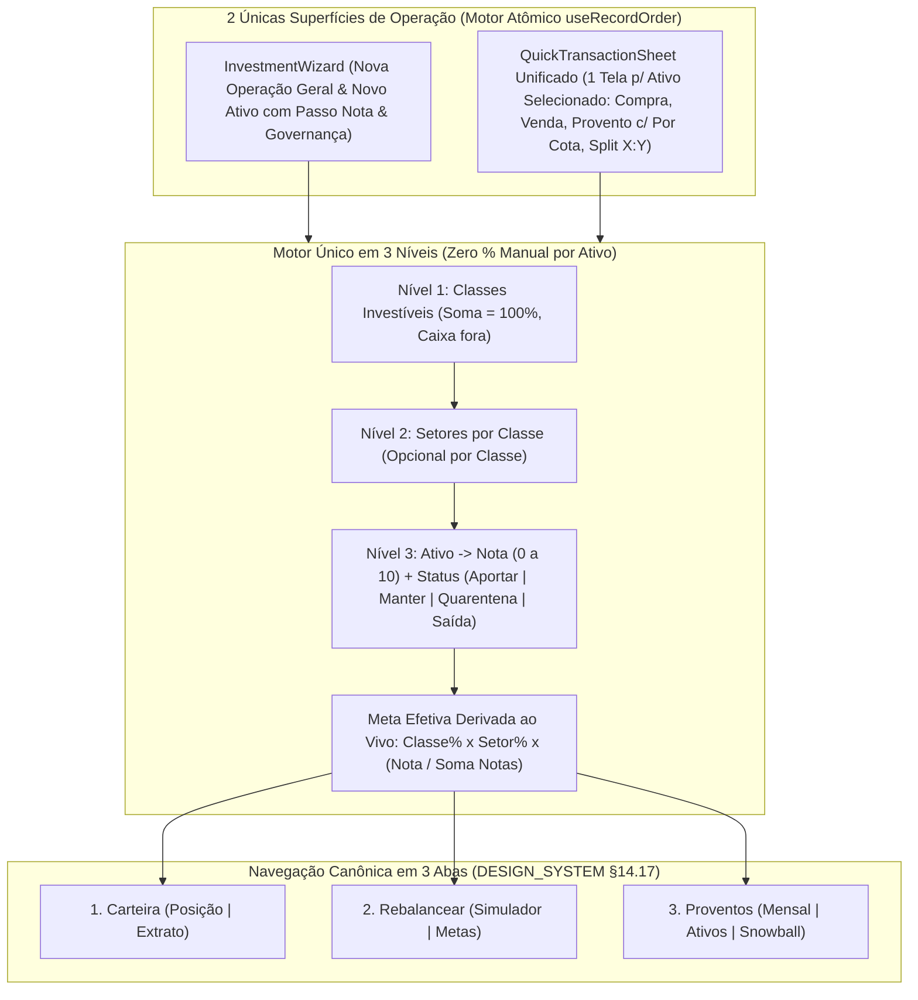

# Auditoria Integral de UI/UX & Plano de Unificação Ponta a Ponta — Investimentos (Plano 42)

> **Classificação Escopo (`AGENTS.md §10.5`):** **Fluxo Completo (Feature / Plano Estrutural — Minor Release `v3.10.0`)**  
> **Módulos Auditados:** `src/domain/portfolio/`, `src/features/investments/`, `src/components/modules/`, `src/state/`, `src/data/`, `src/features/tools/`, `src/features/overview/`, `src/features/reports/`, `supabase/migrations/` (33.125 linhas inspecionadas).

---

## 1. Diagnóstico Executivo: Por que a página parece uma "Colcha de Retalhos"?

A auditoria do código-fonte confirmou integralmente a percepção de uso: o módulo de Investimentos acumula camadas de **4 gerações diferentes de arquitetura** coexistindo na mesma tela, e a migração recente de **Porcentagem para Notas (Plano 41)** ficou **~45% executada**, mantendo a pilha antiga viva e em conflito direto com a nova.

> [!CAUTION]
> **Sabotagem Silenciosa Descoberta no Motor de Rebalanceamento:** Em [aporte-tab.tsx](file:///home/gabrielsales/meus_apps/financasnew/src/features/investments/pages/aporte-tab.tsx#L198-L215) e [aporte.ts](file:///home/gabrielsales/meus_apps/financasnew/src/domain/portfolio/aporte.ts#L435-L446), basta existir **1 único ativo** salvo na tabela legada `allocation_targets` (por exemplo, um ativo criado pelo `InvestmentWizard`, cujo Passo 3 ainda pede `%`) para `hasIndividualTargets` virar `true`, forçar `targetPercentage: 0` em todos os outros ativos e **desligar 100% o cálculo por Notas (`score`) e Setores**! Além disso, a função canônica `calculateEffectiveAssetTargets` em [allocation.ts](file:///home/gabrielsales/meus_apps/financasnew/src/domain/portfolio/allocation.ts#L415-L490) nunca é chamada em nenhum componente da interface.

### 1.1. Resquícios de `% por Ativo` vs. Sistema de Notas (0–10)

| Ponto da Jornada | O que acontece hoje no código | Impacto real na experiência |
|---|---|---|
| **Cadastro de Novo Ativo** ([step-target.tsx](file:///home/gabrielsales/meus_apps/financasnew/src/features/investments/wizard/step-target.tsx#L13-L83)) | O Passo 3 do Wizard pede **"Definir Meta de Alocação %"** (`0–100%`) e grava em `allocation_targets`. Zero menção a Nota, Status ou Tese. | Quebra imediata de modelo mental ao cadastrar qualquer ativo — e ainda sabota o motor de Notas para o resto da carteira. |
| **Aba Metas > Ativos** ([target-editor.tsx](file:///home/gabrielsales/meus_apps/financasnew/src/components/modules/target-editor.tsx#L287-L374)) | Colaram um badge `Nota X` e um micro-botão `"Avaliar"` (`10px`) à esquerda, mas o controle principal da linha continua sendo o stepper de **`% do patrimônio`** somando `100%`. | Dois sistemas concorrentes na mesma linha. Pior: exibe badge verde `"+X,X% · Recebe aporte"` mesmo quando o ativo está em **Quarentena** ou **Saída**. |
| **Bug da Falsa Nota 8** ([targets-tab.tsx](file:///home/gabrielsales/meus_apps/financasnew/src/features/investments/pages/targets-tab.tsx#L137), [asset-detail-sheet.tsx](file:///home/gabrielsales/meus_apps/financasnew/src/features/investments/components/asset-detail-sheet.tsx#L247)) | Ativos nunca avaliados (`score === null`) recebem `asset.score ?? 8` na UI (badge verde *"Alta Convicção"*), enquanto o domínio calcula com **Nota 5** neutra. | Ao clicar em *"Avaliar"* num ativo que mostrava `Nota 8/10`, o diálogo abre selecionado em `5/10`. |
| **Custódia às Cegas** ([position-table.tsx](file:///home/gabrielsales/meus_apps/financasnew/src/components/modules/position-table.tsx), [position-mobile-card.tsx](file:///home/gabrielsales/meus_apps/financasnew/src/components/modules/portfolio/position-mobile-card.tsx)) | `PositionRow` não carrega `score`, `allocation_status` nem meta derivada. | O usuário olha toda a carteira sem saber quais ativos têm nota alta, quais estão sem avaliação e quais estão em Quarentena/Saída. |
| **Ficha do Ativo Duplicada** ([asset-detail-sheet.tsx](file:///home/gabrielsales/meus_apps/financasnew/src/features/investments/components/asset-detail-sheet.tsx#L639-L826)) | Renderiza **dois cards concorrentes**: *"Diagnóstico de Alocação & Metas"* (lendo `%` antiga e dizendo *"Sem meta por ativo"*) logo acima de *"Tese & Governança"* (mostrando Nota e Status). | Contradição visual direta e botão *"Aportar no Wizard"* ativo até para ativos em Quarentena. |
| **Sugestões e Desvios Cegos** ([resumo-tab.tsx](file:///home/gabrielsales/meus_apps/financasnew/src/features/investments/pages/resumo-tab.tsx#L332-L366), [step-select.tsx](file:///home/gabrielsales/meus_apps/financasnew/src/features/investments/wizard/step-select.tsx#L83-L99)) | `AllocationDriftCard` e as sugestões do `InvestmentWizard` leem apenas `allocation_targets`, ignorando `score` e `allocation_status`. | Ativos em **Quarentena** continuam sendo recomendados como prioridade de compra! |
| **Denominador de Caixa & Colisão de Setores** ([targets-tab.tsx](file:///home/gabrielsales/meus_apps/financasnew/src/features/investments/pages/targets-tab.tsx#L97), [aporte-tab.tsx](file:///home/gabrielsales/meus_apps/financasnew/src/features/investments/pages/aporte-tab.tsx#L171)) | `TargetsTab` inclui `Caixa` na soma de 100% das Classes; `AporteTab` exclui o `Caixa` do patrimônio-base. E `sector_targets` não tem `class_name` no banco. | Distorção matemática nas metas; setores com mesmo nome em classes distintas (ex.: *"Tecnologia"* em `BDRs` e `Internacional`) sobrescrevem um ao outro; e [allocation-breakdown-dialog.tsx](file:///home/gabrielsales/meus_apps/financasnew/src/features/investments/components/allocation-breakdown-dialog.tsx#L68-L72) compara `% na classe` com `% no patrimônio total`, gerando gaps falsos. |

---

### 1.2. Mapa de Duplicações, Código Morto (~3.300+ linhas) e Fluxos Quebrados

1. **Código 100% Morto inflando o bundle e confundindo manutenção:**
   - [asset-form-dialog.tsx](file:///home/gabrielsales/meus_apps/financasnew/src/features/investments/components/asset-form-dialog.tsx) + [asset-sell-tab.tsx](file:///home/gabrielsales/meus_apps/financasnew/src/features/investments/components/asset-form/asset-sell-tab.tsx) (**1.473 linhas** com 0 usos em produção — deixando órfão o vínculo de Renda Fixa com a **Reserva de Emergência**!).
   - [contributions-list-dialog.tsx](file:///home/gabrielsales/meus_apps/financasnew/src/features/investments/components/contributions-list-dialog.tsx) (**189 linhas**, 0 usos) e modo de criação morto em [contribution-form-dialog.tsx](file:///home/gabrielsales/meus_apps/financasnew/src/features/investments/components/contribution-form-dialog.tsx).
   - [position-table-header.tsx](file:///home/gabrielsales/meus_apps/financasnew/src/components/modules/portfolio/position-table-header.tsx) órfão e tipos/helpers duplicados linha por linha dentro de [position-table.tsx](file:///home/gabrielsales/meus_apps/financasnew/src/components/modules/position-table.tsx#L42-L171).
   - Mounts inalcançáveis de `AssetEditDialog` e `ConfirmDialog` em [resumo-tab.tsx](file:///home/gabrielsales/meus_apps/financasnew/src/features/investments/pages/resumo-tab.tsx#L832-L885).

2. **6 Modais Concorrentes para Compra / Venda / Provento / Split com Regras Conflitantes:**
   - [investment-wizard.tsx](file:///home/gabrielsales/meus_apps/financasnew/src/features/investments/wizard/investment-wizard.tsx) (usa 2 checkboxes soltos `syncCash` + `recordContribution`, permitindo marcar ambos ou nenhum; só aceita split `1:N`).
   - [quick-transaction-sheet.tsx](file:///home/gabrielsales/meus_apps/financasnew/src/features/investments/components/quick-transaction-sheet.tsx) (1.191 linhas; usa botões mutuamente exclusivos, mas com default invertido `syncCash = true`!).
   - [transaction-form-dialog.tsx](file:///home/gabrielsales/meus_apps/financasnew/src/features/investments/components/transaction-form-dialog.tsx) (872 linhas; **não usa `useRecordOrder`**, executa multi-escrita sequencial não-atômica no cliente violando `AGENTS.md §5`, sem IRRF de RF e usando stepper para preço!).
   - [dividend-form-dialog.tsx](file:///home/gabrielsales/meus_apps/financasnew/src/features/investments/components/dividend-form-dialog.tsx) (único com modo *"Por Cota"*, e na aba [proventos-tab.tsx](file:///home/gabrielsales/meus_apps/financasnew/src/features/investments/pages/proventos-tab.tsx#L429-L449) **o botão `"Registrar Provento"` desaparece após o 1º lançamento**!).
   - [asset-split-dialog.tsx](file:///home/gabrielsales/meus_apps/financasnew/src/features/investments/components/asset-split-dialog.tsx) (único com proporção `X:Y`, mas em [asset-detail-sheet.tsx](file:///home/gabrielsales/meus_apps/financasnew/src/features/investments/components/asset-detail-sheet.tsx#L422-L426) o clique dispara 2 modais ao mesmo tempo!).
   - Dentro da própria `AssetDetailSheet`, existem **3 botões diferentes de compra** (`"Aportar"`, `"Aportar no Wizard"`, `"+ Nova Operação"`), cada um abrindo um modal distinto — e quando aberta pela aba `Metas` ou `Relatórios`, os botões **ficam mudos** (`onAction` não é passado)!

3. **Bugs Estruturais de Navegação, Cache, Rascunho e Backup:**
   - **Rotas inexistentes:** cliques navegando para `/investimentos?...` (a rota em [routes.tsx](file:///home/gabrielsales/meus_apps/financasnew/src/app/routes.tsx#L23) é `/investments`), `/carteira?tab=aporte` e `onSelectTab("targets")` em [resumo-tab.tsx](file:///home/gabrielsales/meus_apps/financasnew/src/features/investments/pages/resumo-tab.tsx#L905) (a aba se chama `"metas"`, falhando silenciosamente!).
   - **Invalidação de cache errada:** [investment-wizard.tsx](file:///home/gabrielsales/meus_apps/financasnew/src/features/investments/wizard/investment-wizard.tsx#L468-L470) invalida `["group-targets"]` e `["allocation-targets"]` com hífen, mas as keys reais usam underscore (`["group_targets", ...]`).
   - **Banner de rascunho preso:** em [targets-tab.tsx](file:///home/gabrielsales/meus_apps/financasnew/src/features/investments/pages/targets-tab.tsx#L311-L312), salvar uma classe individual mantém a chave no `draft`, travando o alerta amarelo *"Alterações não salvas"* na tela.
   - **Perda de dados na Restauração de Backup:** o RPC SQL `public.restore_backup` ignora `score`, `allocation_status`, `score_criteria`, `last_reviewed_at`, `review_frequency_months`, `thesis_summary`, `sector`, `class_targets` e `sector_targets`.

---

### 1.3. Auditoria de Conformidade Visual (`AGENTS.md §4` & `DESIGN_SYSTEM.md`)

- **Hierarquia de Abas (`DESIGN_SYSTEM §14.17` & Regra 9):** [investments-page.tsx](file:///home/gabrielsales/meus_apps/financasnew/src/features/investments/pages/investments-page.tsx#L146-L193) renderiza **5 abas Nível 1** (limite máximo canônico é **3**), e `ProventosTab` / `InitialPocketCostDialog` / `PortfolioImportDialog` injetam ícones e rótulos compostos em `Tabs variant="pills"` de Nível 2.
- **Sobrecarga Vertical:** `ResumoTab` empilha **8 blocos** (Carrossel global persistente em todas as abas + 4 KPIs + `CashKpiCard` gigante em `text-3xl` competindo com o Patrimônio Total + Alerta de Concentração avulso + `AllocationDriftCard` avulso + Donut + `PositionTable` com filtro duplicado `Por Classe | Por Setor` + `SnapshotsCarousel`). `ProventosTab` empilha **3 banners seguidos** e recria 11 cards de KPI manualmente sem `<KpiCard />`.
- **Ergonomia Mobile & Modais (Regras 7, 10, 15, 18, 20, 26):**
  - 8 diálogos renderizam `<ModalFooter>` **dentro do corpo rolável (`children`)** em vez da prop `footer` do `<Modal />`;
  - [portfolio-mapping-step.tsx](file:///home/gabrielsales/meus_apps/financasnew/src/features/investments/components/portfolio-mapping-step.tsx#L135) injeta `overflow-y-auto max-h-56 scrollbar-thin` dentro de `<Modal />` (scroll duplo proibido pela Regra 26);
  - `<Input type="number">` nativo com `text-xs` (`12px` no mobile, disparando **auto-zoom forçado no iOS Safari** — Regra 20) em [aporte-result.tsx](file:///home/gabrielsales/meus_apps/financasnew/src/components/modules/aporte-result.tsx#L401-L413), [monthly-closing-editor.tsx](file:///home/gabrielsales/meus_apps/financasnew/src/features/investments/components/monthly-closing-editor.tsx#L491-L498) e [portfolio-import-dialog.tsx](file:///home/gabrielsales/meus_apps/financasnew/src/features/investments/components/portfolio-import-dialog.tsx#L653-L681);
  - [asset-score-evaluation-dialog.tsx](file:///home/gabrielsales/meus_apps/financasnew/src/features/investments/components/asset-score-evaluation-dialog.tsx#L224) usa `grid-cols-11` rígido, esmagando os 11 botões de nota a ~22px no smartphone; [quick-transaction-sheet.tsx](file:///home/gabrielsales/meus_apps/financasnew/src/features/investments/components/quick-transaction-sheet.tsx#L493) usa `grid-cols-3` e `grid-cols-2` rígidos sem prefixo `sm:`.
- **Tokens, Formatação pt-BR, Ícones & Haptics (Regras 11, 13, 14, 16, 17, 23, 28, 33):**
  - Classes CSS **inexistentes** falhando silenciosamente: `bg-warning-surface/30`, `bg-positive-surface/30`, `bg-portfolio-surface/20` ([portfolio-darf-monitor.tsx](file:///home/gabrielsales/meus_apps/financasnew/src/features/investments/components/portfolio-darf-monitor.tsx#L125-L263)), `bg-surface-subtle` e `bg-attention/10`;
  - Dezenas de percentuais e valores usando `.toFixed(1)` com ponto inglês (`12.4%`, `R$ 150.00`), datas ISO cruas (`YYYY-MM-DD`) e textos sem acento (`"Diario"`, `"Extrato do Mes"`);
  - Caixas de ícones proibidas no Nível 1 (`position-table.tsx`, `portfolio-activity-panel.tsx`, `initial-pocket-cost-dialog.tsx`), micro-fontes `text-[9px]`/`text-[10px]` manuais, duplo disparo sensorial em `asset-score-evaluation-dialog.tsx` e ausência de `EquationBreakdownPopover` nos KPIs compostos.

---

## 2. Arquitetura da Nova Experiência Integrada (Ponta a Ponta)

Com base nas 12 decisões estratégicas alinhadas, toda a funcionalidade de Investimentos passa a operar sob **um único modelo mental, matemático e visual**, do cadastro do primeiro ativo até a execução do aporte e relatórios:

> [!IMPORTANT]
> **Equação Canônica Única em Todo o App (com Explicabilidade Ativa — Regra 33):**  
> Para todo ativo elegível (`status = "active"`), onde ativos ainda não avaliados (`score = null`) exibem selo transparente **"Sem nota"** na interface e assumem peso neutro $\sigma_i = 5$ até avaliação (e ativos em `Manter`, `Quarentena` ou `Saída` assumem $\sigma_i = 0$ para novos aportes):
> $$T_i = \text{Meta}_{\text{Classe}} \times \text{Meta}_{\text{Setor na Classe}} \times \frac{\sigma_i}{\sum_{k \in \text{Grupo}} \sigma_k}$$
> Se uma classe não tiver metas setoriais configuradas (ex.: Cripto, Renda Fixa ou carteira iniciante), a equação colapsa automaticamente para $T_i = \text{Meta}_{\text{Classe}} \times (\sigma_i / \sum_{k \in \text{Classe}} \sigma_k)$. O **Caixa da corretora** fica 100% fora das metas percentuais, atuando como liquidez pronta para somar no Simulador de Aporte.

---

### 2.1. Desenho Detalhado das 3 Abas Canônicas

#### Aba 1 — `Carteira` (`Posição` | `Extrato`)
- **`PageHeader` Limpo:** título *"Investimentos"*, ações concisas: botão secundário **Relatório** (abre dossiê A4/Excel) e CTA primário **Nova Operação** (abre `InvestmentWizard`). Sem botão redundante de Caixa no topo.
- **Sub-aba `Posição` (organizada em 4 zonas harmônicas, sem empilhamento de banners):**
  1. **Carrossel Inteligente Único (`PortfolioInsightsCarousel` restrito à `Posição`):** unifica em slides de altura uniforme (`Regra 19`) os alertas de *Desvio Real de Alocação (baseado em Notas)*, *Concentração*, *Revisões de Tese Pendentes*, *Acompanhamento de Quarentena* e *Proventos Provisionados B3*.
  2. **Faixa Executiva de KPIs + Liquidez Integrada:** os 4 `<KpiCard />` (`Patrimônio Total`, `Rentabilidade TWR`, `Resultado Histórico`, `TIR`) ganham `<EquationBreakdownPopover />` real mostrando as parcelas exatas do cálculo (`Regra 33`). Abaixo deles, uma **barra horizontal compacta e elegante de Liquidez / Caixa em Corretora** (`Ajustar Saldo` e `Aportar Caixa ->` levando direto para `Rebalancear > Simulador`), sem tipografia `text-3xl` competindo com o Patrimônio Total.
  3. **Distribuição Patrimonial (`Por Classe | Por Setor | Por Ativo`):** Donut com `SegmentedControl` padronizado; clicar em Classe ou Setor abre o `AllocationBreakdownDialog` corrigido matematicamente (`% efetiva no patrimônio`), listando os ativos com suas **Notas e Status**.
  4. **Custódia Integrada (`PositionTable` + `PositionMobileCard`) & Evolução Mensal:**
     - Cada linha/card exibe de forma limpa: **Ticker + Badges discretos (`Reserva` se vinculado à Reserva de Emergência, `Quarentena`/`Saída`/`Manter`)**, **Selo de Nota (`Nota 9` ou `Sem nota` clicável em 1 toque para avaliar)** e comparativo **`Atual X,X% · Meta Y,Y%`** (derivada ao vivo das Notas!);
     - Filtro unificado por Classe e por Status de Governança (`Todos | Aportar | Quarentena | Sem nota`), eliminando o seletor duplicado de agrupamento;
     - Carrossel compacto de Evolução Mensal no rodapé (sem botões de relatório repetidos em cada card).
- **Sub-aba `Extrato` (antiga `Movimentações` integrada):**
  - Barra de ferramentas superior clara dando visibilidade imediata às 3 ferramentas patrimoniais antes escondidas/espalhadas: **Marcos Históricos (Pré-App)**, **Importar Planilha** e **Apuração DARF 6015**;
  - Lista unificada de movimentações com *Whole-Element Interaction* (`DESIGN_SYSTEM §14.14`, sem repetição poluída de lápis + lixeira em cada linha), abrindo o `QuickTransactionSheet` unificado.

#### Aba 2 — `Rebalancear` (`Simulador` | `Metas`)
- **Sub-aba `Simulador` (Fluxo Unificado de Execução):**
  - **Painel de Aporte Composto:** campo `MoneyInput` de **Dinheiro Novo (Bolso)** + switch/chip interativo **"Somar Caixa da Corretora (+ R$ X)"** exibindo o **Poder Total de Compra** (ao executar o lote, a parcela em caixa abate automaticamente o ativo `CAIXA` e apenas o dinheiro novo gera registro em `portfolio_contributions` para não distorcer a TIR!);
  - **Seletor de Estratégia Exposto:** `Rateio Proporcional` (distribui entre os elegíveis deficitários) vs. `Menos Ordens` (`strategy: "optimized"` — concentra nos maiores gaps para reduzir corretagem/ordens);
  - **Lista & Árvore 100% Sincronizadas (`AporteResult`):** eliminação do duplo check conflitante (`Checkbox` vs pill `Pendente/Feito`). Existe **um único estado de seleção e edição de cotas** (com `NumberStepperInput` / `NumericInput` de `16px` no mobile, zero auto-zoom iOS), refletido igualmente na visão **Prioridade** e na visão **Árvore**. Cada sugestão mostra o badge de `Nota`, a `Meta Derivada %` e um gatilho discreto explicando por que recebeu aquele valor, enquanto a seção recolhível de *"Ativos Poupados"* discrimina claramente `Em Quarentena`, `Manter`, `Saída`, `Acima da Meta` e `Cota > Saldo`.
- **Sub-aba `Metas` (Árvore Hierárquica Criativa & Harmônica):**
  - **Cabeçalho Estratégico:** Card compacto do **PQS (Índice de Qualidade da Carteira 0–10)** com explicação da média ponderada + **Barra de Soma das Classes Investíveis (`100%`)** + menu enxuto de ações rápidas neutras (*Espelhar Posição Atual*, *Normalizar 100%*) + alternador rápido de visão **`Hierarquia` | `Lista de Ativos`**;
  - **Árvore Viva em 3 Níveis:** cada card de **Classe** exibe sua fatia atual vs. meta `%` (`PercentInput` / stepper limpo) e expande suavemente para mostrar:
    1. **Faixa opcional de Setores da Classe** (colapsada e discreta se a classe usar distribuição direta; expansível em 1 clique com *"Dividir por setores"* quando o investidor desejar refinar Ações/FIIs);
    2. **Ativos membros** com controle rápido inline de **Nota (`0–10`)**, seletor compacto de **Status (`Aportar | Manter | Quarentena | Saída`)**, botão de tese detalhada e a **pílula da Meta Derivada ao Vivo** (`Ex.: 40% Classe × 25% Bancos × 10/18 Nota = 5,56% da carteira`);
  - **Barra Contextual Única de Rascunho (`Sticky Draft Bar`):** sem botões *"Salvar"* ou *"Lixeira"* repetidos em cada linha! Qualquer ajuste em Classes ou Setores aciona uma barra inferior/contextual limpa com **`Descartar alterações`** e **`Salvar Metas`** (gravação transacional atômica). Ajustes de Nota/Status salvam com Optimistic UI + Undo Toast (`Regra 32`).

#### Aba 3 — `Proventos` (`Mensal` | `Ativos` | `Snowball`)
- **CTA Permanente:** botão fixo **`Registrar Provento`** sempre visível no cabeçalho da aba (corrigindo o sumiço após o 1º registro), abrindo o `QuickTransactionSheet` já em modo Provento (com suporte a lançamento *Total* ou *Por Cota*).
- **Fim do Triplo Empilhamento de Banners:** os 3 cards concorrentes dão lugar a **1 Card Único de Reinvestimento Inteligente** quando houver caixa de proventos disponível, levando em 1 clique para `Rebalancear > Simulador` com o saldo engatilhado (garantindo que dividendos pagos por ativos em Quarentena sejam reinvestidos nos ativos saudáveis de Nota alta). Proventos provisionados da B3 ficam consolidados no carrossel da Carteira e num indicador discreto.
- **KPIs & Bola de Neve Padronizados:** substituição dos 11 cards manuais por `<KpiCard />` canônicos; nas visões `Ativos` e `Snowball`, ativos em **Quarentena** ou **Saída** exibem badge semântico claro (*"Aportes pausados — proventos redirecionados"*), sem falso incentivo de compra.

---

### 2.2. Consolidação de Modais, Ficha do Ativo e Vitrine Pública

1. **`InvestmentWizard` (Cadastro de Novo Ativo & Operação Guiada):**
   - **Novo Passo 3 — `StepGovernance` (substituindo `StepTarget`):** seletor tátil responsivo de **Nota (`0–10` em grid `grid-cols-6 sm:grid-cols-11` com alvos $\ge 44\text{px}$)** + **Status (`Aportar` padrão)** + **Card de Preview ao Vivo** mostrando exatamente quantos `%` da carteira e do setor o novo ativo representará + acordeão opcional para **Checklist Fundamentalista & Resumo da Tese** + botão claro *"Avaliar depois (manter Sem Nota / Peso 5)"*;
   - Em ativos de **Renda Fixa / Tesouro**, resgate do toggle **"Compõe minha Reserva de Emergência"** (`useEmergencyFundComposition`), sugerindo automaticamente status `Manter` caso a reserva já esteja 100% preenchida;
   - No `StepSelect`, as sugestões rápidas passam a consumir `calculateEffectiveAssetTargets` (Notas + Setores), bloqueando qualquer sugestão de ativos em `Quarentena` ou `Saída`.
2. **`QuickTransactionSheet` Unificado + `AssetDetailSheet` Enxuta:**
   - Absorve os recursos exclusivos que estavam fragmentados (*Provento por Cota* de `DividendFormDialog` e *Split/Bonificação proporcional `X:Y`* de `AssetSplitDialog`), operando 100% sobre `useRecordOrder` com seletor único de recursos: **`Dinheiro Novo (Bolso)`** (default) vs. **`Saldo em Caixa da Corretora`**;
   - Na `AssetDetailSheet`, os 3 botões de compra viram uma barra limpa (`Operar Ativo` abrindo `QuickTransactionSheet` + ícones compactos secundários conforme `Regra 18`), funciona em **qualquer tela** onde a ficha for aberta (`Carteira`, `Rebalancear`, `Relatórios`), e os 2 cards conflitantes fundem-se no card único **"Governança, Meta Derivada & Tese"**;
   - Em `AssetEditDialog` (`size="lg"` em grid de 2 colunas), remoção da menção a *"Tese"* do campo `notes` (renomeado para *"Observações Operacionais / Corretora"*) e inclusão do vínculo de **Reserva de Emergência** para Renda Fixa.
3. **Vitrine Pública `/ferramentas/rebalanceamento` Alinhada ao Áxis:**
   - Mantida como ativo estratégico de SEO/IA (lazy-loaded, custo zero no bundle logado), mas atualizada em [rebalance-simulator-page.tsx](file:///home/gabrielsales/meus_apps/financasnew/src/features/tools/pages/rebalance-simulator-page.tsx) para permitir simular **Classes (%) + Ativos com Notas (0–10)** usando a mesma função pura `deriveAssetWeightsFromScores` de `src/domain/portfolio/`, demonstrando ao visitante exatamente o diferencial do Áxis sem micro-gestão de `%` por ativo.

---

## 3. Plano de Execução Faseado e Portões de Qualidade

### Fase 0 — Governança de Branch, Documentação Viva & Arquivamento
- Criar branch de trabalho `bot/plano-42-unificacao-investimentos` (`AGENTS.md §10.1`).
- Arquivar os planos `40` e `41` em `docs/plans/completed/` e registrar `docs/plans/42_PLANO_UNIFICACAO_INTEGRAL_UI_UX_INVESTIMENTOS.md`.
- Atualizar a regra legada conflitante em [AGENTS.md](file:///home/gabrielsales/meus_apps/financasnew/AGENTS.md#L141) (`§6`), alinhando-a oficialmente à Governança por Notas e Status do produto.

### Fase 1 — Migração Não-Destrutiva de Banco, Schema & RPCs (`supabase/` + `src/types/` + `src/data/`)
- Criar migração SQL `20260101000126_unify_scoring_governance_and_sector_scope.sql`:
  1. **Conversão automática de legado:** para usuários que possuam linhas em `allocation_targets` e ainda não tenham `class_targets` ou `score`, derivar `class_targets` pela soma das classes investíveis (excluindo Caixa) e converter os pesos relativos de `allocation_targets` em `score` inteiro proporcional (`1–10`, ou `allocation_status = 'neutral'` quando `target_percentage = 0`) nos ativos com `score IS NULL` — garantindo **perda zero de intenção configurada**;
  2. ** Correção de `last_reviewed_at`:** ativos nunca avaliados (`score IS NULL` e `thesis_summary IS NULL`) têm `last_reviewed_at = NULL` em vez do falso `now()`;
  3. **Escopo de `class_name` em `sector_targets`:** adicionar coluna `class_name text not null default 'Ações'`, ajustando constraint única para `(user_id, class_name, name)` e atualizando os RPCs `set_group_target` / `remove_group_target` + criação de RPC transacional em lote `save_portfolio_hierarchy_targets` (salva classes + setores atomicamente numa única chamada!);
  4. **Descomissionamento limpo:** `drop function if exists public.set_allocation_targets` e `drop table if exists public.allocation_targets`;
  5. **Correção do RPC `public.restore_backup`:** incluir persistência e restauração completa de `score`, `allocation_status`, `score_criteria`, `last_reviewed_at`, `review_frequency_months`, `thesis_summary`, `sector`, `quantity`, `average_price`, `fixed_income_metadata`, `class_targets` e `sector_targets`;
  6. **RPC Atômico de Exclusão de Transação com Estorno de Caixa:** substituir a multi-escrita sequencial cliente de `portfolio-activity-panel.tsx`.
- Atualizar `src/types/database.ts`, `src/types/schema.ts`, schemas Zod em [schemas.ts](file:///home/gabrielsales/meus_apps/financasnew/src/domain/portfolio/schemas.ts), `src/domain/export/backup.ts` e remover repositório/hooks de `allocation_targets`, corrigindo todas as query keys em `portfolio-keys.ts`, `investment-wizard.tsx` e `use-public-share-mutations.ts`.
- **Portão 1:** `npm run typecheck` + testes de repositório, backup e rollback RPC 100% verdes.

### Fase 2 — Consolidação do Motor Puro em `src/domain/portfolio/`
- Unificar [allocation.ts](file:///home/gabrielsales/meus_apps/financasnew/src/domain/portfolio/allocation.ts) e [aporte.ts](file:///home/gabrielsales/meus_apps/financasnew/src/domain/portfolio/aporte.ts) exclusivamente no modelo de 3 níveis (`Classe %` investível sem Caixa $\rightarrow$ `Setor %` opcional por `(className, sectorName)` $\rightarrow$ `Nota 0–10 + Status`):
  - Remover `targetPercentage` individual de `AporteAssetInput` e conectar `calculateEffectiveAssetTargets` como fonte única para `simulateCombinedAporte`, `AllocationDrift`, `AllocationBreakdown`, `AssetDetail` e `buildAporteSuggestions` ([tickers-catalog.ts](file:///home/gabrielsales/meus_apps/financasnew/src/domain/portfolio/tickers-catalog.ts));
  - Mapear explicitamente `reason: "neutral"` (*"Manter — novos aportes pausados"*) em `SkippedAssetDiagnostic`, além de `"quarantine"` e `"exit"`;
  - Corrigir `calculatePortfolioQualityScore` para receber sempre `allocation_status` nos relatórios e na UI;
  - Suportar **Aporte Composto** (`pocketAmountBRL + cashUsedBRL`) calculando corretamente o patrimônio pós-aporte (dinheiro já em Caixa não é somado duas vezes ao patrimônio total se o denominador considerar custódia investida + aporte total).
- Substituir formatações `.toFixed()` em textos de domínio por formatadores pt-BR canônicos.
- **Portão 2:** `npx vitest run src/domain/portfolio/` 100% verde com novos casos de borda (Caixa transitório, setores homônimos entre classes, Aporte Composto, status `Manter`/`Quarentena`/`Saída` e ativos `Sem nota`).

### Fase 3 — Limpeza de Código Morto & Unificação dos Modais Operacionais
- **Exclusão definitiva (~3.300+ linhas removidas):**
  - Excluir `asset-form-dialog.tsx`, `asset-form/asset-sell-tab.tsx`, `contributions-list-dialog.tsx`, `transaction-form-dialog.tsx`, `dividend-form-dialog.tsx`, `asset-split-dialog.tsx` e consolidar `position-types.ts` + `position-table-header.tsx` sem duplicações em `position-table.tsx`.
- **Extração DRY & Modernização de `QuickTransactionSheet` e `InvestmentWizard`:**
  - Extrair sub-blocos compartilhados de campos de ordem (Compra/Venda, IRRF de Renda Fixa, Provento Total / Por Cota, Split / Grupamento / Bonificação `X:Y`, e Seletor Único de Recursos `Dinheiro Novo` vs. `Saldo em Caixa`);
  - Criar `StepGovernance` em `src/features/investments/wizard/step-governance.tsx` (substituindo `step-target.tsx`), com seletor responsivo de Nota (`grid-cols-6 sm:grid-cols-11`), Status, preview da `% derivada` em tempo real, Checklist/Tese expansível e opção *"Avaliar depois"*;
  - Integrar o vínculo **"Compõe a Reserva de Emergência"** no `StepNewPosition` e no `AssetEditDialog` para ativos de Renda Fixa;
  - Mover **100% dos `<ModalFooter>`** para a prop `footer` de `<Modal />` / `<ResponsiveDialog />`, remover `overflow-y-auto` aninhado de `portfolio-mapping-step.tsx`, corrigir `showCalculator` e garantir `text-base sm:text-sm` em todos os inputs (zero auto-zoom iOS).
- **Portão 3:** testes de `InvestmentWizard`, `QuickTransactionSheet`, `AssetEditDialog` e `AssetScoreEvaluationDialog` 100% aprovados.

### Fase 4 — Reestruturação das 3 Abas Principais (`Carteira`, `Rebalancear`, `Proventos`) & Ficha do Ativo
- **Em [investments-page.tsx](file:///home/gabrielsales/meus_apps/financasnew/src/features/investments/pages/investments-page.tsx) e [routes.tsx](file:///home/gabrielsales/meus_apps/financasnew/src/app/routes.tsx):**
  - Consolidar as 3 abas Nível 1 (`Carteira`, `Rebalancear`, `Proventos`) com mapeamento retrocompatível de query params (`?tab=aporte` $\rightarrow$ `rebalancear` / `simulador`, `?tab=metas` $\rightarrow$ `rebalancear` / `metas`, `?tab=movimentacoes` $\rightarrow$ `carteira` / `extrato`) e alias de rota `/investimentos` redirecionando para `/investments`.
- **Aba `Carteira` (`Posição` | `Extrato`) + `AssetDetailSheet`:**
  - Enxugar `ResumoTab` nas 4 zonas definidas (Carrossel único restrito à `Posição`, 4 KPIs com `EquationBreakdownPopover` + barra compacta de Caixa, Donut com `AllocationBreakdownDialog` corrigido, `PositionTable`/`PositionMobileCard` com **Nota / Sem nota + Status + Meta Derivada %**);
  - Na sub-aba `Extrato`, integrar barra de ações para **Marcos Históricos**, **Importar Planilha** e **Monitor DARF 6015**, com linhas em *Whole-Element Interaction*;
  - Refatorar `AssetDetailSheet` unificando o card **"Governança, Meta Derivada & Tese"** e eliminando os botões duplicados/mudos em todas as páginas hospedeiras (`Carteira`, `Rebalancear`, `Relatórios`).
- **Aba `Rebalancear` (`Simulador` | `Metas`):**
  - Construir a **Árvore Hierárquica Interativa de Metas & Notas** (com PQS no topo, expansão Classe $\rightarrow$ Setores opcionais $\rightarrow$ Ativos com Nota/Status inline, equação ao vivo, visão alternativa em Lista de Ativos e barra única de rascunho `Descartar | Salvar Metas`);
  - Atualizar o `Simulador` com **Aporte Composto** (Bolso + Caixa), seletor `Proporcional | Menos Ordens` e `AporteResult` sincronizado entre Lista e Árvore sem duplo check.
- **Aba `Proventos` (`Mensal` | `Ativos` | `Snowball`):**
  - Fixar botão permanente `Registrar Provento`, consolidar o banner único de reinvestimento conectado ao `Simulador`, padronizar `<KpiCard />` e sinalizar ativos em `Quarentena`/`Saída`.
- **Portão 4:** `npm run typecheck` + `npm run lint` + testes de páginas/componentes de `investments` 100% verdes.

### Fase 5 — Vitrine Pública (`/ferramentas/rebalanceamento`), Relatórios, Home & Polimento Global UI/UX
- Atualizar [rebalance-simulator-page.tsx](file:///home/gabrielsales/meus_apps/financasnew/src/features/tools/pages/rebalance-simulator-page.tsx) (e transporte de simulação pendente) para demonstrar o rebalanceamento por **Classes (%) + Notas (0–10)** com visual 100% fiel aos tokens do Áxis.
- Corrigir PQS e colunas de governança (`Manter`, `Quarentena`, `Saída`, Renda Fixa) em `PortfolioExecutiveReport`, `ReportClassTables` e `excel-export.ts`, além dos deep-links de `OverviewPage` (`SurplusAporteBanner`, `QuickAporteCard`).
- Varredura fina das **34 Regras do `AGENTS.md`**: substituição de todas as classes CSS inexistentes (`bg-warning-surface`, `bg-surface-subtle`, `bg-attention`), padronização da trinca `border-border/80 bg-surface shadow-xs`, remoção de caixas de ícones Nível 1, eliminação de `text-[9px]`/`text-[10px]` ad-hoc, revisão de acentuação pt-BR, `formatPercent`/`<MoneyText />` em 100% dos números e remoção de duplos disparos hápticos.
- **Portão Final de Homologação (`v3.10.0`):** `npm run verify:full` (`typecheck` + `lint` + suíte completa Vitest + testes de acessibilidade `axe` nos 3 temas `light/dark/oled` + smoke E2E Playwright mobile/desktop), bump de versão para `3.10.0` em `package.json` e atualização de `ESPECIFICACAO_TECNICA.md` e `ROADMAP.md`.
