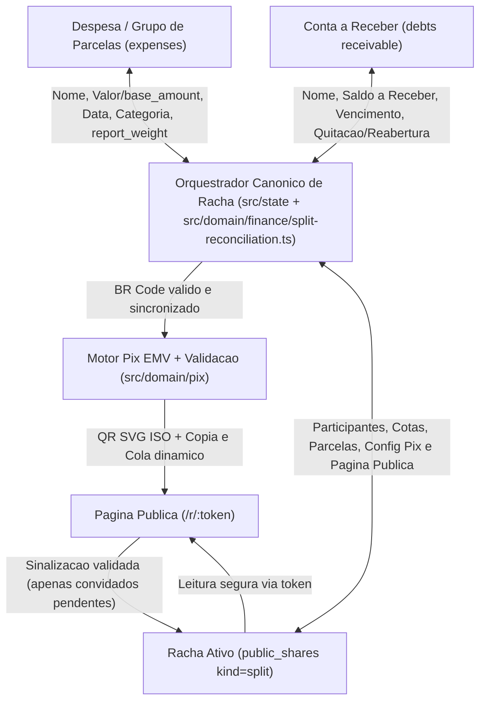

# Plano Arquitetural e de Implementação — Reestruturação Holística da Funcionalidade de Racha (Despesa Compartilhada)

> **Status:** Concluído na v3.15.0 (2026-11-22)
> **Classificação de Escopo (`AGENTS.md` §10.5):** **Fluxo Completo (Feature / Plano / Módulo)** — envolve migration SQL/RPC, refatoração de domínio puro, camada de sincronização bidirecional unificada, reestruturação de modais/página pública, testes unitários/integração/E2E (`npm run verify:full`), atualização da documentação canônica (`ESPECIFICACAO_TECNICA.md`, `PROJECT_STRUCTURE.md`, `ROADMAP.md`) e bump **MINOR** no `package.json`.

---

## 1. Diagnóstico Forense Completo (Causa Raiz de Todos os Problemas)

A auditoria integral do fluxo de ponta a ponta — da criação no Wizard/Extrato até o banco (`public_shares`, `expenses`, `debts`), RPCs, página pública `/r/:token`, sinalização e quitação — revelou **17 falhas estruturais e bugs concretos**, agrupados nos 5 eixos reportados.

---

### Eixo A — Por que o valor recebido dos rachas NÃO está sendo descontado da despesa

Existem **6 bugs simultâneos e encadeados** que impedem o abatimento contábil (`report_weight`) e a visualização do desconto:

1. **Bug Crítico A1 — Código morto em [split-sync.ts](file:///home/gabrielsales/meus_apps/financasnew/src/services/split-sync.ts#L100-L113) (despesas à vista SEMPRE ficam com peso `1.0`):**
   - Para qualquer racha de despesa à vista (1x), `participant_installments` é `undefined`/`[]` e `groupExpenses` é `[]`.
   - A execução entra no `else` (linha 100) e calcula `totalSettledFromFriends` filtrando **`validInstallments` — que é garantidamente vazio (`[]`) dentro desse `else`!**
   - Resultado: `totalSettledFromFriends` é **sempre `0`**, `netCents = totalCents` e **`targetWeight = 1`** (0% de desconto). A função sequer recebe `participants` ou `settledFromFriendsCents`.

2. **Bug Crítico A2 — Closure obsoleta (`stale state`) ao quitar em [use-manage-split.ts](file:///home/gabrielsales/meus_apps/financasnew/src/features/transactions/components/split/use-manage-split.ts#L112-L118):**
   - Ao clicar em **"Recebi Tudo"** (ou confirmar baixa parcial/finalizar), `persistParticipants` passa `result: hostNetCostCents / 100` para `settleIntegratedReceivable`.
   - Porém `hostNetCostCents` vem da renderização **anterior** à baixa! Em um racha de R\$ 100,00 (2 pessoas), antes do clique `hostNetCostCents` vale R\$ 100,00. Ao clicar "Recebi Tudo", o RPC recebe `p_result = 100`, dividindo `100 / 100 = 1.0` e **gravando `report_weight = 1` no banco**!
   - Junto com o Bug A1, isso garante que **nem baixas parciais nem "Recebi Tudo" reduzem o peso da despesa**.

3. **Bug Crítico A3 — Parâmetro `result` invertido ao confirmar aviso na Home ([use-pending-split-signals.ts](file:///home/gabrielsales/meus_apps/financasnew/src/features/overview/components/pending-split-signals/use-pending-split-signals.ts#L179-L181)):**
   - A RPC `settle_integrated_receivable(p_debt_id, p_result)` define `report_weight = p_result / base_amount`, onde `p_result` deve ser o **custo líquido do anfitrião** (`total - recebido`).
   - A linha 180 envia `result: linkedDebt.amount` (o valor **a receber dos amigos**, não a cota do anfitrião!). Num racha de R\$ 300,00 em 3 pessoas (anfitrião R\$ 100,00, amigos R\$ 200,00), o sistema grava peso `0.6667` (R\$ 200,00) em vez de `0.3333` (R\$ 100,00).

4. **Bug Crítico A4 — Despesa parcelada com modo `single_total` nunca desconta ([split-sync.ts](file:///home/gabrielsales/meus_apps/financasnew/src/services/split-sync.ts#L69-L84)):**
   - Se uma compra em 3x no cartão é rachada para recebimento à vista (`single_total`), `participant_installments` é vazio. `syncSplitExpenseReportWeights` percorre as 3 parcelas do cartão procurando parcelas pagas por `installment_number` em um array vazio, resultando em `settledForInst = 0` e `report_weight = 1` nas 3 faturas.

5. **Bug Crítico A5 — `base_amount` fica congelado ao editar o valor da despesa ([use-expense-detail-actions.ts](file:///home/gabrielsales/meus_apps/financasnew/src/features/transactions/components/use-expense-detail-actions.ts#L174-L176)):**
   - Editar o `value` de uma despesa avulsa não atualiza `base_amount`. Depois, `settle_integrated_receivable` divide `p_result / base_amount` usando o valor antigo, distorcendo ou zerando o desconto.
   - Além disso, o fallback de busca de parcelas irmãs em [split-sync.ts](file:///home/gabrielsales/meus_apps/financasnew/src/services/split-sync.ts#L56-L58) filtra por `.eq("description", linkedExpense.description)` — ao trocar o nome da despesa em uma parcela, o agrupamento quebra.

6. **Bug A6 — Invalidação de cache incompleta, visibilidade fraca do desconto e dessincronização com `/dividas`:**
   - `useManageSplit` e `usePendingSplitSignals` invalidam apenas `["expenses"]` e `["card-expenses"]`, deixando `["overview"]`, `["budgets"]`, `["reports"]`, `["insights"]`, `["debts"]` e `["public-share", token]` desatualizados.
   - `useUpdatePublicShare` ([use-public-share-mutations.ts](file:///home/gabrielsales/meus_apps/financasnew/src/state/mutations/use-public-share-mutations.ts#L20)) invalida `["public-shares"]` (plural), enquanto `usePublicShare` ([use-public-shares.ts](file:///home/gabrielsales/meus_apps/financasnew/src/state/queries/use-public-shares.ts#L18)) lê `["public-share", token]` (singular).
   - Quitar o recebível pela página `/dividas` ([settle-dialog.tsx](file:///home/gabrielsales/meus_apps/financasnew/src/features/debts/components/settle-dialog.tsx#L53-L55)) nunca atualiza o `public_shares` (mantendo o link Pix ativo e os participantes como "Pendente").
   - Clicar em **"Dar Baixa"** em [use-active-splits.ts](file:///home/gabrielsales/meus_apps/financasnew/src/features/transactions/components/splits/use-active-splits.ts#L50-L58) falha com erro `"Cobrança vinculada não encontrada"` sempre que o racha foi criado a partir de uma despesa existente (que não cria `debt`).
   - Em [transaction-row.tsx](file:///home/gabrielsales/meus_apps/financasnew/src/components/modules/transaction-row.tsx#L109-L146), o badge de rateio tem `hidden sm:inline-flex` (invisível no mobile!) e o valor reduzido aparece como um texto pequeno e pouco intuitivo (`Relat.: R\$ XX`).

---

### Eixo B — Por que o QR Code Pix e o Pix Copia e Cola / Link não estão funcionando

Foram identificados **7 problemas distintos** na geração, atualização, cópia e leitura do Pix/QR Code e do link público:

1. **Bug Crítico B1 — Editar a Chave Pix (ou título) nunca regenera `pix_br_code` nem `pix_key_type` ([use-manage-split.ts](file:///home/gabrielsales/meus_apps/financasnew/src/features/transactions/components/split/use-manage-split.ts#L85-L90)):**
   - Ao salvar alterações em `ManageSplitDialog`, apenas `payload.pix_key` é atualizado; `payload.pix_br_code` continua congelado com a chave antiga/errada!
   - Na página pública ([use-public-split-page.ts](file:///home/gabrielsales/meus_apps/financasnew/src/features/public-share/hooks/use-public-split-page.ts#L113-L115)), para rachas à vista (`participantInstallments.length <= 1`), retorna-se `payload.pix_br_code` estático sem recalcular. Logo, o QR Code e o Copia e Cola permanecem quebrados mesmo após o anfitrião corrigir a chave.

2. **Bug Crítico B2 — Classificação incorreta e corrupção de chaves Pix (especialmente Celular) ([pix-br-code.ts](file:///home/gabrielsales/meus_apps/financasnew/src/domain/pix/pix-br-code.ts#L143-L195) e [use-split-expense-form.ts](file:///home/gabrielsales/meus_apps/financasnew/src/features/transactions/components/split/use-split-expense-form.ts#L90-L94)):**
   - **Celular sem máscara** (ex.: `79999887766`, caso mais comum no Brasil) possui 11 dígitos e é classificado erroneamente como **`"cpf"`** (sem validar dígitos verificadores Mod-11 do CPF!). Assim, `normalizePixKey` **não adiciona `+55`**, gerando um BR Code inválido rejeitado por todos os bancos!
   - **Celular com `55` sem `+`** (ex.: `5579999887766`) retorna `"unknown"`. Em `use-split-expense-form.ts:93`, `detected === "unknown" ? "cpf" : detected` **força `"cpf"`**, executando `.replace(/\D/g, "")` — o que corrompe chaves aleatórias com formato alternativo ou celulares sem `+`.
   - **Perda de `keyType` na página pública ([use-public-split-page.ts](file:///home/gabrielsales/meus_apps/financasnew/src/features/public-share/hooks/use-public-split-page.ts#L123-L133)):** `buildPixTransferCode` é chamado **sem passar `keyType: payload.pix_key_type`**! Mesmo quando o anfitrião escolhe explicitamente `"Celular (+55)"`, a página pública reclassifica como `"cpf"` e remove o `+55` em rachas parcelados.
   - **Zero validação prévia de chave Pix:** o formulário aceita qualquer string arbitrária e gera BR Codes inválidos sem feedback ao anfitrião.

3. **Bug B3 — Caracteres não aceitos por bancos rígidos e falta de guarda TLV em [pix-br-code.ts](file:///home/gabrielsales/meus_apps/financasnew/src/domain/pix/pix-br-code.ts#L83-L128):**
   - `sanitizeMerchantText` permite `/`, `_`, `,` e `.` em `merchantName`, `merchantCity` e `infoAdicional` (ex.: `"Pizza 1/3"` em `use-public-split-page.ts:129`), o que é rejeitado por validadores rígidos de bancos (Caixa, Itaú, BB, Bradesco).
   - `formatEmvField` não bloqueia strings com mais de 99 caracteres (gerando length de 3 dígitos que corrompe o TLV).
   - Para maior interoperabilidade BACEN em QR Codes estáticos, `merchantName` e `merchantCity` devem ser sanitizados para ASCII puro `[A-Z0-9 ]`, `infoAdicional` para `[A-Za-z0-9 ]` dentro do teto de 99 bytes do Template `26`, e `txId` estritamente alfanumérico até 25 chars (ou `***`).

4. **Bug B4 — `QrCodeCanvas` com zona de silêncio reduzida e fallback enganoso ([qr-code-canvas.tsx](file:///home/gabrielsales/meus_apps/financasnew/src/components/ui/qr-code-canvas.tsx#L24-L78), [split-charge-qr-box.tsx](file:///home/gabrielsales/meus_apps/financasnew/src/components/modules/split-charge/split-charge-qr-box.tsx#L32-L38)):**
   - Usa `margin = 2` módulos (o padrão ISO/IEC 18004 exige **4 módulos** de *quiet zone* para leitura confiável em câmeras móveis) e renderiza via `<canvas>` sem escalonamento por `devicePixelRatio`, enquanto `renderQrCodeSvg` do `uqr` produz SVG vetorial nítido em qualquer tela.
   - Quando `pixBrCode` falha ou vem vazio, `SplitChargeQrBox` renderiza um ícone estático `<QrCode />` que parece um QR Code quebrado/ilegível em vez de um aviso claro.

5. **Bug B5 — Falha silenciosa de cópia em navegadores embutidos (WhatsApp/Instagram/Telegram) ([split-charge-pix-panel.tsx](file:///home/gabrielsales/meus_apps/financasnew/src/components/modules/split-charge/split-charge-pix-panel.tsx#L74-L95)):**
   - `navigator.clipboard?.writeText` frequentemente não existe ou falha em *in-app browsers* (WhatsApp WebView) e origens não-HTTPS. Sem fallback (`textarea` + `execCommand("copy")`) e sem exibir o código selecionável em caso de falha, o botão **"Copiar Pix"** aparenta não funcionar.

6. **Bug B6 — Expiração de 30 dias quebra rachas parcelados ([public-shares.ts](file:///home/gabrielsales/meus_apps/financasnew/src/data/repositories/public-shares.ts#L56-L57)):**
   - `createPublicShare` fixa `expiresInDays = 30`. Um racha em 6x ou 12x expira antes mesmo do vencimento da 2ª parcela!

7. **Bug B7 — Trigger de revogação impede pausa manual ([20260101000126_auto_revoke_archived_split_shares.sql](file:///home/gabrielsales/meus_apps/financasnew/supabase/migrations/20260101000126_auto_revoke_archived_split_shares.sql#L15-L21)):**
   - O trigger sobrescreve `new.is_revoked := false` sempre que `is_completed = false`, impedindo que o anfitrião pause/desative temporariamente o link público.

---

### Eixo C — Por que a despesa com racha continua como "Individual", não vincula e permite criar rachas duplicados

1. **Bug Crítico C1 — `ExpenseDetailDialog` nunca expõe `linkedSplitShare` para a View nem para o Footer ([use-expense-detail-actions.ts](file:///home/gabrielsales/meus_apps/financasnew/src/features/transactions/components/use-expense-detail-actions.ts#L72-L89), [expense-detail-view.tsx](file:///home/gabrielsales/meus_apps/financasnew/src/features/transactions/components/expense-detail-view.tsx#L68-L88), [expense-detail-footer.tsx](file:///home/gabrielsales/meus_apps/financasnew/src/features/transactions/components/expense-detail-footer.tsx#L68-L94)):**
   - `useExpenseDetailActions` encontra `linkedSplitShare` e `linkedRachaDebt`, mas **não os retorna** para a UI.
   - `ExpenseDetailView` continua exibindo `Orçamento: Individual` sem nenhum indicador de racha.
   - `ExpenseDetailFooter` só verifica `expense.trip_id`; para qualquer outra despesa (mesmo já rachada!), **sempre exibe o botão "Rachar"** que abre `SplitExpenseDialog` e **cria um segundo registro duplicado em `public_shares`**!

2. **Bug Crítico C2 — Criar racha a partir de despesa existente não cria cobrança em `debts`, não vincula `debt_id` e erra o total em parceladas ([expense-detail-dialog.tsx](file:///home/gabrielsales/meus_apps/financasnew/src/features/transactions/components/expense-detail-dialog.tsx#L142-L150), [split-payload-builder.ts](file:///home/gabrielsales/meus_apps/financasnew/src/features/transactions/components/split/split-payload-builder.ts#L63-L99)):**
   - `SplitExpenseDialog` cria apenas o `public_shares`, sem criar a conta a receber em `debts` e sem preencher `payload.debt_id`.
   - Em uma compra parcelada (ex.: 3x de R\$ 100,00 = R\$ 300,00), `expense.value` é o valor de **1 parcela** (R\$ 100,00), mas `installments_total = 3` — o modal divide R\$ 100,00 em 3x de R\$ 33,33 em vez de somar o grupo (R\$ 300,00)!
   - Ao gerar link para uma dívida órfã em [active-splits-card.tsx](file:///home/gabrielsales/meus_apps/financasnew/src/features/transactions/components/active-splits-card.tsx#L145), usa-se `totalCents` da dívida (que é só a parte dos amigos!) como valor total da despesa, dividindo novamente pela metade!

3. **Bug C3 — `ExpenseEditForm` não possui vínculo/conversão para Racha nem sincronização na edição ([expense-edit-form.tsx](file:///home/gabrielsales/meus_apps/financasnew/src/features/transactions/components/expense-edit-form.tsx#L117-L204), [use-expense-detail-actions.ts](file:///home/gabrielsales/meus_apps/financasnew/src/features/transactions/components/use-expense-detail-actions.ts#L162-L191)):**
   - Ao contrário do Modo Viagem (`expense.trip_id`), editar `description`, `value`, `date` ou `category_id` de uma despesa rachada **não faz nenhuma sincronização** com `public_shares` nem com `debts`.
   - Não é possível transformar uma despesa individual em Racha diretamente pela edição, e o campo manual de `report_weight` fica exposto podendo sobrescrever o cálculo do racha.

4. **Bug C4 — `ExpenseRow` no extrato não sinaliza Racha ativo ([transaction-feed-rows.tsx](file:///home/gabrielsales/meus_apps/financasnew/src/features/transactions/components/list/transaction-feed-rows.tsx#L44-L62)):**
   - Exibe badges de `Familiar` e `Viagem`, mas nunca de `Racha`.

5. **Bug C5 — Banner da Home abre modal de simulação "Churrasco R\$ 480" em vez do racha real ([split-pending-banner.tsx](file:///home/gabrielsales/meus_apps/financasnew/src/features/overview/components/split-pending-banner.tsx#L33-L35), [transaction-list-modals.tsx](file:///home/gabrielsales/meus_apps/financasnew/src/features/transactions/components/list/transaction-list-modals.tsx#L68-L82)):**
   - Clicar em **"Ver e Cobrar"** no banner da Home quando há 1 racha pendente navega para `/transacoes?id=<id>&racha_modal=1`, acionando `showRachaSimulation` (`isSimulation={true}`) em vez de abrir `ManageSplitDialog` para o racha real!

---

### Eixo D — Limitações de Edição do Racha Ativo e Sincronização Bidirecional

Em [manage-split-dialog.tsx](file:///home/gabrielsales/meus_apps/financasnew/src/features/transactions/components/split/manage-split-dialog.tsx#L71-L94) e [use-manage-split.ts](file:///home/gabrielsales/meus_apps/financasnew/src/features/transactions/components/split/use-manage-split.ts#L41-L55):
- Só é possível editar `title` e `pix_key` (e mesmo assim sem regenerar BR Code e sem sincronizar com a despesa/dívida).
- Não é possível editar: nomes dos participantes, quantidade de participantes, valores personalizados por pessoa (`splitCustomWithRemainder` já existe no domínio mas nunca foi exposto na UI!), valor total, data, modo de parcelamento, tipo da chave Pix, nome do titular, cidade, política de centavos, validade do link, pausa/reativação, regeneração do token ou mensagem/privacidade da página pública.
- `useManageSplit` guarda `participants` e `editedTitle` em `useState` inicializado apenas na montagem, ficando dessincronizado quando o `share` é atualizado externamente.

---

### Eixo E — Experiência e Coerência da Página Pública (`/r/:token`)

1. **Anfitrião selecionável como pagador ([public-split-identity-banner.tsx](file:///home/gabrielsales/meus_apps/financasnew/src/features/public-share/components/public-split-identity-banner.tsx#L73-L102)):**
   - Renderiza todos os `participants` (inclusive `is_host: true`) como botões clicáveis em *"Quem é você neste racha?"*. Selecionar o anfitrião permite sinalizar pagamento para si mesmo e exibe parcelas já quitadas/valores incorretos.
   - A RPC `signal_split_payment` também não impede sinalizações enviadas com `participant_id` do anfitrião ou de participantes já quitados.
2. **Convidado já quitado ou com pagamento parcial:**
   - Se o convidado já pagou 100%, a página ainda mostra o QR Code e "Já fiz o Pix" (risco de pagamento em dobro!).
   - Se o convidado pagou parcialmente, `effectiveChargeCents` ainda cobra a cota cheia `share_cents` em vez do saldo restante (`share_cents - settled_cents`).
3. **Sinalização de "Quitar todas pendentes" em parcelado ([use-public-split-actions.ts](file:///home/gabrielsales/meus_apps/financasnew/src/features/public-share/hooks/use-public-split-actions.ts#L146-L155)):**
   - Quando o convidado marca "Quitar todas pendentes" e clica "Já fiz o Pix", o valor enviado é o total restante, mas `installmentId` ainda envia apenas 1 parcela!
4. **Fricção desnecessária com 1 convidado e falta de modo prévia para o anfitrião:**
   - Quando há apenas 1 amigo (racha de 2 pessoas), não faz sentido pedir seleção de identidade — deve auto-identificar o único convidado.
   - Quando o próprio anfitrião logado abre `/r/:token`, deve ver um banner **"Prévia do Anfitrião"** com seletor de visão por convidado e botão para voltar à gestão, em vez de ser tratado como um convidado anônimo.

---

## 2. Arquitetura Holística Proposta (Fonte Única da Verdade & Sincronização Bidirecional)

### Princípios Arquiteturais
1. **Vínculo 1:1 Garantido no Banco de Dados:** Uma despesa (ou grupo de parcelas `installment_group_id`) possui **no máximo 1 racha vinculado**, garantido por colunas indexadas (`expense_id`, `installment_group_id`, `debt_id`) e índices parciais únicos em `public_shares`.
2. **Motor Puro Único no Domínio (`src/domain/finance/split-reconciliation.ts`):** Toda lógica de recálculo de cotas, preservação de baixas em edição, cálculo de `report_weight` (à vista, parcelado `per_installment` e parcelado `single_total`), transição de sinais e estado da dívida vive em funções puras 100% cobertas por Vitest.
3. **Orquestrador Único de Mutações (`src/state/mutations/use-split-sync-mutations.ts`):** Os 4 pontos de entrada (`ManageSplitDialog`, `ActiveSplitsCard`, `PendingSplitSignalsCard` e `SettleDialog` em `/dividas`) + `ExpenseDetailDialog` / `ExpenseEditForm` delegam **exclusivamente** ao mesmo conjunto de mutations, eliminando qualquer código duplicado ou divergente e invalidando sempre todas as queries financeiras e públicas afetadas.
4. **Pix EMV Sempre Válido e Dinâmico:** Validação estrita na entrada (com Mod-11 para CPF/CNPJ e desambiguação explícita para 11 dígitos CPF vs Celular `+55`), regeneração obrigatória de `pix_br_code` em qualquer edição e geração dinâmica na página pública sempre passando `keyType` explícito e o saldo exato a pagar do convidado.
5. **Reconciliação Contábil Transparente (Conforme `ESPECIFICACAO_TECNICA.md` §3.13.1):**
   - `expenses.value` / `base_amount` preserva o valor nominal real pago no banco/cartão (conciliação fiel com fatura e extrato bancário).
   - `expenses.report_weight` é atualizado automaticamente a cada confirmação/edição/estorno (`(total - recebido) / total`), reduzindo instantaneamente Orçamentos, Relatórios, Insights, Fatura Ponderada e KPIs Ponderados.
   - A UI passa a exibir de forma **cristalina em mobile e desktop** tanto o valor nominal quanto o valor líquido pós-reembolso (`Sua parte: R\$ X · Reembolsado: R\$ Y`).

---

## 3. Plano de Implementação Detalhado por Ondas

### Onda 1 — Banco de Dados, Integridade Relacional e Hardening de RPCs (Supabase)

**Arquivo novo:** `supabase/migrations/20260101000134_harden_split_expenses_sync_and_links.sql`

1. **Colunas relacionais e unicidade em `public.public_shares`:**
   - Adicionar colunas anuláveis:
     - `expense_id uuid references public.expenses(id) on delete set null`
     - `installment_group_id uuid`
     - `debt_id uuid references public.debts(id) on delete set null`
   - Backfill seguro a partir de `payload->>'expense_id'`, `payload->>'installment_group_id'` e `payload->>'debt_id'` (validando formato UUID e validando existência nas tabelas referenciadas; em caso de duplicados legados para a mesma despesa, manter o mais recente vinculado e limpar a referência duplicada antiga).
   - Índices parciais únicos (evitam criação de racha duplicado mesmo sob concorrência):
     - `uq_public_shares_split_expense_id` em `(user_id, expense_id) WHERE kind = 'split' AND expense_id IS NOT NULL`
     - `uq_public_shares_split_group_id` em `(user_id, installment_group_id) WHERE kind = 'split' AND installment_group_id IS NOT NULL`
   - Índices de busca em `(user_id, expense_id)` e `(user_id, debt_id)`.
2. **Correção do trigger `sync_split_public_share_revocation`:**
   - Só revogar automaticamente quando `is_completed` for `true` (`new.is_revoked := true`).
   - Quando `is_completed` for `false`, respeitar `coalesce((new.payload->>'public_page_paused')::boolean, false)`: se pausado pelo anfitrião, manter `is_revoked := true`; se reaberto de `completed=true -> false` e não pausado, restaurar `is_revoked := false`.
   - Sincronizar automaticamente `new.expense_id`, `new.installment_group_id` e `new.debt_id` a partir do `payload` (quando válidos) para manter compatibilidade total.
3. **Hardening de `signal_split_payment` (nova assinatura compatível):**
   - Adicionar parâmetro opcional `p_installment_ids text[] default null` (suportando quitação de múltiplas parcelas pendentes de uma vez).
   - Bloquear sinalização cujo participante alvo tenha `is_host = true` (`raise exception 'O anfitrião não pode sinalizar pagamento para si mesmo.'`).
   - Bloquear sinalização se o participante (ou todas as parcelas alvo) já estiver quitado (`is_settled = true`).
   - Deduplicar considerando `p_installment_id` e `p_installment_ids`.
4. **Atualização de `get_public_share_by_token`:**
   - Retornar `expense_id`, `installment_group_id`, `debt_id` (sem expor dados privados da despesa) e bloquear links pausados (`public_page_paused = true`), revogados, expirados ou finalizados.
5. **Atualização de tipos (`src/types/schema.ts` e `src/types/database.ts`):**
   - Expandir `SplitSharePayload` com `split_mode?: "equal" | "custom"`, `custom_note?: string | null`, `show_participants_list?: boolean`, `public_page_paused?: boolean`, `due_date?: string | null`.
   - Expandir `SplitPaymentSignal` com `installment_ids?: string[] | null`.
   - Expandir `PublicShare` com `expense_id?: string | null`, `installment_group_id?: string | null`, `debt_id?: string | null`.

---

### Onda 2 — Motor Pix BACEN EMV, Validação de Chaves, QR SVG ISO e Clipboard Resiliente

**Arquivos modificados / criados:**
- [src/domain/pix/pix-br-code.ts](file:///home/gabrielsales/meus_apps/financasnew/src/domain/pix/pix-br-code.ts) (+ `pix-br-code.test.ts`)
- [src/domain/pix/build-pix-transfer-code.ts](file:///home/gabrielsales/meus_apps/financasnew/src/domain/pix/build-pix-transfer-code.ts) (+ `build-pix-transfer-code.test.ts`)
- `src/domain/pix/pix-key-validation.ts` (+ `pix-key-validation.test.ts`, exportado no barrel `src/domain/pix/index.ts`)
- [src/components/ui/qr-code-canvas.tsx](file:///home/gabrielsales/meus_apps/financasnew/src/components/ui/qr-code-canvas.tsx) (+ `qr-code-canvas.test.tsx`)
- [src/services/export-actions.ts](file:///home/gabrielsales/meus_apps/financasnew/src/services/export-actions.ts) (`copyTextToClipboard` com fallback seguro)

---

### Onda 3 — Motor Puro de Reconciliação de Rachas & Orquestrador Bidirecional Unificado

**Arquivos novos / refatorados:**
- `src/domain/finance/split-reconciliation.ts` (+ `split-reconciliation.test.ts`, exportado via `src/domain/finance/index.ts`)
- [src/services/split-sync.ts](file:///home/gabrielsales/meus_apps/financasnew/src/services/split-sync.ts) (+ `split-sync.test.ts`)
- [src/data/repositories/public-shares.ts](file:///home/gabrielsales/meus_apps/financasnew/src/data/repositories/public-shares.ts)
- [src/data/repositories/expenses.ts](file:///home/gabrielsales/meus_apps/financasnew/src/data/repositories/expenses.ts)
- [src/data/repositories/debts.ts](file:///home/gabrielsales/meus_apps/financasnew/src/data/repositories/debts.ts)
- `src/state/mutations/use-split-sync-mutations.ts` (exportado em `src/state/index.ts`)
- [src/state/mutations/use-public-share-mutations.ts](file:///home/gabrielsales/meus_apps/financasnew/src/state/mutations/use-public-share-mutations.ts)

---

### Onda 4 — Integração Total com Despesas (`ExpenseDetailDialog`, `ExpenseEditForm`, `TransactionRow`, `LaunchWizard`, `ActiveSplitsCard`)

- Exposição de `linkedSplitShare` / `linkedRachaDebt` no detalhe da despesa, bloqueio de duplicidade, troca de "Rachar" para "Gerenciar Racha".
- Conversão para racha e banner de sincronização no `ExpenseEditForm`.
- Badge `Racha` e destaque `Sua parte:` (mobile + desktop) em `TransactionRow` e `ExpenseDetailView`.
- Deep-link real `?gerenciar_racha=<shareId>` no `SplitPendingBanner` e `TransactionListPage`.
- Criação unificada via `useCreateLinkedSplit` e sincronização reversa de quitação em `/dividas`.

---

### Onda 5 — Central Completa de Gestão e Edição do Racha (`ManageSplitDialog` em 3 Abas)

- 3 abas em `ManageSplitDialog`: `Baixas`, `Editar Racha` (`split-edit-tab.tsx`), `Pix e Página` (`split-public-config-tab.tsx`).
- Edição completa de título, valor total, data, modo igual/customizado, participantes, parcelas, configuração Pix com prévia ao vivo do QR Code SVG, recado público, privacidade da lista, pausa/reativação, validade, regeneração de token e reabertura de racha concluído.

---

### Onda 6 — Experiência Polida da Página Pública (`/r/:token`)

- Exclusão estrita do anfitrião da seleção de pagador (UI + RPC).
- Auto-identificação para 1 convidado e modo `Prévia do Anfitrião`.
- Cálculo dinâmico do Pix EMV sempre preservando `keyType` e saldo restante exato (`share_cents - settled_cents`).
- Estado quitado sem QR/botão de sinalização e sinalização multi-parcelas via `installmentIds`.

---

### Onda 7 — Documentação, Testes Abrangentes e Quality Gate

- Cobertura completa em domínio, serviços, componentes/fluxo e auditoria SQL (`security-audit.test.ts`).
- Atualização de `ESPECIFICACAO_TECNICA.md` (§3.13.1), `PROJECT_STRUCTURE.md` e `ROADMAP.md` + bump **MINOR** (`3.15.0`) no `package.json`.
- Execução completa de build e `npm run verify:full`.
