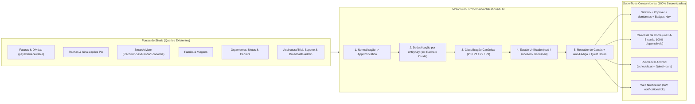

# Plano Mestre: Auditoria Integral e Reorganização Holística do Ecossistema de Notificações, Alertas e Lembretes

> **Status:** Concluído (Fases 0 a 5 implementadas e verificadas)  
> **Data:** 22/11/2026  
> **Escopo:** Todo o ecossistema que notifica, alerta, avisa ou lembra o usuário — dentro do app (Sininho, Popover, `/lembretes`, Carrossel da Home, SmartAdvisor, Badges de Navegação, Alertas Inline, Toasts) e fora do app (Notificações Locais/Interativas Android, Assistente Bancário Nativo, Notificações Web/PWA, E-mails Transacionais, Comunicados Admin e Telegram Operacional).  
> **Classificação de Escopo (`AGENTS.md` §10.5):** **Fluxo Completo (Feature / Plano Estrutural — bump `MINOR` na entrega final, podendo a Fase 0 ser entregue isoladamente como `PATCH` se desejado).**

---

## 1. Sumário Executivo

Ao longo da evolução do aplicativo (Fases 1 a 43), diversos mecanismos de aviso foram adicionados de forma incremental e isolada em cada módulo (Cartões, Dívidas, Rachas, Família, Viagens, Metas, Investimentos, SmartAdvisor, Assinatura/Trial, Assistente Bancário Android, Comunicados Admin e Suporte). O resultado auditado no código atual confirma integralmente a percepção de fragmentação:

1. **Não existe uma "Central Única" de verdade:** hoje o sistema possui **12 superfícies distintas** que emitem avisos, **6 sistemas independentes de persistência de dispensa/leitura** e **5 contadores de badge diferentes** que discordam entre si no mesmo instante.
2. **Duplicidade estrutural (em especial Rachas × Dívidas e Família):** um único Racha gera até **4 notificações simultâneas** (Carrossel da Home, Card de Sinalização na Home, Sininho/Central de Lembretes como "Dívida Vencida" e Push do sistema operacional).
3. **Inversão semântica (A Receber tratado como A Pagar):** contas *a receber* (incluindo rachas onde amigos devem dinheiro ao usuário) entram em `useReminders()` e no Push do dispositivo com severidade crítica (`"Vencido"` em vermelho), somadas no montante *"aguardando quitação"* e com botão **`"Pagar no App"`**.
4. **Inflação de severidade ("Crítico" indevido):** avisos preventivos de 30 dias (ex.: compromisso anual previsto), assinaturas ainda não lançadas no mês (ex.: streaming) e contas *a receber* vencidas recebem prioridade máxima (`priority: 1` ou `status: "overdue"`), deixando o Sininho vermelho e gerando ansiedade artificial (*alert fatigue*).
5. **Banners "presos" sem dispensa:** **7 de 13** banners do Carrossel da Home não possuem botão de dispensar/adiar — incluindo `SplitPendingBanner`, `HouseholdAlertBanner`, `CashGapAlert`, `ActiveTripBanner`, `CorporateDividendsBanner` e `TrialEndingBanner`.
6. **Bugs críticos de funcionamento em Snooze, Push e Android Pro:**
   - Clicar em **"Adiar 3 Dias"** na notificação Android cancela e **redispara a mesma notificação imediatamente** (a data calculada nunca é usada).
   - O motor de Snooze (`applyReminderState`) compara `item.dueDate > snoozeUntil` em vez de `today >= snoozeUntil`, quebrando o adiamento para antecedências maiores que 7 dias e tornando o botão "Adiar" inútil em itens vencidos.
   - O sincronizador de Push (`AuthenticatedProviders`) envia **`allItems`** (incluindo itens já marcados como **lidos** ou **adiados**!) para o sistema operacional.
   - **Zero Push Remoto (FCM/APNs/Web Push):** o app usa exclusivamente `LocalNotifications` disparadas **apenas quando o usuário abre o app** (sem `schedule.at`), sem *Quiet Hours*, e na Web/PWA o "Lembrete Diário" mostra toast de sucesso mesmo sendo um *no-op* silencioso.

---

## 2. Parte 1 — Auditoria Completa do Estado Atual (Com Evidências em Código)

### 2.1. Inventário das 12 Superfícies de Notificação Existentes

| # | Superfície | Onde Vive (Arquivos Principais) | O que Exibe Hoje | Persistência de Estado / Dispensa |
|---|---|---|---|---|
| 1 | **Sininho do Topo (Badge)** | `src/components/layout/notifications-button.tsx`<br>`src/components/layout/page-shell.tsx:117-148` | Soma: `useReminders` (faturas + todas as dívidas) + `onboarding` + `advisor` (P1/P2) + `supportTickets`. **Esquece `unreadBroadcasts`!** Desaparece (`return null`) quando 0. | Nenhuma própria (lê 4 fontes desconectadas). |
| 2 | **Popover do Sininho** | `src/features/reminders/components/notifications/NotificationsPopover.tsx`<br>`use-notifications-popover-data.ts` | `unreadBroadcasts` + `unreadSupportTickets` + `onboarding` + `advisor` (P1/P2) + `reminders.slice(0, 6)` (corte silencioso em 6). | Mistura 5 tabelas/storages (`reminder_states`, `user_notification_reads`, `support_tickets`, `localStorage`, `custom_settings`). |
| 3 | **Página `/lembretes`** | `src/features/reminders/pages/reminders-page.tsx`<br>`use-reminders-page-state.ts` | Apenas `advisor` (P1/P2) + `allItems` (faturas + dívidas, **incluindo adiados na listagem!**). **Oculta** broadcasts, suporte e onboarding. | `reminder_states` + `smartAdvisorDismissals`. |
| 4 | **Badges de Navegação** | `src/components/layout/sidebar.tsx:35`<br>`bottom-nav.tsx:21`<br>`more-menu-sheet.tsx:40` | Apenas `useReminders().totalCount` e `urgentCount` (faturas + dívidas). Ignora advisor, suporte, broadcasts e onboarding. | `reminder_states`. |
| 5 | **Carrossel da Home** | `src/components/modules/dashboard-alerts-carousel.tsx`<br>`src/features/overview/components/build-overview-alerts.tsx` | Até **13 tipos de banners** (permissões, teto familiar, cash-gap, onboarding, viagem ativa, acerto familiar, rachas pendentes, ritmo de gastos, metas, sobra de aporte, proventos, revisão de teses, trial). | Parcial: 6 têm dispensa (`dashboardAlertDismissals`, `dismissedPermissionAlerts`, `onboarding_dismissed`); **7 são indispendáveis**. |
| 6 | **SmartAdvisorCard (Home)** | `src/features/overview/components/smart-advisor/smart-advisor-card.tsx`<br>`src/domain/insights/advisor.ts` | Segundo carrossel rotativo logo abaixo do Carrossel da Home (P1 Crítico, P2 Entrada, P3 Economia, P4 Calibração). | `axis_smart_advisor_dismissals` (`localStorage` + `custom_settings`) + `insight_feedback` (DB). |
| 7 | **Zonas Soltas no Topo da Home** | `src/features/overview/pages/overview-page.tsx:125-138`<br>`overview-dashboard-content.tsx:130-164` | `AutoRegisteredBanner`, `PendingSuggestionsCard`, `PendingSplitSignalsCard`, `DashboardPixClipboardCard`, `ReadOnlyBanner`, `WeeklyDueRadarCard`. | Cada card tem armazenamento próprio (memória, `localStorage`, payload JSON de `public_shares`). |
| 8 | **Push / Notificação Local de Contas** | `src/services/native/local-notifications.ts:543-679`<br>`src/app/authenticated-providers.tsx:83-101` | Dispara notificação no Android (Capacitor) ou Web (`showNotification`) ao abrir o app (1x/dia), agrupando `>= 2` itens no ID `2030`. | `localStorage` (`due_notifications_last_sync_date`, `due_notifications_active_keys`). |
| 9 | **Lembrete Diário (Android)** | `src/services/native/local-notifications.ts:223-317` | Alarme diário recorrente (`id: 2026`, padrão 20:00) com ações "Despesa" e "Receita". **Inoperante na Web/PWA.** | `localStorage` + `custom_settings.deviceNotifications`. |
| 10 | **Assistente Bancário (Android Java)** | `android/app/src/main/java/com/guiafinanceiro/app/BankNotificationListenerService.java`<br>`BankNotificationActionReceiver.java`<br>`src/services/native/bank-listener.ts` | Intercepta pushes bancários em 2º plano, emite push interativo ("Adicionar Rápido" / "Conferir e Salvar") e confirmação ("Desfazer"). | `SharedPreferences` (`bank_notifications_prefs`) + `localStorage` + `custom_settings.bankAssistant`. |
| 11 | **Alertas Globais / Toasts / Update** | `src/components/layout/network-status-banner.tsx`<br>`src/components/modules/{app,native,pwa}-update-toast.tsx`<br>`src/services/toast.ts` | Status offline/reconectado, atualização de PWA/APK (supressão 12h/sessão) e feedback efêmero pós-ação (`pushToast`, max 1 simultâneo). | `sessionStorage` / `localStorage` (`update-toast-policy`). |
| 12 | **Canais Externos (E-mail / Telegram / Admin)** | `supabase/functions/billing-lifecycle-cron/index.ts`<br>`asaas-{checkout,webhook,manage}/index.ts`<br>`support-notify/index.ts`<br>`sunday-digest/index.ts` | E-mails transacionais Resend (trial expirando, checkout/renovação/falha), Telegram exclusivo para o fundador (vendas/suporte), Broadcasts Admin (`admin_broadcast_notifications`), Stub de resumo dominical. | `transactional_email_logs` (idempotência), `user_notification_reads`. |

---

### 2.2. Divergência Crônica dos 5 Contadores de Badge

No mesmo instante, para o mesmo usuário logado, 5 pontos da interface calculam e exibem **números diferentes**:

| Superfície | Faturas/Dívidas (não lidas) | Faturas/Dívidas (adiadas) | SmartAdvisor (P1/P2) | Onboarding | Suporte não lido | Broadcasts Admin |
|---|:---:|:---:|:---:|:---:|:---:|:---:|
| **Sidebar / BottomNav / MoreMenu** | Sim | Não | Não | Não | Não | Não |
| **PageShell (`hasNotifications`)** | Sim | Não | Sim | Sim | Sim | **Não (Bug)** |
| **Bell Badge (`NotificationsButton`)** | Sim | Não | Sim | Sim | Sim | **Não (Bug)** |
| **Bell Popover (`NotificationsPopover`)** | Sim (corta em 6) | Não | Sim | Sim | Sim | Sim |
| **Página `/lembretes` (Header Badge)** | Sim | Não | Sim | **Não** | **Não** | **Não** |
| **Página `/lembretes` (Chips/Lista)** | Sim | **Sim (Bug)** | Sim | **Não** | **Não** | **Não** |

> **Impacto prático:** Se um administrador envia um comunicado urgente (`admin_broadcast_notifications`) para um usuário que está com as contas em dia, `NotificationsButton` calcula `effectiveTotalCount = 0` e **retorna `null`** — o usuário nunca vê o sininho nem o comunicado. E quando há itens adiados, o contador do cabeçalho de `/lembretes` não bate com a soma dos chips de filtro (`Faturas` + `Dívidas`).

---

### 2.3. O Caso Emblema: Rachas (Splits) × Dívidas — Duplicidade e Inversão Semântica

O fluxo exato auditado no código explica por que um único racha causa tanta poluição e confusão:

1. Ao criar um racha (`useCreateLinkedSplit` em `src/state/mutations/use-split-sync-mutations.ts:139-145` e `syncSplitDebtStatus` em `src/services/split-sync.ts:273-352`), o sistema cria:
   - Um registro em `public_shares` (`share_type: "split"`);
   - Uma **dívida vinculada** na tabela `debts` com `type = "receivable"`, `name = "Racha: <título>"`, `expense_id` / `installment_group_id` e `due_date = todayISO()` (padrão: **hoje**!).
2. A partir daí, **o mesmo evento financeiro explode em até 4 superfícies**:
   - **Superfície A (Carrossel da Home — indispendável):** `computePendingSplitReceivables` (`src/domain/overview/build-overview-metrics.ts:292-422`) renderiza `SplitPendingBanner` (`src/features/overview/components/split-pending-banner.tsx`) com `"Despesas a Rachar e Receber · N rachas a receber"`. **Não tem botão de dispensar.**
   - **Superfície B (Topo da Home — card separado):** se um amigo sinaliza que pagou via link público, `PendingSplitSignalsCard` (`src/features/overview/components/pending-split-signals/pending-split-signals-card.tsx`) aparece *acima* do carrossel — mas **não aparece no Sininho nem em `/lembretes`**.
   - **Superfície C (Sininho + `/lembretes` — duplicado e classificado como crítico!):** `useReminders()` (`src/state/queries/use-reminders.ts:113-123`) ingere **todas** as `debts` com `paid_at === null` **sem filtrar `type === "receivable"` e sem verificar se pertencem a um racha**. Como `due_date` padrão é `todayISO()`, no dia seguinte o racha vira `status: "overdue"`:
     - Recebe badge vermelho **`"Vencido"`** (`variant="critical"`);
     - Deixa o **Sininho vermelho** (`overdueCount > 0`);
     - Exibe botão primário **`"Dar Baixa"`** em `/lembretes` (`reminder-item.tsx:180`), sem distinguir que é um recebimento de racha!
   - **Superfície D (Push Android / Web — texto invertido!):** `syncDueReminderNotifications` (`src/services/native/local-notifications.ts:603-669`):
     - Quando há `>= 2` itens, **soma o valor a receber do racha junto com faturas e dívidas a pagar** na frase: *"Você possui N contas aguardando quitação (total de R$ X)"*;
     - Quando há 1 item (mesmo sendo um racha a receber!), dispara: *"Racha: Jantar — Vencida · Saldo em aberto: R$ X. Toque para conferir e quitar."* com botão **`"Pagar no App"`**!

> **Contraste interno importante:** `WeeklyDueRadarCard` (`src/domain/projection/weekly-radar.ts:84`) e `CashGapAlert` (`src/domain/overview/build-overview-metrics.ts:199,210`) **já separam corretamente** `payable` vs. `receivable`. Apenas `useReminders()` e `local-notifications.ts` misturam tudo.

---

### 2.4. Inflação de Severidade ("Crítico/Extremo" Indevido) e Classificações Errôneas

| Origem | Arquivo & Linha | Problema Auditado | Severidade Atual | Severidade Correta |
|---|---|---|---|---|
| **Compromisso anual previsto (30d antes)** | `src/domain/insights/advisor.ts:391-418` | Ex.: IPVA/seguro previsto para daqui a 30 dias gera `priority: 1, category: "critical"`. Deixa o Sininho vermelho com badge `"Crítico"`. | P1 Crítico (vermelho) | **P2 Informativo** (ou P1 Atenção apenas ≤ 7 dias) |
| **Conta recorrente não lançada no mês** | `src/domain/insights/advisor.ts:341-376` | Ex.: assinatura de streaming não identificada ainda no mês gera `priority: 1, category: "critical"` (Sininho vermelho). | P1 Crítico (vermelho) | **P1 Atenção** (âmbar) — só vira P0 se realmente houver risco de atraso vencido |
| **Qualquer Advisor P2 não-renda** | `ReminderNotificationRows.tsx:34`<br>`AdvisorReminderCard.tsx:20` | Hardcode `badgeLabel = isCritical ? "Crítico" : isIncome ? "Entrada" : "Vence hoje"` e ícone `<CreditCard />` para qualquer P2 que não seja `income`! | `"Vence hoje"` + ícone Cartão | Derivar de mapeamento semântico unificado (`resolveSmartAdvisorPresentation`) |
| **Acerto Familiar quando usuário é Pagador** | `src/domain/insights/advisor.ts:513-532` | `household:settlement_pending` tem `category: "income"` mesmo quando `isPayer === true` (usuário deve dinheiro!). No sininho ganha badge verde **`"Entrada"`**! | `"Entrada"` (verde) | **P1 Atenção** (pagador) ou **P2 Informativo** (recebedor) |
| **Dívidas A Receber / Rachas** | `src/state/queries/use-reminders.ts:113-123` | `d.type === "receivable"` vencida gera `status: "overdue"` → `variant="critical"` e Sininho vermelho. | Crítico (vermelho) | **P2 Informativo / Acompanhamento** (nunca crítico) |
| **Fatura de Cartão vencendo HOJE** | `src/domain/reminders/index.ts:69-84` | Inversão oposta: `invoiceStatus` não retorna `"due_today"`, então fatura vencendo **hoje** recebe `status: "due_soon"` (`"Em breve"`) e fica fora de `urgentCount`! | `"Em breve"` (subestimado) | **P0 Crítico / Urgente** (`"Vence hoje"`) |
| **Comunicados Broadcast do Admin** | `SystemNotificationRows.tsx:6-49` | Ignora `broadcast.type` (`info`, `warning`, `critical`, `promotion`, `system`) e pinta tudo igual com badge `"Comunicado"`. | Genérico fixo | Mapear tom visual e severidade de `broadcast.type` |
| **Proventos & Revisão de Teses** | `corporate-dividends-banner.tsx:27`<br>`portfolio-governance-banner.tsx:21` | Usam `role="alert"` (ARIA de interrupção urgente para leitores de tela) em avisos puramente informativos/rotineiros. | `role="alert"` | `role="region"` |

---

### 2.5. Catálogo Completo de Bugs Técnicos Encontrados (22 Achados)

#### A. Motor de Lembretes, Snooze e Roteamento In-App
1. **Bug do Snooze no Domínio (`src/domain/reminders/index.ts:126,136`):** compara `item.dueDate > state.snoozeUntil` em vez de `today >= state.snoozeUntil`. Se um item vence em 9 dias (ex.: antecedência 10d) e o usuário adia por 7 dias, `dueDate > snoozeUntil` é **imediatamente `true`** e o adiamento falha no mesmo segundo. Além disso, `if (item.dueDate <= today) return true` (linha 127) impede adiar itens vencidos — porém `ReminderItem` continua exibindo o botão `"Adiar"`, gravando `"snoozed"` no banco e exibindo os badges contraditórios `"Vencido"` + `"Adiado"` simultaneamente em `/lembretes`.
2. **`debtReminder` ignora antecedência 0, 1 e 2 dias (`src/domain/reminders/index.ts:87-108` + `src/domain/debts/index.ts:45`):** `debtStatus()` fixa `<= 3 dias` como `"due_soon"`, ignorando o parâmetro `daysBefore` quando o usuário configura `"No dia do vencimento"` (0), `"1 dia antes"` ou `"2 dias antes"`.
3. **Ações quebradas do SmartAdvisor no Sininho e em `/lembretes` (`src/features/reminders/utils/navigate-advisor-alert.ts:64-100` e `smart-advisor-routing.ts:75-78`):**
   - `navigateAdvisorAlert` não trata `navigate_family`, `open_family_settlement` nem `open_income_goals`. Clicar em **"Teto familiar estourado"** abre o formulário de **"Nova Despesa"** pré-preenchido com `descricao="Teto familiar estourado"` e `valor=<total_gasto_da_casa>`. Clicar em **"Acerto familiar pendente"** ou **"Meta de receita abaixo do ritmo"** abre **"Nova Receita"**!
   - Até em `smart-advisor-routing.ts:77`, a condição `(insight.category === "critical" && !insight.id.startsWith("dup:"))` captura `household:ceiling_exceeded` antes de chegar no `if` de `navigate_family` (linha 147).
4. **Duplicação de `household:*` no Sininho e `/lembretes`:** `OverviewDashboardContent` (`lines 55-89`) passa `suppressedThemeKeys` para suprimir `household:ceiling_exceeded` e `household:settlement_pending` do `SmartAdvisorCard`, mas `NotificationsButton`, `NotificationsPopover` e `RemindersPage` chamam `useSmartAdvisorInsights()` **sem** supressão.
5. **4 execuções simultâneas do motor `useSmartAdvisorInsights()` na Home:** `PageShell`, `NotificationsButton`, `NotificationsPopover` e `SmartAdvisorCard` instanciam o hook separadamente.
6. **"Marcar todas como lidas" incompleto (`use-notifications-popover-data.ts:129-132`, `use-reminders-page-state.ts:164-169`):** só marca faturas/dívidas (`reminder_states`); ignora `advisorAlerts`, `unreadBroadcasts`, `unreadSupportTickets` e `onboarding`.
7. **Sininho desaparece com 0 pendências e esconde o botão de Privacidade (`notifications-button.tsx:40`, `page-shell.tsx:146-148`):** impede acessar o histórico de lidas pelo sininho e faz o botão de ocultar valores sumir/reaparecer no cabeçalho conforme o número de notificações muda.
8. **Broadcast sem `action_url` some sem leitura completa (`use-notifications-popover-data.ts:114-118`):** a descrição é cortada com `line-clamp-2`, e ao clicar marca como lido e fecha o popover sem expandir a mensagem.

#### B. Push / Notificações Locais e Web/PWA
9. **`ACTION_SNOOZE` ("Adiar 3 Dias") em loop imediato (`src/services/native/local-notifications.ts:759-776`):** calcula `snoozeDate` (+3 dias) e **não passa a data** para `dispatchLocalOrWebNotification` (que nem aceita `schedule.at`), cancelando e redisparando a mesma notificação na mesma hora, perdendo `extra.url` e sem gravar em `reminder_states`.
10. **Push disparado para itens já LIDOS e ADIADOS (`src/app/authenticated-providers.tsx:90,96`):** passa `allItems` (não filtrado por `applyReminderState`) em vez de `items` para `syncDueReminderNotifications`.
11. **Notificações de vencimento só disparam quando o app é aberto (`local-notifications.ts:390-404, 543-679`):** nunca agenda no futuro (`schedule.at`); se o usuário não abrir o app no dia do vencimento, nunca é avisado. E se abrir às 02:00 da manhã, recebe notificação `HIGH` com vibração/luz (zero *Quiet Hours*).
12. **Quitação de dívidas/rachas não cancela push e resumo `2030` fica preso:** `usePayDebt`, `useReceiveDebt`, `useSettleIntegratedReceivable`, `useDeleteDebt` e `useApplySplitSettlement` nunca chamam `cancelDueReminderNotification`. E `cancelDueReminderNotification` nunca cancela/atualiza `DUE_SUMMARY_NOTIFICATION_ID (2030)` quando havia `>= 2` contas.
13. **Desligar `reminders_enabled` ou `dueNotificationsEnabled` não limpa notificações já entregues (`reminders-preferences-form.tsx:64-111`):** não chama `clearAllDueNotifications()`, e ligar `dueNotificationsEnabled` não força re-sync imediato (`force = true`).
14. **Cloud Sync não agenda/cancela alarme diário no Android (`local-notifications.ts:122-152`):** `syncDeviceNotificationsWithCloud` só escreve em `localStorage`, nunca chama `scheduleDailyReminder()` / `cancelDailyReminder()`.
15. **Web/PWA com "falsa ativação" e clique quebrado (`local-notifications.ts:234-236, 415-427, 490`, `vite.config.ts:20-77`):**
    - `scheduleDailyReminder` retorna `true` na Web sem agendar nada, exibindo toast enganoso `"Você receberá uma notificação todos os dias às 20:00"`.
    - Service Worker (`generateSW`) não possui listener `notificationclick`, então clicar numa notificação Web despachada via SW não abre a URL.
    - `cancelNotificationById` é *no-op* na Web (nunca chama `registration.getNotifications({ tag })`).

#### C. Assistente Bancário Nativo (Android Pro)
16. **Duplicação de transações no Quick-Add com app aberto (`BankNotificationActionReceiver.java:40-50` + `bank-listener.ts:293-310, 426-436`):** grava em `KEY_CONFIRMED_BUFFER` *e* dispara `onTransactionConfirmed` ao vivo; na reabertura do app, `flushConfirmedBankTransactions()` reinsere a mesma transação no Supabase.
17. **Botão "Desfazer" nativo não apaga do Supabase (`BankNotificationActionReceiver.java:52-62` + `bank-listener.ts:401-436`):** Java emite `"bankTransactionUndone"`, mas `initBankNotificationListener` nunca registra listener para esse evento; a notificação diz `"A transação foi cancelada com sucesso"` enquanto o lançamento permanece salvo.
18. **Dupla notificação de confirmação com categoria incorreta (`BankNotificationActionReceiver.java:229-254` + `interactive-notifications.ts:373,440-477`):** dispara notificação Java (`axis_confirmations` — marca legada — com `"Categoria: Outros"` hardcoded) *e* notificação Capacitor (`bank_transaction_suggestions`) simultaneamente.
19. **Toggles inoperantes no Assistente Bancário:**
    - `interactiveNotificationsEnabled: false` é completamente ignorado pelo Java (`BankNotificationListenerService.java:239`).
    - `unknownCategoryHandling: "open_quick_wizard"` (`interactive-notifications.ts:272-280`) retorna `{ success: false }` descartado pelos 3 chamadores — o wizard nunca abre e a transação se perde silenciosamente.
    - Logout/downgrade não limpa `KEY_ALLOWED_PACKAGES` no Android; e no primeiro login `monitoredBanks: []` sobrescreve os 54 bancos padrão para vazio enquanto a UI exibe badge `"Ativado"`.
    - **5 listas de pacotes bancários dessincronizadas** (`AndroidManifest.xml`, `BankNotificationListenerService.java`, `BankNotificationPlugin.java`, `bank-patterns.ts`, `preferences.ts`): `com.google.android.gms` é apagado no sync; 5 bancos (Sicoob, Sicredi, Safra, Ton, Stone) são descartados no parser TS; 5 bancos detectados no Android (Itaú Personnalité, RecargaPay, Will Bank, Banco Original, Agibank) são removidos ao tentar habilitar na UI; 9 instituições homologadas não podem ser detectadas no Android.

#### D. Backend, Cron, E-mail e Broadcasts
20. **`sunday-digest` é um stub inoperante (`supabase/functions/sunday-digest/index.ts:45-72`):** calcula `totalWeeklySpentCents` de até 100 usuários e retorna JSON sem enviar e-mail, push ou notificação in-app.
21. **Janela frágil de 4 horas no `billing-lifecycle-cron` (`supabase/functions/billing-lifecycle-cron/index.ts:87-88`):** busca trials expirando entre `now + 70h` e `now + 74h`. Se o cron rodar 1x por dia, ~83% dos usuários em trial nunca recebem o e-mail de aviso de 3 dias (apesar de já existir `idempotencyKey` diária que permitiria janela segura de 24h!).
22. **Broadcasts sem expiração e sem descarte (`20260101000106_admin_refactor_and_governance.sql:92-111`):** `admin_broadcast_notifications` não possui `expires_at` (comunicados antigos aparecem para contas novas indefinidamente), e `user_notification_reads.dismissed_at` não possui RPC nem UI exposta.

---

### 2.6. Auditoria de Empilhamento na Home, Banners Não-Dispensáveis e Copy/UX

#### Zonas Empilhadas Simultaneamente na Home (acima dos KPIs)
Um usuário ativo pode ver **até 9 blocos de alerta/aviso empilhados antes mesmo dos KPIs**:
1. `NetworkStatusBanner` (`PageShell`)
2. `AutoRegisteredBanner` (`overview-page.tsx:125`)
3. `PendingSuggestionsCard` (`overview-page.tsx:126`)
4. `PendingSplitSignalsCard` (`overview-page.tsx:127`)
5. `DashboardPixClipboardCard` (`overview-dashboard-content.tsx:132`)
6. `DashboardAlertsCarousel` (`overview-dashboard-content.tsx:140` — até 13 banners)
7. `SmartAdvisorCard` (`overview-dashboard-content.tsx:143` — segundo carrossel rotativo!)
8. `ReadOnlyBanner` (`overview-dashboard-content.tsx:152`)
9. `WeeklyDueRadarCard` (`overview-dashboard-content.tsx:163`)

#### Matriz de Dispensabilidade do Carrossel da Home (`build-overview-alerts.tsx`)

| Banner no Carrossel | Prioridade Atual | Permite Dispensar? | Persistência Atual | Problema Principal |
|---|:---:|:---:|---|---|
| `PermissionsAlertBanner` | 1 | Sim (`X` permanente) | `localStorage` + `custom_settings` | Dispensar um dispensa *ambos* (`pushDue` + `passiveBankListener`); ignora `dailyReminderEnabled`. |
| `HouseholdAlertBanner` (teto) | 1 | **NÃO** | — | Preso na Home o mês inteiro; duplicado no Sininho/`/lembretes` via SmartAdvisor. |
| `CashGapAlert` | 1 ou 3 | **NÃO** | — | Não permite silenciar temporariamente após o usuário já estar ciente. |
| `OnboardingCarouselBanner` | 2 | Sim (permanente) | `useOnboardingDismissed` | Duplicado no Sininho (`OnboardingNotificationRow`). |
| `ActiveTripBanner` | 2 | **NÃO** | — | Ocupa slot de alerta mesmo sendo um atalho contextual. |
| `HouseholdAlertBanner` (acerto) | 2 | **NÃO** | — | Preso até acerto; duplicado no Sininho/`/lembretes` (com badge errado `"Entrada"`!). |
| `SplitPendingBanner` | 2 | **NÃO** | — | Preso até quitação de todos os amigos; duplicado com dívida `Racha:` no Sininho e Push! |
| `PaceAlertBanner` | 2 ou 3 | Sim (7d / 30d) | `dashboardAlertDismissals.pace` | Bom padrão (`CarouselDismissPopover`), mas duplica com `/insights` (`alerts.ts`) com thresholds diferentes. |
| `GoalProgressAlertBanner` | 3 | Sim (7d / 30d) | `dashboardAlertDismissals.goals` | Bom padrão de reentrada por marco (`alert-dismissals.ts`). |
| `SurplusAporteBanner` | 4 | Sim (7d / 30d) | `dashboardAlertDismissals.surplus` | Coexiste com `QuickAporteCard` na mesma tela e com `aporte:rebalance` no Advisor. |
| `CorporateDividendsBanner` | 2 ou 3 | **NÃO** | — | Preso na Home; `role="alert"` indevido; título `text-xs` (fora do padrão `text-sm`); bug gramatical `"1 proventos"`. |
| `PortfolioGovernanceBanner` | 3 | Sim (7d / 30d) | `dashboardAlertDismissals.governance` | `role="alert"` indevido. |
| `TrialEndingBanner` | 2 ou 4 | **NÃO** | — | Preso durante **todos os 30 dias** de trial (mesmo no dia 1!); bug gramatical `"1d restantes"`. |

#### Inconsistências de Copy & UX Auditadas
- **Anglicismo em produto pt-BR:** `"Burn rate alto"` (`src/domain/insights/alerts.ts:100`) → deve ser `"Comprometimento alto da renda"`.
- **Erros de pluralização:** `"1 proventos disponíveis"` / `"1 proventos previstos"` (`corporate-dividends-banner.tsx:48,53`); `"1d restantes"` (`trial-ending-banner.tsx:63`).
- **Copy enganosa nas Configurações:**
  - `InAppRemindersPrefsCard.tsx:63`: promete *"antes do fechamento/vencimento"*, mas só monitora vencimento.
  - `DueNotificationsPrefsCard.tsx:43`: promete *"no dia do vencimento"*, mas dispara até 30 dias antes/depois e só ao abrir o app.
  - `DailyClosingReminderCard.tsx:48,101`: promete disparo diário na Web/PWA onde não existe agendamento.
  - `RemindersPendingTab.tsx:139-140`: mostra *"próximos `{billDaysBefore}` dias"* para faturas **e** dívidas, ignorando `debtDaysBefore`.
  - `BankingAssistantCard.tsx:78` (`"mais de 20 bancos"`) e `BankingCatalogAccordion.tsx:112` (`"25+ instituições"`) divergem das **36** instituições reais (`HOMOLOGATED_BANKS.length`).
- **Nome de marca legado:** canal Android `axis_confirmations` (`BankNotificationActionReceiver.java:19`) e chaves `axis_smart_advisor_*` (a marca atual é **Axir**).

---

### 2.7. Lacunas de Cobertura: O que Deveria Notificar (e Hoje Falha ou Não Existe)

| Evento de Domínio | Situação Atual | Oportunidade na Nova Arquitetura |
|---|---|---|
| **Pagamento de Racha sinalizado por participante** | Só aparece em `PendingSplitSignalsCard` na Home. Não entra no Sininho, nem em `/lembretes`, nem em Push. | Entrar na Central Unificada como **P1 · Ação Necessária** (com ação direta *"Confirmar recebimento"*). |
| **Falha de cobrança / Assinatura `past_due`** | Só aparece em e-mail e no card discreto da Sidebar. | Entrar na Central Unificada + Carrossel como **P0 · Crítico** com CTA *"Regularizar assinatura"*. |
| **Fechamento de fatura de cartão** | Prometido na copy de Configurações, mas não implementado. | Novo lembrete opt-in **P2 · Informativo**: *"Fatura Nubank fechou — confira antes do vencimento"*. |
| **Estouro de orçamento de categoria (> 100%)** | Só visível se o usuário abrir `/orcamentos` ou `/insights`. | Aviso consolidado **P1 · Atenção** (1 item agrupado por mês, nunca 1 alerta por categoria) com opt-in. |
| **Acerto de Viagem encerrada / Convite de Família ou Viagem** | Sem notificação na Central; apenas banner de viagem ativa na Home. | Entrar na Central como **P1 · Ação Necessária** (convite pendente / acerto aberto pós-viagem). |
| **Proventos creditados na corretora** | Só aparece no Carrossel da Home (não dispensável). | Entrar na Central como **P2 · Informativo** (e dispensável no Carrossel). |
| **Meta financeira conquistada (100%)** | Só aparece no Carrossel da Home. | Celebração **P3** sincronizada entre Carrossel e Central (dispensável). |
| **Resumo Semanal (`sunday-digest`)** | Edge Function stub sem disparo real. | Ativar como e-mail opt-in semanal (domingo) ou remover stub morto. |

---

## 3. Parte 2 — Arquitetura Holística Alvo (`Notification Hub`)

### 3.1. Princípio Arquitetural: Motor Único de Domínio (Single Source of Truth)

Em vez de cada tela calcular suas próprias notificações e contadores, criaremos um **Motor Unificado de Notificações** em `src/domain/notifications/hub/` (funções 100% puras, sem dependência de UI/Supabase, cobertas por Vitest) consumido por um único hook agregador `useNotificationCenter()` em `src/state/queries/use-notification-center.ts`.



### 3.2. Contrato Canônico `AppNotification`

Todo aviso que circula no aplicativo passa a seguir um único contrato tipado em `src/domain/notifications/hub/types.ts`:

```ts
export type NotificationSeverity = "critical" | "action" | "info" | "opportunity";
// P0 = critical (vermelho) | P1 = action (âmbar) | P2 = info (primário/portfólio) | P3 = opportunity (positivo/neutro)

export type NotificationDomain =
  | "bills"          // Faturas de cartão (vencimento e fechamento)
  | "debts_payable"  // Dívidas e parcelas a pagar
  | "receivables"    // Contas a receber e Rachas (SEMPRE separado de contas a pagar!)
  | "family_trips"   // Teto familiar, acertos de casa e viagens
  | "budgets_goals"  // Orçamentos, ritmo de gastos e metas
  | "investments"    // Proventos, aporte e governança de teses
  | "insights"       // SmartAdvisor (duplicidade, recorrência, renda, economia)
  | "account_system";// Assinatura/Trial, Suporte, Broadcasts Admin, Permissões, Onboarding

export type NotificationChannel = "inbox" | "carousel" | "device_push" | "email";

export interface AppNotification {
  /** Chave estável de ocorrência (persistida em reminder_states / dismissals). */
  id: string;
  /** Chave canônica da entidade para deduplicação cross-módulo (ex: "split:<shareId>", "household:ceiling:2026-11"). */
  entityKey: string;
  domain: NotificationDomain;
  severity: NotificationSeverity;
  /** Direção financeira quando aplicável — impede inversão "a pagar" vs "a receber". */
  direction?: "payable" | "receivable" | "neutral";
  title: string;
  description: string;
  badgeLabel: string;
  iconName: string;
  amountCents?: number;
  dueDate?: string; // YYYY-MM-DD
  createdAt?: string;
  /** Canais autorizados pelo roteador após aplicar preferências do usuário. */
  channels: NotificationChannel[];
  /** Se o usuário pode dispensar/silenciar (padrão: true; false apenas para bloqueios de sistema). */
  dismissible: boolean;
  /** Se o usuário pode adiar (snooze) por data (1d / 3d / 7d). */
  snoozable: boolean;
  /** Ação primária de resolução ou navegação. */
  primaryAction: {
    label: string;
    kind: "settle_bill" | "settle_debt" | "confirm_split_signal" | "navigate" | "open_wizard" | "external_permission";
    route?: string;
    payload?: Record<string, unknown>;
  };
}
```

### 3.3. Taxonomia Rígida de Severidade (Fim da Inflação de "Crítico")

| Nível | Código & Tom Visual | Regra Estrita de Elegibilidade (O que PODE entrar) | O que é PROIBIDO neste nível | Cor do Sininho |
|---|---|---|---|---|
| **P0 · Crítico** | `critical` (Vermelho) | Exclusivamente risco imediato real: (1) Fatura ou dívida **a pagar** vencida ou vencendo hoje; (2) Déficit iminente de caixa (`CashGapAlert` crítico); (3) Cobrança duplicada real no mês; (4) Pagamento de assinatura em atraso (`past_due`); (5) Comunicado Admin `type="critical"`. | **Proibido:** contas *a receber*, rachas, compromissos com > 3 dias de antecedência, dicas de economia, onboarding, proventos, trial com > 2 dias. | Vermelho (`bg-critical`) |
| **P1 · Atenção / Ação** | `action` (Âmbar) | Requer ação nos próximos dias: (1) Fatura/dívida **a pagar** dentro da janela configurada (`due_soon`); (2) Amigo sinalizou Pix em Racha aguardando confirmação; (3) Teto familiar ≥ 100% ou acerto familiar **onde usuário é pagador**; (4) Resposta do Suporte; (5) Conta recorrente essencial não lançada no mês; (6) Trial ≤ 3 dias; (7) Permissão Android bloqueada; (8) Broadcast `warning`. | **Proibido:** sugestões de aporte, revisão de teses, metas em progresso, promoções. | Âmbar (`bg-warning-strong`) |
| **P2 · Informativo** | `info` (Primário / Portfólio) | Acompanhamento útil sem urgência de caixa: (1) Rachas e contas **a receber** em aberto (1 item consolidado ou individual discreto); (2) Fatura fechada para conferência; (3) Compromisso anual previsto (até 30d); (4) Renda habitual prevista; (5) Proventos creditados; (6) Viagem ativa; (7) Acerto familiar **onde usuário é recebedor**; (8) Broadcast `info`/`system`. | Nunca gera vibração/luz `HIGH` no Android. | Primário (`bg-primary`) |
| **P3 · Oportunidade** | `opportunity` (Positivo / Neutro) | Inteligência proativa e celebração: (1) Sobra para aporte; (2) Meta conquistada ou reta final; (3) Economia / reajuste / microgastos; (4) Calibração de recorrências; (5) Revisão de teses de carteira; (6) Onboarding; (7) Broadcast `promotion`. | **Nunca** dispara Push no dispositivo e **nunca** conta como urgente no Sininho. | Sem destaque de urgência (ou apenas no Carrossel/Aba Dicas) |

### 3.4. Regras Canônicas de Deduplicação (Fim da Duplicidade)

1. **Regra Racha × Dívida (`entityKey: "split:<shareId>"`):**
   - Toda dívida em `debts` com `type === "receivable"` vinculada a um `public_share` de racha (via `share.debt_id`, `expense_id`, `installment_group_id` ou prefixo `Racha:`) é **automaticamente suprimida** do motor de `debts_payable` e da fila de vencimentos de pagamento.
   - O Racha passa a ser representado por **1 único registro** de domínio `receivables` (tom `portfolio`, severidade `P2 · Informativo`, CTA `"Ver e Cobrar"`).
   - Se houver **sinalização de Pix pendente** (`payment_signals.status === "pending"`), essa sinalização sobe para **P1 · Ação Necessária** (`entityKey: "split_signal:<signalId>"`, CTA `"Confirmar e Abater"`), suprimindo o alerta genérico do mesmo racha enquanto houver confirmação pendente!
2. **Regra A Pagar × A Receber:**
   - Contas *a receber* comuns (não-racha) jamais entram na aba/contagem de contas a pagar nem no push `"aguardando quitação"`. Possuem filtro próprio (`A receber`) na Central, severidade máxima **P2**, label `"A receber"` / `"Cobrança em aberto"` (nunca `"Vencido"` vermelho) e botão **`"Registrar Recebimento"`** (nunca `"Pagar no App"`).
3. **Regra Família (`household:ceiling:<YYYY-MM>` e `household:settlement:<YYYY-MM>`):**
   - Gerados em **um único ponto** do Hub. Eliminam-se os candidatos duplicados em `advisor.ts` (ou o Hub faz *merge* por `entityKey`).
   - O texto e o badge respeitam estritamente `isPayer` (P1 Âmbar, `"Compensar Pix"`) vs. `isReceiver` (P2 Primário, `"A receber"`).
4. **Regra Aporte & Ritmo (`surplus:aporte:<YYYY-MM>` e `pace:monthly:<YYYY-MM>`):**
   - Um único `entityKey` por mês. Se dispensado no Carrossel da Home, fica dispensado também no `SmartAdvisorCard` e não reaparece com outra roupagem.
5. **Regra Onboarding (`system:onboarding`):**
   - Se o usuário dispensar o banner no Carrossel ou no Sininho, some de **ambos** imediatamente.
6. **Regra Carrossel da Home × Sininho:**
   - **Sininho + `/lembretes`** é o **Inbox completo** (P0, P1, P2 acionáveis, Suporte e Broadcasts).
   - **Carrossel da Home** é a **vitrine contextual enxuta** (máximo **4 cards** simultâneos, priorizados por severidade, **100% dispensáveis**). Dispensar um item no Carrossel grava no mesmo registro de dispensa; resolver um item na Central remove imediatamente do Carrossel.

### 3.5. Matriz de Roteamento por Canal & Regras de Conforto do Usuário

| Regra de Conforto | Padrão Proposto |
|---|---|
| **Horário de Silêncio (Quiet Hours)** | **22:00 às 08:00** (habilitado por padrão, configurável pelo usuário). Pushes agendados que caiam nessa janela são deslocados automaticamente para as **08:00** (ou **09:00** padrão para contas). |
| **Agendamento Real no SO (Android)** | Em vez de disparar ao abrir o app, `syncDueReminderNotifications` calcula e agenda via `LocalNotifications.schedule({ schedule: { at } })` os próximos **7 dias** de faturas e dívidas **a pagar** (D-N às `09:00` e D-0 às `09:00`, respeitando *Quiet Hours*). Ao quitar, ler ou adiar no app, cancela o ID exato (e re-agenda o resumo se necessário). |
| **Orçamento Diário Anti-Fadiga (Push)** | Máximo de **1 resumo consolidado de contas/dia** (às `09:00`) + **1 lembrete diário opt-in** (horário escolhido pelo usuário) + **notificações bancárias sob demanda** (quando o usuário habilita). Zero spam de P3 no sistema operacional. |
| **Web / PWA Transparente** | Sem promessas falsas: na Web/PWA sem Web Push configurado, ocultar o seletor de "Lembrete Diário no Dispositivo" ou exibir aviso claro *"Disponível no App Android Pro"*. Se ativarmos notificações Web locais, adicionar listener `notificationclick` no Service Worker para abrir a rota correta. |
| **Sininho Sempre Presente** | O ícone `<Bell />` no cabeçalho **nunca desaparece**. Com 0 pendências, exibe o sino limpo sem badge; ao clicar, permite consultar o histórico de lidas e abrir ajustes de notificação — sem esconder o botão de Privacidade. |
| **100% dos Banners do Carrossel Dispensáveis** | Todos os cards do `DashboardAlertsCarousel` passam a usar `<CarouselDismissPopover />` (7 dias / Próximo mês — e "Não mostrar novamente" para permissões/onboarding). Apenas banners de estado físico/contratual fora do carrossel (`NetworkStatusBanner` e `ReadOnlyBanner`) não são dispensáveis. |
| **Ações Uniformes na Central** | Todo item na Central oferece ações coerentes: **(1) Ação Primária** (Pagar Fatura / Dar Baixa / Registrar Recebimento / Confirmar Racha / Abrir), **(2) Adiar** (Amanhã / 3 dias / 7 dias — funcionando inclusive para vencidos!) e **(3) Arquivar / Marcar como lida**. "Marcar todas como lidas" atua sobre **todas** as pendências visíveis do filtro atual (lembretes + broadcasts + suporte + avisos). |

### 3.6. Padronização Visual (UI/UX) e Guia Textual (pt-BR)

Seguindo estritamente `AGENTS.md` §4 (Regras 8, 13, 14, 17, 19, 23, 28) e `DESIGN_SYSTEM.md`:

- **Zero Emojis** em títulos, corpos de push, e-mails, badges ou empty states — exclusivamente ícones `lucide-react` na escala canônica.
- **Anatomia Única de Banner no Carrossel (Regra 19):** `min-h-[104px] sm:min-h-[72px]`, `rounded-2xl`, `p-3.5 sm:p-4`, título `text-sm font-semibold` (corrigir `CorporateDividendsBanner`), descrição máx. 1–2 linhas, ícone Nível 2 (`size-9 rounded-xl border`), CTA `size="sm"` (`h-8`) + `<CarouselDismissPopover />` no canto superior direito no mobile (`absolute top-3 right-3 sm:static`).
- **Glossário Textual Canônico (pt-BR):**
  - Conta **a pagar** vencida → Badge `"Vencida"` (`critical`) · Verbo: `"Pagar fatura"` / `"Dar baixa"`.
  - Conta **a pagar** vencendo hoje → Badge `"Vence hoje"` (`critical` ou `warning`) · Verbo: `"Pagar hoje"`.
  - Conta **a pagar** próxima → Badge `"Em X dias"` (`warning`) · Verbo: `"Ver detalhes"`.
  - Conta **a receber** / Racha → Badge `"A receber"` ou `"N rachas abertos"` (`portfolio`) · Verbo: `"Ver e cobrar"` / `"Registrar recebimento"`.
  - Sinalização de Pix em Racha → Badge `"Pix sinalizado"` (`warning`) · Verbo: `"Confirmar e abater"`.
  - Proventos → Pluralização correta (`"1 provento disponível"` vs. `"N proventos disponíveis"`).
  - Trial → Pluralização correta (`"1 dia restante"` vs. `"N dias restantes"`).
  - Ritmo / Comprometimento → Substituir `"Burn rate alto"` por `"Comprometimento alto da renda"`.
  - Formatação numérica → 100% via `formatCentsAsBRL` e `formatPercent` (Regra 28).

### 3.7. Redesenho da Tela de Configurações (`Configurações > Notificações`)

Organizar `src/features/settings/components/tabs/notifications-tab.tsx` em **4 blocos claros e honestos**, eliminando duplicação de textos e toggles mortos:

1. **Central de Notificações (No App):**
   - Toggle mestre + seletores de antecedência para **Faturas de Cartão (vencimento)** e **Dívidas a Pagar**;
   - Toggles granulares por categoria: *Fechamento de fatura (opt-in)*, *Rachas e contas a receber*, *Orçamentos e ritmo de gastos*, *Sugestões do Assistente (SmartAdvisor)*, *Família, Viagens e Metas*.
2. **Notificações no Dispositivo (Push / Alertas Locais):**
   - Alertas de contas a pagar (com agendamento real às 09:00);
   - Lembrete de fechamento diário (com seletor de horário — **exibido somente no Android Pro** ou com badge claro de disponibilidade na Web);
   - **Horário de Silêncio (Quiet Hours):** toggle + janela padrão `22:00 – 08:00`;
   - Botão **"Enviar notificação de teste"** para validação imediata pelo usuário.
3. **Assistente Bancário Passivo (Android Pro):**
   - Controles 100% conectados ao serviço nativo Java (incluindo `interactiveNotificationsEnabled`, catálogo unificado de bancos e status real quando `monitoredBanks.length === 0`).
4. **E-mails e Resumos:**
   - E-mails essenciais de conta e assinatura (sempre ativos por segurança);
   - Resumo semanal de domingo (opt-in, caso ativemos `sunday-digest`).

---

## 4. Parte 3 — Plano de Execução Faseado (Roadmap de Implementação)

### Fase 0 — Hotfixes Críticos de Confiança, Rachas, Severidades e Snooze (Prioridade Máxima)
> *Objetivo: eliminar imediatamente as dores mais incômodas relatadas pelo usuário (duplicidade Racha × Dívida, falsos críticos, snooze quebrado e push de itens lidos) sem quebrar contratos existentes.*
>
> **Meta-Auditoria de Dependências da Fase 0:**
> 1. *Camada Pura Primeiro (`src/domain/`):* corrigir `billReminder`, `debtReminder`, `isDebtLinkedToSplit`, `applyReminderState` e `isSnoozeExpired` em `src/domain/reminders/index.ts`, além de recalibrar severidades em `src/domain/insights/advisor.ts`, garantindo testabilidade isolada antes de alterar hooks ou UI.
> 2. *Camada de Estado (`src/state/`):* atualizar `useReminders()` para cruzar `useMyPublicShares("split")` sem quebrar carregamento ou mocks existentes e segregar contadores `payable` vs. `receivable`.
> 3. *Roteamento & Apresentação (`features/` e `components/`):* unificar o roteador do SmartAdvisor (`resolveSmartAdvisorActionRoute` / `navigateAdvisorAlert`) e remover hardcodes de badge/ícone nos rows do popover e `/lembretes`; manter o Sininho sempre visível com contagem correta incluindo broadcasts; limpar chamadas duplicadas em `PageShell`.
> 4. *Camada Nativa (`src/services/native/` e `AuthenticatedProviders`):* sincronizar apenas `items` não lidos/não adiados com `direction === "payable"`, corrigir `ACTION_SNOOZE` para agendar `schedule.at` real e limpar notificações no cancelamento/desativação.

- [x] **0.1. Separação `payable` × `receivable` e deduplicação de Rachas em `useReminders()`:**
  - Adicionar `direction: "payable" | "receivable"` e `isSplitLinked?: boolean` em `ReminderItem` (`src/domain/reminders/index.ts`).
  - Em `src/state/queries/use-reminders.ts`, cruzar `useMyPublicShares("split")` para identificar e excluir dívidas vinculadas a rachas (`share.debt_id`, `expense_id`, `installment_group_id`, `Racha:`) da lista de dívidas vencidas/críticas.
  - Garantir que `receivable` nunca entre em `overdueCount` / `urgentCount` (sino vermelho) nem receba badge `"Vencido"` crítico nem botão `"Pagar no App"`.
- [x] **0.2. Correção de Severidades Indevidas:**
  - Em `src/domain/reminders/index.ts`: fazer `billReminder` retornar `"due_today"` quando `dueDate === today`; corrigir `debtReminder` para respeitar `daysBefore` de `0`, `1` e `2` dias.
  - Em `src/domain/insights/advisor.ts`: rebaixar `annual:*` (30 dias antes) para `priority: 3` (ou `priority: 2` apenas se ≤ 7 dias) e `missing_expense:*` para `priority: 2`; corrigir `household:settlement_pending` para distinguir pagador vs. recebedor (não usar `category: "income"` quando `isPayer === true`).
  - Em `AdvisorNotificationRow.tsx` e `AdvisorReminderCard.tsx`: substituir o hardcode `"Vence hoje"` / `<CreditCard />` pela função canônica `resolveSmartAdvisorPresentation`.
- [x] **0.3. Correção dos Bugs de Snooze, Roteamento e Push:**
  - Corrigir `applyReminderState` e `isSnoozeExpired` (`src/domain/reminders/index.ts:126,136`) para comparar `today >= state.snoozeUntil` e permitir adiar itens vencidos por 1/3/7 dias (com seletor de prazo no botão Adiar na Fase 1/2).
  - Em `src/app/authenticated-providers.tsx:90,96`: passar **`items`** (não `allItems`) e apenas `direction === "payable"` para `syncDueReminderNotifications`.
  - Em `src/services/native/local-notifications.ts:759-776`: corrigir `ACTION_SNOOZE` para agendar `schedule: { at: snoozeDate }` (09:00 de D+3), preservar `extra.url` e sincronizar `reminder_states` no Supabase.
  - Em `src/features/reminders/utils/navigate-advisor-alert.ts` e `smart-advisor-routing.ts`: unificar o roteador em 1 única função DRY e corrigir `navigate_family`, `open_family_settlement` e `open_income_goals`.
- [x] **0.4. Correção da Contagem de Broadcasts e Sininho:**
  - Incluir `unreadBroadcasts.length` em `NotificationsButton`, remover queries redundantes de `PageShell` e manter o botão do Sininho sempre visível (sem esconder o botão de Privacidade).
  - Atualizar testes Vitest de `src/domain/reminders/index.test.ts`, `use-reminders.test.tsx`, `advisor.test.ts` e `local-notifications.test.ts`.

### Fase 1 — Motor Unificado (`Notification Hub`) e Central `/lembretes` Completa
> *Objetivo: criar a fonte única de verdade para todas as notificações in-app e eliminar divergências entre Sininho, Popover, Sidebar, BottomNav e `/lembretes`.*

- [x] **1.1. Criar `src/domain/notifications/hub/` (puro + testes Vitest):**
  - `types.ts`, `build-notification-center.ts`, `index.ts`, `index.test.ts` (motor puro de classificação `P0_CRITICAL`..`P3_OPPORTUNITY`, deduplicação por `entityRefs` e extração de `PendingSplitSignalSummary`).
- [x] **1.2. Criar `useNotificationCenter()` (`src/hooks/use-notification-center.ts`):**
  - Consolida em 1 único lugar: Faturas (`payable`), Dívidas (`payable`), Contas a Receber & Rachas (`receivables`, deduplicados), Sinalizações de Pix em Rachas (`PendingSplitSignals`), SmartAdvisor (com deduplicação de Família/Aporte), Broadcasts Admin, Respostas do Suporte, Alertas de Assinatura (`past_due`/trial iminente) e Onboarding.
  - Conectar `PageShell`, `NotificationsButton`, `NotificationsPopover`, `Sidebar`, `BottomNav`, `MoreMenuSheet` e `RemindersPage` exclusivamente a `useNotificationCenter()` — **100% de paridade nos badges** e fim das 4 execuções duplicadas do `SmartAdvisor`.
- [x] **1.3. Unificar `/lembretes` e `NotificationsPopover`:**
  - Exibir Broadcasts (respeitando `broadcast.type` + modal/expansão quando não houver `action_url`), Suporte e Sinalizações de Racha também em `/lembretes`.
  - Corrigir "Marcar todas como lidas" para atuar sobre todos os itens visíveis do filtro ativo.
  - Adicionar indicador `+N avisos` no Popover quando houver mais de 6 itens.
  - Migration SQL: adicionar `expires_at` em `admin_broadcast_notifications` e RPC `dismiss_broadcast_notification`.

### Fase 2 — Reorganização da Home, Carrossel Único Inteligente (100% Dispensável 7d/30d) e Padronização UI/UX
> *Objetivo: fundir os dois carrosséis da Home em 1 único carrossel inteligente e organizado, eliminar a poluição visual, permitir dispensar por 7 ou 30 dias em todos os itens e harmonizar copy e anatomia.*

- [x] **2.1. Fusão do Carrossel Único Inteligente (`DashboardAlertsCarousel` + `SmartAdvisorCard`):**
  - Unificar os alertas operacionais de `buildOverviewAlertItems` e os insights do `SmartAdvisor` em **1 único carrossel inteligente** na Home (teto de 4–5 cards priorizados, zero duplicidade entre carrossel e advisor).
  - Padronizar a dispensa de **7 dias ou 30 dias** (`CarouselDismissPopover`) em 100% dos cards do carrossel — incluindo `SplitPendingBanner`, `HouseholdAlertBanner`, `CashGapAlert`, `ActiveTripBanner`, `CorporateDividendsBanner` e `TrialEndingBanner` (ocultando trial automaticamente nos primeiros dias ou permitindo dispensar por 7d/30d até a janela crítica de ≤ 3 dias), preservando ações de calibração qualificada quando aplicável.
  - Corrigir `useOverviewPermissionsBanner` para dispensar `pushDue` e `passiveBankListener` de forma independente e considerar `dailyReminderEnabled`.
- [x] **2.2. Desempilhar a Home:**
  - Eliminar redundância entre Carrossel Unificado e `PendingSplitSignalsCard` (sinalizações de racha passam a integrar o fluxo priorizado sem duplicar com `SplitPendingBanner`).
- [x] **2.3. Polimento Textual e Semântico:**
  - Corrigir `"1 proventos"`, `"1d restantes"`, `"Burn rate alto"`, `text-xs` → `text-sm` em `CorporateDividendsBanner`, `role="alert"` → `role="region"` em banners não-críticos, e copy de `RemindersPendingTab.tsx:139` (exibir `billDaysBefore` e `debtDaysBefore`).

### Fase 3 — Reengenharia Híbrida de Push (Local Agendado + Fundação Push Remoto Real), Web/PWA e Blindagem do Android Pro
> *Objetivo: consolidar arquitetura híbrida (Local agendado resiliente offline + Push Remoto real Web Push VAPID / FCM), tornar a Web/PWA transparente e corrigir os bugs do Assistente Bancário nativo.*

- [x] **3.1. Agendamento Real + Quiet Hours (`schedule.ts`, `local-notifications.ts`, mutações e Cloud Sync):**
  - Implementado motor puro `buildDueNotificationSchedule` (`src/domain/notifications/schedule.ts`) com agendamento antecipado para os próximos 7 dias (`schedule: { at }` às `09:00` no Android Pro) e respeito a *Quiet Hours* configurável (`22:00–08:00` padrão), restrito a contas **a pagar** (`payable`) não lidas e não adiadas, com `scheduledPayableItems` em `useReminders`.
  - Conectado `cancelDueReminderNotification` + limpeza de resumo `2030` e agrupamentos `day:*` nas mutações de dívidas/rachas (`useDeleteDebt`, `usePayDebt`, `useReceiveDebt`, `useSettleIntegratedReceivable`, `useApplySplitSettlement`, `useSyncSplitFromDebtSettle`, `useDeleteLinkedSplit`).
  - Conectado `CloudPreferencesSyncInner` (`authenticated-providers.tsx`) para acionar `scheduleDailyReminder` / `cancelDailyReminder` / `clearAllDueNotifications` no Android e limpar estado no logout (`useSignOut`) e downgrade (`require-auth.tsx`).
  - Renomeado canal legado `axis_confirmations` → `axir_confirmations` em `BankNotificationActionReceiver.java` (excluindo o canal legado em Android O+).
- [x] **3.2. Evolução Híbrida para Push Remoto Real (Web Push VAPID + FCM) e Confiabilidade Web/PWA:**
  - Criada migration `supabase/migrations/20260101000136_user_push_subscriptions.sql` (`user_push_subscriptions` + `push_delivery_logs` com RLS estrito), Service Worker worker-push `public/sw-push.js` integrado ao Workbox (`vite.config.ts`), cliente `src/services/push/web-push.ts`, repositório `src/data/repositories/push-subscriptions.ts`, hooks `useMyPushSubscriptions` / mutations e Edge Function `supabase/functions/push-dispatcher/index.ts` (Web Push VAPID + FCM HTTP v1 com idempotência e Quiet Hours).
  - Removido o falso `return true` de `scheduleDailyReminder` na Web e adicionada transparência de disponibilidade por plataforma em `DailyClosingReminderCard`, `DueNotificationsPrefsCard` e `reminders-preferences-form.tsx`.
- [x] **3.3. Correção Integral do Assistente Bancário Android (Java + TS):**
  - Eliminada inserção duplicada em `KEY_CONFIRMED_BUFFER` e notificação dupla (`"• Categoria: Outros"`) quando o app está em warm-start no `BankNotificationActionReceiver.java`.
  - Conectado o listener `"bankTransactionUndone"` no `bank-listener.ts` ao `undoQuickAddTransaction` para deletar a transação no Supabase ao tocar em `"Desfazer"`.
  - Sincronizado `interactiveNotificationsEnabled` para o `SharedPreferences` (`KEY_INTERACTIVE_ENABLED`) lido pelo `BankNotificationListenerService.java`.
  - Corrigido `unknownCategoryHandling: "open_quick_wizard"` (`requiresWizard: true`) para abrir o Wizard Rápido pré-preenchido via `buildReviewRoute` em `ACTION_QUICK_ADD`, `bankTransactionConfirmed` e `flushConfirmedBankTransactions`.
  - Adicionado `clearMonitoredPackages` (logout e downgrade Pro → Free) e unificadas as 5 listas de bancos em fonte única de verdade (40 instituições / 54 pacotes) com teste automatizado de paridade `bank-catalog-parity.test.ts` cobrindo TS, `BANK_PACKAGE_MAP`, `BankNotificationListenerService.java`, `BankNotificationPlugin.java` e `AndroidManifest.xml` (com `com.google.android.gms` restrito como fallback apenas quando Carteira Google estiver autorizada).

### Fase 4 — Expansão de Cobertura Inteligente, Backend (`sunday-digest` Opt-In) e Nova Aba de Configurações
> *Objetivo: cobrir eventos relevantes que hoje não notificam, ativar o resumo semanal opt-in (desativado por padrão) integrado à esteira remota, corrigir crons/e-mails e entregar controle granular confortável ao usuário.*

- [x] **4.1. Novos Eventos Cobertos pelo Hub (com opt-in limpo):**
  - Implementado `src/domain/notifications/hub/event-detectors.ts` e conectado em `buildNotificationCenter` / `useNotificationCenter` (incluindo correção da leitura direta de `useUserSubscription` e persistência via `reminder_states`): Fechamento de fatura de cartão (`detectClosedCardBills`, `P2`, opt-in `billClosing: false` por padrão); Estouro de orçamento consolidado > 100% (`detectConsolidatedBudgetOverrun`, 1 alerta mensal `P1`); Falha de cobrança `past_due` (`P0`, incluindo `SubscriptionPastDueBanner` no Carrossel da Home); Acertos de Viagem encerrada/em liquidação e Convites Familiares pendentes (`detectTripAndFamilyPendingAlerts`, `P1`).
- [x] **4.2. Backend, E-mails & Resumo Semanal (`sunday-digest` Opt-In):**
  - Ampliada janela de fim de trial do `billing-lifecycle-cron` de `70h–74h` para `48h–76h` com autenticação `timingSafeEqualString` e `idempotencyKey`.
  - Criada migration `20260101000137_weekly_digest_and_notification_prefs.sql` (`weekly_digest_enabled boolean not null default false`), template `renderSundayDigestEmail` em `_shared/email-templates.ts` (zero emojis + HTML escape) e Edge Function `sunday-digest` estritamente opt-in com envio via Resend e push remoto opcional via `push-dispatcher`.
- [x] **4.3. Nova UI de `Configurações > Notificações`:**
  - Reestruturada `notifications-tab.tsx` nos 4 blocos definidos na §3.7 (`RemindersCard` com filtros granulares por categoria e copy corrigida, `DevicePushCard` com Due + Daily + Remote Push VAPID + *Quiet Hours* + botão `"Enviar notificação de teste"`, `BankingAssistantCard` com catálogo atualizado de 40 instituições + aviso de 0 bancos selecionados, e `EmailDigestPrefsCard` com Resumo Semanal opt-in desativado por padrão).

### Fase 5 — Governança Permanente, Quality Gates e Documentação
- [x] Expandida suíte unitária e de UI (`src/domain/notifications/hub/index.test.ts`, `subscription-past-due-banner.test.tsx`, `reminders-settings-modal.test.tsx`, `notifications-tab.test.tsx`) cobrindo detectores, severidades, opt-in de categorias, deduplicação, snooze, Quiet Hours e 4 blocos de Configurações.
- [x] Atualizados `docs/architecture/ESPECIFICACAO_TECNICA.md` (§3.10), `docs/architecture/PROJECT_STRUCTURE.md`, `docs/design/DESIGN_SYSTEM.md` (§15.5) e `docs/roadmap/ROADMAP.md` (Fase 123).
- [x] Adicionada Regra 35 permanente no `AGENTS.md` proibindo notificações/banners/carrosséis fora do `Notification Hub` e exigindo `id`, `entityRefs`, severidade calibrada `P0`–`P3`, dispensa 7d/30d, push local/agendado apenas `payable` com *Quiet Hours*, opt-in default-OFF para resumos e zero emojis.
- [x] Rodado `npm run verify` + suítes Vitest afetadas + `npm run build` + `npm run test:e2e` (`npm run verify:full`).

---

## 5. Decisões de Produto Consolidadas (D-N1 a D-N5) & Meta-Auditoria do Plano

Decisões definidas pelo usuário para nortear a execução sequencial da Fase 0 à Fase 5:

1. **D-N1 — Arquitetura Híbrida Evolutiva para Push Remoto Real:** Consolidar o motor híbrido mantendo notificações locais agendadas no sistema operacional (`schedule.at` + Quiet Hours no Android Pro para resiliência offline em contas a pagar e fechamento diário) e evoluindo para **Push Remoto real** (Web Push VAPID no PWA + FCM no Android via `user_push_subscriptions` e Edge Function dispatcher) para eventos assíncronos de servidor (sinalização Pix em racha, resposta de suporte, broadcasts admin e falhas de cobrança).
2. **D-N2 — Contas "A Receber" e "Rachas" Discretos/Informativos (Opção A):** Dívidas vinculadas a rachas nunca duplicam com o racha; contas a receber e rachas entram na Central apenas de forma discreta e informativa (`P2`, filtro próprio, badge `portfolio`, sem entrar em `overdueCount`/`urgentCount`, sem deixar o sino vermelho e sem push invasivo de "aguardando quitação"). Apenas a sinalização ativa de Pix enviado por um participante sobe para `P1 · Ação Necessária`.
3. **D-N3 — Carrossel Único Inteligente na Home (100% Dispensável 7d/30d):** Fundir `DashboardAlertsCarousel` e `SmartAdvisorCard` em **1 único carrossel inteligente e organizado** na Home (teto de 4–5 cards prioritários), garantindo que **100% dos itens** permitam dispensa padronizada por **7 dias ou 30 dias** (`CarouselDismissPopover`), preservando ações de calibração qualificada quando aplicável.
4. **D-N4 — Resumo Semanal (`sunday-digest`) Opt-In por E-mail (Desativado por Padrão):** Ativar o resumo dominical por e-mail via Resend integrado à esteira de notificações remotas, sempre com toggle claro nas configurações para o usuário ativar/desativar e **desativado por padrão (`weekly_digest_enabled = false`)** para evitar incômodos.
5. **D-N5 — Estratégia Fase a Fase com Documentação Contínua:** Iniciar imediatamente pela **Fase 0** (com meta-auditoria de dependências e ordem segura de execução) e avançar sequencialmente pelas Fases 1 a 5, mantendo `npm run verify` verde e atualizando `docs/` a cada fase concluída.
