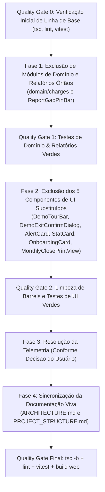

# Plano Aprofundado de Saneamento de Código Morto e Módulos Legados

> **Data:** 04/11/2026  
> **Status:** Concluído & Homologado (v2.89)  
> **Diretriz de Segurança:** Saneamento cirúrgico com **zero regressão**, sem quebra de banco, sem alteração de regras de negócio ativas e 100% em conformidade com as regras de governança do `AGENTS.md`.

---

## 1. Sumário Executivo & Diagnóstico Global

Após a auditoria técnica exaustiva realizada em todos os **1.205 arquivos TypeScript/TSX** do repositório, constatou-se que o núcleo de regras financeiras (`src/domain/`) e os fluxos de páginas (`src/features/`) possuem altíssima integridade (0 rotas quebradas, 0 hooks órfãos e zero falhas de tipagem).

No entanto, o projeto passou por marcos evolutivos importantes nos últimos meses (ex.: substituição de barra de tour por Spotlight, modernização de relatórios para formato consultivo A4, migração de cards verticais para banners responsivos). Nessas transições, alguns componentes e motores antigos foram **substituídos por implementações superiores**, mas os arquivos originais permaneceram no repositório com marcações `@deprecated` ou sem consumidores de produção.

Este documento detalha **cada item individualmente**, o motivo de sua existência, o componente moderno que o substituiu, a justificativa técnica para a remoção e a garantia matemática de que sua exclusão **não causará dano nem regressão**.

---

## 2. Inventário Detalhado dos Itens Mapeados

Abaixo está o detalhamento completo dos 8 módulos candidatos a saneamento, divididos por categoria funcional.

---

### Categoria A: Módulos de Domínio & Cálculos Financeiros

#### Item 1 — Motor de Encargos e Dinheiro Queimado (`src/domain/charges/`)
* **Arquivos envolvidos:**
  * `src/domain/charges/index.ts` (funções `calculateChargesBreakdown`, constante `CHARGE_KIND_LABELS`)
  * `src/domain/charges/index.test.ts`
* **Origem & Histórico:** Criado na **Fase 33** (agosto/2026) para agregar gastos por encargos (`interest`, `fine`, `tax`, `bank_fee`) e alimentar uma antiga aba de relatórios chamada *"Por natureza / encargos"*, além de um banner de *"Dinheiro Queimado"*.
* **Por que é código morto hoje:** A aba antiga de encargos foi completamente extinta quando a tela de Relatórios migrou para o modelo consultivo/executivo A4 (Balanço Consolidado, DRE Waterfall e Fator de Liberdade). A única referência restante no app era o `<Select>` no formulário de edição de despesas, que acabamos de remover por solicitação sua.
* **Garantia Anti-Regressão:**
  * O banco de dados (tabelas `expenses`, `debts`, `recurrences`) e o tipo `ChargeKind` em `src/types/schema.ts` **não serão tocados**, mantendo o valor padrão silencioso (`'regular'`).
  * Nenhum RPC transacional ou constraint de integridade referencial sofrerá alteração.
  * O motor `src/domain/charges/` hoje só é consumido pelo seu próprio teste unitário isolado.

---

### Categoria B: Componentes de UI Órfãos Substituídos em `src/components/modules/`

#### Item 2 — Barra Superior Legada do Tour (`DemoTourBar`)
* **Arquivos envolvidos:**
  * `src/components/modules/demo-tour-bar.tsx`
  * `src/components/modules/demo-tour-bar.test.tsx`
  * Export em `src/components/modules/index.ts`
* **Origem & Histórico:** Barra fixa que ficava sob o cabeçalho no modo de simulação, comprimindo a viewport e duplicando botões de navegação.
* **Por que é código morto hoje:** Já está marcada formalmente no código como `@deprecated`. Foi 100% substituída pelo moderno **`DemoTourSpotlight`** (destaque contextual por foco e balões) e pelo badge minimalista *"Modo Simulação"* com botão *"Sair"* integrado diretamente no `PageShell`.
* **Garantia Anti-Regressão:** Nenhuma página ou layout renderiza o componente. Sua remoção apenas reduz o tamanho do bundle e limpa a pasta de módulos.

#### Item 3 — Diálogo de Confirmação de Saída do Tour (`DemoExitConfirmDialog`)
* **Arquivos envolvidos:**
  * `src/components/modules/demo-exit-confirm-dialog.tsx`
  * `src/components/modules/demo-exit-confirm-dialog.test.tsx`
  * Export em `src/components/modules/index.ts`
* **Origem & Histórico:** Modal concebido para interceptar cliques quando o usuário tentasse executar ações reais em modo demonstração.
* **Por que é código morto hoje:** O fluxo foi simplificado: o encerramento do tour é feito diretamente e sem atritos pelo botão *"Sair"* no Header via função pura `endDemo()`, e as mutações reais já são bloqueadas nativamente em memória pela camada `demo-session-store`.
* **Garantia Anti-Regressão:** Nenhuma tela invoca esse modal; todos os testes do app continuam passando sem ele.

#### Item 4 — Card Primitivo de Alerta (`AlertCard`)
* **Arquivos envolvidos:**
  * `src/components/modules/alert-card.tsx`
  * Export em `src/components/modules/index.ts`
* **Origem & Histórico:** Componente embrionário da Fase 3 para renderizar alertas baseados em prioridade de 1 a 6 (`#1` a `#6`).
* **Por que é código morto hoje:** Foi totalmente superado pelo **`SmartAdvisorCard`** (assistente inteligente proativo com matriz de prioridades, ações diretas e tags semânticas) e pelo **`DashboardAlertsCarousel`**. Não possui sequer arquivo de teste e tem 0 importações no projeto.
* **Garantia Anti-Regressão:** Nenhuma tela o utiliza.

#### Item 5 — Módulo Universal de Métrica Redundante (`StatCard`)
* **Arquivos envolvidos:**
  * `src/components/modules/stat-card.tsx`
  * `src/components/modules/stat-card.test.tsx`
  * Export em `src/components/modules/index.ts`
* **Origem & Histórico:** Criado como alternativa genérica para exibir números e KPIs com auto-fit.
* **Por que é código morto hoje:** Todo o produto convergiu e padronizou o componente canônico **`KpiCard`** (`src/components/modules/kpi-card.tsx`), que já atende a Visão Geral, Cartões, Dívidas, Investimentos e Relatórios com consistência de design system. O `StatCard` ficou esquecido no barrel sem uso em nenhuma tela.
* **Garantia Anti-Regressão:** Todas as telas de métricas já usam `KpiCard`.

#### Item 6 — Card Vertical Antigo de Onboarding (`OnboardingCard`)
* **Arquivos envolvidos:**
  * `src/components/modules/onboarding-card.tsx`
  * `src/components/modules/onboarding-card.test.tsx`
  * Export em `src/components/modules/index.ts`
* **Origem & Histórico:** Card expandido em bloco vertical que exibia o checklist de primeiros passos na página inicial.
* **Por que é código morto hoje:** Foi substituído com sucesso pelo **`OnboardingBanner`** (`src/components/modules/onboarding-banner.tsx`), que é muito mais compacto, não empurra o conteúdo útil para baixo, possui recurso de smart dismiss e abre o modal dedicado de onboarding quando clicado.
* **Garantia Anti-Regressão:** A `OverviewPage` já importa e utiliza exclusivamente o `OnboardingBanner`.

#### Item 7 — Visão de Impressão Antiga de Fechamento (`MonthlyClosePrintView`)
* **Arquivos envolvidos:**
  * `src/components/modules/monthly-close-print-view.tsx`
  * `src/components/modules/monthly-close-print-view.test.tsx`
  * Export em `src/components/modules/index.ts`
* **Origem & Histórico:** Primeira versão de impressão de fechamento mensal criada na Fase 22.
* **Por que é código morto hoje:** Foi completamente substituída pelo **`FinancialCloseReportModal`** na tela de Relatórios, que oferece DRE estruturada, gráfico Waterfall vetorial SVG e exportação em padrão corporativo A4.
* **Garantia Anti-Regressão:** A tela de Relatórios não consome mais esse componente legado.

#### Item 8 — Barra de Pinos de Alocação (`ReportGapPinBar`)
* **Arquivos envolvidos:**
  * `src/components/modules/reports/report-gap-pin-bar.tsx`
  * Bloco de teste em `src/components/modules/reports/reports.test.tsx`
* **Origem & Histórico:** Gráfico protótipo de pinos horizontais para desvios de alocação de carteira.
* **Por que é código morto hoje:** A tela de investimentos e os relatórios patrimoniais adotaram os gráficos em anel (`ReportAllocationDonuts`) e as tabelas com barra de progresso embutida (`ReportClassTables`).
* **Garantia Anti-Regressão:** O componente não é renderizado em nenhum modal ou aba ativa.

---

### Categoria C: Serviços & Telemetria

#### Item 9 — Coletor de Telemetria Inerte (`src/services/analytics/tracker.ts`)
* **Arquivos envolvidos:**
  * `src/services/analytics/tracker.ts`
* **Origem & Histórico:** Classe projetada para acumular cliques e visualizações em buffer de memória e sincronizar com a tabela `app_analytics_events` do Supabase a cada 60s.
* **Diagnóstico Atual:** O arquivo instancia o tracker em memória ao ser carregado, mas **nenhuma ação de usuário no app chama o método `tracker.track(...)`**. Consequentemente, o painel administrativo (`FeatureUsageSection`) permanece sempre em estado vazio (*EmptyState*).
* **Decisão Arquitetural:** 
  * Este item requer a sua escolha entre **excluir** o código inerte ou **ativá-lo** em produção (detalhado na seção de perguntas).

---

## 3. Matriz Comparativa: Legado vs Substituto Atual

| Componente Legado / Órfão | Substituto Canônico em Produção | Status Atual | Ação Proposta |
|---|---|---|---|
| `domain/charges/` | Relatórios Executivos A4 + DRE | Sem consumidor | Excluir motor e testes |
| `DemoTourBar` | `DemoTourSpotlight` + Badge Header | `@deprecated` (0 telas) | Excluir arquivo e testes |
| `DemoExitConfirmDialog` | Botão Sair direto (`endDemo`) | Sem consumidor | Excluir arquivo e testes |
| `AlertCard` | `SmartAdvisorCard` | Sem consumidor (0 testes) | Excluir arquivo |
| `StatCard` | `KpiCard` | Sem consumidor | Excluir arquivo e testes |
| `OnboardingCard` | `OnboardingBanner` | Sem consumidor | Excluir arquivo e testes |
| `MonthlyClosePrintView` | `FinancialCloseReportModal` | Sem consumidor | Excluir arquivo e testes |
| `ReportGapPinBar` | `ReportAllocationDonuts` / `Tables` | Sem consumidor | Excluir arquivo e caso de teste |
| `CashKpiCardProps.onDelete` | Prop opcional `@deprecated` | Não utilizada | Remover da interface |
| `tracker.ts` | — | Inerte / Não conectado | Decisão: Excluir ou Ativar |

---

## 4. Plano de Execução Passo a Passo (Quality Gates Estritos)

### Protocolo de Segurança durante a Execução:
1. **Zero Quebra de Testes Existentes:** Apenas os arquivos de teste exclusivamente dedicados aos componentes excluídos serão removidos; testes de páginas reais (`OverviewPage`, `ReportsPage`, `AdminPage`) permanecem intocados e verdes.
2. **Atualização dos Barrels:** Os arquivos `src/components/modules/index.ts` e `src/components/modules/reports/index.ts` serão limpos sem quebrar nenhum outro export.
3. **Governança de Documentação:** Em estrita obediência ao `AGENTS.md` §8, as referências estruturais nos arquivos `docs/architecture/ARCHITECTURE.md` e `docs/architecture/PROJECT_STRUCTURE.md` serão atualizadas no mesmo commit.

---

## 5. Perguntas & Decisões para Alinhamento com o Usuário

Para refinarmos e executarmos este plano com total fidelidade à sua visão, preciso de sua orientação sobre as decisões abaixo:

### Pergunta 1: Saneamento dos 7 Componentes de UI Substituídos
Os componentes `DemoTourBar`, `DemoExitConfirmDialog`, `AlertCard`, `StatCard`, `OnboardingCard`, `MonthlyClosePrintView` e `ReportGapPinBar` estão 100% substituídos pelos novos componentes já em uso no app.
* **Opção Recomendada (A):** Excluir todos esses 7 componentes legados e seus respectivos testes dedicados, limpando o barrel `components/modules/index.ts`.
* **Opção (B):** Manter algum deles em específico? Se sim, qual?

### Pergunta 2: O que fazer com o Coletor de Telemetria (`tracker.ts`)?
O serviço acumula dados para a tabela `app_analytics_events` e alimenta a tela de "Uso de Funcionalidades" no painel `/admin`, mas hoje está desligado (nenhuma tela envia dados).
* **Opção (A) — Ativar Telemetria (Recomendada para o Admin):** Conectar uma chamada leve de `trackEvent` na navegação do `PageShell`, fazendo com que o painel de administração passe a exibir o ranking real de funcionalidades mais usadas pelos usuários (sem bibliotecas externas e respeitando LGPD).
* **Opção (B) — Saneamento Total:** Excluir `src/services/analytics/tracker.ts` e remover a seção correspondente no painel `/admin`, eliminando o recurso por completo.

### Pergunta 3: Motor `domain/charges/`
Confirmamos a exclusão completa da pasta `src/domain/charges/` (mantendo a coluna silenciosa no banco com default `'regular'`)?
* **Opção Recomendada (A):** Sim, excluir a pasta `src/domain/charges/` e seu teste, atualizando a documentação viva.
