# 🎯 Plano Mestre de Auditoria, Blindagem e Implementação Técnica: Axir (v3.1.0)
## Master Plan de Segurança, Motores Financeiros, Infraestrutura, Congruência de Regras e UI/UX

> **Status:** 100% Concluído & Homologado (Todas as 8 Fases Implementadas e Aprovadas)  
> **Classificação:** 🔵 Fluxo Completo de Engenharia — Auditoria Global, Blindagem e Refinamento de Plataforma  
> **Base de Governança:** `AGENTS.md` (33 Regras Canônicas) · `ESPECIFICACAO_TECNICA.md` · `FINANCIAL_MATH_SPEC.md` · `DESIGN_SYSTEM.md`  
> **Quality Gate Global:** `npm run verify` por fase (`tsc -b`, `eslint`, `vitest src/domain/`) · `npm run verify:full` no encerramento · Bump para `v3.1.0`.

---

## 1. Sumário Executivo & Diagnóstico da Auditoria Global

Este documento consolida a revisão técnica e arquitetural mais aprofundada do ecossistema **Axir**, sanando **fragilidades de segurança, incongruências com as regras do `AGENTS.md`, caminhos de arquivo fictícios, dependências desatualizadas e desvios de precisão matemática**.

### 1.1. Matriz de Incongruências do Plano Remoto vs. Arquitetura Real do Axir

| Item / Módulo | Apontamento no Plano Remoto | Realidade da Arquitetura do Axir | Ação Corretiva no Plano Expandido |
|---|---|---|---|
| **Estrutura de Pastas de Telas** | Mencionava `src/pages/Login.tsx`, `src/pages/Trips.tsx`, `src/pages/FamilyBudget.tsx`, `src/pages/Reports.tsx` | O app adota Feature Slices (`src/features/*/pages/*`) com kebab-case | Corrigido para `src/features/auth/pages/login-page.tsx`, `src/features/trips/pages/trip-details-page.tsx`, `src/features/family/pages/family-page.tsx`, `src/features/reports/pages/reports-page.tsx` |
| **Camada de Autenticação** | Supunha `src/contexts/AuthContext.tsx` e `ProtectedRoute.tsx` | Não há contextos React de auth. Usa singleton reativo em `src/hooks/use-auth.ts` e guard `src/components/routing/require-active-account.tsx` | Mapeado para `use-auth.ts`, `data/auth.ts` e criação de guard estrito de AAL2 |
| **Tabelas do Modo Viagem** | Mencionava `trip_participants` | A tabela oficial no PostgreSQL é `trip_members` | Alinhado com o schema canônico de migrations (`20260101000094+`) |
| **Rota do Racha de Despesas** | Mencionava `/racha/:id` ou `/split/:hash` | A rota real é `/r/:token` (`src/features/public-share/pages/split-public-page.tsx`) | Corrigido e integrado com `public_shares` |
| **Dependência Biométrica** | Sugeria `@capacitor-community/biometric-auth` | O app já utiliza `@aparajita/capacitor-biometric-auth` (^10.0.0) | Reuso estrito da biblioteca nativa existente sem inflar o `package.json` |
| **Gerador de QR Code** | Sugeria libs genéricas e usava serviço externo `api.qrserver.com` | O app possui gerador local puro com `uqr` (`src/domain/pix/qr-code.ts` e `QrCodeCanvas`) | Eliminação total de serviços terceiros externos; uso 100% offline e seguro do `QrCodeCanvas` |
| **Importações de Dados** | Permitia chamadas diretas a `@/data` em telas | A Regra 3 e 45 do `AGENTS.md` proíbe telas de tocarem `@/data/` | Criação da Fase 5 para isolar `@/data` via `@/state` e travar no ESLint |
| **Cabeçalhos de Páginas** | Omitia cabeçalhos ou usava `<h1>` solto | Regra 21 exige `<PageHeader />` unificado em todas as telas | Criação da Fase 6 para unificar cabeçalhos em `cards-page`, `transactions-page` e `trips` |
| **Formatação PT-BR** | Permitia `.toFixed()` em JSX | Regra 28 exige `formatPercent` e `formatCentsAsBRL` (vírgula brasileira) | Criação da Fase 7 para erradicar `.toFixed()` soltos em JSX |

---

### 1.2. Mapeamento de Fragilidades Técnicas e Incongruências de Regras

```mermaid
flowchart TD
    subgraph Diagnóstico Completo da Auditoria
        A1["1. Bypass de 2FA em reload por falta de trava AAL2 em require-active-account"]
        A2["2. Falta de tabela pública para controle e revogação remota de dispositivos"]
        A3["3. App Lock aborta no PWA por trava isNativePlatform e falta PIN numérico"]
        A4["4. Omissão da Tag 01 EMVCo no BR Code Pix, rejeitado por apps bancários"]
        A5["5. Chamadas a api.qrserver.com quebrando offline e vazando links de convite"]
        A6["6. Distorção contábil em balances da Viagem por misturar settlements no paidMap"]
        A7["7. Descarte de participantes em create-trip-dialog por falta de auto-inclusão"]
        A8["8. Aporte proporcional pulverizando compras em dezenas de frações"]
        A9["9. Imports diretos de @/data em telas e modais violando Regras 3 e 45"]
        A10["10. Controles nativos e drag-over manual em attach-receipt-dialog (Regras 4 e 7)"]
        A11["11. Botões de chip repetidos 8+ vezes sem componente canônico (Regra DRY #4)"]
        A12["12. Páginas de Cartões e Transações sem PageHeader unificado (Regra 21)"]
        A13["13. Uso de .toFixed em JSX gerando ponto decimal anglo-saxão (Regra 28)"]
        A14["14. Truncamento cego em cards de alertas e insights (Regra 23)"]
        A15["15. Opacidades divergentes de borda border-border/60 (Regra 16)"]
    end

    A1 --> F1["Fase 1: Segurança e Sessões"]
    A2 --> F1
    A3 --> F1

    A6 --> F2["Fase 2: Motores Financeiros"]
    A7 --> F2
    A8 --> F2

    A4 --> F3["Fase 3: Infraestrutura e Pix"]
    A5 --> F3

    A11 --> F4["Fase 4: Ergonomia de UI/UX"]

    A9 --> F5["Fase 5: Blindagem Arquitetural"]
    A10 --> F5

    A12 --> F6["Fase 6: Harmonização de Cabeçalhos"]
    A14 --> F6
    A15 --> F6

    A13 --> F7["Fase 7: Padronização PT-BR"]

    F1 --> F8["Fase 8: Homologação e Quality Gate"]
    F2 --> F8
    F3 --> F8
    F4 --> F8
    F5 --> F8
    F6 --> F8
    F7 --> F8
```



---

## 2. Sumário do Pipeline Expandido de 8 Fases

```
[Fase 1: Segurança, Gestão de Sessões e Autenticação Robusta]
   ├── Etapa 1.1: Multi-Sessão Concorrente, Registro de Dispositivos (user_devices) e Revogação
   ├── Etapa 1.2: Interceptação Obrigatória de 2FA (AAL2) no Login e Guards de Rota
   └── Etapa 1.3: App Lock Híbrido (Biometria Nativa, WebAuthn e PIN Numérico de Fallback)
   └── [Quality Gate 1: npm run verify]

[Fase 2: Motores Financeiros e Integridade Transacional]
   ├── Etapa 2.1: Sincronização Bidirecional e Amortização Cronológica do Racha
   ├── Etapa 2.2: Persistência Atômica e Balanço Contábil Preciso no Modo Viagem
   └── Etapa 2.3: Rebalanceamento Otimizado (Menos Movimentações) e Renda Fixa por Indexador
   └── [Quality Gate 2: npm run verify]

[Fase 3: Infraestrutura Transversal, Pix EMVCo e Ciclo de Plataforma]
   ├── Etapa 3.1: Padronização EMVCo Tag 01 para Pix e Eliminação de Serviços Externos
   └── Etapa 3.2: Racionalização de Atualizações e Detecção de Plataforma (PWA vs. APK)
   └── [Quality Gate 3: npm run verify]

[Fase 4: Refinamento de Interface, Acessibilidade e Governança AGENTS.md]
   ├── Etapa 4.1: Calculadora com Digitação RTL Fluida e Leitura de Clipboard
   ├── Etapa 4.2: Reorganização Hierárquica da Família e Empty States Calmos em Relatórios
   └── Etapa 4.3: Topologia de Cabeçalhos e Ações no Modo Viagem (<PageHeader />)
   └── [Quality Gate 4: npm run verify]

[Fase 5: Blindagem Arquitetural de Dados, Isolamento e Governança (Regras 3, 45 e 7)]
   ├── Etapa 5.1: Isolamento Estrito da Camada @/data e Bloqueio no ESLint
   ├── Etapa 5.2: Reuso de Primitivos e Eliminação de Controles em Comprovantes (<Dropzone />)
   └── Etapa 5.3: Criação do Primitivo Canônico de Seleção Rápida (<Chip />)
   └── [Quality Gate 5: npm run verify]

[Fase 6: Harmonização de Cabeçalhos e Superfícies Visuais (Regras 16, 21 e 23)]
   ├── Etapa 6.1: Cabeçalhos Canônicos com <PageHeader /> em Cartões e Transações
   ├── Etapa 6.2: Unificação da Trinca de Elevação (border-border/80 bg-surface shadow-xs)
   └── Etapa 6.3: Blindagem contra Truncamento Cego em Cabeçalhos Compostos
   └── [Quality Gate 6: npm run verify]

[Fase 7: Padronização Linguística e Precisão Matemática PT-BR (Regras 11, 28 e 33)]
   ├── Etapa 7.1: Erradicação Completa de .toFixed() Soltos em JSX (formatPercent / formatCentsAsBRL)
   ├── Etapa 7.2: Explicabilidade Matemática Ativa em KPIs Compostos (Equation Popovers)
   └── Etapa 7.3: Extração de Cálculos Financeiros Residuais para Funções Puras de Domínio
   └── [Quality Gate 7: npm run verify]

[Fase 8: Homologação Final, Testes E2E de Fumaça e Version Bump (Quality Gate Global)]
   ├── Etapa 8.1: Execução da Suíte Completa de Sanidade (Playwright Smoke E2E)
   ├── Etapa 8.2: Version Bump Semântico v3.1.0 (MINOR) e Sincronização de Service Worker
   └── Etapa 8.3: Arquivamento e Atualização Canônica do ROADMAP.md
   └── [Quality Gate 8: npm run verify:full 100% Aprovado]
```

---

## 3. Detalhamento Operacional das 8 Fases

---

### FASE 1: Segurança, Gestão de Sessões e Autenticação Robusta

#### Etapa 1.1: Multi-Sessão Concorrente, Registro de Dispositivos e Revogação

```markdown
### DIRETIVA DE ENGENHARIA: ETAPA 1.1

[ARQUIVOS-ALVO]
- Nova Migration: `supabase/migrations/20260101000112_user_devices_and_session_management.sql`
- Camada de Dados: `src/data/repositories/devices.ts`, `src/data/rpc/auth-sessions.ts`
- Estado TanStack Query: `src/state/queries/use-devices.ts`, `src/state/mutations/use-device-mutations.ts`
- Interface: `src/features/settings/components/tabs/security/active-devices-card.tsx`
- Hooks: `src/hooks/use-auth.ts`, `src/services/native/device-info.ts`

[DIAGNÓSTICO E REGRAS DE NEGÓCIO]
1. Sessões Concorrentes: O Supabase Auth suporta múltiplos refresh tokens por padrão, mas a aplicação precisa de uma tabela associativa pública para rastrear os dispositivos conectados com metadados amigáveis (IP, User-Agent, navegador, sistema operacional e última atividade).
2. Revogação Remota Segura:
   - O usuário visualiza todos os aparelhos conectados com badge "Dispositivo Atual" no aparelho em uso.
   - Revogação de aparelho remoto exige desafio de segurança:
     * Se usuário tiver MFA/2FA ativo (AAL2): exige código TOTP de 6 dígitos.
     * Se usuário NÃO tiver MFA ativo: exige confirmação da senha atual (`verifyCurrentPassword`).
   - Logout no próprio aparelho continua sendo instantâneo via `signOut`.

[PLANO DE IMPLEMENTAÇÃO]
1. Criar migration com a tabela `public.user_devices`:
   - Colunas: `id` (uuid pk), `user_id` (uuid fk auth.users), `device_id` (text), `device_name` (text), `browser` (text), `os` (text), `ip_address` (text), `last_seen_at` (timestamptz), `created_at` (timestamptz), `is_revoked` (boolean).
   - RLS: Select e Delete restritos a `auth.uid() = user_id`.
   - RPC `revoke_device_session(p_device_id uuid, p_auth_code text)`: valida permissão e encerra a sessão.
2. No cliente (`src/services/native/device-info.ts`):
   - Extrair identificador estável de dispositivo (`localStorage` / `Capacitor Device`).
   - Atualizar `last_seen_at` no login e com throttle de 24 horas.
3. Na UI (`SecurityTab` -> `ActiveDevicesCard`):
   - Listar dispositivos com badges canônicos e diálogo de confirmação seguro (`Modal size="sm"`).
```

---

#### Etapa 1.2: Interceptação Obrigatória de 2FA (AAL2) no Login e Guards de Rota

```markdown
### DIRETIVA DE ENGENHARIA: ETAPA 1.2

[ARQUIVOS-ALVO]
- Camada de Auth: `src/features/auth/pages/login-page.tsx`, `src/data/auth.ts`, `src/hooks/use-auth.ts`
- Guardiões de Rota: `src/components/routing/require-active-account.tsx`
- Roteador: `src/app/router.tsx`
- Testes: `src/features/auth/pages/login-page.test.tsx`, `src/components/routing/require-active-account.test.tsx`

[DIAGNÓSTICO E REGRAS DE NEGÓCIO]
1. Brecha Identificada: Ao autenticar com e-mail e senha, a chamada `signInWithPassword` emite `SIGNED_IN` e o `useAuth()` salva a sessão em memória e storage. Mesmo que o `login-page.tsx` mostre a tela de TOTP, se o usuário alterar a URL no navegador ou atualizar a página (F5), `require-active-account.tsx` permitia o acesso direto por checar apenas `session?.user`.
2. Requisito Inegociável: Nenhuma rota protegida pode ser renderizada para contas que possuem 2FA habilitado enquanto o nível de garantia não atingir `aal2`.

[PLANO DE IMPLEMENTAÇÃO]
1. No `src/hooks/use-auth.ts`:
   - Adicionar ao `AuthStateSnapshot`:
     `mfaRequired: boolean;`
     `mfaVerified: boolean;`
     `aalLevel: 'aal1' | 'aal2' | null;`
   - Na inicialização (`initGlobalAuth`) e no `onAuthStateChange`:
     Consultar `supabase.auth.mfa.getAuthenticatorAssuranceLevel()`. Se `currentLevel === 'aal1' && nextLevel === 'aal2'`, marcar `mfaRequired = true` e `mfaVerified = false`.
2. No Guard de Rota (`src/components/routing/require-active-account.tsx`):
   - Se `mfaRequired && !mfaVerified`, interceptar imediatamente e redirecionar para `/entrar?desafio=totp` com `replace`.
3. No `src/features/auth/pages/login-page.tsx`:
   - Tratar o parâmetro `?desafio=totp`: se o usuário já possui sessão `aal1` mas falta o desafio `aal2`, exibir imediatamente o formulário de código de 6 dígitos sem solicitar e-mail e senha novamente.
   - Ao verificar o código com sucesso (`supabase.auth.mfa.challengeAndVerify`), atualizar o estado global para `mfaVerified = true` e liberar a navegação para o dashboard.
```

---

#### Etapa 1.3: App Lock Híbrido (Biometria Nativa, WebAuthn e PIN de Fallback)

```markdown
### DIRETIVA DE ENGENHARIA: ETAPA 1.3

[ARQUIVOS-ALVO]
- Serviços: `src/services/native/app-lock.ts`, `src/services/native/biometrics.ts`, `src/services/native/pin-lock.ts`
- Componentes: `src/app/app-lock-overlay.tsx`, `src/components/ui/pin-input.tsx`
- Configurações: `src/features/settings/components/tabs/security-tab.tsx`
- Testes: `src/services/native/app-lock.test.ts`, `src/app/app-lock-overlay.test.tsx`

[DIAGNÓSTICO E REGRAS DE NEGÓCIO]
1. Falha Atual: `app-lock.ts` bloqueia apenas no Android nativo. No PWA e navegador desktop, o app não trava.
2. Solução Híbrida:
   - APK Nativo (Capacitor): Biometria de hardware via `@aparajita/capacitor-biometric-auth`.
   - PWA / Navegador: Suporte a Web Authentication (`PublicKeyCredential` com biometria do sistema operacional como Windows Hello / Touch ID no Safari) ou PIN Numérico Local seguro de 4 a 6 dígitos.
   - O PIN é armazenado em `localStorage` cifrado com salt e hash SHA-256 (`crypto.subtle.digest`).
3. Comportamento:
   - O App Lock é um bloqueio local rápido (não faz logout no Supabase).
   - Ao minimizar e reabrir o app após o tempo de tolerância configurado (0 a 15 minutos), o `AppLockOverlay` cobre a tela com `backdrop-blur-md z-[100]`.
   - Oferece botão "Desbloquear com Biometria" e opção alternativa "Usar PIN".
   - Botão de emergência "Sair da Conta": executa `signOut()` e limpa o estado.
```

---

### Quality Gate 1: Critérios de Aceite da Fase 1

- [x] Multi-sessão: Autenticar a mesma conta em dois aparelhos diferentes mantém ambos conectados.
- [x] Painel de Dispositivos: Lista o aparelho atual com badge distintivo e permite revogar dispositivos remotos mediante confirmação segura.
- [x] Blindagem 2FA: Usuário com 2FA ativo que atualizar a página após digitar e-mail/senha é retido na tela de desafio TOTP; rotas internas recusam renderização sem `aal2`.
- [x] App Lock PWA: No navegador, minimizar o app ou trocar de aba por período superior à tolerância ativa o `AppLockOverlay`.
- [ ] PIN Fallback: Permite desbloqueio local por PIN de 4 a 6 dígitos quando a biometria falhar ou não estiver disponível no hardware.
- [ ] Validação estrita: `npm run verify` executado sem erros de lint, tipo ou testes de domínio.

---

### FASE 2: Motores Financeiros e Integridade Transacional

#### Etapa 2.1: Sincronização Bidirecional e Amortização Cronológica do Racha

```markdown
### DIRETIVA DE ENGENHARIA: ETAPA 2.1

[ARQUIVOS-ALVO]
- Domínio Matemático Puro: `src/domain/finance/split-math.ts`, `src/domain/finance/split-math.test.ts`
- Serviços de Sincronização: `src/services/split-sync.ts`, `src/services/split-sync.test.ts`
- Telas e Modais: `src/components/modules/manage-split-dialog.tsx`, `src/features/public-share/pages/split-public-page.tsx`
- Hooks & Mutations: `src/state/mutations/use-public-share-mutations.ts`

[DIAGNÓSTICO E REGRAS DE NEGÓCIO]
1. Falha de Carregamento Anônimo: Na página pública `/r/:token`, a query `useCategories` disparava sem `enabled: Boolean(session?.user)`, gerando falha de RLS no Supabase para visitantes não autenticados.
2. Amortização Cronológica Estrita de Parcelas:
   - Quando um amigo paga uma fração da sua cota (ex.: R$ 80 de um racha de 3x R$ 50 = R$ 150), o sistema NÃO pode zerar todas as parcelas ou mantê-las todas pendentes.
   - O abatimento deve ocorrer em ordem cronológica estrita de parcelas em aberto:
     * Parcela 1 (R$ 50): totalmente quitada (`is_settled: true`, `report_weight: 0`).
     * Parcela 2 (R$ 50): amortizada em R$ 30 (`is_settled: false`, `settled_cents: 3000`, `report_weight` recalculado proporcionalmente).
     * Parcela 3 (R$ 50): intacta e pendente (`is_settled: false`, `report_weight: 1`).
3. Reabertura (Desfazer Baixa): Reabrir uma parcela ou cota reverte o `report_weight` da despesa original no cartão para o valor original e atualiza o saldo da dívida integrada.

[PLANO DE IMPLEMENTAÇÃO]
1. Em `src/domain/finance/split-math.ts`:
   - Implementar `amortizeSettlementAcrossInstallments(installments, paymentCents)`: função pura em centavos inteiros com testes unitários cobrindo liquidação total, amortização parcial e sobrepagamento.
2. Em `src/components/modules/manage-split-dialog.tsx`:
   - Integrar a amortização cronológica em `handleConfirmCustomSettle` e sincronizar os `report_weight` via `syncSplitExpenseReportWeights`.
3. Em `src/features/public-share/pages/split-public-page.tsx`:
   - Condicionar a busca de categorias a `enabled: Boolean(session?.user)`.
```

---

#### Etapa 2.2: Persistência Atômica e Balanço Contábil Preciso no Modo Viagem

```markdown
### DIRETIVA DE ENGENHARIA: ETAPA 2.2

[ARQUIVOS-ALVO]
- Domínio Matemático Puro: `src/domain/trips/trip-math.ts`, `src/domain/trips/trip-math.test.ts`
- Repositório & RPC: `src/data/repositories/trips.ts`, `src/data/rpc/trips.ts`
- Telas e Modais: `src/features/trips/components/create-trip-dialog.tsx`, `src/features/trips/pages/trip-details-page.tsx`, `src/features/trips/components/trip-settlement-dialog.tsx`

[DIAGNÓSTICO E REGRAS DE NEGÓCIO]
1. Perda de Participantes na Criação:
   - No `CreateTripDialog`, se o usuário digitar o nome em `newMemberName` e submeter diretamente o modal, o participante pendente deve ser automaticamente incorporado à lista `members` antes do envio.
   - A RPC `create_trip` no banco deve receber `p_initial_members` em JSONB e realizar a inserção atômica sem supressão indevida por conflito.
2. Correção da Divergência Contábil no Extrato:
   - Em `src/domain/trips/trip-math.ts` (`calculateMemberBalances`):
     É expressamente PROIBIDO deduzir acertos (`settlements`) do `totalPaidCents` de despesas.
   - Nova modelagem da estrutura de balanço por membro (`TripMemberBalance`):
     ```ts
     export interface TripMemberBalance {
       memberId: string;
       name: string;
       expensesPaidCents: number;       // Total gasto diretamente pelo membro em compras
       expensesOwedCents: number;       // Total consumido/devido pelo membro em cotas
       grossBalanceCents: number;       // Saldo operacional bruto: expensesPaid - expensesOwed
       settlementsPaidCents: number;    // Total pago em liquidações a credores
       settlementsReceivedCents: number;// Total recebido em liquidações de devedores
       netBalanceCents: number;         // Saldo residual final: grossBalance + settlementsPaid - settlementsReceived
     }
     ```
   - Invariantes matemáticas obrigatórias:
     $$\sum \text{grossBalanceCents} = 0 \quad \text{e} \quad \sum \text{netBalanceCents} = 0$$
```

---

#### Etapa 2.3: Rebalanceamento Otimizado (Menos Movimentações) e Renda Fixa por Indexador

```markdown
### DIRETIVA DE ENGENHARIA: ETAPA 2.3

[ARQUIVOS-ALVO]
- Domínio Matemático Puro: `src/domain/portfolio/aporte.ts`, `src/domain/portfolio/aporte.test.ts`, `src/domain/portfolio/fixed-income.ts`
- Telas de Investimentos: `src/features/investments/pages/aporte-tab.tsx`, `src/features/investments/pages/targets-tab.tsx`
- Alertas e Calendário: `src/features/overview/hooks/use-overview-alerts.ts`, `src/features/investments/components/pending-dividends-dialog.tsx`

[DIAGNÓSTICO E REGRAS DE NEGÓCIO]
1. Estratégias Configuráveis de Aporte:
   - **Modo Otimizado (Menos Movimentações - Padrão Inteligente):**
     Calcula o déficit percentual relativo de cada ativo:
     $$\text{Defasagem Relativa} = \frac{\text{Alvo} - \text{Atual}}{\text{Alvo}}$$
     Concentra o montante disponível exclusivamente no ativo mais defasado até que este atinja a mesma defasagem do segundo ativo mais defasado. Se ainda houver sobra de capital, divide a verba entre os dois até empatarem com o terceiro, minimizando custos de corretagem e pulverização de ordens.
   - **Modo Distribuído (Proporcional):**
     Distribui a verba proporcionalmente entre todos os ativos subalocados com base no gap financeiro individual.
2. Metas de Renda Fixa por Indexador Macro:
   - Permitir agrupar títulos de Renda Fixa por indexador: Pós-fixado (CDI/Selic), Inflação (IPCA+) e Prefixado.
   - O cálculo de alocação de carteira avalia o balanceamento entre os indexadores antes do título individual.
3. Alerta e Calendário de Proventos Provisionados:
   - Quando `calculateSuggestedDividends` identificar eventos com Data COM cumprida:
     * Exibir card de destaque no carrossel da Home (`DashboardAlertsCarousel`): *"R$ X em proventos previstos para receber este mês"*.
     * Incluir no Calendário Financeiro com status de `PROVISIONADO` (cor informativa, sem somar no saldo líquido de caixa).
     * Exigir confirmação manual do usuário via `PendingDividendsDialog` para efetivar o crédito na conta.
```

---

### Quality Gate 2: Critérios de Aceite da Fase 2

- [x] Racha público: Link `/r/:token` carrega corretamente para usuários anônimos e logados sem exceção de banco.
- [x] Amortização cronológica: Registro de pagamento parcial quita a parcela 1 e amortiza o saldo na parcela 2, recalculando os `report_weight` no cartão de crédito.
- [x] Conservação do Modo Viagem: `calculateMemberBalances` garante exatidão de centavos ($\sum \text{grossBalanceCents} = 0$ e $\sum \text{netBalanceCents} = 0$) sem distorcer o Total Pago em despesas.
- [x] Aporte Otimizado: Alternar para "Menos Movimentações" concentra a compra no ativo mais defasado em vez de pulverizar em dezenas de frações.
- [x] Proventos: Proventos provisionados constam no calendário sem entrar no saldo de caixa sem confirmação expressa do usuário.
- [x] Validação estrita: `npm run verify` aprovado com 100% de testes verdes.

---

### FASE 3: Infraestrutura Transversal, Pix EMVCo e Ciclo de Plataforma

#### Etapa 3.1: Padronização EMVCo Tag 01 para Pix e Eliminação de Serviços Externos

```markdown
### DIRETIVA DE ENGENHARIA: ETAPA 3.1

[ARQUIVOS-ALVO]
- Domínio Pix: `src/domain/pix/pix-br-code.ts`, `src/domain/pix/pix-br-code.test.ts`, `src/domain/pix/qr-code.ts`
- Componentes de UI: `src/components/ui/qr-code-canvas.tsx`, `src/features/family/components/family-settings-dialog.tsx`, `src/features/settings/components/tabs/app-installation-tab.tsx`
- Modais com Pix: `src/components/modules/split-charge-card.tsx`, `src/features/trips/components/trip-settlement-dialog.tsx`, `src/features/family/components/family-settlement-dialog.tsx`

[DIAGNÓSTICO E REGRAS DE NEGÓCIO]
1. Conformidade com Banco Central (BACEN EMV QRCPS-MPM):
   - A Tag 01 ("Point of Initiation Method") é mandatória para validação estrita em aplicativos bancários de grandes instituições.
   - Inserir a Tag 01 imediatamente após a Tag 00:
     * Tag 00: `01` (Versão) -> `000201`
     * Tag 01: `11` (Estático / Reutilizável) -> `010211`
     * Tag 26: `br.gov.bcb.pix` + chave normalizada
     * Tag 52: `0000` (Merchant Category Code)
     * Tag 53: `986` (Moeda BRL)
     * Tag 54: Valor com 2 casas decimais (se informado)
     * Tag 58: `BR` (País)
     * Tag 59: Nome do beneficiário (sem acentos, máx. 25 chars)
     * Tag 60: Cidade do beneficiário (sem acentos, maiúsculas, máx. 15 chars)
     * Tag 62: Additional Data Field (TxID ou `***`)
     * Tag 63: Checksum CRC16-CCITT (polinômio 0x1021)
2. Eliminação de Serviços Externos de QR Code:
   - Substituir todas as tags `` que chamavam `https://api.qrserver.com/...` em `family-settings-dialog.tsx` e `app-installation-tab.tsx` pelo componente `<QrCodeCanvas />` interno baseado em `uqr`.
   - Garante funcionamento 100% offline, respeita Content Security Policy (CSP) e preserva a privacidade dos dados de convite e URLs.
```

---

#### Etapa 3.2: Racionalização de Atualizações e Detecção de Plataforma (PWA vs. APK)

```markdown
### DIRETIVA DE ENGENHARIA: ETAPA 3.2

[ARQUIVOS-ALVO]
- Serviços de Plataforma: `src/services/native/platform.ts`, `src/hooks/use-app-update.ts`, `src/hooks/use-pwa-install.ts`
- Telas de Configuração: `src/features/settings/components/tabs/app-installation-tab.tsx`, `src/components/modules/platforms-triptych-card.tsx`

[DIAGNÓSTICO E REGRAS DE NEGÓCIO]
1. Despoluição de Ações de Instalação e Download:
   - Se `isNative` (executando no APK Android Pro):
     * Ocultar qualquer botão de "Baixar APK" e "Instalar PWA".
     * O botão de verificação opera com transição unificada de estado:
       - Estado A: "Verificar Atualizações" (outline, ícone Refresh).
       - Estado B (se detectada nova versão): "Atualizar Agora (v3.X.X)" (destaque primário com animação).
       - Estado C (se atualizado): "Aplicativo Atualizado" (desabilitado com badge positivo).
   - Se `isStandaloneDisplay()` ou `isInstalled` (PWA instalado na tela de início):
     * Ocultar o botão "Instalar PWA".
     * Exibir apenas card informativo "PWA Instalado" e link secundário discreto para migração para o Android Pro nativo, caso o usuário deseje.
   - Se `isBrowser` (acesso Web comum):
     * Botão consolidado "Obter Aplicativo" com diálogo claro explicando a diferença entre adicionar à tela inicial (PWA) ou instalar o APK com assistente bancário.
```

---

### Quality Gate 3: Critérios de Aceite da Fase 3

- [x] Validação EMVCo: Códigos Pix gerados pelo Axir possuem Tag 01 (`010211`) e passam em validadores de BR Code bancários.
- [x] Zero dependências externas de imagem: Nenhuma chamada para `api.qrserver.com` ou APIs de terceiros para gerar QR codes.
- [x] Detecção precisa: Usuário em PWA standalone não visualiza banners de instalação de PWA.
- [x] Botão de atualização reativo: "Verificar Atualizações" transiciona para "Atualizar Agora" sem duplicar botões no APK.
- [x] Validação estrita: `npm run verify` aprovado sem regressões.

---

### FASE 4: Refinamento de Interface, Acessibilidade e Governança AGENTS.md

#### Etapa 4.1: Calculadora com Digitação RTL Fluida e Leitura de Clipboard

```markdown
### DIRETIVA DE ENGENHARIA: ETAPA 4.1

[ARQUIVOS-ALVO]
- Domínio da Calculadora: `src/domain/calculator/index.ts`, `src/domain/calculator/index.test.ts`
- Componente Flutuante: `src/components/modules/floating-calculator.tsx`, `src/components/modules/calculator-keypad.tsx`
- Bridge de Comunicação: `src/services/calculator-bridge.ts`

[DIAGNÓSTICO E REGRAS DE NEGÓCIO]
1. Digitação Financeira Natural (Right-to-Left em Modo Moeda):
   - Quando a calculadora for aberta a partir de um campo monetário (`targetMode === 'money'`):
     * Eliminar a necessidade de pressionar a tecla vírgula/ponto para os centavos.
     * Dígitos entram deslocando da direita para a esquerda em centavos:
       Pressionar `1` -> `0,01`
       Pressionar `5` -> `0,15`
       Pressionar `0` -> `1,50`
       Pressionar `0` -> `15,00`
   - O modo decimal (`targetMode === 'decimal'`) preserva a digitação com ponto livre para quantidades de ações/frações cripto.
2. Integração Inteligente com Clipboard:
   - Ao abrir a calculadora, consultar `navigator.clipboard.readText()` (com tratamento silencioso de recusa de permissão).
   - Se contiver valor numérico ou monetário válido (ex.: "145,90" ou "R$ 2.500,00"), exibir chip discreto: *"Colar R$ 145,90"*.
   - Ao clicar, o valor é imediatamente carregado no display.
3. Ergonomia e Regra 20 do AGENTS.md:
   - Zero `autoFocus` declarativo no modal.
   - Teclas com altura mínima de 44px e área de toque confortável no mobile.
```

---

#### Etapa 4.2: Reorganização Hierárquica da Família e Empty States em Relatórios

```markdown
### DIRETIVA DE ENGENHARIA: ETAPA 4.2

[ARQUIVOS-ALVO]
- Orçamento Familiar: `src/features/family/pages/family-page.tsx`
- Relatórios & DRE: `src/features/reports/pages/reports-page.tsx`, `src/features/reports/components/tabs/financial-tab.tsx`, `src/features/reports/components/excel-export-card.tsx`
- Primitivos: `src/components/ui/empty-state.tsx`

[DIAGNÓSTICO E REGRAS DE NEGÓCIO]
1. Hierarquia Cognitiva da Página de Família:
   - O card `HouseholdWealthCard` ("Segurança Patrimonial & Reserva Familiar") estava posicionado no centro da tela, roubando o foco do controle orçamentário corrente.
   - Nova ordenação visual estrita:
     1. Cabeçalho de Controle e Acompanhamento Mensal (`HouseholdCeilingCard` + `HouseholdCombinedFlowCard` ou `HouseholdBalanceCard`).
     2. Auditoria e Equilíbrio de Participantes (`HouseholdComparisonCard`).
     3. Detalhamento por Categorias da Casa (`HouseholdClusteringRanking`).
     4. Extrato Consolidado de Despesas (`HouseholdExpenseFeed`).
     5. Rodapé / Última Seção: "Patrimônio Consolidado & Reserva Familiar" (`HouseholdWealthCard`).
2. Governança de Relatórios em Períodos sem Movimentação:
   - Se o mês ou período customizado possuir zero receitas e despesas:
     * Ocultar tabelas com barras zeradas e exibir `<EmptyState />` calmo com tom neutro (Regra 14 do `AGENTS.md`).
     * No `ExcelExportCard`, desabilitar o botão de download com tooltip explicativo: *"Não há dados suficientes no período para exportar planilhas"*.
```

---

#### Etapa 4.3: Topologia de Cabeçalhos e Ações no Modo Viagem (<PageHeader />)

```markdown
### DIRETIVA DE ENGENHARIA: ETAPA 4.3

[ARQUIVOS-ALVO]
- Telas de Viagem: `src/features/trips/pages/trip-details-page.tsx`
- Componentes da Viagem: `src/features/trips/components/trip-personal-context-card.tsx`
- Layout Padrão: `src/components/layout/page-header.tsx`

[DIAGNÓSTICO E REGRAS DE NEGÓCIO]
1. Padronização Canônica de Cabeçalho (Regra 21 do AGENTS.md):
   - Substituir o `<Card>` improvisado com `<h1>` manual pelo componente unificado `<PageHeader />`.
   - Exibir título, badge de status da viagem e metadados de destino/datas em harmonia visual.
2. Consolidação de Ações Globais:
   - Eliminar a fileira de 7 botões soltos no cabeçalho.
   - Nova arquitetura de ações:
     * Ação Primária em Destaque: `+ Nova Despesa` (botão `variant="default"`, `size="sm"`).
     * Menu de Ações Consolidadas (Dropdown ou grupo compacto de botões de ícone com tooltip):
       - "Convidar Amigos (QR Code / WhatsApp)"
       - "Copiar Link Público"
       - "Fechar e Liquidar Contas"
       - "Sair da Viagem" (se participante não-host)
       - "Excluir Viagem" (se organizador).
   - Na lista de despesas da aba "Despesas", remover o botão duplicado de "Nova Despesa", mantendo o fluxo limpo.
```

---

### Quality Gate 4: Critérios de Aceite da Fase 4

- [x] Calculadora: Digitação de números em modo moeda preenche os centavos da direita para a esquerda sem necessidade de vírgula.
- [x] Clipboard: Sugestão de colagem detecta valores monetários copiados e permite aplicação direta com um toque.
- [x] Layout Familiar: Card de patrimônio e investimentos familiares repousa no final da página, priorizando as despesas correntes do mês.
- [x] Relatórios Vazios: Períodos sem movimentação apresentam Empty State elegante e bloqueiam exportação de arquivos em branco.
- [x] Topologia de Viagem: Cabeçalho utiliza `<PageHeader />` oficial com ações organizadas e sem duplicidade de botões na listagem.
- [x] Verificação: `npm run verify` aprovado sem erros.

---

### FASE 5: Blindagem Arquitetural de Dados, Isolamento e Governança (Regras 3, 45 e 7)

#### Etapa 5.1: Isolamento Estrito da Camada `@/data` e Bloqueio no ESLint

```markdown
### DIRETIVA DE ENGENHARIA: ETAPA 5.1

[ARQUIVOS-ALVO]
- Configuração de Lint: `eslint.config.js`
- Telas com Imports Irregulares:
  * `src/features/settings/components/tabs/account-tab.tsx`
  * `src/features/settings/components/mfa-modal.tsx`
  * `src/features/auth/pages/login-page.tsx`
  * `src/features/auth/pages/reset-password-page.tsx`
  * `src/features/admin/pages/admin-login-page.tsx`
  * `src/services/split-sync.ts`
  * `src/services/native/auto-register-banner.ts`
  * `src/services/native/interactive-notifications.ts`

[DIAGNÓSTICO E REGRAS DE NEGÓCIO]
1. Regras 3 e 45 do AGENTS.md:
   "`src/data/` só é importado por `src/state/`; componentes de `components/` e telas de `features/` nunca tocam dados (`data/`/`state/`)."
2. Violações Detectadas: Seis componentes e serviços chamavam diretamente `getSupabase()` ou repositórios de dados para mutações manuais, burlando o cache do TanStack Query e criando acoplamento rígido.

[PLANO DE IMPLEMENTAÇÃO]
1. Mover as chamadas de banco para mutations e hooks oficiais em `src/state/mutations/` e `src/state/queries/`.
2. Adicionar regra restritiva de imports no `eslint.config.js` (`no-restricted-imports`) proibindo que arquivos em `src/features/` e `src/components/` importem de `@/data` ou `@/data/*`.
```

---

#### Etapa 5.2: Reuso de Primitivos e Eliminação de Controles em Comprovantes (`<Dropzone />`)

```markdown
### DIRETIVA DE ENGENHARIA: ETAPA 5.2

[ARQUIVOS-ALVO]
- Diálogo de Comprovantes: `src/components/modules/attach-receipt-dialog.tsx`
- Primitivo Oficial: `src/components/ui/dropzone.tsx`
- Testes: `src/components/modules/attach-receipt-dialog.test.tsx`

[DIAGNÓSTICO E REGRAS DE NEGÓCIO]
1. Regras 4 (DRY) e 7 (Zero Elementos Nativos) do AGENTS.md:
   `attach-receipt-dialog.tsx` mantinha 2 tags `<input type="file" className="sr-only">` manuais e implementava handlers caseiros de `dragover`, `dragleave` e `drop`.
2. O projeto já dispõe do primitivo [`<Dropzone />`](file:///home/gabrielsales/meus_apps/financasnew/src/components/ui/dropzone.tsx), devidamente estilizado e testado.

[PLANO DE IMPLEMENTAÇÃO]
1. Substituir a caixa de upload manual pelo componente `<Dropzone accept="image/*,application/pdf" onFilesSelected={...} />`.
2. Encapsular o gatilho da câmera mobile como prop nativa integrada ao `<Dropzone />`, eliminando inputs crus do JSX.
```

---

#### Etapa 5.3: Criação do Primitivo Canônico de Seleção Rápida (`<Chip />`)

```markdown
### DIRETIVA DE ENGENHARIA: ETAPA 5.3

[ARQUIVOS-ALVO]
- Novo Primitivo: `src/components/ui/chip.tsx`, `src/components/ui/chip.test.tsx`
- Exportação no Barrel: `src/components/ui/index.ts`
- Consumo no Wizard: `src/features/transactions/wizard/step-details.tsx`, `src/features/transactions/wizard/step-quick.tsx`

[DIAGNÓSTICO E REGRAS DE NEGÓCIO]
1. Regra DRY #4 do AGENTS.md:
   Em `step-details.tsx` e `step-quick.tsx`, a mesma estrutura de botão estilizado (`flex items-center gap-1.5 rounded-lg border py-1.5 px-2.5 text-xs font-medium transition-colors cursor-pointer`) é repetida 8 vezes para selecionar cartões, formas de pagamento, parcelamentos e hábitos.

[PLANO DE IMPLEMENTAÇÃO]
1. Criar o componente `<Chip variant="default" | "outline" | "selected" size="sm" | "md" icon={...}>` com variantes baseadas em `cva`.
2. Substituir todas as 8 repetições manuais do `LaunchWizard` pelo primitivo unificado.
```

---

### Quality Gate 5: Critérios de Aceite da Fase 5

- [x] Bloqueio no ESLint: Nenhuma tela ou componente importa diretamente de `@/data/`.
- [x] Dropzone integrado: `attach-receipt-dialog.tsx` não possui tags nativas `<input type="file">`.
- [x] Primitivo Chip: `Chip` criado em `components/ui/` e consumido em `step-details.tsx` e `step-quick.tsx`.
- [x] Validação estrita: `npm run verify` aprovado.

---

### FASE 6: Harmonização de Cabeçalhos e Superfícies Visuais (Regras 16, 21 e 23)

#### Etapa 6.1: Cabeçalhos Canônicos com `<PageHeader />` em Cartões e Transações

```markdown
### DIRETIVA DE ENGENHARIA: ETAPA 6.1

[ARQUIVOS-ALVO]
- Cartões de Crédito: `src/features/cards/pages/cards-page.tsx`
- Lista de Transações: `src/features/transactions/pages/transaction-list-page.tsx`
- Ferramentas e Simuladores: `src/features/tools/pages/tools-hub-page.tsx`
- Layout Oficial: `src/components/layout/page-header.tsx`

[DIAGNÓSTICO E REGRAS DE NEGÓCIO]
1. Regra 21 do AGENTS.md:
   "É proibido criar marcações JSX ad-hoc de cabeçalho ou títulos soltos apenas para leitores de tela quando há ações contextuais. Todo topo de página utiliza obrigatoriamente o componente unificado `<PageHeader />`."
2. Em `cards-page.tsx`, o título era `<h1 className="sr-only">Cartões de Crédito</h1>` e botões de "Novo Cartão", "Importar" e "Pagar Fatura" ficavam espalhados.
3. Em `transaction-list-page.tsx`, o título era apenas `<h1 className="sr-only">Transações</h1>`.

[PLANO DE IMPLEMENTAÇÃO]
1. Inserir `<PageHeader />` com título editorial claro, ícone sóbrio Nível 1 (`WalletCards` e `Receipt`) e barra de ações responsiva (`actions`):
   - Em Cartões: botão "+ Novo Cartão", "Importar Fatura" e "Pagar Fatura".
   - Em Transações: botão "+ Novo Lançamento" e "Filtrar".
```

---

#### Etapa 6.2: Unificação da Trinca de Elevação (`border-border/80 bg-surface shadow-xs`)

```markdown
### DIRETIVA DE ENGENHARIA: ETAPA 6.2

[ARQUIVOS-ALVO]
- Módulos e Cards:
  * `src/components/modules/real-cash-hero-card.tsx`
  * `src/components/modules/allocation-drift-card.tsx`
  * `src/features/trips/components/trip-personal-context-card.tsx`
  * `src/features/family/components/household-wealth-card.tsx`
  * `src/features/family/components/household-comparison-card.tsx`

[DIAGNÓSTICO E REGRAS DE NEGÓCIO]
1. Regra 16 do AGENTS.md:
   "Cards de dados em todas as páginas utilizam a trinca canônica `border-border/80 bg-surface shadow-xs`, sendo proibido introduzir opacidades de borda divergentes (`border-border/60` ou `border-border/50`) sem justificativa de design system."
2. Ajustar todas as ocorrências de `border-border/60` e `border-border/50` em cartões de dados para a trinca padrão `border-border/80`.
```

---

#### Etapa 6.3: Blindagem contra Truncamento Cego em Cabeçalhos Compostos

```markdown
### DIRETIVA DE ENGENHARIA: ETAPA 6.3

[ARQUIVOS-ALVO]
- Banners e Listas:
  * `src/components/modules/insight-list.tsx`
  * `src/components/modules/subscription/trial-ending-banner.tsx`
  * `src/components/modules/category-donut.tsx`

[DIAGNÓSTICO E REGRAS DE NEGÓCIO]
1. Regra 23 do AGENTS.md:
   "É proibido aplicar `truncate` direto em títulos de cards que dividem a linha com badges ou ícones. Títulos de cards de métricas adotam obrigatoriamente `line-clamp-2` com quebra de palavras (`break-words`), permitindo até 2 linhas legíveis."
2. No `insight-list.tsx`, substituir `<h3 className="...truncate">` por `<h3 className="...line-clamp-2 break-words">`.
```

---

### Quality Gate 6: Critérios de Aceite da Fase 6

- [x] `<PageHeader />` implementado em `cards-page.tsx`, `transaction-list-page.tsx` e `tools-hub-page.tsx`.
- [x] Eliminação de bordas divergentes `border-border/60` em cards de dados em prol de `border-border/80`.
- [x] Títulos de insights e banners com `line-clamp-2 break-words` sem corte seco.
- [x] Validação estrita: `npm run verify` aprovado.

---

### FASE 7: Padronização Linguística e Precisão Matemática PT-BR (Regras 11, 28 e 33)

#### Etapa 7.1: Erradicação Completa de `.toFixed()` Soltos em JSX

```markdown
### DIRETIVA DE ENGENHARIA: ETAPA 7.1

[ARQUIVOS-ALVO]
- Módulos e Telas:
  * `src/components/modules/target-editor.tsx`
  * `src/features/reports/components/tabs/investments-tab.tsx`
  * `src/features/reports/components/tabs/balance-tab.tsx`
  * `src/features/investments/components/portfolio-snapshots-carousel.tsx`
  * `src/features/investments/wizard/step-order.tsx`
  * `src/features/investments/wizard/step-select.tsx`
  * `src/features/reports/components/financial-close-report-modal.tsx`

[DIAGNÓSTICO E REGRAS DE NEGÓCIO]
1. Regras 11 e 28 do AGENTS.md:
   "É obrigatório utilizar os utilitários de formatação de `src/services/masks/` (`formatPercent`, `formatCentsAsBRL`) para qualquer valor percentual ou monetário exibido na UI. É expressamente proibido utilizar interpolação manual com ponto decimal (ex: `${val.toFixed(1)}%` gera '40.8%'); deve-se utilizar `formatPercent(val)` gerando sempre a vírgula brasileira ('40,8%')."
2. Substituir todas as ocorrências de `.toFixed(1)}%` por `{formatPercent(...)}` e interpolações monetárias por `<MoneyText />` ou `formatCentsAsBRL`.
```

---

#### Etapa 7.2: Explicabilidade Matemática Ativa em KPIs Compostos

```markdown
### DIRETIVA DE ENGENHARIA: ETAPA 7.2

[ARQUIVOS-ALVO]
- Cards Analíticos:
  * `src/components/modules/real-cash-hero-card.tsx` (Saldo Livre Real / Safe-to-Spend)
  * `src/features/reports/components/tabs/balance-tab.tsx` (Índice de Independência Financeira - FIRE)
  * `src/features/reports/components/wealth-tear-sheet-modal.tsx` (TWR Anualizado Padrão CVM)

[DIAGNÓSTICO E REGRAS DE NEGÓCIO]
1. Regra 33 do AGENTS.md:
   "Toda métrica financeira derivada que sofra deduções antecipadas ou projeções sintéticas deve obrigatoriamente possuir um gatilho discreto de explicabilidade (`Equation Breakdown Popover` ou detalhamento inline) demonstrando a fórmula matemática transparente e os valores das parcelas que compõem o total."
2. Inserir botão de informação com ícone sóbrio Nível 1 (`Info` / `HelpCircle` `size-3.5`) abrindo popover com a fórmula descritiva detalhada.
```

---

#### Etapa 7.3: Extração de Cálculos Financeiros Residuais para Funções Puras de Domínio

```markdown
### DIRETIVA DE ENGENHARIA: ETAPA 7.3

[ARQUIVOS-ALVO]
- Domínio de Independência Financeira: `src/domain/portfolio/fire.ts`, `src/domain/portfolio/fire.test.ts`
- Telas de Relatórios e Ferramentas: `src/features/reports/components/tabs/balance-tab.tsx`, `src/features/tools/pages/compound-interest-page.tsx`

[DIAGNÓSTICO E REGRAS DE NEGÓCIO]
1. Regra 3 do AGENTS.md:
   "Toda regra financeira (parcelamento, competência de fatura, status de dívida, projeções, insights, ledger, rebalanceamento) vive em `src/domain/` como função pura, sem import de UI/Supabase — obrigatoriamente com teste Vitest colocalizado."
2. Isolar o cálculo da curva de independência financeira (FIRE, runway de meses e patrimônio crítico) em `src/domain/portfolio/fire.ts` com cobertura de 100% em testes unitários.
```

---

### Quality Gate 7: Critérios de Aceite da Fase 7

- [x] Zero `.toFixed()` interpolados com `%` em JSX; todos convertidos para `formatPercent`.
- [x] Popover de explicabilidade matemática ativo no Saldo Livre Real e TWR Anualizado.
- [x] Motor da curva FIRE isolado em `src/domain/portfolio/fire.ts` com testes unitários no Vitest.
- [x] Validação estrita: `npm run verify` aprovado.

---

### FASE 8: Homologação Final, Testes E2E de Fumaça e Version Bump (Quality Gate Global)

#### Etapa 8.1: Execução da Suíte Completa de Sanidade (Playwright Smoke E2E)

```markdown
### DIRETIVA DE ENGENHARIA: ETAPA 8.1

[ARQUIVOS-ALVO]
- Testes E2E: `e2e/smoke.spec.ts`
- Comandos: `npm run test:e2e`

[DIAGNÓSTICO E REGRAS DE NEGÓCIO]
1. Execução dos testes automatizados de fumaça (E2E) cobrindo:
   - Abertura de rotas vitais (Home, Transações, Cartões, Viagens, Família, Relatórios, Investimentos).
   - Ausência de tela branca (*White Screen of Death*).
   - Ausência de exceções JS não tratadas no console do navegador.
   - Responsividade sem horizontal overflow em viewport de 375px (iPhone SE).
```

---

#### Etapa 8.2: Version Bump Semântico `v3.1.0` (MINOR) e Sincronização de Service Worker

```markdown
### DIRETIVA DE ENGENHARIA: ETAPA 8.2

[ARQUIVOS-ALVO]
- Pacote: `package.json`
- PWA & Atualizações: `src/services/native/platform.ts`, `src/app/pwa.ts`

[DIAGNÓSTICO E REGRAS DE NEGÓCIO]
1. Atualização do número de versão de `3.0.23` para `3.1.0` no `package.json` (classificação **MINOR: Expansão Global de Plataforma**).
2. Atualização dos manifestos de build para que o Service Worker force a limpeza de App Shell legado e hidrate a nova versão limpa nos dispositivos PWA instalados.
```

---

#### Etapa 8.3: Arquivamento e Atualização Canônica do `ROADMAP.md`

```markdown
### DIRETIVA DE ENGENHARIA: ETAPA 8.3

[ARQUIVOS-ALVO]
- Roadmap: `docs/roadmap/ROADMAP.md`
- Histórico de Planos: `docs/plans/completed/`

[DIAGNÓSTICO E REGRAS DE NEGÓCIO]
1. Atualizar o `docs/roadmap/ROADMAP.md` marcando a entrega da versão `v3.1.0`.
2. Registrar o fechamento do Plano Mestre de Auditoria.
```

---

### Quality Gate 8: Critérios de Aceite Final do Plano

- [x] `npm run typecheck` executado com código 0 (zero erros de TypeScript).
- [x] `npm run lint` executado com código 0 (zero violações de ESLint, zero emojis no produto, zero imports de `@/data` em telas).
- [x] `vitest run src/domain/` com 100% dos testes aprovados (> 2.500 testes unitários).
- [x] `npm run test:e2e` aprovado sem erros de navegação.
- [x] `package.json` atualizado para `v3.1.0`.
- [x] `npm run verify:full` executado com sucesso e homologação final concluída.

---

## 4. Orientações Finais para Execução do Assistente de Código

1. **Execução Sequencial Obrigatória:** Trabalhar estritamente uma fase por vez, fechando e homologando seu Quality Gate antes de passar para a fase seguinte.
2. **Inspeção Cirúrgica Prévia:** Antes de editar qualquer arquivo, inspecione a árvore real do repositório mapeada neste plano. Nunca crie pastas redundantes como `src/pages` ou `src/contexts`.
3. **Respeito Absoluto ao AGENTS.md:**
   - Zero emojis no produto (apenas ícones `lucide-react` com `aria-hidden="true"`).
   - Zero elementos nativos de controle (usar sempre os componentes de `src/components/ui/`).
   - Funções financeiras puras em `src/domain/` operando exclusivamente em centavos inteiros (`number`).
   - Todos os modais seguindo a governança de modais da Regra 18 (larguras canônicas `sm`, `md`, `lg`, `xl`, layout simétrico de 2 colunas no mobile e zero `autoFocus`).
