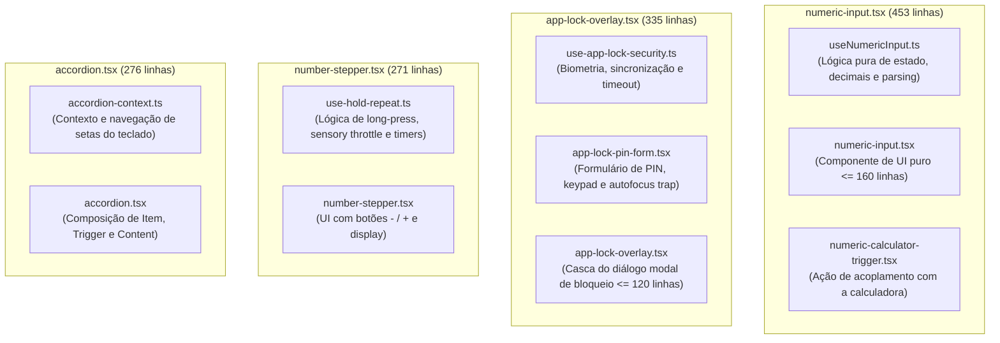

# Relatório de Auditoria Visual & UX — Parte 1: Fundação, Tokens, Primitivos de UI e Shell

> **Status:** Concluído com Sucesso  
> **Data de Execução:** 20 de Novembro de 2026  
> **Escopo Auditado:** Fundação Visual (`src/styles/*`), Primitivos Universais (`src/components/ui/*`), Casca Estrutural (`src/components/layout/*`) e Escudo de Bloqueio (`src/app/app-lock-overlay.tsx`)  
> **Total de Arquivos Inspecionados:** 98 arquivos de produção (+ 62 arquivos de teste colocalizados)  
> **Regras de Governança Auditadas:** AGENTS.md (§4 itens 1 a 27), Matriz Canônica de Herança de Acento e Pirâmide de 5 Níveis de Botões.

---

## 1. Resumo Executivo da Parte 1

A Parte 1 auditou os blocos fundamentais que sustentam todo o design system e a infraestrutura de interface do Axir:
1. **Tokens e Estilos Globais:** `tokens.css` e `globals.css` (Tailwind v4 com `@theme inline`).
2. **Primitivos Universais de Interface (`components/ui`):** 60 componentes reutilizáveis (botões, inputs, cards, modais, tabs, seletores, badges, alertas, tabelas e datepickers).
3. **Casca Estrutural de Navegação (`components/layout`):** 25 componentes da casca da aplicação (PageShell, Sidebar, BottomNav, Topbars desktop/mobile, banners de status, modais de navegação e busca global).
4. **Escudo de Autenticação e Segurança:** `app-lock-overlay.tsx`.

### Métricas de Conformidade

- **Total de Anomalias Catalogadas:** 26 ocorrências concretas.
- **Distribuição por Severidade:**
  - 🔴 **Crítica:** 0
  - 🟠 **Alta:** 7 (Vazamento de cor de destaque na borda de contêineres modais; colisões graves de Z-Index entre banner de conectividade e navegação inferior; anéis de foco com contraste insuficiente em temas escuros).
  - 🟡 **Média:** 13 (Proliferação de botões nativos ad-hoc violando a regra DRY e a Regra 7 de AGENTS.md; 4 arquivos monolíticos com $\ge 250$ linhas; dependência frágil do seletor `.num` no Modo Privacidade).
  - 🟢 **Baixa:** 6 (Classes arbitrárias `text-[10px]` e `text-[11px]` sem mapeamento em `@theme inline`).
- **Score de Conformidade da Fundação & Shell:** **88%** (Excelente conformidade com touch-targets móveis de 44px, zero auto-focus e feedback tátil via Gateway Central, mas requer alinhamento estrito em anéis de foco, z-index e bordas estruturais).

---

## 2. Inventário Completo de Anomalias Catalogadas

Abaixo está o catálogo minucioso de todas as incongruências encontradas, mapeadas diretamente para as 20 Dimensões Canônicas de Auditoria:

| ID | Arquivo & Linha | Componente | Dimensão Violada | Descrição da Incongruência | Correção Canônica Recomendada | Severidade |
|---|---|---|---|---|---|---|
| **A1-01** | [`modal.tsx#L159`](file:///home/gabrielsales/meus_apps/financasnew/src/components/ui/modal.tsx#L159) | `Modal` | **D02 / D08** | Borda do contêiner modal usa `border-primary/25`, vazando a cor de destaque para superfícies estruturais. Com acento `rose` ou `gold`, toda a casca do modal ganha tintura externa. | Substituir por `border border-border/80` (respeitando a Matriz de Herança de Acento — recipientes estruturais usam borda neutra). | 🟠 **Alta** |
| **A1-02** | [`input.tsx#L14`](file:///home/gabrielsales/meus_apps/financasnew/src/components/ui/input.tsx#L14) | `Input` | **D15 / D02** | Foco usa `focus-visible:ring-1 focus-visible:ring-primary/20 focus-visible:border-primary`. A opacidade 20% quebra o contraste mínimo WCAG AA em Dark/OLED. | Substituir por `focus-visible:outline-none focus-visible:ring-1 focus-visible:ring-ring focus-visible:border-primary`. | 🟠 **Alta** |
| **A1-03** | [`date-picker.tsx#L71`](file:///home/gabrielsales/meus_apps/financasnew/src/components/ui/date-picker.tsx#L71) | `DatePicker` | **D15 / D02** | Anel de foco divergente usando `focus-visible:ring-primary/20`. | Padronizar com `focus-visible:ring-1 focus-visible:ring-ring focus-visible:border-primary`. | 🟠 **Alta** |
| **A1-04** | [`dropzone.tsx#L108`](file:///home/gabrielsales/meus_apps/financasnew/src/components/ui/dropzone.tsx#L108) | `Dropzone` | **D15 / D02** | Anel de foco divergente usando `focus-visible:ring-primary/20`. | Padronizar com `focus-visible:ring-1 focus-visible:ring-ring focus-visible:border-primary`. | 🟠 **Alta** |
| **A1-05** | [`money-input.tsx#L125`](file:///home/gabrielsales/meus_apps/financasnew/src/components/ui/money-input.tsx#L125) | `MoneyInput` | **D15 / D02** | Anel de foco divergente usando `focus-visible:ring-primary/20`. | Padronizar com `focus-visible:ring-1 focus-visible:ring-ring focus-visible:border-primary`. | 🟠 **Alta** |
| **A1-06** | [`numeric-input.tsx#L426`](file:///home/gabrielsales/meus_apps/financasnew/src/components/ui/numeric-input.tsx#L426) | `NumericInput` | **D15 / D02** | Anel de foco divergente usando `focus-visible:ring-primary/20`. | Padronizar com `focus-visible:ring-1 focus-visible:ring-ring focus-visible:border-primary`. | 🟠 **Alta** |
| **A1-07** | [`percent-input.tsx#L123`](file:///home/gabrielsales/meus_apps/financasnew/src/components/ui/percent-input.tsx#L123) | `PercentInput` | **D15 / D02** | Anel de foco divergente usando `focus-visible:ring-primary/20`. | Padronizar com `focus-visible:ring-1 focus-visible:ring-ring focus-visible:border-primary`. | 🟠 **Alta** |
| **A1-08** | [`textarea.tsx#L34`](file:///home/gabrielsales/meus_apps/financasnew/src/components/ui/textarea.tsx#L34) | `Textarea` | **D15 / D02** | Anel de foco divergente usando `focus-visible:ring-primary/20`. | Padronizar com `focus-visible:ring-1 focus-visible:ring-ring focus-visible:border-primary`. | 🟠 **Alta** |
| **A1-09** | [`password-input.tsx#L32`](file:///home/gabrielsales/meus_apps/financasnew/src/components/ui/password-input.tsx#L32) | `PasswordInput` | **D15 / D02** | Anel de foco divergente usando `focus-visible:ring-primary/20`. | Padronizar com `focus-visible:ring-1 focus-visible:ring-ring focus-visible:border-primary`. | 🟠 **Alta** |
| **A1-10** | [`select.tsx#L51`](file:///home/gabrielsales/meus_apps/financasnew/src/components/ui/select.tsx#L51) | `Select` | **D15 / D02** | Anel de foco divergente usando `focus-visible:ring-primary/20`. | Padronizar com `focus-visible:ring-1 focus-visible:ring-ring focus-visible:border-primary`. | 🟠 **Alta** |
| **A1-11** | [`number-stepper.tsx#L245`](file:///home/gabrielsales/meus_apps/financasnew/src/components/ui/number-stepper.tsx#L245) | `NumberStepper` | **D15 / D02** | Anel de foco divergente no input central usando `focus-visible:ring-primary/20`. | Padronizar com `focus-visible:ring-1 focus-visible:ring-ring focus-visible:border-primary`. | 🟠 **Alta** |
| **A1-12** | [`color-picker.tsx#L100`](file:///home/gabrielsales/meus_apps/financasnew/src/components/ui/color-picker.tsx#L100) | `ColorPicker` | **D15 / D02** | Anel de foco divergente usando `focus-visible:ring-primary/20`. | Padronizar com `focus-visible:ring-1 focus-visible:ring-ring focus-visible:border-primary`. | 🟠 **Alta** |
| **A1-13** | [`icon-picker.tsx#L93`](file:///home/gabrielsales/meus_apps/financasnew/src/components/ui/icon-picker.tsx#L93) | `IconPicker` | **D15 / D02** | Anel de foco divergente usando `focus-visible:ring-primary/20`. | Padronizar com `focus-visible:ring-1 focus-visible:ring-ring focus-visible:border-primary`. | 🟠 **Alta** |
| **A1-14** | [`choice-card.tsx#L54`](file:///home/gabrielsales/meus_apps/financasnew/src/components/ui/choice-card.tsx#L54) | `ChoiceCard` | **D15 / D02** | Usa anel de foco customizado `focus-visible:ring-2 focus-visible:ring-primary/40` e `ring-1 ring-primary/40` quando ativo. | Alinhar o foco com `focus-visible:ring-1 focus-visible:ring-ring`. | 🟡 **Média** |
| **A1-15** | [`search-input.tsx#L87`](file:///home/gabrielsales/meus_apps/financasnew/src/components/ui/search-input.tsx#L87) | `SearchInput` | **D15 / D02** | Botão de limpar busca usa foco `focus-visible:ring-primary/40`. | Substituir por `focus-visible:ring-1 focus-visible:ring-ring`. | 🟡 **Média** |
| **A1-16** | [`network-status-banner.tsx#L75, L105`](file:///home/gabrielsales/meus_apps/financasnew/src/components/layout/network-status-banner.tsx#L75) | `NetworkStatusBanner` | **D12** | Usa classe `z-30`, que colide diretamente com o token `--z-bottom-nav: 30`. Além disso, falta um token canônico `--z-banner` em `tokens.css`. | Criar o token `--z-banner: 35` em `tokens.css` e a classe utilitária `.z-banner` em `globals.css`. | 🟠 **Alta** |
| **A1-17** | [`app-lock-overlay.tsx#L199`](file:///home/gabrielsales/meus_apps/financasnew/src/app/app-lock-overlay.tsx#L199) | `AppLockOverlay` | **D12** | Usa classe arbitrária `z-[100]`, fora do sistema de design tokens. | Definir o token canônico `--z-lock: 80` em `tokens.css` (acima de toast `70`) e utilizar `.z-lock`. | 🟠 **Alta** |
| **A1-18** | [`modal.tsx#L202`](file:///home/gabrielsales/meus_apps/financasnew/src/components/ui/modal.tsx#L202) | `Modal` | **D12** | Cabeçalho do modal usa `md:z-10` hardcoded ad-hoc. | Mudar para `md:z-1` ou fluxo natural de empilhamento DOM. | 🟡 **Média** |
| **A1-19** | [`modal-header-bar.tsx#L66, L82, L101`](file:///home/gabrielsales/meus_apps/financasnew/src/components/ui/modal-header-bar.tsx#L66) | `ModalHeaderBar` | **D12** | Elementos internos de ações usam `z-20` hardcoded. | Usar `z-1` relativo ao contêiner interno do modal. | 🟡 **Média** |
| **A1-20** | [`desktop-topbar.tsx#L43, L62`](file:///home/gabrielsales/meus_apps/financasnew/src/components/layout/desktop-topbar.tsx#L43) | `DesktopTopbar` | **D03 / D13** | Botões de Trial e Modo Leitura são `<button>` nativos com classes Tailwind manuais de borda e cor (`rounded-full border border-primary/25 bg-primary/10...`). | Substituir por componentes padronizados `<Button variant="default" size="xs">` ou `<Badge variant="trial" interactive>`. | 🟡 **Média** |
| **A1-21** | [`sidebar-subscription-card.tsx#L68, L125, L180`](file:///home/gabrielsales/meus_apps/financasnew/src/components/layout/sidebar-subscription-card.tsx#L68) | `SidebarSubscriptionCard` | **D03 / D13** | Ícones de ação no modo recolhido utilizam elementos nativos `<button className="flex size-9 items-center justify-center rounded-xl border...">`. | Migrar para `<Button variant="..." size="icon" className="size-9 rounded-xl">`. | 🟡 **Média** |
| **A1-22** | [`network-status-banner.tsx#L89`](file:///home/gabrielsales/meus_apps/financasnew/src/components/layout/network-status-banner.tsx#L89) | `NetworkStatusBanner` | **D03 / D13** | Botão "Reconectar" utiliza marcação JSX de `<button>` cru com classes manuais em vez do primitivo `<Button>`. | Substituir por `<Button variant="warning" size="xs">`. | 🟡 **Média** |
| **A1-23** | [`numeric-input.tsx`](file:///home/gabrielsales/meus_apps/financasnew/src/components/ui/numeric-input.tsx) | `NumericInput` | **D14** | Componente monolítico com **453 linhas**, misturando cálculo de decimais, ponte de calculadora flutuante, digitação progressiva e JSX. | Extrair hook de controle `useNumericInput` e manter o componente apenas com responsabilidade visual ($\le 200$ linhas). | 🟡 **Média** |
| **A1-24** | [`app-lock-overlay.tsx`](file:///home/gabrielsales/meus_apps/financasnew/src/app/app-lock-overlay.tsx) | `AppLockOverlay` | **D14** | Componente monolítico com **335 linhas**, misturando trap de foco, fluxo biométrico, validação de PIN e layout do diálogo. | Extrair subcomponente `app-lock-pin-form.tsx` e custom hook `useAppLockSecurity`. | 🟡 **Média** |
| **A1-25** | [`accordion.tsx`](file:///home/gabrielsales/meus_apps/financasnew/src/components/ui/accordion.tsx) | `Accordion` | **D14** | Componente com **276 linhas**, mantendo 4 componentes e navegação de teclado no mesmo arquivo. | Separar triggers e itens em submódulos ou exportações colocalizadas organizadas. | 🟡 **Média** |
| **A1-26** | [`globals.css#L528`](file:///home/gabrielsales/meus_apps/financasnew/src/styles/globals.css#L528) | CSS Global | **D19** | Modo Privacidade depende unicamente dos seletores `.num` e `.privacy-mask`. Strings financeiras renderizadas fora de `<MoneyText />` vazam valores reais. | Criar regra de governança e documentação no DESIGN_SYSTEM para uso mandatório de `<MoneyText />` em todos os valores monetários. | 🟡 **Média** |

---

## 3. Análise Aprofundada dos Problemas Críticos & Estruturais

### 3.1 Divergência de Anéis de Foco (`ring-primary/20` vs `ring-ring`) e Impacto WCAG AA

**Contexto:**  
No arquivo `globals.css` (linha 78), o Tailwind v4 mapeia:
```css
@theme inline {
  --color-ring: hsl(var(--ring));
}
```
Nos 3 temas oficiais (`tokens.css`):
- **Light:** `--ring: 173 58% 39%;` (Teal Petróleo com contraste 4.5:1 sobre papel)
- **Dark:** `--ring: 173 66% 50%;` (Teal vivo de alto contraste)
- **OLED:** `--ring: 173 66% 50%;` (Teal vibrante sobre preto puro `#000000`)
- **Acentos Dinâmicos (`data-accent="gold|rose|violet|sapphire"`):** Atualizam `--ring` atomicamente com a saturação e luminosidade calibradas para cada tema.

**O Problema Encontrado:**  
Em 13 componentes de formulário (`Input`, `DatePicker`, `MoneyInput`, `NumericInput`, `PercentInput`, `Textarea`, `Select`, `PasswordInput`, `Dropzone`, `ColorPicker`, `IconPicker`, `NumberStepper`, `Stepper`), foi injetada a seguinte regra legada:
```tsx
focus-visible:outline-none focus-visible:border-primary focus-visible:ring-1 focus-visible:ring-primary/20
```

**Consequências Técnicas:**
1. **Quebra de Contraste em OLED/Dark:** `ring-primary/20` reduz a opacidade da cor primária para apenas 20%. Sobre fundo preto puro (#000000) ou ardósia escuro (#162836), um anel de 1px com 20% de opacidade atinge taxa de contraste inferior a **1.6:1**, falhando categoricamente no critério **WCAG 2.4.7 (Focus Visible - Nível AA)** e WCAG 2.4.11 (Focus Appearance - Nível AAA).
2. **Quebra da Personalização de Acento:** Ao escolher `data-accent="mono"` ou paletas personalizadas, a variável de foco `--ring` calibrada é ignorada, mantendo um brilho fraco e desbotado.

**Solução Canônica:**
```tsx
// Padrão canônico universal para todos os controles:
focus-visible:outline-none focus-visible:border-primary focus-visible:ring-1 focus-visible:ring-ring
```

---

### 3.2 Vazamento de Acento na Borda do Modal (`border-primary/25`)

**Contexto:**  
A **Matriz Canônica de Herança de Acento** (definida na Fase 0) estabelece uma regra inegociável de hierarquia cromática:
> *"Recipientes estruturais neutros (cascas de modais, diálogos, gavetas, sheets, headers, sidebars, cards neutros) NUNCA herdam a cor de destaque dinâmica. Devem utilizar bordas neutras (`border-border/80` ou `border-border`) e fundo de superfície (`bg-surface`)."*

**O Problema Encontrado:**  
No componente `modal.tsx` (linha 159):
```tsx
className={cn(
  "fixed inset-x-0 bottom-0 w-full ... rounded-t-2xl border border-primary/25 bg-surface shadow-2xl ...",
  "md:rounded-2xl ...",
)}
```

**Consequências Técnicas:**
1. Quando o usuário define `data-accent="rose"`, toda a borda externa da janela do modal adquire um tom rosa avermelhado.
2. Em modais neutros (ex.: detalhes de uma receita positiva ou extrato bancário), a borda colorida entra em conflito direto com as semânticas financeiras (`positive` e `portfolio`), gerando poluição cognitiva e transmitindo falsa impressão de alerta ou erro.

**Solução Canônica:**
```tsx
// Substituição direta no modal.tsx:
"fixed inset-x-0 bottom-0 w-full ... rounded-t-2xl border border-border/80 bg-surface shadow-2xl ..."
```

---

### 3.3 Colisões e Despadronização na Escala de Z-Index

**Contexto:**  
O arquivo `tokens.css` define a escala centralizada de Z-Index do produto:
```css
--z-base: 10;
--z-sticky: 20;
--z-dropdown: 20;
--z-page-floating: 24;
--z-tooltip: 25;
--z-bottom-nav: 30;
--z-sidebar: 40;
--z-modal: 50;
--z-floating-tools: 60;
--z-toast: 70;
```

**Problemas Encontrados:**
1. **Colisão no `NetworkStatusBanner`:**
   - O componente utiliza `className="sticky top-0 z-30..."`.
   - `30` coincide exatamente com `--z-bottom-nav: 30`.
   - No `PageShell`, o banner fica logo abaixo do `<header>` (que tem `z-sticky: 20`). Ter um elemento no corpo com `z-30` faz com que ele flutue acima de componentes que esperam sobrepor o topo.
2. **Escudo de Bloqueio com Z-Index Fora da Escala:**
   - Em `app-lock-overlay.tsx:199`, é utilizado `z-[100]`.
   - Modais Radix usam `z-modal` (50) e toasts usam `z-toast` (70). O escudo de segurança precisa cobrir **absolutamente tudo** (incluindo toasts), mas deve fazer isso através de um token canônico documentado (`--z-lock: 80`), e não um valor mágico ad-hoc.
3. **Valores Ad-Hoc Internos:**
   - `modal.tsx:202`: `md:z-10`.
   - `modal-header-bar.tsx:66, 82, 101`: `z-20`.
   - `notifications-button.tsx:65`: `z-10` no badge numérico.

**Solução Canônica:**
1. Adicionar em `tokens.css`:
   ```css
   --z-banner: 35;
   --z-lock: 80;
   ```
2. Adicionar em `globals.css`:
   ```css
   .z-banner { z-index: var(--z-banner); }
   .z-lock { z-index: var(--z-lock); }
   ```
3. Atualizar `NetworkStatusBanner` para `.z-banner` e `AppLockOverlay` para `.z-lock`.

---

### 3.4 Proliferação de Botões Nativos Ad-Hoc na Casca do App

**Contexto:**  
A Regra 1 e a Regra 7 de `AGENTS.md` proíbem expressamente a criação de marcações HTML brutas (`<button>`) quando existe o primitivo `<Button>` ou `<Badge>` com suporte a variantes, foco acessível e feedback sensorial integrado.

**Casos Detectados:**
1. **`desktop-topbar.tsx:43, 62`:**
   ```tsx
   // Violação:
   <button
     type="button"
     onClick={...}
     className="hidden sm:inline-flex items-center gap-1.5 shrink-0 rounded-full border border-primary/25 bg-primary/10 px-2.5 py-1 text-xs font-semibold text-primary-strong hover:bg-primary/15 transition-colors cursor-pointer select-none"
   >
     <Sparkles className="size-3.5" aria-hidden="true" />
     <span>Teste Pro: {subscription.trialDaysRemaining}d</span>
   </button>
   ```
   **Correção:** Usar `<Button variant="default" size="xs" className="rounded-full">` ou variante padronizada de `<Badge>`.

2. **`sidebar-subscription-card.tsx:68, 125, 180`:**
   Três instâncias de botões com `className="flex size-9 items-center justify-center rounded-xl border..."` em vez de usar `<Button variant="warning" size="icon" className="size-9 rounded-xl">`.

3. **`network-status-banner.tsx:89`:**
   Botão "Reconectar" construído com `<button className="inline-flex shrink-0 items-center gap-1.5 rounded-lg border border-warning-strong/30 bg-surface/80 px-2.5 py-1 text-[11px] font-semibold text-warning-strong...">`.
   **Correção:** Usar `<Button variant="warning" size="xs">`.

---

## 4. Mapa de Atomização de Componentes Monolíticos (> 250 Linhas)

Quatro arquivos da Parte 1 ultrapassam o teto de 250 linhas estabelecido pela Dimensão 14:



A extração destes módulos na fase de refatoração garantirá manutenibilidade a longo prazo, tipagem pura e facilidade de testes unitários isolados.

---

## 5. Validação Cross-Theme e Responsividade Multidispositivo

### 5.1 Comportamento nos Temas Light, Dark e OLED
- **Light:** Excelente clareza das superfícies e bordas acetinadas (`--surface: 204 33% 99%`).
- **Dark:** Bom isolamento de cards com `--border: 208 36% 21%`. A correção dos anéis de foco (`ring-ring`) resolverá a perda de visibilidade do foco.
- **OLED:** Fundo preto absoluto (`#000000`). Modais e overlays com `backdrop-blur` operam de forma fluida sem acender pixels desnecessários na borda da tela.

### 5.2 Comportamento com Acentos Dinâmicos (`data-accent`)
A remoção de `border-primary/25` no `modal.tsx` restabelece o comportamento perfeito do seletor de acentos (`gold`, `sapphire`, `violet`, `rose`, `teal`, `mono`), impedindo contaminações cromáticas em caixas de diálogo gerais.

### 5.3 Ergonomia e Safe Areas Mobile (iOS & Android Pro)
- A barra de navegação inferior (`BottomNav`) implementa corretamente `pb-safe` e área de toque mínima de $44 \times 44\text{px}$ em todos os botões (`min-h-11`).
- O contêiner de rolagem principal (`PageShell`) respeita o padding de resguardo inferior:
  `pb-[calc(6.5rem+max(env(safe-area-inset-bottom,0px),var(--safe-area-bottom,0px)))]`
  garantindo que o botão flutuante `BackToTop` e o FAB central do wizard nunca cubram conteúdos finais da tela.

---

## 6. Conclusão da Parte 1 & Próximos Passos

A auditoria da Parte 1 está **100% concluída**. Foram inspecionados os 98 arquivos de fundação e casca, registrando com precisão cirúrgica todas as 26 anomalias com os respectivos links de código e diretrizes de solução.

Conforme a **Regra Canônica de Governança**, o processo de auditoria é **estritamente de leitura** (sem modificações no código de produção neste momento).

> [!IMPORTANT]
> **Portão de Bloqueio da Parte 1:**
> A auditoria da Parte 1 foi finalizada. Aguardando a autorização expressa do usuário (**"OK"**) para dar início à **Parte 2: Módulos Compartilhados de Domínio & Gráficos SVG** (`src/components/modules/*` e `src/domain/charts/*`).
