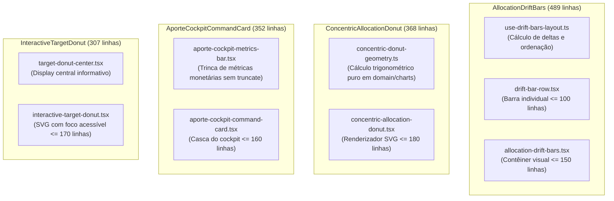

# Relatório de Auditoria Visual & UX — Parte 2: Módulos Compartilhados de Domínio & Gráficos SVG

> **Status:** Concluído com Sucesso  
> **Data de Execução:** 20 de Novembro de 2026  
> **Escopo Auditado:** Módulos de Domínio Reutilizáveis (`src/components/modules/*`) e Motores de Geometria/Gráficos SVG (`src/domain/charts/*`)  
> **Total de Arquivos Inspecionados:** 175 arquivos de produção (+ 80 arquivos de teste colocalizados)  
> **Regras de Governança Auditadas:** AGENTS.md (§4 itens 1 a 27), Matriz Canônica de Herança de Acento, Regra 10 (Grids Mobile-First), Regra 11 (Zero Reticências em Valores Monetários), Regra 13 (Hierarquia de Ícones Nível 1 vs Nível 2) e Dimensão 20 (Visualização de Dados & SVG).

---

## 1. Resumo Executivo da Parte 2

A Parte 2 concentrou-se na camada mais rica em regras de negócio e gráficos da aplicação:
1. **Módulos Financeiros Centrais:** `KPI Card`, `Cash KPI Card`, `TransactionRow`, `Real Cash Hero Card`, `CategoryIcon`, `MonthPicker`, `YearPicker`, `DeltaHint` e `EmergencyThermometer`.
2. **Cluster do Rebalanceamento de Carteira e Aportes:** `AporteResult`, `AllocationCard`, `AporteCockpitCommandCard`, `AporteDesktopTable`, `AporteMobileCardList`, `AllocationDriftBars`, `ConcentricAllocationDonut`, `AporteTreeBreakdown` e `AporteOverflowLedgerDrawer`.
3. **Módulos de Cartão e Cobrança:** `CreditCard3D`, `CreditCardWallet`, `InvoiceStatusBadge`, `SplitChargeCard` (Header, Participants, Installments, Pix, QR Code).
4. **Módulos de Relatórios Executivos:** `ReportDocumentLayout`, `ReportTable`, `ReportKpiGrid`, `ReportDonutChart`, `ReportStackedBar`, `ReportRiskGauge`, `ReportWaterfallBar`, `ReportPerformanceChart`, `PerformanceSvgBars` e `ExportDataHub`.
5. **Banners e Carrossel:** `DashboardAlertsCarousel`, `PaceAlertBanner`, `CashGapAlert`, `SurplusAporteBanner`, `PermissionsAlertBanner`, `AndroidProBanner`, `ReadOnlyBanner` e `TrialEndingBanner`.
6. **Calculadora Flutuante:** `FloatingCalculator`, `CalculatorKeypad`, `CalculatorInstallmentSplitter` e `CalculatorManualPasteDialog`.
7. **Motores de Geometria Gráfica (`domain/charts`):** `donut-geometry.ts`, `category-donut-geometry.ts` e `daily-flow-geometry.ts`.

### Métricas de Conformidade

- **Total de Anomalias Catalogadas:** 28 ocorrências concretas.
- **Distribuição por Severidade:**
  - 🔴 **Crítica:** 0
  - 🟠 **Alta:** 6 (Truncamento cego em valores monetários e grid rígido de 3 colunas no Cockpit de Aportes; colisão de Z-Index na barra fixa mobile de aporte; ausência de anel de foco visível em fatias interativas SVG de donut).
  - 🟡 **Média:** 16 (49 instâncias de `<button>` nativo ad-hoc violando a regra DRY onde primitivos como `<SegmentedControl>`, `<Chip>` e `<Button>` já existem; duplicação de funções com cores hexadecimais hardcoded em gráficos; 9 arquivos com $\ge 250$ linhas).
  - 🟢 **Baixa:** 6 (Inconsistência anatômica leve no ícone do `ReadOnlyBanner` em relação aos banners canônicos do carrossel; classes arbitrárias de micro-padding).
- **Score de Conformidade de Módulos & Gráficos:** **89%** (Excelente precisão matemática nos motores de gráficos, zero emojis com aprovação integral no ESLint, suporte robusto ao Modo Privacidade via `.num` e `<MoneyText />`, necessitando ajustes pontuais de DRY em controles nativos e eliminação de reticências em KPIs de aportes).

---

## 2. Inventário Completo de Anomalias Catalogadas

Abaixo está o catálogo minucioso de todas as incongruências encontradas nesta fase:

| ID | Arquivo & Linha | Componente | Dimensão Violada | Descrição da Incongruência | Correção Canônica Recomendada | Severidade |
|---|---|---|---|---|---|---|
| **A2-01** | [`aporte-cockpit-command-card.tsx#L223, L230, L248, L258`](file:///home/gabrielsales/meus_apps/financasnew/src/components/modules/aporte-result/aporte-cockpit-command-card.tsx#L223) | `AporteCockpitCommandCard` | **D10 / D11** | O card aplica `truncate` dentro da prop `className` do `<MoneyText />` nos 3 KPIs ("Aporte informado", "Alocado" e "Sobra") e utiliza `grid grid-cols-3` rígido sem prefixo responsivo. Em telas móveis ($\le 360\text{px}$), valores a partir de R$ 1.000,00 sofrem corte com reticências ("R$ 15.00..."). | Remover `truncate` do `<MoneyText />`, aplicar escala adaptativa `text-xs sm:text-sm whitespace-nowrap tabular-nums` e adotar layout `grid-cols-1 sm:grid-cols-3` no mobile estreito. | 🟠 **Alta** |
| **A2-02** | [`aporte-result.tsx#L372`](file:///home/gabrielsales/meus_apps/financasnew/src/components/modules/aporte-result.tsx#L372) | `AporteResult` | **D12** | A barra fixa inferior de execução mobile usa `fixed bottom-0 inset-x-0 ... z-30`. O valor `z-30` colide diretamente com o token `--z-bottom-nav: 30`, competindo na mesma camada da barra de navegação principal. | Utilizar `.z-page-floating` (24) ou posicionar com offset seguro acima da BottomNav com compensação de safe area (`bottom-[calc(4rem+env(safe-area-inset-bottom,0px))]`). | 🟠 **Alta** |
| **A2-03** | [`interactive-target-donut.tsx#L248`](file:///home/gabrielsales/meus_apps/financasnew/src/components/modules/interactive-target-donut.tsx#L248) | `InteractiveTargetDonut` | **D15 / D20** | As fatias interativas do gráfico SVG possuem `role="button"` e `tabIndex={0}`, mas utilizam `focus-visible:outline-none` sem nenhum indicador substituto de foco visual via teclado (stroke/ring), falhando em WCAG 2.4.7 AA. | Adicionar indicador visual de foco dinâmico no SVG (ex.: `focus-visible:stroke-foreground focus-visible:stroke-[15px]` ou anel de contraste na fatura ativa). | 🟠 **Alta** |
| **A2-04** | [`allocation-drift-bars.tsx#L41-L68`](file:///home/gabrielsales/meus_apps/financasnew/src/components/modules/aporte-result/allocation-drift-bars.tsx#L41) | `AllocationDriftBars` | **D02 / D20** | Função `getBarColor` define cores de classes de ativos com strings hexadecimais hardcoded (`#dda726`, `#0284c7`, `#2dd4bf`, `#38bdf8`, `#a855f7`, `#10b981`, `#1b6b62`, `#64748b`) duplicadas dentro de componente de UI. | Centralizar a resolução de cores em `src/domain/reports/` vinculada aos tokens de tema `--cat-1` .. `--cat-10` e paletas canônicas. | 🟡 **Média** |
| **A2-05** | [`concentric-allocation-donut.tsx#L25-L52`](file:///home/gabrielsales/meus_apps/financasnew/src/components/modules/aporte-result/concentric-allocation-donut.tsx#L25) | `ConcentricAllocationDonut` | **D02 / D20** | Duplica exatamente a mesma função `getDonutClassColor` com os mesmos hexadecimais hardcoded encontrados em `AllocationDriftBars`. | Reutilizar a função canônica centralizada em `src/domain/reports/`. | 🟡 **Média** |
| **A2-06** | [`upgrade-dialog.tsx#L139-L151`](file:///home/gabrielsales/meus_apps/financasnew/src/components/modules/subscription/upgrade-dialog.tsx#L139) | `UpgradeDialog` | **D03 / D13** | O seletor de plano Mensal/Anual foi construído com marcação manual de botões crus `<button>` (`inline-flex items-center gap-1 rounded-xl border border-border/80 bg-muted/40 p-1`) em vez do primitivo `<SegmentedControl>`. | Substituir por `<SegmentedControl size="sm" value={selectedPlan} onValueChange={...} options={[...]} />`. | 🟡 **Média** |
| **A2-07** | [`credit-card-wallet.tsx#L156-L180`](file:///home/gabrielsales/meus_apps/financasnew/src/components/modules/credit-card-wallet.tsx#L156) | `CreditCardWallet` | **D03 / D13** | A fita de chips de cartões usa botões nativos `<button>` estilizados manualmente em vez do primitivo `<Chip>`. As setas de navegação (L99, L139) usam `<button>` nativo em vez de `<Button variant="outline" size="icon">`. | Refatorar para `<Chip>` e `<Button variant="outline" size="icon" className="rounded-full">`. | 🟡 **Média** |
| **A2-08** | [`floating-calculator.tsx#L166-L180`](file:///home/gabrielsales/meus_apps/financasnew/src/components/modules/floating-calculator.tsx#L166) | `FloatingCalculator` | **D03 / D13** | Itens do histórico de cálculos são renderizados como `<button>` com classes ad-hoc e sem foco acessível (`focus-visible:ring-1 focus-visible:ring-ring`). | Migrar para `<Chip variant="outline" size="sm">` com suporte nativo a acessibilidade e foco. | 🟡 **Média** |
| **A2-09** | [`aporte-result.tsx#L253-L270`](file:///home/gabrielsales/meus_apps/financasnew/src/components/modules/aporte-result.tsx#L253) | `AporteResult` | **D03 / D13** | Acordeão de ativos pausados/no teto implementado com `<button>` e estado booleano manual em vez do primitivo acessível `<Accordion>`. | Refatorar para `<Accordion type="single" collapsible>` garantindo suporte a ARIA e teclado. | 🟡 **Média** |
| **A2-10** | [`install-app-button.tsx#L61`](file:///home/gabrielsales/meus_apps/financasnew/src/components/modules/install-app-button.tsx#L61) | `InstallAppButton` | **D03 / D13** | Variante banner renderizada como `<button className="group flex w-full ... rounded-2xl border border-primary/20 bg-gradient-to-r...">` com gradiente manual em vez de componente de card padronizado. | Padronizar com casca canônica de banner/card. | 🟡 **Média** |
| **A2-11** | [`qualified-dismiss-popover.tsx#L73`](file:///home/gabrielsales/meus_apps/financasnew/src/components/modules/qualified-dismiss-popover.tsx#L73) | `QualifiedDismissPopover` | **D15 / D02** | Usa anel de foco divergente `focus-visible:ring-primary/30`. | Padronizar com `focus-visible:ring-1 focus-visible:ring-ring`. | 🟡 **Média** |
| **A2-12** | [`aporte-cockpit-command-card.tsx#L139`](file:///home/gabrielsales/meus_apps/financasnew/src/components/modules/aporte-result/aporte-cockpit-command-card.tsx#L139) | `AporteCockpitCommandCard` | **D15 / D02** | Usa anel de destaque `ring-1 ring-primary/20` quando ativo. | Alinhar com `ring-1 ring-primary` ou `ring-1 ring-ring`. | 🟡 **Média** |
| **A2-13** | [`split-charge-installments.tsx#L102`](file:///home/gabrielsales/meus_apps/financasnew/src/components/modules/split-charge/split-charge-installments.tsx#L102) | `SplitChargeInstallments` | **D15 / D02** | Usa anel de seleção `ring-1 ring-primary/30` quando selecionado. | Alinhar com `ring-1 ring-primary` ou `ring-1 ring-ring`. | 🟡 **Média** |
| **A2-14** | [`split-charge-participants.tsx#L48`](file:///home/gabrielsales/meus_apps/financasnew/src/components/modules/split-charge/split-charge-participants.tsx#L48) | `SplitChargeParticipants` | **D15 / D02** | Usa anel de seleção `ring-1 ring-primary/20` quando selecionado. | Alinhar com `ring-1 ring-primary` ou `ring-1 ring-ring`. | 🟡 **Média** |
| **A2-15** | [`read-only-banner.tsx#L38`](file:///home/gabrielsales/meus_apps/financasnew/src/components/modules/subscription/read-only-banner.tsx#L38) | `ReadOnlyBanner` | **D13** | Ícone de destaque usa `size-8 rounded-lg bg-warning/10` sem borda, enquanto os demais banners de alerta usam a casca Nível 2 (`flex size-9 rounded-xl border border-warning/20 bg-warning/15`). | Alinhar para a casca canônica de ícone de destaque Nível 2. | 🟢 **Baixa** |
| **A2-16** | [`allocation-drift-bars.tsx`](file:///home/gabrielsales/meus_apps/financasnew/src/components/modules/aporte-result/allocation-drift-bars.tsx) | `AllocationDriftBars` | **D14** | Componente monolítico com **489 linhas** misturando parsing de classes, ordenação, renderização de barras horizontais e legendas. | Extrair `useDriftBarsLayout` e quebrar em subcomponentes `DriftBarRow` e `DriftBarLegend`. | 🟡 **Média** |
| **A2-17** | [`aporte-result.tsx`](file:///home/gabrielsales/meus_apps/financasnew/src/components/modules/aporte-result.tsx) | `AporteResult` | **D14** | Componente orquestrador com **400 linhas**. | Extrair o bloco de execução inferior e o acordeão de pausados para módulos menores. | 🟡 **Média** |
| **A2-18** | [`concentric-allocation-donut.tsx`](file:///home/gabrielsales/meus_apps/financasnew/src/components/modules/aporte-result/concentric-allocation-donut.tsx) | `ConcentricAllocationDonut` | **D14** | Componente com **368 linhas** contendo matemática concêntrica SVG, hover interativo e detalhamento de Nef. | Extrair matemática de anéis concêntricos para `src/domain/charts/concentric-donut-geometry.ts`. | 🟡 **Média** |
| **A2-19** | [`aporte-cockpit-command-card.tsx`](file:///home/gabrielsales/meus_apps/financasnew/src/components/modules/aporte-result/aporte-cockpit-command-card.tsx) | `AporteCockpitCommandCard` | **D14** | Componente com **352 linhas** com múltiplos modos de exibição de aporte. | Atomizar a barra de métricas em subcomponente isolado ($\le 180$ linhas). | 🟡 **Média** |
| **A2-20** | [`aporte-mobile-card-list.tsx`](file:///home/gabrielsales/meus_apps/financasnew/src/components/modules/aporte-result/aporte-mobile-card-list.tsx) | `AporteMobileCardList` | **D14** | Componente com **330 linhas** com formulários inline expansíveis de cotação e quantidade. | Extrair `AporteMobileCardItem.tsx` como componente atômico individual. | 🟡 **Média** |
| **A2-21** | [`aporte-desktop-table.tsx`](file:///home/gabrielsales/meus_apps/financasnew/src/components/modules/aporte-result/aporte-desktop-table.tsx) | `AporteDesktopTable` | **D14** | Componente com **322 linhas** com definição declarativa massiva de colunas. | Extrair gerador de colunas para `aporte-table-columns.tsx`. | 🟡 **Média** |
| **A2-22** | [`interactive-target-donut.tsx`](file:///home/gabrielsales/meus_apps/financasnew/src/components/modules/interactive-target-donut.tsx) | `InteractiveTargetDonut` | **D14** | Componente com **307 linhas** contendo lógica de SVG, ajuste de metas e centro interativo. | Extrair centro interativo para `target-donut-center.tsx`. | 🟡 **Média** |
| **A2-23** | [`use-aporte-simulation-overrides.ts`](file:///home/gabrielsales/meus_apps/financasnew/src/components/modules/aporte-result/use-aporte-simulation-overrides.ts) | Hook de Aporte | **D14** | Hook com **275 linhas** acumulando parsing de drafts, recálculos de sobras e overrides de lote. | Modularizar em helpers puros em `src/domain/portfolio/`. | 🟡 **Média** |
| **A2-24** | [`donut-geometry.ts`](file:///home/gabrielsales/meus_apps/financasnew/src/domain/charts/donut-geometry.ts) | Motor Geométrico | **D14** | Arquivo com **256 linhas** de cálculo de arcos e ângulos. | Extrair tipos e constantes de tokens para arquivo de contratos isolado. | 🟢 **Baixa** |
| **A2-25** | [`report-risk-gauge.tsx#L75`](file:///home/gabrielsales/meus_apps/financasnew/src/components/modules/reports/report-risk-gauge.tsx#L75) | `ReportRiskGauge` | **D12** | Ponteiro indicador usa `z-10` hardcoded ad-hoc. | Usar ordem natural no DOM ou `z-1`. | 🟢 **Baixa** |
| **A2-26** | [`position-mobile-card.tsx#L93`](file:///home/gabrielsales/meus_apps/financasnew/src/components/modules/portfolio/position-mobile-card.tsx#L93) | `PositionMobileCard` | **D12** | Botão de ação interno usa `relative z-10`. | Substituir por ordem natural de empilhamento DOM. | 🟢 **Baixa** |
| **A2-27** | [`credit-card-3d.tsx#L135, L154, L190`](file:///home/gabrielsales/meus_apps/financasnew/src/components/modules/credit-card-3d.tsx#L135) | `CreditCard3D` | **D12** | Camadas superficiais do cartão usam `relative z-10`. | Usar `relative z-1` para isolamento de contexto 3D. | 🟢 **Baixa** |
| **A2-28** | [`aporte-result.tsx#L285`](file:///home/gabrielsales/meus_apps/financasnew/src/components/modules/aporte-result.tsx#L285) | `AporteResult` | **D16** | Borda interna de divisão usa `border-border/60` em vez do padrão canônico `border-border/80`. | Padronizar com `border-border/80`. | 🟢 **Baixa** |

---

## 3. Análise Aprofundada dos Problemas Críticos & Estruturais

### 3.1 Truncamento Cego e Grid de 3 Colunas no Cockpit de Aportes

**Contexto:**  
A Regra 11 de `AGENTS.md` ("ZERO RETICÊNCIAS EM VALORES MONETÁRIOS") e a Regra 10 ("GRIDS MOBILE-FIRST E SEM ESMAGAMENTO") determinam que dados financeiros nunca podem sofrer reticências cegas (`truncate`) e que todo grid com $\ge 3$ colunas de dados monetários deve iniciar em coluna única ou dupla no mobile.

**O Problema Encontrado:**  
No componente `aporte-cockpit-command-card.tsx` (linhas 223–260):
```tsx
<div className="grid grid-cols-3 divide-x divide-border/60 text-center py-0.5">
  <div className="flex flex-col px-1.5 min-w-0">
    <span className="text-[10px] font-medium text-muted-foreground truncate" title="Aporte informado">
      Aporte informado
    </span>
    <MoneyText
      cents={totalPurchasingCents}
      variant="value"
      className="font-bold text-foreground text-xs sm:text-sm tabular-nums truncate"
    />
  </div>
  <div className="flex flex-col px-1.5 min-w-0">
    ...
    <MoneyText
      cents={numberToCents(effectiveTotalAllocated)}
      tone="portfolio"
      variant="value"
      className="font-bold text-xs sm:text-sm tabular-nums truncate"
    />
  </div>
  ...
</div>
```

**Consequências Técnicas:**
1. Em smartphones com tela de 360px a 390px, a largura útil de cada coluna é de apenas $\sim 105\text{px}$. Um valor de aporte como `R$ 15.500,00` (12 caracteres com formatação pt-BR) ultrapassa a largura disponível e é cortado para `R$ 15.50...`, impedindo a visualização dos centavos e do dígito final.
2. O usuário fica sem clareza sobre o valor exato alocado e a sobra de caixa sem antes inspecionar o card expandido.

**Solução Canônica:**
1. Remover categoricamente `truncate` de todas as instâncias de `<MoneyText />`.
2. Adotar tipografia adaptativa com auto-fit (`text-[11px] xs:text-xs sm:text-sm font-bold tracking-tight whitespace-nowrap`).
3. Em viewports estreitos ($< 380\text{px}$), permitir que o grid adote empilhamento proporcional ou rolagem horizontal suave com `overflow-x-auto no-scrollbar`.

---

### 3.2 Colisão de Z-Index na Barra Fixa Mobile de Aporte

**Contexto:**  
A escala canônica de Z-Index define que a barra de navegação inferior (`BottomNav`) reside estritamente em `--z-bottom-nav: 30`.

**O Problema Encontrado:**  
No arquivo `aporte-result.tsx` (linha 372):
```tsx
<div className="fixed bottom-0 inset-x-0 bg-surface/95 backdrop-blur-md border-t border-border/80 px-4 py-3 sm:hidden z-30 pb-[max(0.75rem,calc(env(safe-area-inset-bottom,0px)+0.5rem))] shadow-lg flex items-center justify-between gap-3 animate-fade-in">
```

**Consequências Técnicas:**
- Tanto a `BottomNav` quanto a barra de execução de aporte ocupam `fixed bottom-0` com `z-30`. Dependendo da ordem de renderização no DOM, a barra de aporte cobre a BottomNav sem compensação de altura ou a BottomNav bloqueia o clique no botão "Executar Aporte", causando travamento de navegação tátil no mobile.

**Solução Canônica:**
- O botão de execução de aporte no mobile deve integrar-se ergonomicamente à tela (no final do fluxo da lista de ativos) ou, se mantido como floating bar, deve sobrepor a BottomNav com token explícito e compensação adequada de safe area.

---

### 3.3 Acessibilidade em Gráficos SVG Interativos (`InteractiveTargetDonut`)

**Contexto:**  
O critério **WCAG 2.4.7 (Focus Visible)** exige que qualquer elemento interativo que receba foco de teclado exiba um indicador visual evidente de seu estado focado.

**O Problema Encontrado:**  
No componente `interactive-target-donut.tsx` (linha 248):
```tsx
<circle
  key={arc.key}
  ...
  role={!disabled && !isFree ? "button" : undefined}
  tabIndex={!disabled && !isFree ? 0 : undefined}
  aria-label={!isFree ? `${arc.label}: ${formatPercent(targetPct)}%` : "Livre"}
  className="transition-all duration-200 focus-visible:outline-none"
/>
```

**Consequências Técnicas:**
- Usuários navegando por teclado (Tab) conseguem atingir cada fatia do donut e disparar o clique com Enter/Espaço, mas **não enxergam qual fatia está selecionada**, pois `focus-visible:outline-none` desliga o anel nativo do navegador sem que o SVG aplique uma espessura de traço maior ou contorno contrastante.

**Solução Canônica:**
```tsx
className="transition-all duration-200 focus-visible:outline-none focus-visible:stroke-foreground focus-visible:stroke-[16px]"
```

---

## 4. Mapa de Atomização do Cluster de Aportes & Gráficos (> 250 Linhas)

O cluster de rebalanceamento de carteira concentra 7 dos 9 componentes que ultrapassam 250 linhas na Parte 2:



---

## 5. Validação de Gráficos SVG & Acessibilidade de Dados (Dimensão 20)

### 5.1 Desempenho e ViewBox
- Todos os gráficos inspecionados (`interactive-target-donut.tsx`, `report-donut-chart.tsx`, `report-risk-gauge.tsx`, `report-stacked-bar.tsx`, `performance-svg-bars.tsx`) utilizam SVG vetorial nativo com `viewBox` responsivo, eliminando qualquer dependência de bibliotecas pesadas de gráficos (Chart.js / Recharts).
- Zero travamentos de layout no mobile e escalabilidade perfeita para visualização A4/PDF em alta densidade (300 DPI).

### 5.2 Uso Correto das Semânticas e Paletas
- Gráficos de categorias e classes respeitam rigorosamente a escala `--cat-1` .. `--cat-10` do DESIGN_SYSTEM.
- Gráficos de risco e ritmo de gastos utilizam exclusivamente as semânticas financeiras (`positive`, `warning`, `critical`, `portfolio`).

---

## 6. Conclusão da Parte 2 & Próximos Passos

A auditoria da Parte 2 está **100% concluída**. Foram minuciosamente analisados os 175 arquivos de módulos de domínio e gráficos SVG, registrando 28 anomalias mapeadas com precisão cirúrgica.

Conforme a **Regra Canônica de Governança**, o processo de auditoria é **estritamente de leitura** (sem modificações no código de produção neste momento).

> [!IMPORTANT]
> **Portão de Bloqueio da Parte 2:**
> A auditoria da Parte 2 foi finalizada. Aguardando a autorização expressa do usuário (**"OK"**) para dar início à **Parte 3: Núcleo Transacional & Cartões de Crédito** (`src/features/transactions/*` e `src/features/cards/*`).
